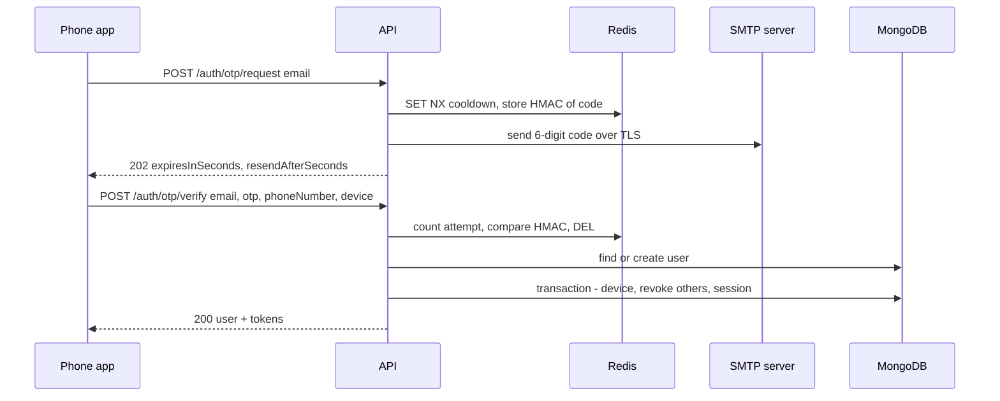
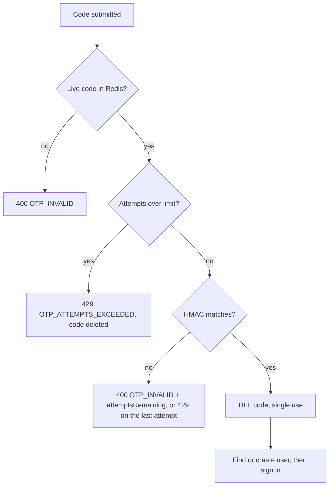

# 01. OTP login (sign-up and sign-in)

> **Status:** 🟡 Partially implemented — email sign-in with a one-time code works in code and tests, but phone sign-in has no SMS provider (off in production) and delivery of a real code email to an inbox is not confirmed yet.
> Last reviewed against the code: 2026-10-12.

## Summary

CipherChat has no passwords. A user types an email address and a phone number, gets a 6-digit
one-time password (OTP) by email, and types it into the app. The server checks the code, creates
the account if it is new, and signs the phone in. The same screen also offers "Sign in with phone
number instead", where the code goes by SMS (Short Message Service), but no SMS provider exists
yet, so that path only works in development. Codes are never stored in plain form: Redis keeps
only an HMAC (keyed hash) of each code, for 5 minutes, for 5 attempts, and for one use.

## Status at a glance

| Part                                                         | Status         | Evidence                                                                                                                                         |
| ------------------------------------------------------------ | -------------- | ------------------------------------------------------------------------------------------------------------------------------------------------ |
| Email OTP request and verify (API)                           | ✅ Implemented | `emailOtp.test.js`, `otp.test.js`; not verified on a device                                                                                      |
| OTP generation, HMAC storage, TTL, attempt limit, single use | ✅ Implemented | `otp.test.js`, `emailOtp.test.js`                                                                                                                |
| Resend cooldown and rate limits (per IP, per identifier)     | ✅ Implemented | `otp.test.js`, `emailOtp.test.js`                                                                                                                |
| SMTP email provider (Nodemailer, TLS only)                   | 🟡 Partial     | `emailOtp.test.js` (mocked transport). SMTP login verified against the real server; a real code email reaching an inbox is **not confirmed yet** |
| `console` email/SMS providers (development)                  | ✅ Implemented | `env.test.js` (refused in production)                                                                                                            |
| Phone OTP by SMS                                             | 🟡 Partial     | Code path + `console` provider only; no real SMS provider → off in production                                                                    |
| Email **and** phone number at sign-up                        | ✅ Implemented | `emailOtp.test.js`, mobile `signUp.test.js`                                                                                                      |
| No account enumeration                                       | ✅ Implemented | `emailOtp.test.js`                                                                                                                               |
| Sign-in and Verify screens                                   | ✅ Implemented | mobile `signUp.test.js`, `auth.test.js`; no separate device-test record in ARCHITECTURE.md §12                                                   |
| No OTPs, emails or phone numbers in logs                     | ✅ Implemented | `auth.test.js`, `emailOtp.test.js`, `logger.test.js`                                                                                             |

## How it works

1. **Sign-in screen** (`sign-in.js`). Default mode is email: the user must enter an email address
   **and** a phone number. `readSignInForm` validates both on the phone (shared `emailSchema`;
   `toE164` reads numbers without `+` as Indian numbers). Phone mode needs only the number.
2. The app calls `POST /auth/otp/request` with **only** the identifier that receives the code:
   `{ email }` or `{ phoneNumber }`. The phone number of email mode is not sent yet.
3. **API, request.** Rate limit per IP (20/h), body check (exactly one identifier), rate limit per
   identifier (5/h, keyed by an HMAC). Then `otpService.requestOtp`:
   - if the channel has no provider (`none`), answer `503 OTP_CHANNEL_UNAVAILABLE`;
   - take the resend cooldown with an atomic `SET NX` (60 s); if it is taken, answer
     `429 OTP_COOLDOWN` with `retryAfterSeconds`;
   - make a 6-digit code with Node's CSPRNG (`randomInt`, no modulo bias);
   - in one Redis `MULTI`: delete any old code, store `{ codeHash, attempts: 0 }`, set the TTL;
   - send the code. If sending fails, both Redis keys are deleted and the answer is
     `502 OTP_DELIVERY_FAILED`.
4. The API answers `202 { expiresInSeconds, resendAfterSeconds }`. The answer is the same for new
   and existing accounts.
5. **Verify screen** (`verify.js`). The user types 6 digits; the code is submitted automatically
   when the 6th digit is typed. A "Resend code" button appears when the countdown ends.
6. The app calls `POST /auth/otp/verify` with the identifier, the code, the phone number (email
   mode) and the device details (`deviceId`, platform, model name, app and OS version).
7. **API, verify.** Rate limit per IP (50/15 min), body check, rate limit per identifier (15/h).
   Then `otpService.verifyOtp`: in one `MULTI` it increments `attempts`, reads `codeHash` and the
   TTL. It compares HMACs in constant time. A correct code is deleted (single use: only the request
   whose `DEL` returns 1 wins).
8. **Only after the code is correct**, `authService` finds or creates the user:
   - **email:** existing user → sign in (a missing phone number is added; a different one is
     refused). New user → created with email + phone number (`PHONE_NUMBER_REQUIRED` if none;
     `PHONE_NUMBER_TAKEN` if another account has the number).
   - **phone:** upsert by phone number; `phoneVerifiedAt` is set because the SMS code proved it.
9. In one MongoDB transaction the device is registered, other devices and sessions are revoked
   (single active device), the device's old public keys are cleared, and a session is created.
   See [02-session-management.md](02-session-management.md).
10. The API answers `200 { user (with isNew), device, tokens }`. The app opens the SQLCipher
    database, stamps an install id and saves the tokens (`startSession`). The root layout then
    shows the signed-in screens.

## Packages and versions

| Package                                      | Declared                       | Installed   | Used for                                            |
| -------------------------------------------- | ------------------------------ | ----------- | --------------------------------------------------- |
| `nodemailer` (API)                           | `10.0.11`                      | `10.0.11`   | SMTP delivery of the code email                     |
| `ioredis` (API)                              | `^5.6.0`                       | `5.11.1`    | OTP and cooldown keys in Redis                      |
| `rate-limiter-flexible` (API)                | `^11.2.1`                      | `11.2.1`    | Per-IP and per-identifier limits                    |
| `libphonenumber-js` (API, `max` metadata)    | `^1.13.14`                     | `1.13.14`   | Validate and normalise numbers to E.164             |
| `libphonenumber-js` (mobile, `min` metadata) | `^1.13.14`                     | `1.13.14`   | Instant number check and display format             |
| `zod` (API / shared / mobile)                | `^4.1.0` / `^4.1.0` / `^4.6.5` | `4.6.5`     | Request and form validation                         |
| `mongoose` (API)                             | `^8.18.0`                      | `8.24.5`    | `users`, `devices`, `sessions`                      |
| `express` (API)                              | `^5.1.0`                       | `5.2.1`     | Routes                                              |
| `zustand` (mobile)                           | `^5.0.15`                      | `5.0.15`    | `useAuthStore`                                      |
| `expo-router` (mobile)                       | `~57.0.25`                     | `57.0.25`   | `sign-in` / `verify` routes and the signed-in guard |
| Node `crypto` (built in)                     | —                              | Node ≥ 22.9 | `randomInt`, HMAC-SHA256, `timingSafeEqual`         |

## Source files

**API**

- [auth.routes.js](../apps/api/src/modules/auth/auth.routes.js) — request/verify routes, body schemas, rate-limit order.
- [otpService.js](../apps/api/src/modules/auth/otpService.js) — code generation, HMAC storage, cooldown, attempts, single use.
- [otpDelivery.js](../apps/api/src/modules/auth/otpDelivery.js) — picks the email or SMS provider; a `null` provider switches a channel off.
- [authService.js](../apps/api/src/modules/auth/authService.js) — `loginWithOtp`: find-or-create user, phone rules, login transaction.
- [phone.js](../apps/api/src/modules/auth/phone.js) — `phoneNumberSchema` (E.164 normalisation).
- [services/email/index.js](../apps/api/src/services/email/index.js) — email providers (`smtp`, `console`, `none`) and the email text.
- [services/email/smtp.js](../apps/api/src/services/email/smtp.js) — Nodemailer transport options and `EmailDeliveryError`.
- [services/sms/index.js](../apps/api/src/services/sms/index.js) — SMS providers (`console`, `none`).
- [middleware/rateLimit.js](../apps/api/src/middleware/rateLimit.js) — `RATE_LIMITS` table, fail-closed limiter.
- [lib/crypto.js](../apps/api/src/lib/crypto.js) — `generateNumericCode`, `hmacSha256`, `safeEqualHex`.
- [lib/logger.js](../apps/api/src/lib/logger.js) — redaction of `otp`, `email`, `phoneNumber`, `codeHash` and more.
- [models/User.js](../apps/api/src/models/User.js) — user schema and partial unique indexes.
- [config/env.js](../apps/api/src/config/env.js) — OTP, email and SMS settings.

**Mobile**

- [app/sign-in.js](../apps/mobile/src/app/sign-in.js) — email + phone form, mode switch.
- [app/verify.js](../apps/mobile/src/app/verify.js) — code entry, auto-submit, resend countdown.
- [auth/signInForm.js](../apps/mobile/src/auth/signInForm.js) — `readSignInForm`: what is sent to request and to verify.
- [auth/authStore.js](../apps/mobile/src/auth/authStore.js) — `requestOtp`, `verifyOtp`, device details.
- [auth/errorMessages.js](../apps/mobile/src/auth/errorMessages.js) — error code → user text.
- [auth/session.js](../apps/mobile/src/auth/session.js) — `startSession` after a successful verify.
- [lib/phone.js](../apps/mobile/src/lib/phone.js) — `toE164` (default country `IN`), `formatPhone`.
- [app/_layout.js](../apps/mobile/src/app/_layout.js) — shows `sign-in`/`verify` only while signed out.

**Shared**

- [constants.js](../packages/shared/src/constants.js) — `OTP_LENGTH` (6), `OTP_CHANNEL`, `ERROR_CODE`.
- [validation.js](../packages/shared/src/validation.js) — `otpSchema`, `emailSchema` (trim, lower-case, ≤ 254), `deviceIdSchema`.

## API endpoints

| Method | Path                | Auth | Purpose                                                                                                                                                   | Rate limit                                                      |
| ------ | ------------------- | ---- | --------------------------------------------------------------------------------------------------------------------------------------------------------- | --------------------------------------------------------------- |
| `POST` | `/auth/otp/request` | None | Send a code to `{ email }` or `{ phoneNumber }` (exactly one). `202 { expiresInSeconds, resendAfterSeconds }`                                             | 20/h per IP · 5/h per identifier · 60 s cooldown per identifier |
| `POST` | `/auth/otp/verify`  | None | Check the code, find or create the user, sign the device in. Body: `email` or `phoneNumber`, `otp`, `device`; with `email`, `phoneNumber` is account data | 50/15 min per IP · 15/h per identifier                          |

Codes for adding an email to an existing account use other endpoints and a separate OTP purpose;
see [15-account-and-device-management.md](15-account-and-device-management.md).

## Data storage

### MongoDB

- `users`: `email` (lower-case, immutable), `phoneNumber` (E.164, immutable), `phoneVerifiedAt`
  (set only by phone sign-in; `null` for a number typed at email sign-up), `displayName`,
  `profilePhoto`, `lastSeen`, timestamps. Partial unique indexes on `email` and `phoneNumber`; a
  user needs at least one of them. `migrateUserIndexes()` replaces the old Phase 1 index at start.
- A successful verify also writes `devices` and `sessions`
  (see [02-session-management.md](02-session-management.md)). Nothing about the code itself is
  stored in MongoDB.

### Redis

| Key                                                                     | Value                         | TTL                                  |
| ----------------------------------------------------------------------- | ----------------------------- | ------------------------------------ |
| `otp:{HMAC(channel:value)}`                                             | hash `{ codeHash, attempts }` | `OTP_TTL_SECONDS` (300 s)            |
| `otp:cd:{HMAC(channel:value)}`                                          | `"1"` (resend cooldown)       | `OTP_RESEND_COOLDOWN_SECONDS` (60 s) |
| `rl:otpRequestPerIp:{ip}`, `rl:otpVerifyPerIp:{ip}`                     | counter                       | 1 h / 15 min                         |
| `rl:otpRequestPerIdentifier:{HMAC}`, `rl:otpVerifyPerIdentifier:{HMAC}` | counter                       | 1 h                                  |

`codeHash = HMAC(OTP_HMAC_SECRET, "otp:{key}:{code}")`. The identifier key is
`HMAC(OTP_HMAC_SECRET, "[purpose:]channel:value")`, so Redis never holds a raw email, number or code.

### On the phone

Nothing is stored for the code. The verify screen keeps the email/number only in route params.
After a successful verify, `startSession` writes SecureStore `auth.session` and `device.installId`,
and the SQLCipher `meta` row `install_id` (details in
[02-session-management.md](02-session-management.md) and
[07-local-database-encryption.md](07-local-database-encryption.md)).

## Security measures

- **Codes:** 6 digits from the CSPRNG; only an HMAC is stored; 5 min TTL; 5 attempts (the attempt
  is counted **before** the comparison, in the same `MULTI`); constant-time compare; single use
  even under concurrent submissions (`DEL` must return 1).
- **New code replaces old:** a new request deletes the previous code and resets attempts.
- **No account enumeration:** `/otp/request` answers the same for known and unknown identifiers;
  every account check (`PHONE_NUMBER_*`) runs only after the code is verified.
- **Account is created only after a correct code** (tested: an expired or exhausted code never
  creates a user).
- **Rate limits fail closed:** if Redis is not ready, limiters answer `503 SERVICE_UNAVAILABLE`.
  Identifier keys are HMACs. Client IPs respect `TRUST_PROXY_HOPS`.
- **SMTP:** TLS always, certificate checks on, TLS ≥ 1.2; port 465 = TLS from the start, any other
  port must upgrade with STARTTLS (`requireTLS`). One pooled transporter (max 2 connections),
  connect/greeting 10 s and socket 20 s timeouts. A send counts only if the server **accepted the
  recipient**. Nodemailer logging is off. `EmailDeliveryError` carries only SMTP codes, never the
  recipient, message or password.
- **Email content:** only the code and its expiry. No name, account or device details.
- **Console providers** print a masked identifier and the code straight to stdout (never the
  logger) and are refused when `NODE_ENV=production`.
- **Logs:** pino redacts `otp`, `codeHash`, `email`, `phoneNumber`, `token`, `pass` and more;
  request logs hold only id, method, path, status.
- **Strict input:** shared zod schemas; phone numbers re-validated on the server with full
  metadata; `otp` must be exactly 6 digits.
- **Revoked installs cannot sign in:** a `deviceId` that was revoked gets `403 DEVICE_REVOKED`.

## Error handling

| Situation                                                | Error code / behaviour                                    | What the user sees                                                                                |
| -------------------------------------------------------- | --------------------------------------------------------- | ------------------------------------------------------------------------------------------------- |
| Bad email/number/code format, or both/neither identifier | `400 VALIDATION_ERROR`                                    | "Please check what you entered and try again." (most format errors are caught on the phone first) |
| Phone sign-in with `SMS_PROVIDER=none`                   | `503 OTP_CHANNEL_UNAVAILABLE`                             | "Phone sign-in isn't available yet. Please use your email address."                               |
| Resend inside the cooldown                               | `429 OTP_COOLDOWN`, `Retry-After`                         | "Please wait Ns before requesting another code." On the Verify screen the countdown restarts      |
| Too many requests                                        | `429 RATE_LIMITED`, `Retry-After`                         | "Too many attempts. Please try again later."                                                      |
| Redis down (limiter)                                     | `503 SERVICE_UNAVAILABLE`                                 | "Service is temporarily unavailable…"                                                             |
| Redis down (OTP store)                                   | 5xx, no email sent, nobody signed in                      | Generic "Something went wrong"                                                                    |
| SMTP refused or recipient not accepted                   | `502 OTP_DELIVERY_FAILED`; code and cooldown deleted      | "We couldn't send the code. Please try again."                                                    |
| Wrong code (attempts left)                               | `400 OTP_INVALID` + `details.attemptsRemaining`           | "Incorrect code. N attempts left."                                                                |
| Expired, used or unknown code                            | `400 OTP_INVALID`                                         | "This code is incorrect or has expired. Request a new one."                                       |
| 5th wrong attempt or later                               | `429 OTP_ATTEMPTS_EXCEEDED`; code deleted                 | "Too many incorrect attempts. Request a new code."                                                |
| New email account without a number                       | `400 PHONE_NUMBER_REQUIRED`                               | "Enter your phone number to create your account."                                                 |
| Number used by another account                           | `409 PHONE_NUMBER_TAKEN`                                  | "This phone number is already used by another CipherChat account."                                |
| Email registered with another number                     | `409 PHONE_NUMBER_MISMATCH`                               | "…registered with a different phone number. Go back and check the number."                        |
| This install's `deviceId` was revoked                    | `403 DEVICE_REVOKED`; the app switches to a new device id | "This device was signed out. Request a new code to sign in again."                                |
| No network / timeout (15 s)                              | `NetworkError`                                            | "No connection. Check your internet and try again."                                               |

Note: the code is consumed as soon as it is verified, so after `PHONE_NUMBER_*` or `DEVICE_REVOKED`
the user needs a new code.

## Configuration

API (`apps/api/src/config/env.js`, template `apps/api/.env.example`):

| Variable                                           | Default      | Notes                                                                                                       |
| -------------------------------------------------- | ------------ | ----------------------------------------------------------------------------------------------------------- |
| `OTP_HMAC_SECRET`                                  | — (required) | ≥ 32 chars, no placeholder, must differ from `JWT_ACCESS_SECRET`                                            |
| `OTP_TTL_SECONDS`                                  | `300`        | 60–900                                                                                                      |
| `OTP_MAX_ATTEMPTS`                                 | `5`          | 1–10                                                                                                        |
| `OTP_RESEND_COOLDOWN_SECONDS`                      | `60`         | 10–600                                                                                                      |
| `EMAIL_PROVIDER`                                   | `smtp`       | `smtp` · `console` (refused in production) · `none`. The old value `resend` is refused with a clear message |
| `SMTP_HOST`, `SMTP_PORT`, `SMTP_USER`, `SMTP_PASS` | —            | All four required when `EMAIL_PROVIDER=smtp`. `.env.example` suggests port 587                              |
| `SMTP_FROM`                                        | `SMTP_USER`  | Required if `SMTP_USER` is not an email address. `addr` or `Name <addr>`                                    |
| `SMS_PROVIDER`                                     | `console`    | `console` (refused in production) · `none` (phone sign-in off)                                              |
| `TRUST_PROXY_HOPS`                                 | `0`          | Needed behind a load balancer so per-IP limits see the real client IP                                       |

At least one of `EMAIL_PROVIDER` / `SMS_PROVIDER` must be enabled. Rate limits are constants in
`RATE_LIMITS` (`rateLimit.js`), not environment variables.

Mobile: `EXPO_PUBLIC_API_URL` (the API base URL; https required in release builds).

## Testing status

- **Automated** (counts are `it(` cases found by grep):
  - API `otp.test.js` (15): phone channel — request, E.164 normalisation, HMAC-only storage with
    TTL, cooldown with `Retry-After`, per-number and per-IP limits, verify, attempts lock, single
    use, expiry, wrong number, payload validation.
  - API `emailOtp.test.js` (40): email channel — the same rules, case-insensitive email, no
    enumeration, SMTP over TLS with a fake transport, pooled transporter, port 465 vs STARTTLS,
    recipient not accepted → 502, Redis failure, concurrent submissions, email + phone sign-up
    rules, `SMS_PROVIDER=none`, link codes (see doc 15).
  - API `env.test.js` (16): SMTP settings, console providers refused in production, at least one
    channel, distinct strong secrets.
  - API `auth.test.js`: log hygiene for a full auth flow; `user.test.js` (3): identifiers and index
    migration.
  - Mobile `signUp.test.js` (8): form rules, request with email only, phone carried to verify,
    phone mode. Mobile `auth.test.js` (16): device id and details, email sign-in, revoked device id
    switch. Mobile `phone.test.js` (3).
- **Device testing:** email + phone sign-up and email OTP sign-in were used on two Android
  phones (RMX2103, RMX3851, debug build, 2026-10-11/12) with `EMAIL_PROVIDER=console`, so the
  code was read from the development API log, not from an inbox. The one-time "Add your
  email/phone" screen was device-verified the same days. SMTP login was verified against the
  real SMTP server (2026-10-12), without sending an email.
- **Not tested yet:**
  - A real code email arriving in an inbox (and spam-folder behaviour).
  - Any real SMS provider (none exists).
  - Sign-in on a release build, on iOS, and behind a proxy with `TRUST_PROXY_HOPS` > 0.

## Known limitations and pending work

- **No SMS provider.** Phone sign-in works only with the `console` provider in development; in
  production `SMS_PROVIDER` must be `none`.
- **The phone number typed at email sign-up is not verified** (product decision, ARCHITECTURE.md
  §7.1a). Someone could register another person's number. `phoneVerifiedAt` is ready for a later
  "verified only" rule.
- **Real email delivery not confirmed.** With Gmail, `.env.example` notes a limit of about 500
  emails/day.
- **A failed account check costs the code:** after `PHONE_NUMBER_MISMATCH`, `PHONE_NUMBER_TAKEN`
  or `DEVICE_REVOKED` the user must request a new code (and wait for the 60 s cooldown).
- Numbers typed without `+` are read as Indian (`DEFAULT_COUNTRY = 'IN'` on the phone).
- No CAPTCHA or device attestation; abuse protection is rate limits only.

## Related documents

- [02-session-management.md](02-session-management.md) — tokens and the session created at login.
- [15-account-and-device-management.md](15-account-and-device-management.md) — adding a missing email or phone, link codes, devices, deletion.
- [06-key-management.md](06-key-management.md) — key registration right after sign-in.
- [07-local-database-encryption.md](07-local-database-encryption.md) — the database opened at sign-in.
- [13-contact-discovery-and-search.md](13-contact-discovery-and-search.md) — how the saved phone number is used.
- ARCHITECTURE.md: [§5.3 API surface](ARCHITECTURE.md#53-api-surface), [§5.5 Redis](ARCHITECTURE.md#55-redis), [§5.6 External providers](ARCHITECTURE.md#56-external-providers), [§7.1 Sign-in](ARCHITECTURE.md#71-sign-in-and-key-registration), [§7.1a Email and phone number](ARCHITECTURE.md#71a-email-and-phone-number-phase-11), [§8 Security controls](ARCHITECTURE.md#8-security-controls), [§10 Data retention](ARCHITECTURE.md#10-data-retention).
