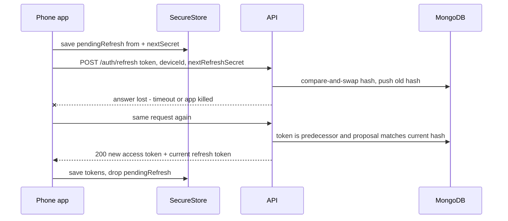
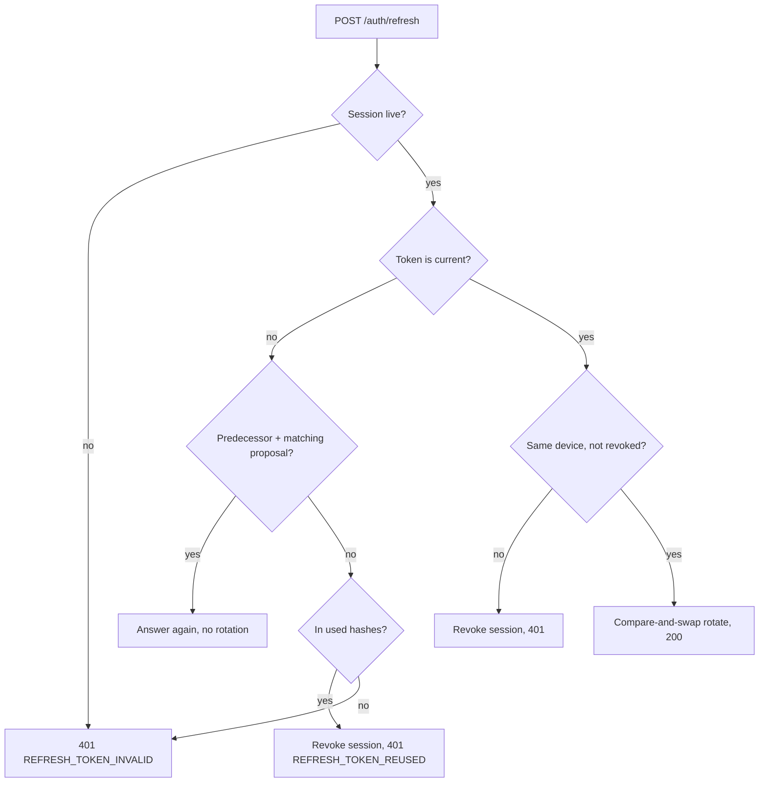

# 02. Session management

> **Status:** ✅ Implemented — access and refresh tokens, rotation with reuse detection, recovery of interrupted rotations, single active device, revocation and the sign-out wipe are all in code and covered by automated tests (not verified on a device as a separate test).
> Last reviewed against the code: 2026-10-12.

## Summary

After a successful OTP login (see [01-otp-login.md](01-otp-login.md)) the phone holds two tokens:
a short **access token** (a JWT, JSON Web Token, valid 15 minutes) for every API call, and a
long **refresh token** (30 days, extended on each use) to get new access tokens. Each refresh
token works once: it is replaced ("rotated") on every refresh, and reuse of an old one is treated
as theft. Every request also checks a live `Session` row in MongoDB, so logout, a sign-in on
another phone, revocation and account deletion take effect at once. When the server ends the
session, the phone deletes all local data.

## Status at a glance

| Part                                                                   | Status         | Evidence                                                 |
| ---------------------------------------------------------------------- | -------------- | -------------------------------------------------------- |
| Access JWT (HS256, pinned algorithm/issuer/audience)                   | ✅ Implemented | API `auth.test.js`                                       |
| `authenticate` middleware: JWT **and** live session row                | ✅ Implemented | API `auth.test.js`, `devices.test.js`, `account.test.js` |
| Refresh rotation, compare-and-swap, reuse detection, device binding    | ✅ Implemented | API `auth.test.js`                                       |
| Interrupted rotation recovery (`pendingRefresh` / `nextRefreshSecret`) | ✅ Implemented | API `auth.test.js`, mobile `api.test.js`                 |
| Client: single-flight refresh, proactive refresh, retry after 401      | ✅ Implemented | mobile `api.test.js`                                     |
| Logout (server revoke + local wipe)                                    | ✅ Implemented | API `auth.test.js`, mobile `auth.test.js`                |
| Single active device per user                                          | ✅ Implemented | API `devices.test.js`                                    |
| Restore after restart, reinstall detection                             | ✅ Implemented | mobile `auth.test.js`                                    |
| Device testing of these flows                                          | ⏳ Pending     | Not verified on a device as a separate test              |

## How it works

1. **Login creates the session.** In the login transaction the server revokes every other device
   and every session of the user (v1 rule: one active device), upserts this device, and creates a
   `Session` row with the SHA-256 hash of a new refresh secret. It returns
   `{ accessToken, accessTokenExpiresIn, refreshToken, refreshTokenExpiresAt }`.
2. **Tokens.** Access token: HS256 JWT with `sub` = user id, `sid` = session id, `did` = device
   id, `jti`, `iat`, `exp`, issuer and audience. Refresh token: `<sessionId>.<secret>` where the
   secret is 32 random bytes in base64url. The server stores only `SHA-256(secret)`.
3. **The phone saves the session** as **one** SecureStore entry, `auth.session`, so a rotation
   is written atomically. A copy is kept in memory.
4. **Every API call** (`lib/api.js`): if the access token has less than 30 s left, refresh first.
   Send `Authorization: Bearer <jwt>`. On a 401, use a token another request just refreshed, or
   refresh once, and retry once. A second 401 ends the session.
5. **`authenticate` on the server:** the header must be `Bearer` + a JWT-shaped string; the JWT
   must verify (HS256 only, issuer, audience, 5 s clock tolerance, required claims); `sub` and
   `sid` must be ObjectIds; a `Session` row with that id and user must exist, not be revoked, not
   be expired, and have the same `deviceId` as the token. Then `req.auth = { userId, sessionId,
deviceId }`.
6. **Refresh.** The app first saves `pendingRefresh = { from, nextSecret }` in `auth.session`,
   then sends `POST /auth/refresh { refreshToken, deviceId, nextRefreshSecret }`. The server:
   - rejects unknown, malformed, revoked or expired sessions (`REFRESH_TOKEN_INVALID`);
   - if the token is the **immediate predecessor** of the current one and
     `SHA-256(nextRefreshSecret)` equals the current hash, it is a repeat of a rotation whose
     answer was lost: it answers again with a new access token and the current refresh token,
     **without rotating**;
   - if the token is an older used one, it revokes the session (`REFRESH_TOKEN_REUSED`);
   - checks the device: another `deviceId` revokes the session; a revoked device gets
     `DEVICE_REVOKED`;
   - refuses a proposal equal to the current or a used secret (`400`, nothing revoked);
   - rotates with a compare-and-swap on the current hash, keeps the last 10 used hashes, and
     extends `expiresAt` by `REFRESH_TOKEN_TTL_DAYS`. A copy that loses the swap is answered as a
     repeat if it carries the same proposal, otherwise it is reuse.
7. **The app saves the answer before using it.** Saving drops `pendingRefresh`. If the app was
   signed out (or signed in again) while the refresh ran, the answer is thrown away.
8. **Temporary failures keep everything:** timeouts, network errors, 429 and 5xx keep the session
   and the pending rotation, so the next attempt sends exactly the same request. Only a 400 lets
   the next attempt propose a new secret.
9. **Session-ending answers** from refresh (`REFRESH_TOKEN_INVALID`, `REFRESH_TOKEN_REUSED`,
   `DEVICE_REVOKED`, or any 401/403) call `handleSessionEnded`, which runs `wipeLocalSession()`
   and shows "You were signed out. Please sign in again." on the sign-in screen.
10. **Logout.** `POST /auth/logout` (5 s timeout, best effort) revokes the session, clears the
    device's push token, ends any call and clears online status. The phone always wipes, even
    offline.
11. **Restart.** `restoreSession()` wipes an expired refresh session. If the install id in
    SecureStore does not match the one in the database (a reinstall: iOS keeps Keychain items),
    it wipes and creates a new device id.

## Packages and versions

| Package                       | Declared            | Installed   | Used for                                                                   |
| ----------------------------- | ------------------- | ----------- | -------------------------------------------------------------------------- |
| `jose` (API)                  | `^6.2.12`           | `6.2.12`    | Sign and verify access JWTs                                                |
| `mongoose` (API)              | `^8.18.0`           | `8.24.5`    | `sessions`, `devices`, transactions                                        |
| `rate-limiter-flexible` (API) | `^11.2.1`           | `11.2.1`    | 60 refreshes / 15 min per IP                                               |
| `zod` (API / mobile)          | `^4.1.0` / `^4.6.5` | `4.6.5`     | Refresh body (`REFRESH_SECRET_PATTERN`)                                    |
| `expo-secure-store` (mobile)  | `~57.0.4`           | `57.0.4`    | `auth.session`, `device.id`, `device.installId`                            |
| `expo-crypto` (mobile)        | `~57.0.3`           | `57.0.3`    | `getRandomBytesAsync` (next secret), `randomUUID` (device and install ids) |
| `zustand` (mobile)            | `^5.0.15`           | `5.0.15`    | `useAuthStore` status and notice                                           |
| Node `crypto` (built in)      | —                   | Node ≥ 22.9 | `randomBytes`, SHA-256, `timingSafeEqual`, `randomUUID` (`jti`)            |

## Source files

**API**

- [tokenService.js](../apps/api/src/modules/auth/tokenService.js) — sign/verify JWT, create and parse refresh tokens.
- [authService.js](../apps/api/src/modules/auth/authService.js) — login transaction, `refresh`, retry check, reuse handling, `logout`.
- [auth.routes.js](../apps/api/src/modules/auth/auth.routes.js) — `/auth/refresh` and `/auth/logout` routes.
- [middleware/authenticate.js](../apps/api/src/middleware/authenticate.js) — JWT + live session check.
- [models/Session.js](../apps/api/src/models/Session.js) — session schema, TTL index, `USED_TOKEN_HISTORY` (10).
- [models/Device.js](../apps/api/src/models/Device.js) — `revokedAt`, `revokedReason`.
- [deviceService.js](../apps/api/src/modules/devices/deviceService.js) — `revokeDevice` (see doc 15).
- [middleware/rateLimit.js](../apps/api/src/middleware/rateLimit.js) — `refreshPerIp`, `authenticatedPerUser`.
- [lib/logger.js](../apps/api/src/lib/logger.js) — redacts tokens and hashes.

**Mobile**

- [lib/api.js](../apps/mobile/src/lib/api.js) — `apiRequest`, single-flight `refreshSession`, `pendingRotation`, session-ending codes.
- [auth/tokenStore.js](../apps/mobile/src/auth/tokenStore.js) — one SecureStore entry, in-memory copy, dev-only `devInvalidateAccessToken`.
- [auth/session.js](../apps/mobile/src/auth/session.js) — `startSession`, `restoreSession`, `wipeLocalSession`.
- [auth/authStore.js](../apps/mobile/src/auth/authStore.js) — `initialize`, `logout`, `handleSessionEnded`.
- [lib/deviceId.js](../apps/mobile/src/lib/deviceId.js) — per-install UUID v4, `resetDeviceId`.
- [lib/secureStorage.js](../apps/mobile/src/lib/secureStorage.js) — `SECURE_KEYS`, `AFTER_FIRST_UNLOCK_THIS_DEVICE_ONLY`.
- [app/_layout.js](../apps/mobile/src/app/_layout.js) — splash until the session is restored; signed-in / signed-out guard.
- [app/(app)/security.js](<../apps/mobile/src/app/(app)/security.js>) — token diagnostics and "Invalidate access token" (development builds only).

**Shared**

- [constants.js](../packages/shared/src/constants.js) — `ERROR_CODE` (`UNAUTHENTICATED`, `REFRESH_TOKEN_INVALID`, `REFRESH_TOKEN_REUSED`, `DEVICE_REVOKED`).

## API endpoints

| Method   | Path                 | Auth                      | Purpose                                                                     | Rate limit                                |
| -------- | -------------------- | ------------------------- | --------------------------------------------------------------------------- | ----------------------------------------- |
| `POST`   | `/auth/otp/verify`   | None                      | Creates the session and issues the first tokens (see doc 01)                | 50/15 min per IP · 15/h per identifier    |
| `POST`   | `/auth/refresh`      | Refresh token in the body | Rotate the refresh token, issue an access token; answer a proven repeat     | 60/15 min per IP                          |
| `POST`   | `/auth/logout`       | JWT                       | Revoke this session, clear the push token, end calls, clear presence. `204` | None (this route has no per-user limiter) |
| `DELETE` | `/devices/:deviceId` | JWT                       | Revoke a device and its sessions (see doc 15)                               | 120/min per user                          |

All other JWT routes use `authenticate`, and every router except `/auth` adds 120 requests/min
per user.

## Data storage

### MongoDB

- `sessions`: `userId`, `deviceId` (immutable), `refreshTokenHash` (SHA-256), `usedRefreshTokenHashes`
  (last 10), `expiresAt`, `lastUsedAt`, `revokedAt`, `revokedReason`, timestamps. Index
  `(userId, deviceId, revokedAt)`; TTL index on `expiresAt`, so MongoDB deletes a session (revoked
  ones too) when it expires.
- `revokedReason` values in code: `new_login`, `logout`, `refresh_token_reuse`, `device_mismatch`,
  `device_revoked`.
- `devices`: `revokedAt`, `revokedReason` (`replaced_by_new_login`, `revoked_by_user`), `pushToken`
  (set to `null` on revocation and logout), `lastActiveAt` (updated on login and refresh). Revoked
  rows are kept, so a revoked `deviceId` can never sign in again.

### Redis

Only rate-limit counters: `rl:refreshPerIp:{ip}` (15 min) and `rl:authenticatedPerUser:{userId}`
(1 min). No tokens are stored in Redis.

### On the phone

| Where            | Name               | Holds                                                                                                                                                             |
| ---------------- | ------------------ | ----------------------------------------------------------------------------------------------------------------------------------------------------------------- |
| SecureStore      | `auth.session`     | `accessToken`, `accessTokenExpiresAt`, `refreshToken`, `refreshTokenExpiresAt` (ms), `user`, and `pendingRefresh = { from, nextSecret }` while a rotation is open |
| SecureStore      | `device.id`        | Per-install UUID v4; replaced after `DEVICE_REVOKED`, a detected reinstall, or account deletion                                                                   |
| SecureStore      | `device.installId` | Random id, compared with the database at start                                                                                                                    |
| SQLCipher `meta` | `install_id`       | The same install id, inside the encrypted database                                                                                                                |

SecureStore uses `AFTER_FIRST_UNLOCK_THIS_DEVICE_ONLY`: never synced or restored to another device.

## Security measures

- **Short access tokens + a session check on every request** (`authenticate.js`): revocation is
  immediate, not after 15 minutes.
- **JWT hardening:** only HS256 is accepted (no `alg: none`, no foreign keys), issuer and audience
  pinned, required claims, 5 s clock tolerance. `JWT_ACCESS_SECRET` ≥ 32 chars and different from
  `OTP_HMAC_SECRET`.
- **Refresh secrets are random (256 bits)**, so a plain SHA-256 is enough; only hashes are stored
  and compared in constant time.
- **Rotation on every refresh** with compare-and-swap: two concurrent refreshes cannot both
  rotate.
- **Reuse detection:** an old token (in the last 10) revokes the whole session. A valid token from
  another `deviceId` revokes it too.
- **Lost-answer recovery without weakening reuse detection:** a repeat is answered only with proof
  of the current secret (the app chose it), only for the immediate predecessor, only from the same
  live device. No time window.
- **Single active device:** each login revokes all other devices and sessions of the user.
- **Client:** single-flight refresh (two parallel refreshes would look like theft); the new token
  is persisted before use; a late refresh answer after sign-out is discarded; tokens live only in
  SecureStore, never in logs.
- **Fail closed on the phone:** session-ending codes wipe the database **and** its key, tokens,
  the Signal identity, the install id, push registration and media files; `initialize()` wipes on
  unreadable local state instead of crashing.
- **Logs:** `token`, `refreshToken`, `refreshTokenHash`, `usedRefreshTokenHashes`, `authorization`
  and `secret` are redacted (tested: no refresh token or proposed secret in logs).
- **Developer tools** (token timer, "Invalidate access token") exist only in `__DEV__` builds
  (`releaseUi.test.js`).

## Error handling

| Situation                                                                             | Error code / behaviour                             | What the user sees                                           |
| ------------------------------------------------------------------------------------- | -------------------------------------------------- | ------------------------------------------------------------ |
| Missing, malformed, tampered or expired JWT; revoked/expired session; device mismatch | `401 UNAUTHENTICATED`                              | Nothing: the app refreshes and retries once                  |
| Retry still 401                                                                       | App ends the session (`UNAUTHENTICATED`) and wipes | Sign-in screen: "You were signed out. Please sign in again." |
| Refresh: unknown, revoked or expired session; malformed token                         | `401 REFRESH_TOKEN_INVALID` (nothing revoked)      | Wipe + same notice                                           |
| Refresh: old token reused                                                             | `401 REFRESH_TOKEN_REUSED`, session revoked        | Wipe + same notice                                           |
| Refresh: token from another device                                                    | Session revoked, `401 REFRESH_TOKEN_INVALID`       | Wipe + same notice                                           |
| Refresh: device revoked, session still live                                           | Session revoked, `401 DEVICE_REVOKED`              | Wipe, new device id, same notice                             |
| Refresh: proposal equals the current or a used secret                                 | `400 VALIDATION_ERROR`, nothing rotated            | Nothing visible; the next attempt proposes a new secret      |
| Refresh: too many                                                                     | `429 RATE_LIMITED`                                 | Session and pending rotation kept; the request fails         |
| Network error, timeout (15 s), 5xx                                                    | Session and pending rotation kept                  | The screen's own offline/error text                          |
| Logout while offline                                                                  | Server call fails after ≤ 5 s                      | Signed out locally anyway                                    |

## Configuration

| Variable                   | Default           | Notes                                                                          |
| -------------------------- | ----------------- | ------------------------------------------------------------------------------ |
| `JWT_ACCESS_SECRET`        | — (required)      | ≥ 32 chars, no placeholder, differs from `OTP_HMAC_SECRET` (and `TURN_SECRET`) |
| `JWT_ISSUER`               | `secure-chat-api` | Pinned at verify time                                                          |
| `JWT_AUDIENCE`             | `secure-chat-app` | Pinned at verify time                                                          |
| `ACCESS_TOKEN_TTL_SECONDS` | `900`             | 60–3600                                                                        |
| `REFRESH_TOKEN_TTL_DAYS`   | `30`              | 1–365; sliding (extended on every rotation)                                    |
| `TRUST_PROXY_HOPS`         | `0`               | For the per-IP refresh limit behind a proxy                                    |

Constants in mobile code: `REFRESH_LEEWAY_MS` 30 s and `DEFAULT_TIMEOUT_MS` 15 s (`lib/api.js`),
`LOGOUT_TIMEOUT_MS` 5 s (`authStore.js`). Mobile build variable: `EXPO_PUBLIC_API_URL`.

## Testing status

- **Automated** (counts are `it(` cases found by grep):
  - API `auth.test.js` (28): middleware (valid, missing, malformed, tampered, `alg: none`, foreign
    key, expired, wrong issuer/audience); refresh rotation, hashes only, reuse, concurrent
    refreshes, device binding, unknown/guessed tokens, expired sessions; 13 cases for interrupted
    and repeated rotations; logout; log hygiene.
  - API `devices.test.js` (8): new sign-in signs out the previous device; same device replaces its
    session; revoked device's tokens stop working and it cannot sign in again.
  - API `account.test.js` (6): deletion ends access token, refresh token and device access.
  - Mobile `api.test.js` (17): token attach, 401 → refresh → retry, single-flight, proactive
    refresh, wipe on rejection, new device id on `DEVICE_REVOKED`, network failure keeps session,
    late answer after logout, 8 cases for the pending rotation.
  - Mobile `auth.test.js` (16): tokens as one SecureStore entry, restore without network, expired
    session, reinstall leftovers, logout online/offline, fresh database key after re-login.
  - Mobile `releaseUi.test.js` (6): token tools hidden in release builds.
- **Device testing:** not verified on a device as a separate test. ARCHITECTURE.md §12 does not
  record a device run of refresh recovery, logout or revocation.
- **Not tested yet:**
  - A real lost refresh answer on a phone (app killed mid-refresh).
  - Behaviour after `JWT_ACCESS_SECRET` rotation in a deployed environment.
  - Release builds and iOS.

## Known limitations and pending work

- **One active device.** Signing in on a new phone signs the old one out; history does not move
  (ARCHITECTURE.md §13).
- **After a sign-in elsewhere or a revocation, the old phone keeps its device id at first.** Its
  session is already revoked, so refresh answers `REFRESH_TOKEN_INVALID` (not `DEVICE_REVOKED`)
  and the wipe keeps `device.id`. The next sign-in on that phone gets `403 DEVICE_REVOKED`; only
  then does the app create a new device id, and the user must request a new code.
- `/auth/logout` has no per-user rate limit (other JWT routers have 120/min).
- A used token older than the last 10 rotations is no longer recognised as reuse; it is just
  invalid (`REFRESH_TOKEN_INVALID`) and does not revoke the session.
- An in-memory refresh lock only protects one app process; the server side is protected by the
  compare-and-swap.
- Multi-device sessions are out of scope for v1.

## Related documents

- [01-otp-login.md](01-otp-login.md) — how the session is created.
- [15-account-and-device-management.md](15-account-and-device-management.md) — devices list, revocation, account deletion.
- [07-local-database-encryption.md](07-local-database-encryption.md) — what the sign-out wipe deletes.
- [12-crash-recovery.md](12-crash-recovery.md) — the refresh-token race in the crash-recovery overview.
- [11-push-notifications.md](11-push-notifications.md) — push token cleared at logout.
- ARCHITECTURE.md: [§5.2 Request pipeline](ARCHITECTURE.md#52-request-pipeline), [§5.4 Data model](ARCHITECTURE.md#54-data-model-mongodb), [§6.3 Startup sequence](ARCHITECTURE.md#63-startup-sequence), [§6.4 On-device storage](ARCHITECTURE.md#64-on-device-storage), [§7.5 Sessions and tokens](ARCHITECTURE.md#75-sessions-and-tokens), [§7.7 Logout, revocation and account deletion](ARCHITECTURE.md#77-logout-revocation-and-account-deletion), [§8 Security controls](ARCHITECTURE.md#8-security-controls).
