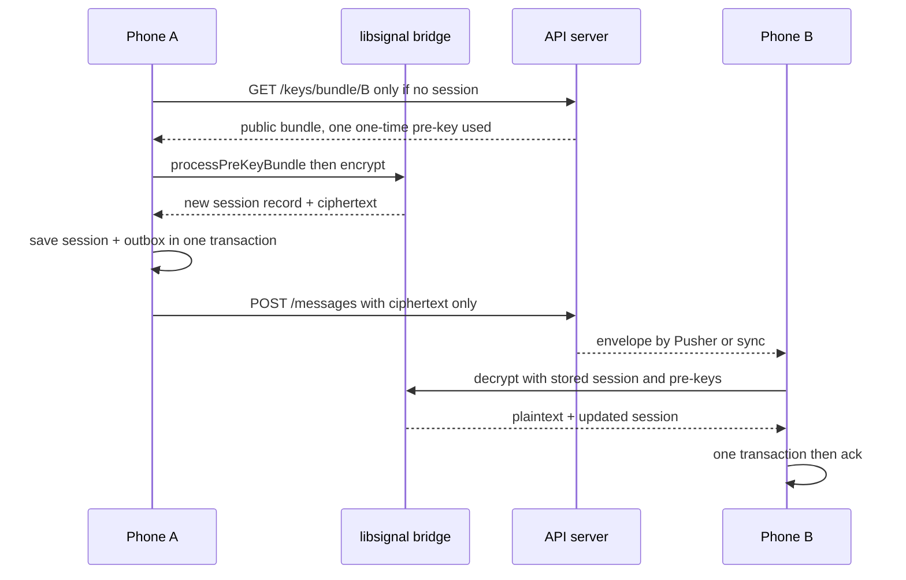
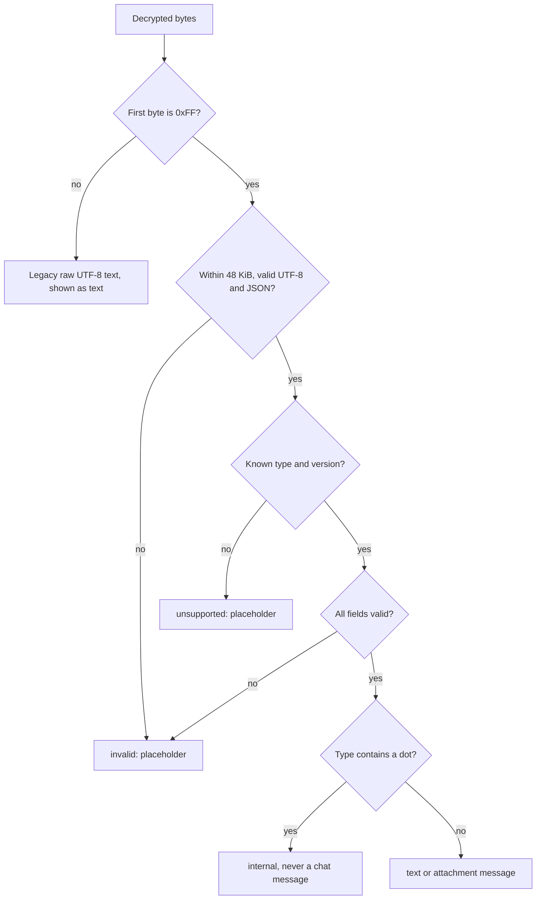

# 03. End-to-end encryption

> **Status:** ✅ Implemented — every message is encrypted on the phone with the official libsignal 0.105.0 on Android; the iOS bridge is written but has not been compiled or tested on a device.
> Last reviewed against the code: 2026-10-12.

## Summary

CipherChat uses end-to-end encryption (E2EE): only the two phones in a chat can read what is
sent. The app uses the Signal Protocol through the official **libsignal** library. It does not
implement any cryptography itself. A thin "bridge" passes data between JavaScript and libsignal.
The server stores and forwards only ciphertext (encrypted bytes) and some metadata. It never has
plaintext or private keys. Inside each Signal message the app puts typed, versioned content
(format v1: a `0xFF` marker byte and then JSON), so new message types can be added safely later.

## Status at a glance

| Part                                                                                 | Status         | Evidence                                                                                                                                                                                                                                                 |
| ------------------------------------------------------------------------------------ | -------------- | -------------------------------------------------------------------------------------------------------------------------------------------------------------------------------------------------------------------------------------------------------- |
| Android native bridge (Kotlin, `org.signal:libsignal-android:0.105.0`)               | ✅ Implemented | `nativeParity.test.js`; encrypted messages delivered between two Android phones, device-verified 2026-10-09 ([ARCHITECTURE §12](ARCHITECTURE.md#12-status-and-roadmap), Phase 7); encrypted photos, videos and voice notes device-verified 2026-10-11/12 |
| iOS native bridge (Swift, `LibSignalClient` v0.105.0)                                | 🟡 Partial     | Written; same contract checked statically by `nativeParity.test.js`. Not compiled (needs macOS/Xcode), not verified on a device                                                                                                                          |
| Session setup from a key bundle (PQXDH: X25519 + Kyber-1024)                         | ✅ Implemented | `apps/api/test/e2ee.test.js`, `apps/api/test/keys.test.js`, `apps/mobile/test/e2ee.test.js`                                                                                                                                                              |
| Double Ratchet encrypt / decrypt                                                     | ✅ Implemented | `apps/mobile/test/e2ee.test.js`, `apps/mobile/test/messaging.test.js`                                                                                                                                                                                    |
| Content format v1 (`0xFF` + JSON; `text`, `attachment`, `call.dtls`)                 | ✅ Implemented | `apps/mobile/test/content.test.js`, `messaging.test.js` (content format block)                                                                                                                                                                           |
| Raw text from app versions before R1 still readable                                  | ✅ Implemented | `content.test.js`, `messaging.test.js`                                                                                                                                                                                                                   |
| One lock for every session read-modify-write (`withSignalLock`)                      | ✅ Implemented | `e2ee.test.js`, `messaging.test.js`                                                                                                                                                                                                                      |
| Crash-safe: session, pre-key removal, message and envelope status in one transaction | ✅ Implemented | `e2ee.test.js` ("processes envelopes stored before a crash, exactly once")                                                                                                                                                                               |
| Placeholders for undecryptable / unsupported / invalid content                       | ✅ Implemented | `messaging.test.js`, `content.test.js`                                                                                                                                                                                                                   |
| Re-encrypt after `STALE_RECIPIENT_DEVICE` (peer signed in again)                     | ✅ Implemented | `apps/api/test/e2ee.test.js`, `apps/api/test/messaging.test.js`, `apps/mobile/test/messaging.test.js`                                                                                                                                                    |
| Trust on first use + security codes                                                  | ✅ Implemented | See [06-key-management.md](06-key-management.md)                                                                                                                                                                                                         |
| Sealed sender (hide who sends to whom)                                               | ⏳ Pending     | Not implemented ([ARCHITECTURE §13](ARCHITECTURE.md#13-known-limitations-and-risks))                                                                                                                                                                     |
| Multi-device (more than one Signal device per user)                                  | ⏳ Pending     | `signalDeviceId` is always 1 in v1                                                                                                                                                                                                                       |

## How it works

**Sending a message**

1. The user types text. `enqueueText()` first checks that the text can be encoded
   (`encodeContent(textContent(text))`), then stores the message in SQLCipher with status
   `sending`. Text that could never be sent (empty, too long) throws a `ContentError` and is not
   stored.
2. `deliverOutgoing()` runs. If the message has no outbox row yet, `encryptToOutbox()` runs
   under `withSignalLock`:
   - If the peer has a pending security-code change, nothing is encrypted (`UNTRUSTED_IDENTITY`).
   - If there is no session with the peer, the app fetches the peer's public key bundle
     (`GET /keys/bundle/:userId`) and calls `processPreKeyBundle` (PQXDH). The session, the
     peer's identity key (if new) and the peer device are saved in one transaction.
   - The content bytes are encrypted with `encrypt` (Double Ratchet).
   - The new session record and the outbox row (ciphertext, type, recipient device,
     `recipientRegistrationId`) are saved in **one** transaction.
3. The app sends `POST /messages` with the ciphertext. The server checks the recipient device
   and its `registrationId`, stores a `Message` (metadata only) and a `MessageEnvelope`
   (ciphertext), and answers `201`.
4. The app marks the message `sent` and deletes the outbox row in one transaction. A retry
   always resends the **same** ciphertext with the same `clientMessageId`, so the ratchet never
   moves twice for one message.

**Receiving a message**

5. An envelope arrives by Pusher (inline if ≤ 8 KB) or by HTTPS sync. It is stored first in the
   local `message_envelopes` table with status `pending` (`insertEnvelopeIfNew`).
6. Under `withSignalLock`, for a PreKey message (type 3) the app asks the bridge
   (`preKeyMessageInfo`) which one-time pre-key it needs and loads it, plus all signed and Kyber
   pre-keys. Then it calls `decrypt`.
7. In **one** transaction: save the session, store the sender identity if it is the first one,
   save the peer device, delete the used one-time pre-key, insert the message, mark the envelope
   `done` (its ciphertext is cleared).
8. The plaintext bytes go to `decodeContent()`. Text and attachments become chat messages.
   Internal content (`call.*`) never does. Unknown or malformed content becomes a placeholder.
9. Only after local storage does the app acknowledge the envelopes
   (`POST /messages/envelopes/ack`). Details: [04-one-to-one-messaging.md](04-one-to-one-messaging.md).



**How received plaintext is read (`decodeContent`)**



A type with a dot is internal even when it is unknown or malformed. It never becomes a chat
message, conversation, unread count or read receipt.

### The native bridge

The bridge (`modules/signal-protocol`) is **stateless**. JavaScript passes in the records that a
call needs (identity key pair, session, pre-keys, trusted peer identity). Native code loads them
into a per-call `InMemorySignalProtocolStore`, runs libsignal, and returns the updated records.
JavaScript saves them. All binary values cross the bridge as standard base64.

| Function               | What it does                                                                                |
| ---------------------- | ------------------------------------------------------------------------------------------- |
| `generateIdentity`     | Identity key pair + registration id (1–16380)                                               |
| `generateSignedPreKey` | EC pre-key signed by the identity key                                                       |
| `generateKyberPreKey`  | Kyber pre-key signed by the identity key (Android: `KYBER_1024`)                            |
| `generatePreKeys`      | A batch of one-time EC pre-keys                                                             |
| `preKeyMessageInfo`    | Reads the pre-key ids and the claimed sender identity from a PreKey message                 |
| `securityCode`         | 60-digit security code (`NumericFingerprintGenerator`)                                      |
| `processPreKeyBundle`  | Builds an outgoing session from a peer bundle (PQXDH)                                       |
| `encrypt`              | Encrypts with the session; returns `type`, `body` and the new session                       |
| `decrypt`              | Decrypts type 2 (`SignalMessage`) or type 3 (`PreKeySignalMessage`); reports `usedPreKeyId` |

Every result that touches a session also returns `remoteIdentityKey` and
`remoteRegistrationId`. The registration id lets the server detect that the peer signed in
again with new keys.

Only `crypto/signalService.js` calls the bridge. If the module is missing in a build,
`getSignalNative()` throws. There is no fallback to other crypto code.

### Content format v1 (`messaging/content.js`)

```
byte 0     0xFF  (CONTENT_MARKER; never appears in UTF-8)
bytes 1..  UTF-8 JSON: { "type": <string>, "version": <integer>, ...fields }
```

| Type         | Version | Fields                                                                                                                                               | In the chat                                              |
| ------------ | ------- | ---------------------------------------------------------------------------------------------------------------------------------------------------- | -------------------------------------------------------- |
| `text`       | 1       | `text` (1–16,000 UTF-16 code units)                                                                                                                  | The text                                                 |
| `attachment` | 1       | `id`, `key` (32 B), `digest` (32 B), `size`, `contentType`; optional `fileName`, `width`, `height`, `durationMs`, `blurHash`, `caption`, `voiceNote` | Photo, video or voice note ([05](05-encrypted-media.md)) |
| `call.dtls`  | 1       | `callId`, `role`, `from`, `to`, `kind`, `fingerprints` (SHA-256 only, 1–4, no duplicates)                                                            | Never shown (internal, [10](10-voice-video-calls.md))    |

- Schemas are `strictObject`: no unknown fields. A new field means a new version.
- Whole content limit: `SIGNAL.MAX_CIPHERTEXT_BYTES` (64 KiB) − 16 KiB = **48 KiB**, checked
  before parsing. The 16 KiB leaves room for Signal overhead (a first message carries a Kyber
  ciphertext).
- The chat input allows 4,000 characters.
- Plaintext without the marker is raw UTF-8 text from an app version before R1. It is always
  shown as text and can never be read as typed or internal content.

### Trust model

- **Trust on first use (TOFU).** The first identity key seen for a peer is stored in
  `signal_identities` with `INSERT OR IGNORE` and is never silently replaced. The bridge seeds
  libsignal with that trusted key, so libsignal itself refuses a different key
  (`UNTRUSTED_IDENTITY`).
- **Changes are held.** A changed key blocks sending and holds incoming ciphertext until the
  user accepts the new security code. Details: [06-key-management.md](06-key-management.md).
- **Identity comes from the Signal session only.** Device ids sent by the server only route
  messages. The Signal address is always `(peer user id, 1)`.
- **The server is trusted to hand out the first key correctly.** If users never compare
  security codes, a server that served a wrong key on first contact would not be detected.

### What the server can and cannot see

| Party           | Can see                                                                                    | Never sees                                                          |
| --------------- | ------------------------------------------------------------------------------------------ | ------------------------------------------------------------------- |
| API + MongoDB   | Public Signal keys, ciphertext envelopes, who sends to whom and when, delivered/read times | Plaintext, private keys, trust decisions (security-code acceptance) |
| Pusher          | Channel name (device UUID), ciphertext if ≤ 8 KB (else only ids), receipts                 | Plaintext, names, phone numbers                                     |
| Expo push / FCM | Push token, the fixed text "CipherChat / New message", an opaque message id                | Sender, conversation, content                                       |

Source: [ARCHITECTURE §4](ARCHITECTURE.md#4-trust-boundaries-who-sees-what). The server
cannot tell a chat message from internal content: both are ciphertext.

## Packages and versions

| Package                                                      | Declared   | Installed                         | Used for                             |
| ------------------------------------------------------------ | ---------- | --------------------------------- | ------------------------------------ |
| `org.signal:libsignal-android` (Gradle)                      | `0.105.0`  | `0.105.0` (pinned)                | Android bridge                       |
| `LibSignalClient` (CocoaPods, git tag)                       | `v0.105.0` | Not installed (iOS build not run) | iOS bridge                           |
| `@signalapp/libsignal-client` (API and mobile devDependency) | `0.105.0`  | `0.105.0`                         | Tests: real libsignal in Node        |
| `zod` (mobile)                                               | `^4.6.5`   | `4.6.5`                           | Content schemas                      |
| `zod` (shared, API)                                          | `^4.1.0`   | `4.6.5` (hoisted)                 | Request validation (ciphertext, ids) |
| `expo-crypto`                                                | `~57.0.3`  | `57.0.3`                          | `randomUUID` for `clientMessageId`   |
| `expo` (modules core)                                        | `~57.0.27` | `57.0.27`                         | Native module system for the bridge  |

`test/nativeParity.test.js` fails if the Android, iOS and test versions of libsignal differ.

## Source files

**Mobile**

- [signalService.js](../apps/mobile/src/crypto/signalService.js) — all Signal orchestration: sessions, encrypt to outbox, decrypt envelopes, `sealForPeer` / `openFromPeer`, security codes.
- [signalStore.js](../apps/mobile/src/crypto/signalStore.js) — reads and writes Signal state in SQLCipher and SecureStore.
- [encoding.js](../apps/mobile/src/crypto/encoding.js) — bytes ↔ base64 for the bridge.
- [content.js](../apps/mobile/src/messaging/content.js) — content format v1: encode, decode, schemas.
- [messageStore.js](../apps/mobile/src/messaging/messageStore.js) — local message statuses (`undecryptable`, `unsupported`, `identity_pending`) and the outbox.
- [chat/[peerUserId].js](<../apps/mobile/src/app/(app)/chat/[peerUserId].js>) — shows placeholders and the security-code banner.

**Native module**

- [index.js](../apps/mobile/modules/signal-protocol/index.js) — JS entry; throws if the native module is missing.
- [SignalProtocolModule.kt](../apps/mobile/modules/signal-protocol/android/src/main/java/expo/modules/signalprotocol/SignalProtocolModule.kt) — Android bridge.
- [SignalProtocolModule.swift](../apps/mobile/modules/signal-protocol/ios/SignalProtocolModule.swift) — iOS bridge (same contract).
- [build.gradle](../apps/mobile/modules/signal-protocol/android/build.gradle), [SignalProtocol.podspec](../apps/mobile/modules/signal-protocol/ios/SignalProtocol.podspec) — library dependencies.
- [withLibsignalAndroid.js](../apps/mobile/plugins/withLibsignalAndroid.js), [withLibsignalIos.js](../apps/mobile/plugins/withLibsignalIos.js) — build plugins (Signal Maven repo + desugaring; pod + prebuild checksum).
- [signalBridge.mjs](../apps/mobile/test/mocks/signalBridge.mjs) — test double with the same contract, using Node libsignal.

**API**

- [messages.routes.js](../apps/api/src/modules/messages/messages.routes.js) — strict send schema: ciphertext only, no plaintext field.
- [messageService.js](../apps/api/src/modules/messages/messageService.js) — `STALE_RECIPIENT_DEVICE` check, envelope storage.
- [keyService.js](../apps/api/src/modules/keys/keyService.js) — public key bundles (see [06](06-key-management.md)).

**Shared**

- [constants.js](../packages/shared/src/constants.js) — `SIGNAL`, `CIPHERTEXT_TYPE`, `ERROR_CODE`.
- [validation.js](../packages/shared/src/validation.js) — `ciphertextSchema` (base64, 1 B – 64 KiB decoded), `ciphertextTypeSchema` (2 or 3).

## API endpoints

E2EE uses the messaging and key endpoints. They are documented in full in
[04-one-to-one-messaging.md](04-one-to-one-messaging.md) and [06-key-management.md](06-key-management.md).
Every authenticated route also has the 120 requests/min per-user limit.

| Method | Path                      | Auth | Purpose                                                                             | Rate limit       |
| ------ | ------------------------- | ---- | ----------------------------------------------------------------------------------- | ---------------- |
| `GET`  | `/keys/bundle/:userId`    | JWT  | Peer's public bundle to start a session                                             | 30/min per user  |
| `POST` | `/messages`               | JWT  | Send one envelope: `type` (2/3) + `ciphertext` + optional `recipientRegistrationId` | 60/min per user  |
| `GET`  | `/messages/envelopes`     | JWT  | Fetch envelopes (ciphertext) for this device                                        | 120/min per user |
| `POST` | `/messages/envelopes/ack` | JWT  | Acknowledge after local storage                                                     | 120/min per user |

## Data storage

### MongoDB

- `messageenvelopes`: `type` (2 = Whisper, 3 = PreKey), `ciphertext` (base64), sender ids,
  `senderSignalDeviceId`, `seq`. One per recipient device.
- `messages`: metadata only. **No content field.**
- `devices.signal`, `onetimeprekeys`: public keys (see [06](06-key-management.md)).

### Redis

Not used for E2EE.

### On the phone

| Where       | Name                | Holds                                                             |
| ----------- | ------------------- | ----------------------------------------------------------------- |
| SecureStore | `signal.identity`   | Identity key pair + registration id                               |
| SQLCipher   | `signal_sessions`   | Session record per address `userId.1`                             |
| SQLCipher   | `signal_identities` | Trusted peer identity key (TOFU)                                  |
| SQLCipher   | `peer_devices`      | Server device id that represents each peer                        |
| SQLCipher   | `message_envelopes` | Incoming ciphertext until processed; `done` rows keep only the id |
| SQLCipher   | `messages`          | Decrypted plaintext                                               |
| SQLCipher   | `outbox`            | Outgoing ciphertext until the server accepts it                   |
| SQLCipher   | `sync_state`        | `envelope_cursor`, `next_prekey_id`                               |

Database details: [07-local-database-encryption.md](07-local-database-encryption.md).

## Security measures

- **No custom crypto.** Kotlin and Swift only call libsignal. `nativeParity.test.js` checks
  that the bridges delegate every operation to libsignal and pin the same version.
- **Ciphertext only on the server.** `POST /messages` uses a `strictObject` schema with no
  content field. An extra field such as `text` is rejected with `400 VALIDATION_ERROR`.
- **No double ratchet steps.** `withSignalLock` serialises encrypt, decrypt and session setup.
  The outbox keeps the exact ciphertext, so a retry never re-encrypts.
- **Atomic state changes.** Session advance + outbox write, and session + pre-key removal +
  message + envelope status, each commit in one SQLCipher transaction.
- **Replays.** libsignal reports `DUPLICATE_MESSAGE`; the envelope is marked `done` and nothing
  is shown twice.
- **Stale keys.** Each send carries `recipientRegistrationId`. If the recipient has new keys,
  the server stores nothing and answers `409 STALE_RECIPIENT_DEVICE`. The app drops the old
  session and outbox ciphertext, fetches a new bundle and re-encrypts once.
- **Strict content parsing.** Size checked before parsing, UTF-8 checked, schemas are strict,
  types are looked up in `Map`s (so names like `constructor` resolve to nothing).
- **Old text is safe.** Raw text can never be read as internal content, because `0xFF` never
  appears in UTF-8.
- **Error texts carry no key material.** Bridge errors carry only a code and the exception class
  name.

## Error handling

| Situation                                                | Error code / behaviour                                                                              | What the user sees                                                                                                                                |
| -------------------------------------------------------- | --------------------------------------------------------------------------------------------------- | ------------------------------------------------------------------------------------------------------------------------------------------------- |
| Peer identity key changed (bundle or PreKey message)     | `UNTRUSTED_IDENTITY`; change recorded, incoming ciphertext held (`identity_pending`)                | Banner "Security code changed"; bubble "Waiting for you to accept this contact's new security code."; outgoing "Not sent · security code changed" |
| Same Signal message received twice                       | `DUPLICATE_MESSAGE`; envelope marked `done`                                                         | Nothing (shown once)                                                                                                                              |
| Decrypt fails for another reason                         | `NO_SESSION`, `MISSING_PREKEY` or `SIGNAL_ERROR`; message status `undecryptable`, envelope `failed` | "🔒 This message could not be decrypted."                                                                                                         |
| Unknown content type or version                          | Status `unsupported`, error `UNSUPPORTED_CONTENT`; body empty                                       | "This message isn't supported by this version of CipherChat."                                                                                     |
| Malformed content                                        | Status `unsupported`, error `INVALID_CONTENT`; body empty                                           | "This message could not be displayed."                                                                                                            |
| Internal content (`call.*`) in the chat pipeline         | Envelope `done`, error `INTERNAL_CONTENT`; session still saved                                      | Nothing                                                                                                                                           |
| Text cannot be encoded (empty, > 16,000 chars, > 48 KiB) | `ContentError` (`CONTENT_INVALID` / `CONTENT_TOO_LARGE`); nothing stored                            | Message is not added (input is limited to 4,000 chars)                                                                                            |
| Recipient signed in again / new keys                     | `409 STALE_RECIPIENT_DEVICE`; one automatic re-encrypt and resend                                   | Nothing, unless the identity key changed                                                                                                          |
| Offline, 5xx or 429 on send                              | Message `failed`, error `TEMPORARY`; retried on next sync                                           | Failed bubble; retries automatically                                                                                                              |
| Sender has no registered keys                            | `409 KEYS_NOT_REGISTERED`                                                                           | Message fails                                                                                                                                     |
| Native Signal module missing in a build                  | `getSignalNative()` throws; `useSignalSetup` state `unavailable`; messaging never starts            | No chats sync; no dedicated error screen (development builds show the key state on the Security screen)                                           |

## Configuration

- No server environment variable controls E2EE. Parameters are constants in
  `packages/shared/src/constants.js` (`SIGNAL`): `DEFAULT_DEVICE_ID` 1,
  `MAX_CIPHERTEXT_BYTES` 64 KiB, `SECURITY_CODE_ITERATIONS` 5200, `SECURITY_CODE_VERSION` 2.
- `app.json` plugins: `./plugins/withLibsignalAndroid`, `./plugins/withLibsignalIos`.
- `modules/signal-protocol/expo-module.config.json` registers the module for `android` and `apple`.
- The mobile app's only build variable is `EXPO_PUBLIC_API_URL`.

## Testing status

- **Automated:**
  - `apps/api/test/e2ee.test.js` (11 tests): two Node libsignal devices; only the recipient gets
    plaintext; ratchet both ways; restart; id-only realtime for large envelopes; no private keys
    in requests, responses, realtime or MongoDB; idempotency; plaintext-shaped fields rejected;
    `STALE_RECIPIENT_DEVICE`.
  - `apps/mobile/test/e2ee.test.js` (15 tests): two app instances with real libsignal;
    force-close; crash recovery exactly once; replays; inline and id-only events; key handling;
    pre-key rotation.
  - `apps/mobile/test/content.test.js` (14 test declarations, 3 of them `it.each` tables): format,
    legacy text, unknown, malformed, attachment and `call.dtls` content, UI placeholders.
  - `apps/mobile/test/messaging.test.js`: content-format block (9 tests), "security" block (no
    plaintext or private keys sent), security-code block (12 tests).
  - `apps/mobile/test/nativeParity.test.js` (7 tests): same functions, error codes and version on
    Android, iOS and the test double; no crypto in the bridges. Static checks only.
- **Device testing:** Android only. Encrypted messages between two Android phones
  (device-verified 2026-10-09, including queued messages after a 100 s outage delivered once each,
  in order). Encrypted photos, videos and voice notes (device-verified 2026-10-11/12; they travel
  as `attachment` v1 content). R2 attestation sizes were measured with libsignal on an RMX2103.
- **Not tested yet:** the iOS bridge (not compiled, no device); a security-code change on real
  phones; release builds.

## Known limitations and pending work

- **Metadata is visible to the server:** who messages whom and when. Sealed sender is not
  implemented.
- **Trust on first use:** the first key is trusted until users compare security codes.
- **One device per user** (`signalDeviceId` = 1). Multi-device and groups are not in v1.
- **iOS:** the Swift bridge has not been compiled or run. Its Kyber key type is the library
  default (not checked here); the server only accepts 1,569-byte Kyber-1024 public keys.
- **Undecryptable messages are not retried** with other keys; the placeholder stays.
- **Internal content sent through `/messages`** would still get a "delivered" receipt and a push
  timer, because the server cannot tell it apart. Internal content is meant for its own path
  (call signaling).

## Related documents

- [04-one-to-one-messaging.md](04-one-to-one-messaging.md) — send, receive, receipts, retries.
- [05-encrypted-media.md](05-encrypted-media.md) — `attachment` content and file encryption.
- [06-key-management.md](06-key-management.md) — keys, bundles, rotation, security codes.
- [07-local-database-encryption.md](07-local-database-encryption.md) — where Signal state is stored.
- [08-real-time-messaging.md](08-real-time-messaging.md) — how envelopes reach the phone.
- [10-voice-video-calls.md](10-voice-video-calls.md) — `call.dtls` attestations (R2).
- ARCHITECTURE: [§4 Trust boundaries](ARCHITECTURE.md#4-trust-boundaries-who-sees-what),
  [§6.5 Native Signal bridge](ARCHITECTURE.md#65-native-signal-bridge-modulessignal-protocol),
  [§7.2 Sending](ARCHITECTURE.md#72-sending-a-message),
  [§7.3 Receiving](ARCHITECTURE.md#73-receiving-a-message),
  [§8 Security controls](ARCHITECTURE.md#8-security-controls),
  [§13 Known limitations](ARCHITECTURE.md#13-known-limitations-and-risks).
