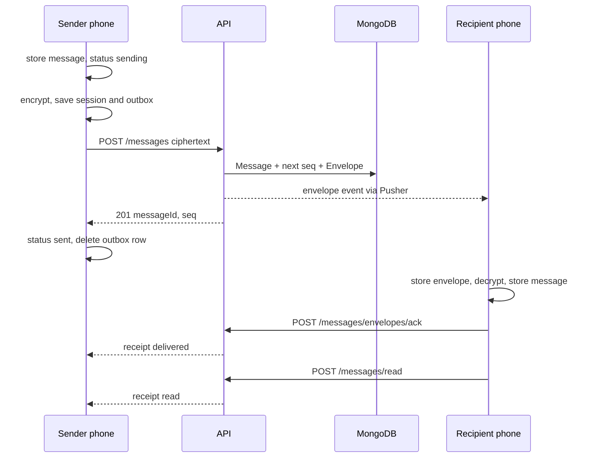
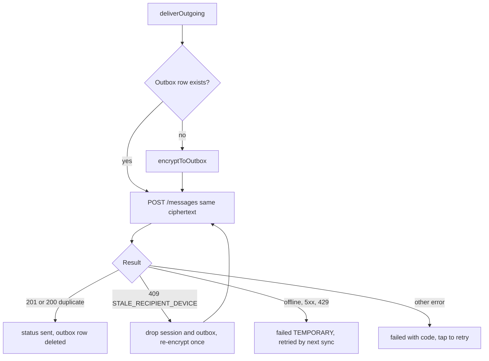

# 04. One-to-one messaging

> **Status:** ✅ Implemented — text messages are encrypted on the phone, sent as ciphertext, stored per device on the server, delivered with receipts, and recovered after crashes and outages.
> Last reviewed against the code: 2026-10-12.

## Summary

Two people can chat 1:1. The phone stores each new message in its encrypted local database
first, then encrypts it with the Signal Protocol and sends only the ciphertext to the API. The
API stores one **envelope** (ciphertext + routing data) for the recipient's device and tells that
device about it. The recipient decrypts it, stores it locally, and **acknowledges** it. The
sender then sees "delivered" and later "read". Every step can be retried safely, so a crash, a
timeout or a lost connection never loses a message and never shows it twice.

E2EE (end-to-end encryption) itself is described in
[03-end-to-end-encryption.md](03-end-to-end-encryption.md). Realtime delivery (Pusher) is in
[08-real-time-messaging.md](08-real-time-messaging.md). This document covers the message
pipeline around them.

## Status at a glance

| Part                                                                       | Status         | Evidence                                                                                            |
| -------------------------------------------------------------------------- | -------------- | --------------------------------------------------------------------------------------------------- |
| Compose and send text (store first, encrypt, send ciphertext)              | ✅ Implemented | `apps/mobile/test/messaging.test.js`, `apps/api/test/messaging.test.js`                             |
| One envelope per recipient device, per-device `seq`                        | ✅ Implemented | `apps/api/test/messaging.test.js` (offline recovery, paging)                                        |
| Idempotent send (`clientMessageId`) and outbox retries                     | ✅ Implemented | Both `messaging.test.js` files                                                                      |
| Receive, decrypt, store, then acknowledge                                  | ✅ Implemented | `apps/mobile/test/messaging.test.js`                                                                |
| Delivered / read receipts (realtime + recovery by `POST /messages/status`) | ✅ Implemented | Both `messaging.test.js` files                                                                      |
| Ordered delivery after an outage, once each, with receipts                 | ✅ Implemented | Device-verified 2026-10-09 (100 s outage, ARCHITECTURE §12 Phase 7)                                 |
| `STALE_RECIPIENT_DEVICE` re-encrypt (peer signed in again)                 | ✅ Implemented | `apps/api/test/messaging.test.js`, `apps/mobile/test/messaging.test.js`                             |
| Held messages (security code changed)                                      | ✅ Implemented | `apps/mobile/test/messaging.test.js` (security code changes); details in [06](06-key-management.md) |
| Placeholders (undecryptable, unsupported, invalid content)                 | ✅ Implemented | `apps/mobile/test/messaging.test.js`                                                                |
| Conversation list (last message, unread count, ticks)                      | ✅ Implemented | Covered indirectly by `messaging.test.js`; UI row not unit-tested                                   |
| Photos, videos, voice notes                                                | ✅ Implemented | See [05-encrypted-media.md](05-encrypted-media.md)                                                  |
| Group chats, multi-device                                                  | ⏳ Pending     | Not in v1 (ARCHITECTURE §12 "Not in v1")                                                            |

## How it works

**Sending**

1. The user taps Send in the chat screen. `sendMessage()` in `messagingEngine.js` calls
   `enqueueText()`.
2. `enqueueText()` checks the text against the content limits (1 to 16,000 characters, whole
   content ≤ 48 KiB). Text that can never be sent is refused **before** it is stored. The chat
   input itself allows at most 4,000 characters (`MAX_LENGTH`).
3. In one SQLCipher transaction the phone inserts the message (status `sending`, a new random
   `clientMessageId`, UUID v4) and creates or updates the conversation row. The bubble appears
   at once.
4. `deliverOutgoing()` runs (single-flight per message). If there is no outbox row yet,
   `encryptToOutbox()` runs under `withSignalLock`:
   - if a security-code change for this peer is pending, nothing is encrypted (error
     `UNTRUSTED_IDENTITY`, the message is "held");
   - if there is no Signal session yet, it fetches the peer's key bundle and builds one
     (see [06-key-management.md](06-key-management.md));
   - it encrypts the typed content (`0xFF` + JSON, see [03](03-end-to-end-encryption.md)) and
     saves the advanced session **and** the ciphertext in the `outbox` table in one transaction.
5. The phone sends `POST /messages` with `recipientUserId`, `recipientDeviceId`,
   `recipientRegistrationId`, `clientMessageId`, `type` (2 = Whisper, 3 = PreKey) and
   `ciphertext`. There is no field for plaintext.
6. The API (`messageService.sendEnvelope`):
   - refuses a message to yourself (400);
   - returns the original result if this `(senderDeviceId, clientMessageId)` already exists
     (200, `duplicate: true`);
   - checks the sender device is active and has keys, and the recipient device is active, has
     keys, and still has the same registration id (else 409 `STALE_RECIPIENT_DEVICE`);
   - in one MongoDB transaction creates the `Message` (metadata only), takes the next `seq`
     from the counter `envelope:{recipientDeviceId}`, and creates the `MessageEnvelope`.
7. After the commit the API publishes the envelope to the recipient's Pusher channel (best
   effort) and schedules the push check (3 s, see
   [11-push-notifications.md](11-push-notifications.md)). It answers 201 with `messageId`,
   `seq`, `status: "sent"`.
8. The phone sets the message to `sent`, stores the server `messageId`, and deletes the outbox
   row, in one transaction.

**Receiving**

1. The envelope arrives by Pusher (inline if the event is ≤ 8 KB) or by sync
   (`GET /messages/envelopes?after=<cursor>`).
2. The phone stores it in `message_envelopes` with `INSERT OR IGNORE` (status `pending`).
3. Under `withSignalLock` it decrypts each pending envelope in `seq` order. In one transaction
   it saves the session, removes a used one-time pre-key, inserts the message (status
   `received`), updates the conversation, and marks the envelope `done` (its ciphertext is
   cleared, the row stays for de-duplication).
4. Only after storing and processing a page, it calls `POST /messages/envelopes/ack
{upToSeq}` and then saves the new cursor in `sync_state` (`envelope_cursor`).
5. The API sets `deliveredAt` on the envelopes and messages, moves envelope expiry to 7 days,
   and publishes a `receipt` event (`delivered`) to the sender's device.

**Read receipts**

1. When the chat screen is focused (and whenever new messages arrive while it is open),
   `markConversationRead()` sets the peer's `received` messages to `read` with
   `receipt_pending = 1`.
2. `flushReadReceipts()` sends `POST /messages/read` in batches of up to 100 ids, then clears
   `receipt_pending`. If offline, the receipts stay queued for the next sync.
3. The API marks only messages addressed to the caller as read (also sets `deliveredAt` if it
   was missing) and publishes `read` receipts to the sender's device.
4. A sender that missed receipts asks `POST /messages/status` for its `sent`/`delivered`
   messages during every sync (`refreshOutgoingStatuses`). Local status never moves backwards
   (`sending/failed` < `sent` < `delivered` < `read`).

## Packages and versions

| Package                                 | Declared  | Installed | Used for                                                                     |
| --------------------------------------- | --------- | --------- | ---------------------------------------------------------------------------- |
| `express` (API)                         | `^5.1.0`  | 5.2.1     | Message routes                                                               |
| `mongoose` (API)                        | `^8.18.0` | 8.24.5    | `messages`, `messageenvelopes`, `counters`, transactions                     |
| `zod` (API, shared)                     | `^4.1.0`  | 4.6.5     | Request validation (`strictObject`)                                          |
| `rate-limiter-flexible` (API)           | `^11.2.1` | 11.2.1    | 120/min per user, 60 sends/min per user                                      |
| `pusher` (API)                          | `^5.3.4`  | 5.3.4     | Publishing envelope and receipt events (see [08](08-real-time-messaging.md)) |
| `expo-sqlite` (mobile, SQLCipher build) | `~57.0.4` | 57.0.4    | Local messages, outbox, inbox (see [07](07-local-database-encryption.md))    |
| `expo-crypto` (mobile)                  | `~57.0.3` | 57.0.3    | `randomUUID()` for `clientMessageId`                                         |
| `zustand` (mobile)                      | `^5.0.15` | 5.0.15    | `useMessagingStore` (`revision` makes screens re-read the DB)                |
| libsignal (native)                      | 0.105.0   | 0.105.0   | Encrypt / decrypt (see [03](03-end-to-end-encryption.md))                    |

## Source files

**API**

- [messages.routes.js](../apps/api/src/modules/messages/messages.routes.js) — the five message endpoints and their zod schemas.
- [messageService.js](../apps/api/src/modules/messages/messageService.js) — send (dedupe, device checks, transaction), list, ack, read, status.
- [Message.js](../apps/api/src/models/Message.js) — message metadata model, `directConversationId`, 90-day TTL.
- [MessageEnvelope.js](../apps/api/src/models/MessageEnvelope.js) — per-device ciphertext, `seq`, retention constants.
- [Counter.js](../apps/api/src/models/Counter.js) — atomic `nextSequence()` for per-device `seq`.
- [realtime/index.js](../apps/api/src/services/realtime/index.js) — `publishEnvelope`, `publishReceipts`.
- [pushNotifier.js](../apps/api/src/modules/messages/pushNotifier.js) — push if not acknowledged within the delay.
- [rateLimit.js](../apps/api/src/middleware/rateLimit.js) — `authenticatedPerUser`, `messageSendPerUser`.

**Mobile**

- [messagingEngine.js](../apps/mobile/src/messaging/messagingEngine.js) — `sendMessage`, `retryFailedMessage`, full sync, read receipts, status refresh.
- [signalService.js](../apps/mobile/src/crypto/signalService.js) — `enqueueText`, `encryptToOutbox`, `deliverOutgoing`, `flushOutbox`, `syncInbox`, `processEnvelope`.
- [signalStore.js](../apps/mobile/src/crypto/signalStore.js) — local inbox (`message_envelopes`), message inserts, `sync_state`, transactions.
- [messageStore.js](../apps/mobile/src/messaging/messageStore.js) — conversations, message status, receipts, outbox.
- [content.js](../apps/mobile/src/messaging/content.js) — typed content format and limits.
- [hooks.js](../apps/mobile/src/messaging/hooks.js) — `useConversations`, `useChat`, `useUnreadTotal`, `peerLabel`.
- [chat/[peerUserId].js](<../apps/mobile/src/app/(app)/chat/[peerUserId].js>) — chat screen: bubbles, ticks, failure text, retry, read marking.
- [(tabs)/index.js](<../apps/mobile/src/app/(app)/(tabs)/index.js>) — chat list with pull-to-refresh and search.
- [ChatListRow.js](../apps/mobile/src/components/ChatListRow.js) — one chat row: preview, tick, unread badge.
- [endpoints.js](../apps/mobile/src/config/endpoints.js) — all message API paths.

**Shared**

- [constants.js](../packages/shared/src/constants.js) — `LIMITS`, `MESSAGE_STATUS`, `CIPHERTEXT_TYPE`, `ERROR_CODE`, `SIGNAL.MAX_CIPHERTEXT_BYTES`.
- [validation.js](../packages/shared/src/validation.js) — `clientMessageIdSchema`, `ciphertextSchema`, `cursorSchema`, `messageIdBatchSchema`, `pageSizeSchema`.

## API endpoints

All routes need a valid access JWT and a live session ([02](02-session-management.md)), and
share the limit of **120 requests/min per user**.

| Method | Path                                     | Auth | Purpose                                                                             | Rate limit                     |
| ------ | ---------------------------------------- | ---- | ----------------------------------------------------------------------------------- | ------------------------------ |
| `POST` | `/messages`                              | JWT  | Send one encrypted envelope. 201 new, 200 duplicate.                                | 60/min per user (plus 120/min) |
| `GET`  | `/messages/envelopes?after=<seq>&limit=` | JWT  | Undelivered envelopes for this device, `seq` order. Default 50, max 100.            | 120/min per user               |
| `POST` | `/messages/envelopes/ack`                | JWT  | `{upToSeq}`: mark delivered, send delivered receipts.                               | 120/min per user               |
| `POST` | `/messages/read`                         | JWT  | `{messageIds}` (1–100, unique): read receipts for messages addressed to the caller. | 120/min per user               |
| `POST` | `/messages/status`                       | JWT  | `{messageIds}` (1–100): state of the caller's own sent messages.                    | 120/min per user               |

## Data storage

### MongoDB

| Collection         | Fields                                                                                                                                                                                                                             | Indexes                                                                                       | Retention                             |
| ------------------ | ---------------------------------------------------------------------------------------------------------------------------------------------------------------------------------------------------------------------------------- | --------------------------------------------------------------------------------------------- | ------------------------------------- |
| `messages`         | `senderUserId`, `senderDeviceId`, `recipientUserId`, `clientMessageId`, `conversationId` (sorted user ids joined by `:`), `chatId` (reserved for groups), `deliveredAt`, `readAt`, `expiresAt`, `createdAt`. **No content field.** | Unique `(senderDeviceId, clientMessageId)`; `(conversationId, createdAt)`; TTL on `expiresAt` | 90 days                               |
| `messageenvelopes` | `messageId`, `recipientUserId`, `recipientDeviceId`, `senderUserId`, `senderDeviceId`, `senderSignalDeviceId`, `seq`, `type`, `ciphertext` (base64), `deliveredAt`, `expiresAt`, `createdAt`                                       | Unique `(recipientDeviceId, seq)`; unique `(messageId, recipientDeviceId)`; TTL               | 30 days undelivered, 7 days after ack |
| `counters`         | `_id = "envelope:{deviceId}"`, `value`                                                                                                                                                                                             | —                                                                                             | Deleted with the account              |

### Redis

Not used for messages (only rate-limit counters `rl:messageSendPerUser:*` and
`rl:authenticatedPerUser:*`).

### On the phone

SQLCipher tables (see [07](07-local-database-encryption.md)):

| Table               | Role here                                                                                                                                                          |
| ------------------- | ------------------------------------------------------------------------------------------------------------------------------------------------------------------ |
| `messages`          | Plaintext body, `direction`, `status`, `error`, `client_message_id`, `server_message_id` (both unique), `delivered_at`, `read_at`, `receipt_pending`, `created_at` |
| `conversations`     | One row per peer: `title` (local nickname), `last_message_at`, `locked`                                                                                            |
| `outbox`            | Ciphertext of outgoing messages until the server accepts them (+ `recipient_registration_id`)                                                                      |
| `message_envelopes` | Inbox of envelopes as received; status `pending` / `done` / `failed` / `identity_pending`                                                                          |
| `sync_state`        | `envelope_cursor` (last acknowledged `seq`)                                                                                                                        |

Local message statuses: outgoing `sending` → `sent` → `delivered` → `read`, or `failed`;
incoming `received` → `read`, or `undecryptable`, `identity_pending`, `unsupported`.
No SecureStore keys are specific to messaging.

## Security measures

- **No plaintext on the server.** The send schema is a `strictObject` with only ids, `type` and
  `ciphertext`; an extra `body` or `plaintext` field is rejected (400). The `messages` model has
  no content field. Tested in `apps/api/test/messaging.test.js` ("no plaintext anywhere").
- **Ciphertext size** is limited to 64 KiB (`SIGNAL.MAX_CIPHERTEXT_BYTES`), the JSON body to 100 KB.
- **Access control.** List, ack and read only touch envelopes/messages addressed to the caller
  (`recipientUserId` + `recipientDeviceId` from the session). Status only returns the caller's
  own sent messages. Tested ("a user can never list, acknowledge or mark read envelopes
  addressed to someone else").
- **Stale keys.** `recipientRegistrationId` lets the API reject ciphertext for keys the recipient
  no longer has (409, nothing stored).
- **Revoked devices.** A revoked sender gets 401 `DEVICE_REVOKED`; a replaced device never gets
  the old device's envelopes.
- **No double ratchet step.** Retries reuse the outbox ciphertext, so the Signal ratchet advances
  once per message.
- **Crash safety.** Every local state change is one SQLCipher transaction; the API state change
  is one MongoDB transaction.
- **Receipts carry metadata only:** message id, status, time.
- **Locked chats.** Their names and previews never appear in the normal chat list
  (`listConversations` filters `locked`); see [09-chat-lock.md](09-chat-lock.md).

## Error handling

| Situation                                            | Error code / behaviour                                                                                                    | What the user sees                                               |
| ---------------------------------------------------- | ------------------------------------------------------------------------------------------------------------------------- | ---------------------------------------------------------------- |
| Offline, timeout, 5xx or 429 while sending           | Local `failed` + `TEMPORARY`; `flushOutbox` retries on the next sync, oldest first, stops at the first temporary failure  | "Waiting for connection · tap to retry"                          |
| Recipient signed in again / new device / no keys     | 409 `STALE_RECIPIENT_DEVICE`; app drops session and outbox row, fetches a new bundle, re-encrypts and sends **once** more | Nothing if the retry works; else "Not sent · tap to retry"       |
| Peer's security code changed (pending)               | `UNTRUSTED_IDENTITY`, nothing encrypted                                                                                   | "Not sent · security code changed" (sent after accepting)        |
| Message to yourself                                  | 400 `VALIDATION_ERROR`                                                                                                    | "Not sent · tap to retry"                                        |
| `clientMessageId` reused for another recipient       | 409 `VALIDATION_ERROR`                                                                                                    | "Not sent · tap to retry"                                        |
| Sender has no registered keys                        | 409 `KEYS_NOT_REGISTERED`                                                                                                 | "Not sent · tap to retry"                                        |
| Sender device revoked                                | 401 `DEVICE_REVOKED`                                                                                                      | Session ends, local data wiped ([02](02-session-management.md))  |
| Text empty or over limits                            | `ContentError` before storing                                                                                             | Nothing is stored or sent                                        |
| Incoming message cannot be decrypted                 | Envelope `failed`, message `undecryptable`                                                                                | "🔒 This message could not be decrypted."                        |
| Duplicate ciphertext (libsignal `DUPLICATE_MESSAGE`) | Envelope marked `done` silently                                                                                           | Nothing                                                          |
| Unknown content type/version                         | Message `unsupported` / `UNSUPPORTED_CONTENT`                                                                             | "This message isn’t supported by this version of CipherChat."    |
| Malformed content                                    | Message `unsupported` / `INVALID_CONTENT`                                                                                 | "This message could not be displayed."                           |
| Incoming with a changed identity key                 | Envelope and message `identity_pending`                                                                                   | "🔒 Waiting for you to accept this contact's new security code." |
| Realtime publish fails on the API                    | Logged; envelope stays in MongoDB                                                                                         | Message arrives on the next sync                                 |

## Configuration

| Name                                                             | Where        | Default | Effect                                                                             |
| ---------------------------------------------------------------- | ------------ | ------- | ---------------------------------------------------------------------------------- |
| `PUSH_NOTIFY_DELAY_MS`                                           | API env      | 3000    | Wait before a push for an unacknowledged envelope ([11](11-push-notifications.md)) |
| `PUSHER_APP_ID`, `PUSHER_KEY`, `PUSHER_SECRET`, `PUSHER_CLUSTER` | API env      | none    | Realtime; without them delivery uses sync only ([08](08-real-time-messaging.md))   |
| `EXPO_PUBLIC_API_URL`                                            | Mobile build | —       | API base URL                                                                       |

Code constants: `LIMITS.PAGE_SIZE_DEFAULT` 50, `LIMITS.PAGE_SIZE_MAX` 100,
`LIMITS.MESSAGE_BATCH_MAX` 100, `ENVELOPE_RETENTION` (30 d / 7 d),
`MESSAGE_METADATA_RETENTION_MS` (90 d), chat input `MAX_LENGTH` 4000.

## Testing status

- **Automated:**
  - `apps/api/test/messaging.test.js` (29 cases): send, auth, recipient validation, stale keys,
    invalid/plaintext fields, oversize, idempotency and concurrent retries, access control,
    TTL retention, realtime events (inline, id-only, Pusher failure), offline recovery and
    paging, delivered/read receipts, Pusher channel auth, no plaintext or private keys anywhere.
  - `apps/mobile/test/messaging.test.js` (64 cases, two simulated apps with real libsignal):
    send/receive both ways, duplicates, id-only events, offline and reconnect, background,
    queued sends while offline, same-ciphertext retries, force-close and restart, receipt
    recovery, undecryptable placeholder, logout wipe, content format, media, security-code
    changes, network changes.
  - `apps/api/test/e2ee.test.js` and `apps/api/test/push.test.js` also send messages.
- **Device testing:** a 100 s outage delivered queued messages once each, in order, with
  receipts (two Android phones, debug build, 2026-10-09, ARCHITECTURE §12 Phase 7). Encrypted
  photos, videos and voice notes were sent and received on two Android phones (2026-10-11/12).
- **Not tested yet:** release build, iOS devices, a dedicated test for the chat-list row
  (`ChatListRow.js`), very long chats (more than 200 messages, see below).

## Known limitations and pending work

- **One active device per user.** Envelopes are per device, but login allows one device and
  `signalDeviceId` is always 1. Multi-device is not in v1.
- **No group chats.** `messages.chatId` and `CHAT_TYPE.GROUP` are reserved only.
- **History lives only on the phone.** Acknowledged envelopes are not served again; a new phone
  starts empty. No backup.
- **The chat screen shows the latest 200 messages** (`listChatMessages` default `limit = 200`).
  No paging of older messages was found in the code.
- **Ordering uses two clocks.** Outgoing messages are sorted by the phone's time when they were
  written; incoming ones by the server's envelope time. If the phone clock is wrong, a sent
  message can appear out of place next to received ones. (Inference from the code; not
  observed on a device.)
- **Server metadata.** The API sees who messages whom and when (no sealed sender).
- **Read receipts cannot be turned off.** Settings shows a "Privacy — Last seen, read receipts"
  row, but it is disabled and marked "Soon".

## Related documents

- [03-end-to-end-encryption.md](03-end-to-end-encryption.md) — Signal protocol, content format.
- [05-encrypted-media.md](05-encrypted-media.md) — attachments inside messages.
- [06-key-management.md](06-key-management.md) — bundles, sessions, security-code changes.
- [07-local-database-encryption.md](07-local-database-encryption.md) — SQLCipher tables.
- [08-real-time-messaging.md](08-real-time-messaging.md) — Pusher, sync triggers, connectivity.
- [11-push-notifications.md](11-push-notifications.md) — push when an envelope is not acknowledged.
- [12-crash-recovery.md](12-crash-recovery.md) — recovery after kills and outages.
- [15-account-and-device-management.md](15-account-and-device-management.md) — what account deletion removes.
- ARCHITECTURE.md: [§5.3](ARCHITECTURE.md#53-api-surface), [§5.4](ARCHITECTURE.md#54-data-model-mongodb), [§7.2](ARCHITECTURE.md#72-sending-a-message), [§7.3](ARCHITECTURE.md#73-receiving-a-message), [§9](ARCHITECTURE.md#9-delivery-semantics-and-reliability), [§10](ARCHITECTURE.md#10-data-retention).
