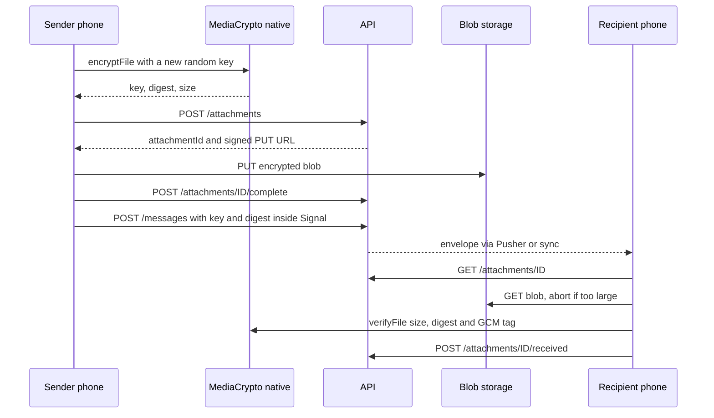
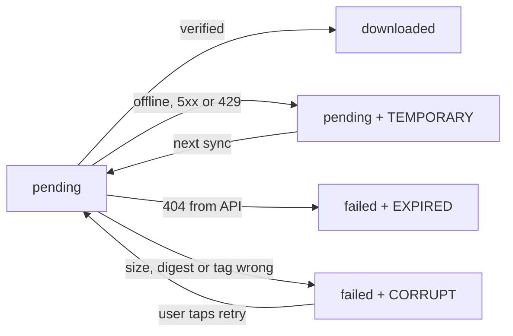

# 05. Encrypted media: photos, videos and voice notes

> **Status:** 🟡 Partially implemented — works end to end on Android (device-verified), but only the `local` storage driver exists and there is no iOS media encryption yet.
> Last reviewed against the code: 2026-10-12.

## Summary

Users can send photos, videos and voice notes in a 1:1 chat. The phone encrypts each file with
its own random key before anything leaves the phone. The server stores only the encrypted,
padded file (a "blob") and never gets the key. The key and a checksum (digest) travel to the
other person inside the normal end-to-end encrypted (E2EE) Signal message. On both phones the
file stays encrypted on disk. It is decrypted into a temporary file only while it is on screen
or playing.

## Status at a glance

| Part                                                        | Status         | Evidence                                                                                 |
| ----------------------------------------------------------- | -------------- | ---------------------------------------------------------------------------------------- |
| Send and receive photos, videos and voice notes (Android)   | ✅ Implemented | Device-verified 2026-10-11/12 (RMX2103 Android 11, RMX3851 Android 16, debug build)      |
| Streamed AES-256-GCM file encryption (native, Android)      | ✅ Implemented | Device-verified 2026-10-11/12; contract parity in `mediaUnits.test.js`                   |
| Attachments API (reserve, complete, download, received)     | ✅ Implemented | `apps/api/test/attachments.test.js` (29 cases)                                           |
| Size padding (`paddedAttachmentSize`)                       | ✅ Implemented | `packages/shared/test/attachments.test.js` (5 cases)                                     |
| Idempotent upload retries, automatic downloads, integrity   | ✅ Implemented | `apps/mobile/test/messaging.test.js` (17 media cases, two app instances, real libsignal) |
| Composer UI: picker, voice recorder, bubbles                | ✅ Implemented | `apps/mobile/test/mediaUi.test.js` (16 cases)                                            |
| Preview with caption and Send before anything is sent       | ✅ Implemented | `mediaUi.test.js`; not verified on a device yet (added 2026-10-12)                       |
| In-app camera (tap = photo, hold = video, flip, flash)      | ✅ Implemented | `mediaUi.test.js` with a camera double; not verified on a device yet (added 2026-10-12)  |
| Voice notes: hold to record, slide to cancel / lock, review | ✅ Implemented | `mediaUi.test.js`; not verified on a device yet (added 2026-10-12)                       |
| Voice-note waveform, seek, 1× / 1.5× / 2× speed             | ✅ Implemented | `mediaUi.test.js`, `mediaUnits.test.js`; not verified on a device yet (added 2026-10-12) |
| Full-screen viewer with screenshot blocking                 | ✅ Implemented | Not covered by a dedicated test; not verified on a device                                |
| Retention sweep (blob first, then metadata)                 | ✅ Implemented | `attachments.test.js` (retention section)                                                |
| `local` storage driver                                      | ✅ Implemented | `attachments.test.js` (signed URLs section)                                              |
| S3 / Cloudflare R2 storage driver                           | ⏳ Pending     | Not built (needs approval)                                                               |
| Media on iOS                                                | ⏳ Pending     | `modules/media-crypto` has an Android implementation only                                |
| Video thumbnails, documents                                 | ⏳ Pending     | Listed under "Not in v1" in ARCHITECTURE.md §12                                          |

## How it works

**Sending**

1. The user taps the attach button (system photo picker) or holds the microphone button
   (voice note). The picker or recorder writes a **plaintext copy** into the app cache
   (`cache/ImagePicker` or `cache/Audio`).
2. `prepareAttachment()` checks the type (image, video or audio) and the size (1 byte to
   100 MiB). It then calls the native `MediaCrypto.encryptFile()`.
3. The native module creates a new random 32-byte key and 12-byte nonce, removes GPS EXIF tags
   from JPEG photos, pads the plaintext with zeros to a size bucket, and encrypts it with
   libsignal's AES-256-GCM in 64 KiB chunks. The blob goes to `files/attachments/<uuid>.bin`.
   It returns the key, the SHA-256 digest of the blob, the real size and the blob size.
4. The plaintext copy in the cache is deleted (always, also on failure).
5. The message row and the attachment row (with key and digest) are written in **one SQLCipher
   transaction**. The bubble appears with status `sending`.
6. Delivery (`attemptDelivery` in `signalService.js`) first calls `ensureUploaded()`:
   - `POST /attachments` with `clientAttachmentId`, `recipientUserId` and the blob size. The
     API answers with an `attachmentId` and a pre-signed upload URL (valid 15 min).
   - The blob is uploaded with a native, streamed `PUT` (expo-file-system `UploadTask`).
   - `POST /attachments/:id/complete`. The API accepts only if storage holds exactly the
     declared number of bytes.
7. Only then is the Signal message built. Its content is `attachment` v1:
   `{ id, key, digest, size, contentType, width?, height?, durationMs?, voiceNote?, caption? }`.
   It is encrypted and sent like a text message (outbox, `clientMessageId` dedupe).

**Receiving**

1. The envelope arrives through Pusher or HTTPS sync and is decrypted as usual. The phone
   stores an attachment row in state `pending` with the key and digest.
2. After each sync and each realtime envelope, `downloadPendingAttachments()` fetches pending
   attachments, oldest first (up to 20 per run). It stops at the first temporary failure.
3. `GET /attachments/:id` returns a pre-signed download URL. The blob is downloaded natively to
   a `.part` file. The download is aborted if it grows beyond the expected size.
4. `MediaCrypto.verifyFile()` checks size, SHA-256 digest and GCM tag **without writing any
   plaintext**. Only then is the `.part` file renamed to `<uuid>.bin` and the row set to
   `downloaded`.
5. `POST /attachments/:id/received` (best effort) tells the server it can delete its copy
   sooner.

**Viewing**

1. A photo bubble decrypts the image into `cache/secure-media/` while the bubble is mounted.
   Videos and voice notes are decrypted only when the user plays them.
2. The temporary file is deleted when the bubble unmounts, when the viewer closes, every time
   the app goes to the background, at every start (crash recovery) and at sign-out.



States of an incoming attachment on the phone:



**Blob format** (same in Kotlin, the Node test double and `packages/shared`):

```
blob   = nonce (12 bytes) || AES-256-GCM(key, nonce, aad, plaintext || zero padding) || tag (16 bytes)
aad    = "SecureChat attachment v1"
digest = SHA-256(blob)
padded = paddedAttachmentSize(size): at least 1 KiB, 16 buckets per power of two (≤ 6.25 % larger)
```

### Composer changes (2026-10-12)

- **Preview before sending.** A photo or video from the picker or the camera opens a full-screen
  preview (`MediaPreview.js`) with a caption box and a Send button. Nothing is encrypted or
  uploaded until Send. Close (or Back) deletes the app's own copy (picker or camera cache).
- **In-app camera** (`CameraCapture.js`, `expo-camera`). Tap the shutter for a photo; hold it to
  record a video (the camera switches to video mode, records while held, stops on release, at
  most 180 s, 720p); flip front/back; flash for photos. Files are written only to the app's
  private `cache/Camera` and swept at start like the picker's copies. The barcode scanner (ML
  Kit) is disabled in the build. The camera closes when a call starts or the app leaves the
  screen.
- **Voice notes, WhatsApp style** (`VoiceComposer.js`, `useVoiceRecorder.js`). Hold the mic to
  record and release to send; slide left to cancel; slide up to lock (hands-free). When locked,
  Stop opens a review bar to listen first, then Send or Delete. A quick tap records nothing and
  shows "Hold to record, release to send".
- **Waveform** (`media/waveform.js`). While recording, the microphone level is sampled every
  100 ms (expo-audio metering) and compressed into at most 48 bars, one base64url digit each.
  It travels as the optional `waveform` field of the encrypted `attachment` content and is
  stored in `attachments.waveform` (migration 10). Older notes show flat bars.
- **Voice bubble.** Play/pause, the waveform (tap or drag to seek, a dot marks the position),
  the time, and a 1× / 1.5× / 2× speed button while playing.

## Packages and versions

| Package                                       | Declared                                                                    | Installed | Used for                                                |
| --------------------------------------------- | --------------------------------------------------------------------------- | --------- | ------------------------------------------------------- |
| `org.signal:libsignal-android` (media-crypto) | `0.105.0` (`modules/media-crypto` gradle)                                   | 0.105.0   | `Aes256GcmEncryption` / `Aes256GcmDecryption`, streamed |
| `expo-file-system`                            | not in `apps/mobile/package.json` (comes with `expo`, which pins `~57.0.7`) | 57.0.7    | Native streamed upload/download tasks, file paths       |
| `expo-image-picker`                           | `~57.0.20`                                                                  | 57.0.20   | System photo picker (one photo or video)                |
| `expo-audio`                                  | `~57.0.5`                                                                   | 57.0.5    | Voice-note recording and playback                       |
| `expo-video`                                  | `~57.0.5`                                                                   | 57.0.5    | Video playback in the full-screen viewer                |
| `expo-screen-capture`                         | `~57.0.4`                                                                   | 57.0.4    | Blocks screenshots while the viewer is open             |
| `expo-crypto`                                 | `~57.0.3`                                                                   | 57.0.3    | `randomUUID()` for file names and `clientAttachmentId`  |
| `zustand`                                     | `^5.0.15`                                                                   | 5.0.15    | `useMediaStore` (UI refresh, plaintext generation)      |
| `mongoose` (API)                              | `^8.18.0`                                                                   | 8.24.5    | `attachments` collection                                |
| `express` (API)                               | `^5.1.0`                                                                    | 5.2.1     | Routes, `/blobs` router of the `local` driver           |
| `rate-limiter-flexible` (API)                 | `^11.2.1`                                                                   | 11.2.1    | Upload count and MiB budget per user                    |
| `zod`                                         | API/shared `^4.1.0`, mobile `^4.6.5`                                        | 4.6.5     | Request and content schemas                             |

## Source files

**API**

- [attachments.routes.js](../apps/api/src/modules/attachments/attachments.routes.js) — the four endpoints and their strict request schema (no key, type or name field).
- [attachmentService.js](../apps/api/src/modules/attachments/attachmentService.js) — reserve, complete, download, received, sweep, account-deletion expiry.
- [Attachment.js](../apps/api/src/models/Attachment.js) — Mongo schema, retention constants, indexes.
- [services/storage/index.js](../apps/api/src/services/storage/index.js) — storage driver interface and factory.
- [services/storage/local.js](../apps/api/src/services/storage/local.js) — `local` driver: disk storage and HMAC-signed `/blobs` URLs.
- [app.js](../apps/api/src/app.js) — mounts `/attachments` and the `/blobs` router.
- [server.js](../apps/api/src/server.js) — starts/stops the sweeper; warns about `local` in production.
- [accountService.js](../apps/api/src/modules/account/accountService.js) — expires attachments at account deletion.

**Mobile**

- [media/attachmentService.js](../apps/mobile/src/media/attachmentService.js) — prepare, upload, download, open (decrypt), cleanup.
- [media/attachmentStore.js](../apps/mobile/src/media/attachmentStore.js) — SQLCipher `attachments` rows and states.
- [media/mediaFiles.js](../apps/mobile/src/media/mediaFiles.js) — where files live; sweeps and wipe.
- [media/transfer.js](../apps/mobile/src/media/transfer.js) — streamed upload/download through pre-signed URLs.
- [components/media/AttachmentContent.js](../apps/mobile/src/components/media/AttachmentContent.js) — bubble content: photo, video tile, voice note player, transfer state.
- [components/media/MediaViewer.js](../apps/mobile/src/components/media/MediaViewer.js) — full-screen viewer.
- [components/media/useDecryptedMedia.js](../apps/mobile/src/components/media/useDecryptedMedia.js) — decrypt while shown, release on unmount/background.
- [components/media/useVoiceRecorder.js](../apps/mobile/src/components/media/useVoiceRecorder.js) — voice-note recording rules.
- [components/media/pickMedia.js](../apps/mobile/src/components/media/pickMedia.js) — photo picker and MIME type detection.
- [messaging/content.js](../apps/mobile/src/messaging/content.js) — `attachment` v1 content schema.
- [crypto/signalService.js](../apps/mobile/src/crypto/signalService.js) — `enqueueAttachment`, upload before Signal encryption, incoming rows.
- [messaging/messagingEngine.js](../apps/mobile/src/messaging/messagingEngine.js) — `sendAttachment`, download trigger, background/start cleanup.
- [db/migrations.js](../apps/mobile/src/db/migrations.js) — migration v8 (`attachments` table).
- [chat/\[peerUserId\].js](<../apps/mobile/src/app/(app)/chat/[peerUserId].js>) — composer (attach, record) and viewer.

**Native module**

- [MediaCryptoModule.kt](../apps/mobile/modules/media-crypto/android/src/main/java/expo/modules/mediacrypto/MediaCryptoModule.kt) — `encryptFile`, `verifyFile`, `decryptFile`, path checks, GPS stripping.
- [media-crypto/index.js](../apps/mobile/modules/media-crypto/index.js) — JS entry; throws on platforms without the module.
- [media-crypto build.gradle](../apps/mobile/modules/media-crypto/android/build.gradle) — libsignal dependency.

**Shared**

- [constants.js](../packages/shared/src/constants.js) — `ATTACHMENT` limits, `paddedAttachmentSize`, `encryptedAttachmentSize`, error codes.
- [validation.js](../packages/shared/src/validation.js) — `clientAttachmentIdSchema`, `encryptedAttachmentSizeSchema`.

## API endpoints

All `/attachments` routes need a valid access token (JWT) and a live session, and count toward
the general limit of 120 requests/min per user.

| Method | Path                         | Auth                        | Purpose                                                                                     | Rate limit                                                |
| ------ | ---------------------------- | --------------------------- | ------------------------------------------------------------------------------------------- | --------------------------------------------------------- |
| `POST` | `/attachments`               | JWT                         | Reserve an upload slot (201) or return the same slot for a retry. Returns a signed PUT URL. | 30/min per user · 2 048 MiB/h per user (new uploads only) |
| `POST` | `/attachments/:id/complete`  | JWT, uploading device only  | Mark uploaded if storage holds exactly the declared bytes. Idempotent.                      | —                                                         |
| `GET`  | `/attachments/:id`           | JWT, uploader or recipient  | Signed download URL (15 min). Others get the same 404 as a missing id.                      | —                                                         |
| `POST` | `/attachments/:id/received`  | JWT, recipient only         | Shorten server retention to 7 days from now (204).                                          | —                                                         |
| `PUT`  | `/blobs/:storageKey?exp&sig` | Signed URL, no bearer token | `local` driver only: upload exactly the signed number of bytes.                             | —                                                         |
| `GET`  | `/blobs/:storageKey?exp&sig` | Signed URL, no bearer token | `local` driver only: stream the blob.                                                       | —                                                         |

Request body of `POST /attachments` (strict, any extra field is rejected with 400):
`{ clientAttachmentId: UUID v4, recipientUserId: ObjectId, size: 1..encryptedAttachmentSize(100 MiB) }`.

## Data storage

### MongoDB

Collection `attachments` (one document per uploaded blob). **No media key, no content type,
no file name, no real size.**

| Field                                | Meaning                                          |
| ------------------------------------ | ------------------------------------------------ |
| `uploaderUserId`, `uploaderDeviceId` | Who uploaded                                     |
| `recipientUserId`                    | The only other user who may download             |
| `clientAttachmentId`                 | Uploader's idempotency key                       |
| `storageKey`                         | 32 random bytes (hex); never derived from any id |
| `size`                               | Size of the encrypted, padded blob               |
| `status`                             | `pending` or `uploaded`                          |
| `uploadedAt`, `downloadedAt`         | Times                                            |
| `expiresAt`                          | When the sweep may delete it                     |
| `createdAt`                          | Mongoose timestamp                               |

Indexes: unique `(uploaderDeviceId, clientAttachmentId)`, unique `storageKey`, `expiresAt`,
`recipientUserId`. There is **no TTL index**: the sweep deletes the blob first, then the
document, so a blob never outlives its metadata.

Retention (`ATTACHMENT_RETENTION`):

| Situation                   | `expiresAt`                                                                     |
| --------------------------- | ------------------------------------------------------------------------------- |
| Reserved, never completed   | 24 h after creation                                                             |
| Upload completed            | 30 days after completion                                                        |
| Recipient confirmed receipt | min(current value, now + 7 days)                                                |
| Account deletion            | Now, for attachments sent **to** the user and the user's own unfinished uploads |

The sweeper runs every `ATTACHMENT_SWEEP_INTERVAL_SECONDS` (up to 500 documents per run) and
once right after an account deletion.

### Redis

Only rate-limit counters: `rl:attachmentCreatePerUser:{userId}` (60 s window) and
`rl:attachmentMegabytesPerUser:{userId}` (1 h window). No attachment data.

### Attachment storage (`local` driver)

Files named `<storageKey>` under `ATTACHMENT_STORAGE_DIR`. Uploads are written to a random
`.part` file and renamed when complete, so a blob is either absent or complete.

### On the phone

- `attachments.waveform` (migration 10): the voice-note waveform string, or NULL.
- `cache/Camera`: photos and videos from the in-app camera until encrypted or discarded.

- **SQLCipher table `attachments`** (migration v8), one row per message: `message_id`,
  `direction`, `kind` (`image`/`video`/`audio`), `voice_note`, `content_type`,
  `attachment_id`, `client_attachment_id`, `media_key`, `digest`, `size` (real size),
  `width`, `height`, `duration_ms`, `file_name`, `state`, `error`, `updated_at`.
  States: outgoing `encrypted` → `uploaded`; incoming `pending` → `downloaded` or `failed`.
- **Files** (app-private internal storage only; `allowBackup` is `false`):

| Location                            | Holds                                                              |
| ----------------------------------- | ------------------------------------------------------------------ |
| `files/attachments/<uuid>.bin`      | Encrypted blobs (same bytes as uploaded). Kept with the chat.      |
| `files/attachments/<uuid>.bin.part` | A download that is not verified yet                                |
| `cache/secure-media/`               | Plaintext, only while viewed or played                             |
| `cache/ImagePicker`, `cache/Audio`  | Picker copy / fresh recording, deleted once encrypted or discarded |

- **SecureStore:** not used by media (the SQLCipher key protects the media keys).

## Security measures

- **No custom cryptography.** AES-256-GCM is libsignal's incremental implementation; SHA-256
  and the key/nonce random generator are the platform's (`MessageDigest`, `SecureRandom`).
- **One key and one nonce per file.** The key reaches the recipient only inside the Signal
  message. The server never sees it.
- **Integrity.** The digest of the blob travels in the Signal message, so the server cannot
  swap or truncate a blob. Downloads are checked for exact size, digest and GCM tag before the
  file is kept. Comparison uses `MessageDigest.isEqual` (constant time).
- **Size hiding.** Padding to `paddedAttachmentSize` hides the exact size from the server.
- **Plaintext never enters JavaScript.** Encryption and decryption stream file-to-file in
  native code, 64 KiB at a time (a 100 MiB video never has to fit in memory).
- **Path restriction.** `MediaCryptoModule.privateFile()` refuses any path outside the app's
  `filesDir`/`cacheDir` (`ERR_MEDIA_PATH`). Canonical paths are used, so `..` tricks fail.
- **No storage permissions.** `app.json` blocks `READ/WRITE_EXTERNAL_STORAGE`,
  `READ_MEDIA_*` and `ACCESS_MEDIA_LOCATION`. The system photo picker hands over one copy.
- **Location.** GPS EXIF tags are removed from JPEG copies before encryption. If removal
  fails, the photo is not sent. The picker is called with `exif: false`.
- **Server-side checks.** Strict request schema (no key/type/name fields), self-send refused,
  recipient must exist, retries with a different recipient or size are refused (409),
  download only by uploader or recipient, only after completion, only before expiry.
- **Signed URLs (`local`).** HMAC-SHA256 over operation, storage key, expiry and (for uploads)
  exact size, with a random per-process key. Compared with `timingSafeEqual`. A `GET` URL
  cannot upload and a `PUT` URL cannot download. `Content-Length` must match, and extra bytes
  are refused (413).
- **Transport.** Relative URLs belong to the API; absolute transfer URLs must pass the same
  https check as the API URL in release builds (`isAllowedApiUrl`).
- **Bounded downloads.** A download larger than expected is aborted, so a bad server cannot
  fill the phone's storage.
- **Logs.** Request logs keep only the path without the query string, so signatures are never
  logged (tested).
- **Viewer.** No share, save or "open with". Screenshots and recording are blocked while the
  full-screen viewer is open, and it closes when the app leaves the screen. Locked chats also
  block capture through `ChatLockGate` (see [09-chat-lock.md](09-chat-lock.md)).
- **Cleanup.** Plaintext is deleted on release/unmount, on every background, at start
  (`cleanUpMediaFiles` also removes `.part` files and blobs no row refers to) and at sign-out
  (`wipeAllMedia`).

## Error handling

| Situation                                             | Error code / behaviour                                             | What the user sees                                                    |
| ----------------------------------------------------- | ------------------------------------------------------------------ | --------------------------------------------------------------------- |
| File over 100 MiB                                     | `MEDIA_TOO_LARGE` (also from native `ERR_MEDIA_SIZE`)              | Alert "Can't send": "Files up to 100 MB can be sent"                  |
| Type is not image/video/audio                         | `MEDIA_UNSUPPORTED`                                                | Alert "This kind of file cannot be sent"                              |
| Picked file missing or empty                          | `MEDIA_UNAVAILABLE`                                                | Alert with the reason                                                 |
| Encryption failed                                     | `FAILED`; partial blob deleted                                     | Alert "The file could not be encrypted"                               |
| Network trouble during upload                         | `NetworkError` → message `failed` with `TEMPORARY`                 | Failed bubble; the next sync retries with the same attachment         |
| `complete` answers 409 `ATTACHMENT_INCOMPLETE`        | Treated as a network error; the bytes are uploaded again next time | Same as above                                                         |
| Signed URL expired (403), 408, 429 or 5xx on transfer | Retryable `NetworkError`                                           | Retried automatically                                                 |
| Other transfer status                                 | `ApiError` `TRANSFER_REJECTED`                                     | Failed bubble                                                         |
| Reused `clientAttachmentId` with other recipient/size | 409 `VALIDATION_ERROR`                                             | Failed bubble                                                         |
| Sending to yourself / unknown recipient               | 400 `VALIDATION_ERROR` / 404 `NOT_FOUND`                           | Failed bubble                                                         |
| Upload budget or rate limit hit                       | 429 `RATE_LIMITED` (503 if Redis is down)                          | Failed bubble, retried later                                          |
| Download: attachment expired or not visible           | 404 `ATTACHMENT_NOT_FOUND` → `failed` + `EXPIRED`, never retried   | "Photo no longer available"                                           |
| Download: offline or server trouble                   | `pending` + `TEMPORARY`; queue stops                               | "… · waiting for connection"                                          |
| Download: wrong size, digest or tag                   | `ERR_MEDIA_INTEGRITY` / `TransferSizeError` → `failed` + `CORRUPT` | "… was damaged · tap to retry"                                        |
| Decrypt for viewing fails                             | `CORRUPT` or `FAILED`                                              | "This media could not be opened" / "Couldn't play this voice message" |
| iOS or a build without the module                     | `getMediaCrypto()` throws inside `prepareAttachment` → `FAILED`    | Alert "The file could not be encrypted"                               |
| Recording during a call                               | Not started                                                        | "You can't record a voice message during a call."                     |
| Microphone permission refused                         | Not started                                                        | Hint; "Turn it on in Settings" if Android will not ask again          |
| Voice note under 1 s                                  | Recording deleted                                                  | "Voice message too short."                                            |

## Configuration

API environment variables (validated in `apps/api/src/config/env.js`, template
`apps/api/.env.example`):

| Variable                            | Default              | Notes                                            |
| ----------------------------------- | -------------------- | ------------------------------------------------ |
| `ATTACHMENT_STORAGE`                | `local`              | Only `local` is accepted today                   |
| `ATTACHMENT_STORAGE_DIR`            | `./data/attachments` | Must be a persistent disk; one API instance only |
| `ATTACHMENT_SWEEP_INTERVAL_SECONDS` | `600`                | 0 to 86 400; `0` disables the periodic sweep     |

Fixed constants (`packages/shared` `ATTACHMENT`): max file 100 MiB, URL lifetime 15 min,
longest voice note 15 min, minimum padded size 1 KiB.

`apps/mobile/app.json`:

- Plugins: `expo-image-picker` (photos permission text), `expo-audio`
  (`microphonePermission`, `enableBackgroundPlayback: false`, `enableBackgroundRecording: false`),
  `expo-video`.
- `android.blockedPermissions` includes all external-storage and `READ_MEDIA_*` permissions and
  `ACCESS_MEDIA_LOCATION`. `android.allowBackup` is `false`.
- The local module `modules/media-crypto` declares only the `android` platform.

Voice-note recording preset: AAC in MP4 (`.m4a`), mono, 44.1 kHz, 64 kbit/s.

## Testing status

- **Automated:**
  - `apps/api/test/attachments.test.js` (29): upload → complete → download; request validation
    (no key/type/name, size cap, self/unknown recipient, auth); retries and races; signed URLs
    (tampering, expiry, exact bytes, wrong operation, interrupted upload); authorization;
    retention, sweep and account deletion; MiB budget; no signatures in logs.
  - `packages/shared/test/attachments.test.js` (5): padding buckets, integer math, schemas.
  - `apps/mobile/test/messaging.test.js`, block "photos, videos and voice notes" (17), plus one
    test for an unsupported type (PDF placeholder): end-to-end between two app instances with
    real libsignal; private-storage only; path refusal; JPEG GPS stripping; idempotent upload
    retry; held while a security code is undecided; offline retry; tampered and oversize
    downloads; expired attachment; wrong key; voice note and video; size/type refusal;
    background wipe; start-up cleanup after a kill; sign-out wipe.
  - `apps/mobile/test/mediaUi.test.js` (9): voice note record/send/cancel/too short/leave chat,
    microphone refused, no recording during a call; attach photo with caption; cancelled
    picker; photo bubble decrypts only while shown.
  - `apps/mobile/test/mediaUnits.test.js` (16): transfer URL rules, cache-path checks, safe
    plaintext names, MIME kinds and extensions, and parity between the Kotlin module and the
    Node test double (functions, AAD, sizes, padding formula, path refusal).
  - Note: the mobile tests use a Node implementation of the MediaCrypto contract
    (`test/mocks/mediaCryptoMock.js`, Node AES-256-GCM). The Kotlin code itself runs only on a
    device.
- **Device testing:** sending and receiving encrypted photos, videos and voice notes between
  two Android phones (RMX2103 Android 11, RMX3851 Android 16, debug build), 2026-10-11/12.
- **Not tested yet:**
  - Release build with media (needs an https API URL).
  - The 100 MiB limit and very large videos on a real device.
  - Screenshot blocking in the full-screen viewer on a device.
  - Server-side sweep on a long-running deployment.
  - Any iOS behaviour.

## Known limitations and pending work

- **Only the `local` storage driver.** It stores blobs on the API host's disk and signs URLs
  with a per-process random key. It supports **one API instance** only; a restart makes open
  URLs invalid (the phone asks for new ones). An S3-compatible driver (Cloudflare R2 or S3)
  with a bucket lifecycle rule is designed but not built and needs approval.
- **No iOS implementation** of `modules/media-crypto`. On iOS, sending or opening media fails.
- **Metadata visible to the server:** that an attachment exists, who sent it to whom, when,
  and its size bucket.
- **Container metadata** in videos and audio (for example an MP4 location atom) is not
  stripped. Only JPEG GPS tags are removed: the stripper runs only when the content type is
  `image/jpeg`.
- **Screenshots** are blocked in the full-screen viewer and in locked chats, not in ordinary
  chat bubbles. Recipients can still photograph the screen.
- **No** video thumbnails, documents/other file types, camera capture from the chat, or
  multi-select.
- ARCHITECTURE.md §7.10 says voice-note playback also pauses on audio-focus loss. The app code
  pauses for calls, for another voice note and when leaving the app; any audio-focus handling
  would be inside expo-audio and is **not verified**.
- `expo-file-system` is imported directly by the app but is not listed in
  `apps/mobile/package.json`; it is installed as a dependency of `expo`.

## Related documents

- [03-end-to-end-encryption.md](03-end-to-end-encryption.md) — Signal content format v1 (`attachment` type).
- [04-one-to-one-messaging.md](04-one-to-one-messaging.md) — outbox, retries, sync that drive uploads and downloads.
- [07-local-database-encryption.md](07-local-database-encryption.md) — SQLCipher and migration v8.
- [09-chat-lock.md](09-chat-lock.md) — gate and screenshot blocking around chats.
- [12-crash-recovery.md](12-crash-recovery.md) — media plaintext cleanup and attachment resume/sweep.
- [15-account-and-device-management.md](15-account-and-device-management.md) — what account deletion removes.
- ARCHITECTURE.md: [§4 Trust boundaries](ARCHITECTURE.md#4-trust-boundaries-who-sees-what),
  [§5.3 API surface](ARCHITECTURE.md#53-api-surface),
  [§5.4 Data model](ARCHITECTURE.md#54-data-model-mongodb),
  [§6.4 On-device storage](ARCHITECTURE.md#64-on-device-storage),
  [§7.10 Photos, videos and voice notes](ARCHITECTURE.md#710-photos-videos-and-voice-notes-phase-10),
  [§10 Data retention](ARCHITECTURE.md#10-data-retention),
  [§12 Phase 10](ARCHITECTURE.md#phase-10--encrypted-photos-videos-and-voice-notes-2026-10-11-uncommitted),
  [§13 Known limitations](ARCHITECTURE.md#13-known-limitations-and-risks).
