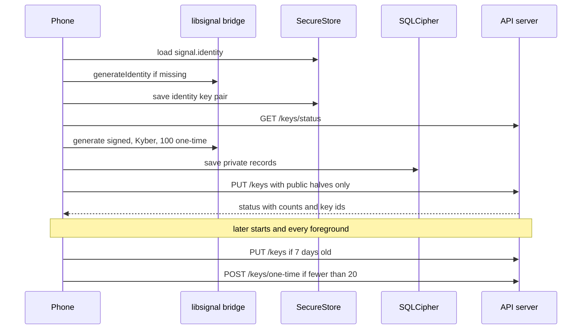
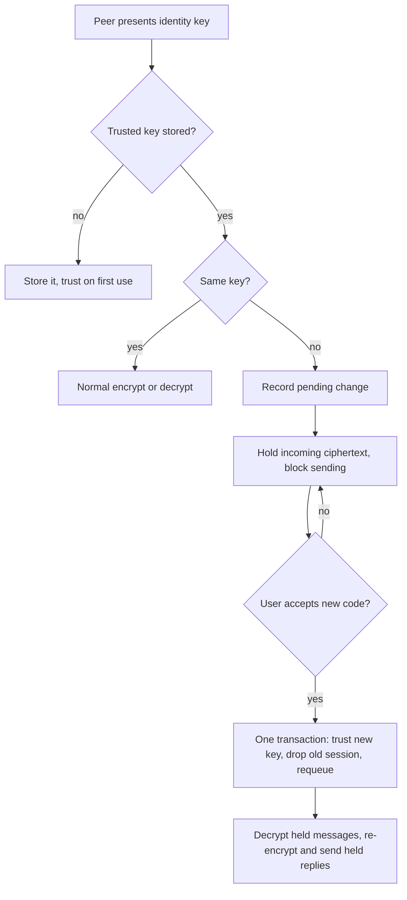

# 06. Key management

> **Status:** ✅ Implemented — keys are generated on the phone, only public halves are uploaded, pre-keys are topped up and rotated, and identity-key changes are held until the user accepts them; a security-code change was tested on two phones, 7-day rotation was not.
> Last reviewed against the code: 2026-10-12.

## Summary

Each phone creates its own Signal keys with libsignal. Private keys never leave the phone. The
phone uploads only the **public** halves to the API, so other users can start an encrypted chat
with it. The app keeps enough one-time pre-keys on the server, replaces its signed and Kyber
pre-keys every 7 days, and deletes old private keys later. If a contact's identity key changes,
the app does not trust the new key silently. It shows a "Security code changed" warning and holds
messages until the user compares and accepts the new 60-digit security code.

## Status at a glance

| Part                                                                        | Status         | Evidence                                                                                                                 |
| --------------------------------------------------------------------------- | -------------- | ------------------------------------------------------------------------------------------------------------------------ |
| Identity key pair + registration id, created on the phone                   | ✅ Implemented | `apps/mobile/test/e2ee.test.js` ("keeps the identity key pair in SecureStore, not in the database")                      |
| Signed EC pre-key + Kyber pre-key, signed by the identity key               | ✅ Implemented | `apps/api/test/keys.test.js`, `apps/mobile/test/e2ee.test.js`                                                            |
| One-time pre-keys: 100 per batch, ≤ 200 on the server, top-up below 20      | ✅ Implemented | `keys.test.js` ("adds pre-keys up to the cap"), `apps/mobile/test/messaging.test.js` (key maintenance on foreground)     |
| Upload of public keys only (strict schemas)                                 | ✅ Implemented | `keys.test.js` ("rejects unknown fields such as a private key"), `e2ee.test.js` (API and mobile)                         |
| Identity key fixed until the next OTP login                                 | ✅ Implemented | `keys.test.js` ("refuses to replace a registered identity key", "a fresh OTP login on the same install allows new keys") |
| Bundle fetch hands out each one-time pre-key once; works with an empty pool | ✅ Implemented | `keys.test.js`                                                                                                           |
| Bundle fetch rate limit (30/min per user)                                   | ✅ Implemented | `keys.test.js` ("rate limits bundle fetches")                                                                            |
| Signed/Kyber rotation every 7 days; old private keys deleted after 35 days  | ✅ Implemented | `apps/mobile/test/e2ee.test.js` (rotation block, 4 tests)                                                                |
| Key setup retries when offline (backoff, network, foreground)               | ✅ Implemented | `apps/mobile/test/signalSetup.test.js`                                                                                   |
| Identity-key change: detect, hold, show, accept                             | ✅ Implemented | `apps/mobile/test/messaging.test.js` (security-code block, 12 tests); not verified on a device                           |
| Security code screen (60 digits)                                            | ✅ Implemented | `messaging.test.js` ("same 60 digits on both phones"); not verified on a device                                          |
| iOS key generation (Swift bridge)                                           | 🟡 Partial     | Written; not compiled, not verified on a device                                                                          |
| Multi-device keys                                                           | ⏳ Pending     | Not in v1 (`signalDeviceId` = 1)                                                                                         |

## How it works

**Registration and maintenance**

1. After sign-in, the signed-in layout runs `useSignalSetup()`. It calls
   `ensureKeysRegistered()`. Concurrent callers share one run (single-flight). Messaging starts
   only after this succeeds.
2. `ensureIdentity()` loads `signal.identity` from SecureStore. If there is none, it calls the
   bridge `generateIdentity` and saves the identity key pair + registration id.
3. The app asks the server `GET /keys/status`.
4. **Not registered yet** (first start, or after a new OTP login):
   - generate a signed EC pre-key and a Kyber pre-key, each with a random unused key id,
     and save both private records in SQLCipher in one transaction;
   - generate 100 one-time pre-keys and save the private records;
   - send `PUT /keys` with `registrationId`, `identityKey`, the public signed and Kyber pre-keys
     (with signatures), and the 100 public one-time pre-keys.
5. **Already registered:**
   - rotate the signed and Kyber pre-keys if the newest is 7 days old or older, or if the
     server serves other key ids than this phone's newest ones (an earlier upload failed). The
     new public keys go up with `PUT /keys` (same identity key). A failure here is ignored and
     retried next time; current keys stay valid;
   - delete replaced private signed/Kyber keys whose replacement is older than 35 days, but
     never the key the server currently serves;
   - if the server holds fewer than 20 one-time pre-keys, generate 100 more and send
     `POST /keys/one-time`.
6. If setup fails with a network error, 5xx or 429, it retries after 2, 5, 10, then every 30
   seconds, and also at once when the network comes back or the app returns to the foreground.
   Other errors are not retried.
7. Every time the app returns to the foreground, the messaging engine runs
   `ensureKeysRegistered()` again (best effort), so phones that stay open for days still rotate
   and top up.

**Starting a session with a peer**

8. When a phone has no session with a peer, it calls `GET /keys/bundle/:userId`. The server
   picks that user's newest active device with keys and atomically removes one one-time
   pre-key (`findOneAndDelete`, lowest `keyId` first). If the pool is empty, the bundle has
   `oneTimePreKey: null` and libsignal uses the signed + Kyber pre-keys only.
9. When the peer later decrypts the first message (a PreKey message), it deletes the matching
   one-time private key from its SQLCipher database in the same transaction as the message.

### Key types

| Key                         | Algorithm                                             | Private half                  | Public half                     | Lifetime                                                     |
| --------------------------- | ----------------------------------------------------- | ----------------------------- | ------------------------------- | ------------------------------------------------------------ |
| Identity key pair           | Curve25519 (libsignal `IdentityKeyPair`)              | SecureStore `signal.identity` | `devices.signal.identityKey`    | Until logout / new OTP login                                 |
| Registration id             | Random number 1–16380                                 | SecureStore (with identity)   | `devices.signal.registrationId` | Same as identity                                             |
| Signed pre-key              | EC, signed by identity                                | `signal_signed_prekeys`       | `devices.signal.signedPreKey`   | Rotated every 7 days; private kept 35 days after replacement |
| Kyber pre-key (last resort) | Kyber-1024 (Android `KYBER_1024`), signed by identity | `signal_kyber_prekeys`        | `devices.signal.kyberPreKey`    | Same as signed pre-key                                       |
| One-time pre-keys           | EC                                                    | `signal_prekeys`              | `onetimeprekeys` collection     | Until used once                                              |

**Key ids.** Pre-key ids are 24-bit (1 to `0xFFFFFF`). Signed and Kyber ids are random and
never reuse an id still stored locally. One-time ids are sequential from a random start,
remembered in `sync_state.next_prekey_id`, and wrap to 1 at the maximum.

### Identity-key change and the security code

A peer's identity key changes when they reinstall or sign in again (logout deletes local keys,
and a new login clears the server keys).

- **Trust on first use.** The first identity key seen for an address (`userId.1`) is stored in
  `signal_identities` and never silently overwritten.
- **Outgoing.** The bridge seeds libsignal with the trusted key. If a fetched bundle has a
  different key, libsignal refuses it (`UNTRUSTED_IDENTITY`). The app records a `pending` row in
  `identity_changes` and blocks sending to that peer (nothing is uploaded or encrypted).
- **Incoming.** If a PreKey message claims a different key, the ciphertext stays in
  `message_envelopes` with status `identity_pending`, a placeholder message is shown, and no
  read receipt can be sent for it.
- **At most one pending change per peer** (unique index). A newer key updates the pending row.
- **Showing the code.** `getSecurityCode()` calls the bridge `securityCode` with both user ids
  and both identity public keys (5,200 iterations, version 2). Both phones get the same 60
  digits. The screen shows them as 12 groups of 5. While a change is pending, the code is for
  the **new** key.
- **Accepting.** The user taps "Accept new security code" and confirms. `acceptIdentityChange()`
  runs only if the pending key is still the one shown. In one transaction it: makes the new key
  trusted, deletes the old session and cached peer device, deletes outbox ciphertext for that
  peer, marks the change `accepted`, and re-queues the held envelopes. Then held messages are
  decrypted and held outgoing messages are encrypted again and sent.
- **Calls.** While a change is pending, an outgoing call is not placed and an incoming call
  cannot be answered ([10-voice-video-calls.md](10-voice-video-calls.md)).

## Packages and versions

| Package                                                     | Declared   | Installed                         | Used for                                            |
| ----------------------------------------------------------- | ---------- | --------------------------------- | --------------------------------------------------- |
| `org.signal:libsignal-android` (Gradle)                     | `0.105.0`  | `0.105.0` (pinned)                | Key generation, signatures, security code (Android) |
| `LibSignalClient` (CocoaPods, git tag)                      | `v0.105.0` | Not installed (iOS build not run) | Same on iOS                                         |
| `@signalapp/libsignal-client` (devDependency, API + mobile) | `0.105.0`  | `0.105.0`                         | Real keys in tests                                  |
| `expo-secure-store`                                         | `~57.0.4`  | `57.0.4`                          | Identity key pair storage                           |
| `mongoose` (API)                                            | `^8.18.0`  | `8.24.5`                          | `devices`, `onetimeprekeys`                         |
| `zod` (shared / API)                                        | `^4.1.0`   | `4.6.5` (hoisted)                 | Key upload validation                               |

## Source files

**API**

- [keys.routes.js](../apps/api/src/modules/keys/keys.routes.js) — routes and strict body schemas.
- [keyService.js](../apps/api/src/modules/keys/keyService.js) — register, top up, status, bundle, reset.
- [Device.js](../apps/api/src/models/Device.js) — `signal` sub-document with public keys.
- [OneTimePreKey.js](../apps/api/src/models/OneTimePreKey.js) — public one-time pre-key pool.
- [authService.js](../apps/api/src/modules/auth/authService.js) — clears the device keys at every OTP login (`resetDeviceKeys`).
- [deviceService.js](../apps/api/src/modules/devices/deviceService.js) — deletes one-time pre-keys of a revoked device.
- [accountService.js](../apps/api/src/modules/account/accountService.js) — deletes one-time pre-keys at account deletion.
- [rateLimit.js](../apps/api/src/middleware/rateLimit.js) — `bundleFetchPerUser` (30/min).

**Mobile**

- [signalService.js](../apps/mobile/src/crypto/signalService.js) — `ensureKeysRegistered`, rotation, `establishSession`, `getSecurityCode`, `acceptIdentityChange`.
- [signalStore.js](../apps/mobile/src/crypto/signalStore.js) — key storage, pruning, identity changes.
- [useSignalSetup.js](../apps/mobile/src/crypto/useSignalSetup.js) — runs setup once per signed-in start, with retries.
- [messagingEngine.js](../apps/mobile/src/messaging/messagingEngine.js) — key maintenance on foreground, `acceptSecurityCode`.
- [security-code/[peerUserId].js](<../apps/mobile/src/app/(app)/security-code/[peerUserId].js>) — security code screen.
- [chat/[peerUserId].js](<../apps/mobile/src/app/(app)/chat/[peerUserId].js>) — "Security code changed" banner and timeline notices.
- [secureStorage.js](../apps/mobile/src/lib/secureStorage.js) — SecureStore key names and options.

**Native module**

- [SignalProtocolModule.kt](../apps/mobile/modules/signal-protocol/android/src/main/java/expo/modules/signalprotocol/SignalProtocolModule.kt), [SignalProtocolModule.swift](../apps/mobile/modules/signal-protocol/ios/SignalProtocolModule.swift) — `generateIdentity`, `generateSignedPreKey`, `generateKyberPreKey`, `generatePreKeys`, `securityCode`.

**Shared**

- [constants.js](../packages/shared/src/constants.js) — `SIGNAL` parameters, error codes.
- [validation.js](../packages/shared/src/validation.js) — key, signature, key id and registration id schemas.

## API endpoints

All key routes need a JWT and also have the 120 requests/min per-user limit.

| Method | Path                   | Auth | Purpose                                                                                                               | Rate limit       |
| ------ | ---------------------- | ---- | --------------------------------------------------------------------------------------------------------------------- | ---------------- |
| `PUT`  | `/keys`                | JWT  | Register or rotate: `registrationId`, `identityKey`, `signedPreKey`, `kyberPreKey`, optional `oneTimePreKeys` (≤ 100) | 120/min per user |
| `POST` | `/keys/one-time`       | JWT  | Add `preKeys` (1–100); total ≤ 200                                                                                    | 120/min per user |
| `GET`  | `/keys/status`         | JWT  | `registered`, `registrationId`, `signedPreKeyId`, `kyberPreKeyId`, `oneTimePreKeyCount`                               | 120/min per user |
| `GET`  | `/keys/bundle/:userId` | JWT  | Peer's public bundle; uses up one one-time pre-key                                                                    | 30/min per user  |

Related: `POST /auth/otp/verify` clears the device's keys ([01](01-otp-login.md)),
`DELETE /devices/:deviceId` and `DELETE /account` delete one-time pre-keys
([15](15-account-and-device-management.md)).

## Data storage

### MongoDB

- `devices.signal` (or `null` when not registered): `registrationId`, `identityKey`,
  `signedPreKey` and `kyberPreKey`, each `{ keyId, publicKey, signature, uploadedAt }`.
  `signalDeviceId` is always 1.
- `onetimeprekeys`: `userId`, `deviceId`, `keyId`, `publicKey`, `createdAt`. Unique index
  `(deviceId, keyId)`. Removed when served, at the next OTP login of that install, when the
  device is revoked, or when the account is deleted.

### Redis

Only rate-limit counters (`rl:{limiter}:{key}`), for example `bundleFetchPerUser`. No keys.

### On the phone

| Where       | Name                    | Holds                                                                                 |
| ----------- | ----------------------- | ------------------------------------------------------------------------------------- |
| SecureStore | `signal.identity`       | `identityKeyPair`, `identityKey`, `registrationId`                                    |
| SQLCipher   | `signal_signed_prekeys` | `key_id`, `record` (with private half), `created_at`                                  |
| SQLCipher   | `signal_kyber_prekeys`  | Same columns                                                                          |
| SQLCipher   | `signal_prekeys`        | One-time pre-key records (private halves)                                             |
| SQLCipher   | `signal_identities`     | Trusted peer identity key per address, `first_seen_at`                                |
| SQLCipher   | `identity_changes`      | `previous_identity_key`, `new_identity_key`, `status` (`pending` / `accepted`), times |
| SQLCipher   | `sync_state`            | `next_prekey_id`                                                                      |

## Security measures

- **Private keys stay on the phone.** The identity key pair is in SecureStore
  (`AFTER_FIRST_UNLOCK_THIS_DEVICE_ONLY`: not synced, not restored to another device). Other
  private keys are in the SQLCipher database.
- **Strict upload schemas.** `PUT /keys` and `POST /keys/one-time` use `strictObject`. An
  unexpected field (for example a private key) is rejected, never stored. Key sizes are checked:
  EC public key 33 bytes, Kyber-1024 public key 1,569 bytes, signature 64 bytes.
- **Responses are built field by field.** `getBundle` returns only public fields.
- **Identity key cannot be swapped with a stolen token.** A different identity key for an
  already registered device returns `409 IDENTITY_KEY_CONFLICT`. Only a new OTP login clears it.
- **One-time pre-keys are served once** (`findOneAndDelete`) and never from a revoked device.
- **Pool draining is limited:** 30 bundle fetches per minute per caller.
- **Forward secrecy for old first messages:** replaced signed/Kyber private keys are deleted 35
  days after replacement (longer than the 30-day undelivered-envelope retention).
- **Changed identity keys are never trusted silently.** The server never learns trust decisions.
- **Accept only what was shown.** Accepting checks that the pending key is still the key whose
  code the user saw.
- **Fresh keys after re-login.** Senders include `recipientRegistrationId`; ciphertext for keys
  that no longer exist is refused (`409 STALE_RECIPIENT_DEVICE`).

## Error handling

| Situation                                              | Error code / behaviour                                     | What the user sees                                                                |
| ------------------------------------------------------ | ---------------------------------------------------------- | --------------------------------------------------------------------------------- |
| Device already has another identity key                | `409 IDENTITY_KEY_CONFLICT`                                | Key setup fails (not retried)                                                     |
| Too many one-time pre-keys (> 200)                     | `409 PREKEY_LIMIT_EXCEEDED`                                | Nothing; top-up fails                                                             |
| Duplicate one-time pre-key id                          | `409 VALIDATION_ERROR` ("Duplicate pre-key id")            | Nothing                                                                           |
| One-time upload before registration                    | `409 KEYS_NOT_REGISTERED`                                  | Nothing                                                                           |
| Bundle for a user without keys or only revoked devices | `404 KEYS_NOT_REGISTERED`                                  | Message fails                                                                     |
| Own bundle, bad user id, unknown or malformed fields   | `400 VALIDATION_ERROR`                                     | —                                                                                 |
| This device was revoked                                | `401 DEVICE_REVOKED`                                       | Signed out, local data wiped ([02](02-session-management.md))                     |
| Too many bundle fetches                                | `429 RATE_LIMITED`; the send is marked `TEMPORARY`         | Message retried later                                                             |
| Redis down for the rate limiter                        | `503 SERVICE_UNAVAILABLE`                                  | Setup retried                                                                     |
| Offline / 5xx / 429 during setup                       | Retry after 2, 5, 10, 30 s, on reconnect and on foreground | Chats do not sync until it works                                                  |
| Rotation upload fails                                  | Ignored; retried next time                                 | Nothing                                                                           |
| Peer's identity key changed                            | `UNTRUSTED_IDENTITY`; pending change recorded              | Banner "Security code changed"; held messages; "Not sent · security code changed" |
| Key changed again while the user was reading the code  | Accept returns `false`                                     | Alert "Security code changed again"                                               |
| No peer key known yet                                  | `getSecurityCode` returns `null`                           | "There is no security code for … yet. It appears after you exchange a message."   |

## Configuration

No environment variables. Parameters are constants in `packages/shared/src/constants.js`
(`SIGNAL`):

| Constant                                             | Value      |
| ---------------------------------------------------- | ---------- |
| `ONE_TIME_PREKEY_BATCH`                              | 100        |
| `ONE_TIME_PREKEY_MAX_STORED`                         | 200        |
| `ONE_TIME_PREKEY_LOW_WATERMARK`                      | 20         |
| `SIGNED_PREKEY_ROTATION_MS`                          | 7 days     |
| `SIGNED_PREKEY_RETENTION_MS`                         | 35 days    |
| `MAX_KEY_ID`                                         | `0xFFFFFF` |
| `MAX_REGISTRATION_ID`                                | 16380      |
| `SECURITY_CODE_ITERATIONS` / `SECURITY_CODE_VERSION` | 5200 / 2   |
| `DEFAULT_DEVICE_ID`                                  | 1          |

Rate limits are in `apps/api/src/middleware/rateLimit.js` (`bundleFetchPerUser` 30/60 s,
`authenticatedPerUser` 120/60 s). Retry delays are `SETUP_RETRY_DELAYS_MS` in
`useSignalSetup.js`.

## Testing status

- **Automated:**
  - `apps/api/test/keys.test.js` (12 tests): register and status; unknown fields and malformed
    keys rejected; identity key cannot be replaced; new OTP login allows new keys; cap of 200;
    bundle has public fields only and each one-time key once; session works with an empty pool;
    404 for no keys and revoked devices; own bundle refused; bundle rate limit.
  - `apps/mobile/test/e2ee.test.js`: public keys only uploaded; identity in SecureStore; used
    one-time key deleted locally; logout wipes keys; rotation after 7 days, deletion after 35
    days, failed upload retried without blocking messaging.
  - `apps/mobile/test/signalSetup.test.js` (6 tests): offline retries, backoff, retry on network
    and foreground, which errors retry, stop on unmount.
  - `apps/mobile/test/messaging.test.js`: key maintenance on foreground; security-code block
    (12 tests: first contact, unchanged key, changed key held, accept, re-login, not accepting,
    restart, offline accept, duplicate events, internal content, same 60 digits on both phones,
    logout wipe).
  - `apps/mobile/test/migrations.test.js`: migration 5 (`identity_changes`, one pending per peer).
- **Device testing:** keys are registered on every Android sign-in, and encrypted messages and
  media were device-verified (2026-10-09 and 2026-10-11/12), which needs working keys and
  bundles. A real identity change was tested on two phones on 2026-10-10 (RMX2103 + RMX3085,
  from the project's test notes): the other user signed in again with a new identity key, the
  phone showed "Security code changed", calls were blocked and answering was blocked until the
  change was accepted, then calls worked again.
- **Not tested yet:** 7-day signed pre-key rotation on a device; iOS key generation.

## Known limitations and pending work

- **Trust on first use.** The first key is trusted until users compare codes.
- **Empty one-time pool.** Bundle fetches drain it. When it is empty, a session starts from the
  signed + Kyber pre-keys only: still secure, but the first message has weaker forward secrecy.
- **Single device per user.** The bundle is for the newest active device; `signalDeviceId` is
  always 1.
- **Lost identity = new identity.** Logout or a reinstall deletes the identity key, so contacts
  see a security-code change after the next sign-in.
- **Unused local one-time keys.** Private one-time keys are saved before the upload. If the
  upload fails, those records stay in `signal_prekeys` unused (observed in code; harmless but
  not cleaned up).
- **iOS:** not compiled or run.

## Related documents

- [03-end-to-end-encryption.md](03-end-to-end-encryption.md) — how the keys are used.
- [07-local-database-encryption.md](07-local-database-encryption.md) — where private keys are stored.
- [01-otp-login.md](01-otp-login.md) — login clears the device keys.
- [02-session-management.md](02-session-management.md) — sign-out wipe and revocation.
- [10-voice-video-calls.md](10-voice-video-calls.md) — pending security code blocks calls.
- [15-account-and-device-management.md](15-account-and-device-management.md) — revocation and deletion.
- ARCHITECTURE: [§5.3 API surface](ARCHITECTURE.md#53-api-surface),
  [§6.4 On-device storage](ARCHITECTURE.md#64-on-device-storage),
  [§6.5 Native Signal bridge](ARCHITECTURE.md#65-native-signal-bridge-modulessignal-protocol),
  [§7.1 Sign-in and key registration](ARCHITECTURE.md#71-sign-in-and-key-registration),
  [§7.6 Identity key change](ARCHITECTURE.md#76-identity-key-change-security-code-changed),
  [§8 Security controls](ARCHITECTURE.md#8-security-controls).
