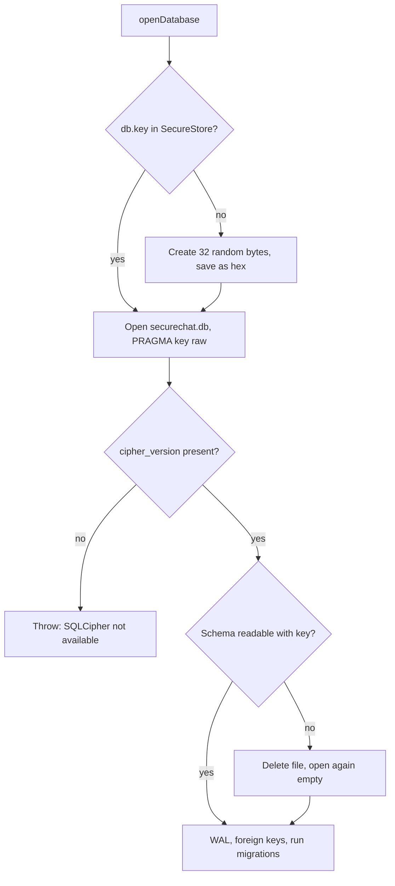
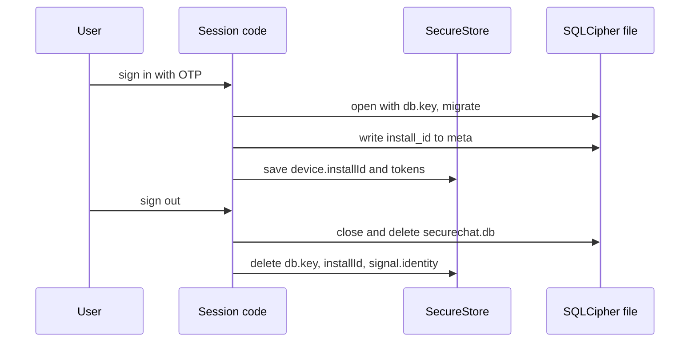

# 07. Local database encryption

> **Status:** ✅ Implemented — all local chat data and Signal state live in one SQLCipher-encrypted database whose random key is kept in SecureStore; the fail-closed and wrong-key paths are covered by code only, not by automated tests or device checks.
> Last reviewed against the code: 2026-10-12.

## Summary

The app keeps messages, Signal sessions, pre-keys and other local data in one SQLite database
file, `securechat.db`. The file is encrypted with **SQLCipher** (an SQLite build that encrypts
the whole file, using OpenSSL). The key is 32 random bytes, created on the phone and stored only
in SecureStore (Android Keystore / iOS Keychain). The app refuses to store anything if the build
does not include SQLCipher. On sign-out, the database file and its key are deleted together.

## Status at a glance

| Part                                                                | Status         | Evidence                                                                                                                                          |
| ------------------------------------------------------------------- | -------------- | ------------------------------------------------------------------------------------------------------------------------------------------------- |
| SQLCipher through `expo-sqlite` (`useSQLCipher: true`)              | ✅ Implemented | `app.json`; the app runs on the Android test phones (device tests 2026-10-09 to 2026-10-12), but on-disk encryption was not inspected on a device |
| OpenSSL `libcrypto.so` packaged for SQLCipher on Android            | ✅ Implemented | `plugins/withSqlcipherOpenssl.js`; not covered by automated tests                                                                                 |
| Random 256-bit raw key in SecureStore (`db.key`)                    | ✅ Implemented | `apps/mobile/test/auth.test.js` ("opens the local database with a random 256-bit raw SQLCipher key")                                              |
| Fail closed if SQLCipher is missing (`PRAGMA cipher_version`)       | ✅ Implemented | Code only: the test fake always reports a cipher version                                                                                          |
| No credentials left if the database cannot open                     | ✅ Implemented | `auth.test.js` ("leaves no credentials behind if the encrypted database cannot be opened")                                                        |
| Wrong or lost key: delete the file and start empty                  | ✅ Implemented | Code only; no automated test found                                                                                                                |
| Append-only migrations with `PRAGMA user_version` (v1–v10)          | ✅ Implemented | `apps/mobile/test/migrations.test.js` (v5, v6, v7 upgrades); v8 is exercised by the media tests, not by an upgrade test                           |
| Reinstall detection (install id in SecureStore and in the database) | ✅ Implemented | `auth.test.js` ("discards Keychain leftovers after a reinstall")                                                                                  |
| Wipe on sign-out (file + key + identity + media)                    | ✅ Implemented | `auth.test.js`, `apps/mobile/test/e2ee.test.js`, `apps/mobile/test/messaging.test.js`                                                             |
| New key after every new login                                       | ✅ Implemented | `auth.test.js` ("a new login after logout gets a fresh database key")                                                                             |
| Android `allowBackup: false`                                        | ✅ Implemented | `app.json`; not covered by automated tests                                                                                                        |
| iOS build                                                           | ⏳ Pending     | Not verified on a device                                                                                                                          |

## How it works

1. **Sign-in.** After a successful OTP login, `startSession()` opens the database **first**.
   Only then does it write an install id and save the tokens. If the database cannot be opened,
   everything is wiped, so no credentials are left without encrypted storage.
2. **Key.** `getOrCreateKey()` reads `db.key` from SecureStore. If it is missing or not 64 hex
   characters, it creates 32 random bytes with `expo-crypto` `getRandomBytesAsync(32)`, stores
   them as hex, and uses them.
3. **Open.** `openWithKey()` opens `securechat.db` and runs `PRAGMA key = "x'<hex>'"`. This is
   SQLCipher's raw-key form: the key is already random, so no password-based key derivation is
   needed.
4. **Fail closed.** It reads `PRAGMA cipher_version`. An empty answer means the build is plain
   SQLite. The app throws `SQLCipher is not available in this build` and stores nothing.
5. **Key check.** It reads `sqlite_master`. With a wrong key, this read fails.
6. **Recovery.** If opening fails for any reason other than missing SQLCipher, the file is
   deleted and opened once more with the same key (an empty database).
7. **Settings.** `PRAGMA journal_mode = WAL` and `PRAGMA foreign_keys = ON`.
8. **Migrations.** For each migration with a version above `PRAGMA user_version`, the SQL and
   the new `user_version` run in one transaction.
9. **Restart.** `restoreSession()` opens the database and compares the install id in SecureStore
   (`device.installId`) with the one in the `meta` table (`install_id`). If they differ (for
   example, the app was reinstalled on iOS, where Keychain items survive, or the file was
   recreated), the local session is wiped and a new device id is created.
10. **Sign-out.** `wipeLocalSession()` stops calls, messaging and presence, unregisters push,
    clears tokens, then `destroyDatabase()` closes the connection, deletes the file and deletes
    `db.key`. It also deletes encrypted media files, the install id and `signal.identity`.

### Migrations

Migrations live in `src/db/migrations.js`. They are append-only: a shipped migration is never
edited.

| Version | Phase            | Change                                                                                                                                                                   |
| ------- | ---------------- | ------------------------------------------------------------------------------------------------------------------------------------------------------------------------ |
| 1       | Foundation       | `meta`                                                                                                                                                                   |
| 2       | 3A (E2EE)        | `signal_signed_prekeys`, `signal_kyber_prekeys`, `signal_prekeys`, `signal_sessions`, `signal_identities`, `peer_devices`, `message_envelopes`, `messages`, `sync_state` |
| 3       | 3B (messaging)   | `conversations`; `messages` gets `delivered_at`, `read_at`, `error`, `receipt_pending`; `outbox`                                                                         |
| 4       | Chat Lock        | `conversations.locked`, `conversations.locked_at`                                                                                                                        |
| 5       | Identity changes | `identity_changes` (one `pending` per peer); `outbox.recipient_registration_id`                                                                                          |
| 6       | Voice calls      | `call_log`                                                                                                                                                               |
| 7       | Video calls      | `call_log.kind` (`voice` / `video`, default `voice`)                                                                                                                     |
| 8       | Media            | `attachments` (one per message, `ON DELETE CASCADE`)                                                                                                                     |
| 9       | Peer numbers     | `conversations.peer_phone` (number of someone who messaged us; see doc 13)                                                                                               |
| 10      | Waveforms        | `attachments.waveform` (voice-note loudness bars; see doc 05)                                                                                                            |

### Tables

| Table                                                             | Holds                                                                                                                             |
| ----------------------------------------------------------------- | --------------------------------------------------------------------------------------------------------------------------------- |
| `meta`                                                            | Key/value metadata, for example `install_id`                                                                                      |
| `signal_signed_prekeys`, `signal_kyber_prekeys`, `signal_prekeys` | This phone's pre-key records, **including private halves**                                                                        |
| `signal_sessions`                                                 | Signal session per address (`userId.1`)                                                                                           |
| `signal_identities`                                               | Trusted identity key of each peer (trust on first use)                                                                            |
| `peer_devices`                                                    | Server device id that represents each peer                                                                                        |
| `message_envelopes`                                               | Incoming ciphertext until processed; status `pending` / `done` / `failed` / `identity_pending` (a `done` row keeps no ciphertext) |
| `messages`                                                        | Decrypted message text (plaintext), status, times, `receipt_pending`                                                              |
| `sync_state`                                                      | `envelope_cursor`, `next_prekey_id`                                                                                               |
| `conversations`                                                   | One row per peer, local nickname (`title`), `locked`, `locked_at`                                                                 |
| `outbox`                                                          | Outgoing ciphertext until the server accepts it                                                                                   |
| `identity_changes`                                                | Security-code changes, `pending` or `accepted`                                                                                    |
| `call_log`                                                        | Call history: peer, direction, kind, outcome, times (no media)                                                                    |
| `attachments`                                                     | Media metadata, **media key** and digest, encrypted file name, transfer state                                                     |

Media files are not in the database. They are stored only as encrypted blobs in the app's
private `files/attachments/` folder; their keys are in the `attachments` table
([05-encrypted-media.md](05-encrypted-media.md)).

## Packages and versions

| Package                                   | Declared                                   | Installed                             | Used for                                                       |
| ----------------------------------------- | ------------------------------------------ | ------------------------------------- | -------------------------------------------------------------- |
| `expo-sqlite`                             | `~57.0.4`                                  | `57.0.4`                              | SQLite API; built with SQLCipher when `useSQLCipher` is on     |
| SQLCipher (vendored in `expo-sqlite`)     | —                                          | `4.7.0 community`                     | Whole-file encryption                                          |
| `io.github.ronickg:openssl` (Android AAR) | `3.3.2-1` (`compileOnly` in `expo-sqlite`) | Packaged by `withSqlcipherOpenssl.js` | `libcrypto.so` for SQLCipher                                   |
| `expo-secure-store`                       | `~57.0.4`                                  | `57.0.4`                              | `db.key`, `device.installId`, `signal.identity`                |
| `expo-crypto`                             | `~57.0.3`                                  | `57.0.3`                              | Random key bytes, install id (UUID)                            |
| `sql.js` (devDependency)                  | `^1.14.2`                                  | `1.14.2`                              | Tests: real SQLite in WebAssembly instead of the native module |

## Source files

**Mobile**

- [database.js](../apps/mobile/src/db/database.js) — key, open, fail-closed check, recovery, migrate, `meta`, `destroyDatabase`.
- [migrations.js](../apps/mobile/src/db/migrations.js) — the ordered migrations v1–v10.
- [session.js](../apps/mobile/src/auth/session.js) — `startSession`, `restoreSession` (install id check), `wipeLocalSession`.
- [secureStorage.js](../apps/mobile/src/lib/secureStorage.js) — SecureStore key names and `AFTER_FIRST_UNLOCK_THIS_DEVICE_ONLY`.
- [signalStore.js](../apps/mobile/src/crypto/signalStore.js) — Signal tables and `inTransaction`.
- [messageStore.js](../apps/mobile/src/messaging/messageStore.js) — message, conversation and outbox tables.
- [mediaFiles.js](../apps/mobile/src/media/mediaFiles.js) — `wipeAllMedia` at sign-out.

**Build configuration**

- [app.json](../apps/mobile/app.json) — `expo-sqlite` plugin with `useSQLCipher: true`; Android `allowBackup: false`.
- [withSqlcipherOpenssl.js](../apps/mobile/plugins/withSqlcipherOpenssl.js) — extracts `libcrypto.so` for every ABI from the OpenSSL AAR and packages it.

**Tests**

- [setup.js](../apps/mobile/test/setup.js) — `expo-sqlite` fake on `sql.js`: a file is bound to the first raw key and refuses any other key.

API and Shared: not involved.

## API endpoints

None. The local database is never sent to the server.

## Data storage

### MongoDB

Not used.

### Redis

Not used.

### On the phone

| Where       | Name                         | Holds                                                           |
| ----------- | ---------------------------- | --------------------------------------------------------------- |
| SecureStore | `db.key`                     | 64 hex characters (256-bit raw SQLCipher key)                   |
| SecureStore | `device.installId`           | Install id, matched against `meta.install_id`                   |
| SecureStore | `signal.identity`            | Signal identity key pair (kept outside the database on purpose) |
| App files   | `securechat.db`              | The SQLCipher database (tables above)                           |
| App files   | `files/attachments/<id>.bin` | Encrypted media blobs (keys in the database)                    |

SecureStore items use `AFTER_FIRST_UNLOCK_THIS_DEVICE_ONLY`: readable after the first unlock
since boot, never synced, never restored to another device.

## Security measures

- **Whole-file encryption.** Every table, including plaintext messages and private pre-keys, is
  inside the SQLCipher file.
- **Strong random key.** 32 bytes from the system random generator, used as a raw key.
- **Key only in the OS key store.** `db.key` is in SecureStore, bound to this device.
- **Fail closed.** No `cipher_version` means no SQLCipher, and the app throws instead of writing
  plaintext.
- **Database before credentials.** At sign-in the database opens first; on failure all local
  credentials are removed.
- **No backups.** Android `allowBackup` is `false`, and SecureStore items are "this device only".
- **Clean sign-out.** The file and its key are deleted together, plus the identity key, install
  id and encrypted media. A new login creates a new key.
- **Atomic changes.** Each migration and each multi-step state change (for example session +
  message + envelope status) runs in one transaction.
- **Narrow access.** Only `db/` and the `*Store.js` modules run SQL. Message rows are read only
  inside `ChatLockGate` ([09-chat-lock.md](09-chat-lock.md)).

## Error handling

| Situation                                                                | Error code / behaviour                                            | What the user sees                                                                                                                                         |
| ------------------------------------------------------------------------ | ----------------------------------------------------------------- | ---------------------------------------------------------------------------------------------------------------------------------------------------------- |
| Build without SQLCipher                                                  | Throws `SQLCipher is not available in this build`; nothing stored | Sign-in fails; no credentials kept                                                                                                                         |
| Native SQLite library fails to load (for example `libcrypto.so` missing) | Open throws; `startSession` wipes local credentials               | Sign-in fails                                                                                                                                              |
| Key does not match the file (key lost or reset)                          | File deleted, empty database created                              | Local history is gone. If this happens at app start, the new file has no `install_id`, so `restoreSession()` wipes the session and the user signs in again |
| Install id missing or different                                          | `wipeLocalSession({ newDeviceId: true })`                         | Signed out at start                                                                                                                                        |
| Refresh session expired at start                                         | `wipeLocalSession()`                                              | Signed out at start                                                                                                                                        |
| `db.key` value not 64 hex characters                                     | Treated as missing; a new key is created                          | Same as a lost key                                                                                                                                         |
| Database used before it is open                                          | `Database is not open` error                                      | — (programming error)                                                                                                                                      |

## Configuration

- `app.json` → `plugins` → `["expo-sqlite", { "useSQLCipher": true }]`.
- `app.json` → `plugins` → `./plugins/withSqlcipherOpenssl` (Android packaging).
- `app.json` → `android.allowBackup: false`.
- Database name: `DATABASE_NAME = 'securechat.db'` in `database.js`.
- No environment variables.

## Testing status

- **Automated:**
  - `apps/mobile/test/auth.test.js`: random 256-bit raw key from SecureStore; no credentials left
    when the database cannot open; reinstall detection; logout deletes the file and key (also
    offline); a new login gets a new key; no tokens inside the database file.
  - `apps/mobile/test/migrations.test.js` (4 tests): v4→v5, v5→v6 and v6→v7 upgrades keep
    existing data; only one pending identity change per contact.
  - `apps/mobile/test/e2ee.test.js`: identity key in SecureStore, not in the database; logout
    wipes identity, sessions, pre-keys and messages.
  - `apps/mobile/test/messaging.test.js`: "logout disconnects Pusher and wipes messages, keys and
    the database".
  - Note: Jest uses `sql.js` with a fake that imitates SQLCipher key binding. It does not
    encrypt anything. Real SQLCipher is only exercised in builds on phones.
- **Device testing:** the Android test phones ran the app with this database during the device
  tests of 2026-10-09 to 2026-10-12 (the app cannot store data without SQLCipher). The encrypted
  file itself was not inspected on a device.
- **Not tested yet:** the fail-closed branch with a real non-SQLCipher build; the wrong-key
  recovery path; a v7→v8 upgrade test; `allowBackup` and the OpenSSL plugin by automated tests;
  iOS.

## Known limitations and pending work

- **Lost key means lost history.** Recreating the file does not restore old messages: envelopes
  that were already acknowledged are not served again ([ARCHITECTURE §13](ARCHITECTURE.md#13-known-limitations-and-risks)).
  The comment in `database.js` ("local data can always be re-synced") is too optimistic.
- **Any open failure deletes the file.** Not only a wrong key: any error other than missing
  SQLCipher leads to delete-and-recreate.
- **No backup and no transfer.** History lives only on this phone.
- **Readable after first unlock.** `AFTER_FIRST_UNLOCK_THIS_DEVICE_ONLY` lets background work read
  the key after the first unlock since boot; the key is not locked again when the screen locks.
- **iOS** has not been tested on a device.

## Related documents

- [03-end-to-end-encryption.md](03-end-to-end-encryption.md) — what is stored and why.
- [06-key-management.md](06-key-management.md) — Signal keys in SecureStore and SQLCipher.
- [02-session-management.md](02-session-management.md) — when the sign-out wipe runs.
- [05-encrypted-media.md](05-encrypted-media.md) — encrypted media files and their keys.
- [09-chat-lock.md](09-chat-lock.md) — `locked` chats in `conversations`.
- [12-crash-recovery.md](12-crash-recovery.md) — transactions and restart behaviour.
- ARCHITECTURE: [§6.4 On-device storage](ARCHITECTURE.md#64-on-device-storage),
  [§8 Security controls](ARCHITECTURE.md#8-security-controls),
  [§10 Data retention](ARCHITECTURE.md#10-data-retention),
  [§13 Known limitations](ARCHITECTURE.md#13-known-limitations-and-risks).
