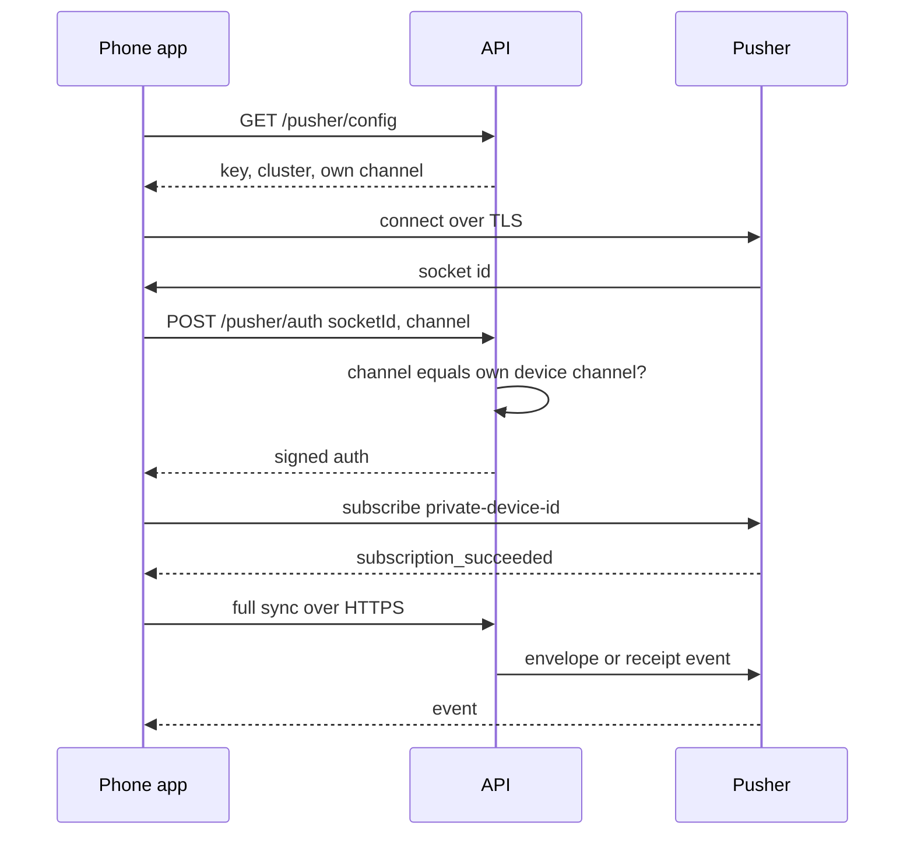
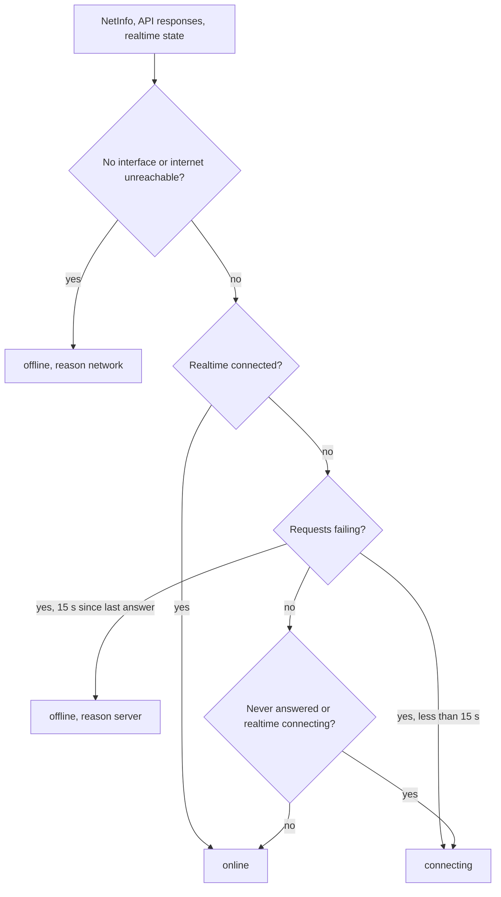

# 08. Real-time messaging

> **Status:** ✅ Implemented — each device has one private Pusher channel for live events, and every event can also be recovered over HTTPS, so delivery never depends on Pusher alone.
> Last reviewed against the code: 2026-10-12.

## Summary

When the app is open, new messages, receipts, call signals, online-status changes and typing
pings arrive at once through **Pusher Channels** (a hosted WebSocket service). Each device
listens on exactly one private channel, `private-device-{deviceId}`, and only our API can
authorise that subscription. Pusher only makes things faster: MongoDB stays the source of
truth, and the app catches up over HTTPS ("sync") whenever it connects, reconnects, returns to
the screen, changes network, or polls. The app also tracks its own connection quality and shows
a banner when it is offline, reconnecting, or cannot reach the server.

## Status at a glance

| Part                                                                  | Status         | Evidence                                                                                                               |
| --------------------------------------------------------------------- | -------------- | ---------------------------------------------------------------------------------------------------------------------- |
| Private device channel, authorised by the API                         | ✅ Implemented | `apps/api/test/messaging.test.js` ("POST /pusher/auth")                                                                |
| Public config only (key + cluster) to the app                         | ✅ Implemented | `apps/api/test/messaging.test.js`, `apps/mobile/test/messaging.test.js` ("never contains the Pusher secret")           |
| `envelope` event, inline ≤ 8 KB or ids only                           | ✅ Implemented | Both `messaging.test.js` files                                                                                         |
| `receipt` event (delivered / read)                                    | ✅ Implemented | Both `messaging.test.js` files                                                                                         |
| `presence` and `typing` events                                        | ✅ Implemented | `apps/api/test/presence.test.js`, `apps/mobile/test/presence.test.js`; see [14](14-presence-and-typing.md)             |
| `call` events                                                         | ✅ Implemented | See [10-voice-video-calls.md](10-voice-video-calls.md)                                                                 |
| Sync on start, (re)subscribe, foreground, network change, poll        | ✅ Implemented | `apps/mobile/test/messaging.test.js` ("offline and reconnect", "online status and network changes")                    |
| Pusher dropped in the background (push takes over), kept during calls | ✅ Implemented | `apps/mobile/test/messaging.test.js`                                                                                   |
| Network switch (Wi-Fi ⇄ mobile data) reconnect                        | ✅ Implemented | `apps/mobile/test/messaging.test.js`; network switches device-verified for calls 2026-10-09 (ARCHITECTURE §12 Phase 7) |
| Connectivity status (online / connecting / offline + reason)          | ✅ Implemented | `apps/mobile/test/connectivity.test.js`                                                                                |
| Connection banner                                                     | ✅ Implemented | No dedicated test; not verified on a device as a separate item                                                         |
| Works without Pusher (no-op realtime, polling)                        | ✅ Implemented | `apps/api/test/messaging.test.js` (503 on `/pusher/auth`, sync recovery)                                               |

## How it works

**Connecting**

1. After the Signal keys are ready, the signed-in layout calls `startMessaging(userId)`. It
   starts realtime, a first sync, the 30 s poll, the 20 s heartbeat, and the AppState and
   NetInfo listeners.
2. `connectRealtime()` calls `GET /pusher/config`. The API answers with `realtime: {key,
cluster}` (or `null` if Pusher is not configured) and `channel`, the caller's own
   `private-device-{deviceId}` taken from the session.
3. If `realtime` is `null`, the state becomes `unavailable` and the app relies on sync.
4. Otherwise pusher-js connects with `forceTLS: true`, `activityTimeout` 30 s and
   `pongTimeout` 10 s (so a dead socket is noticed in about 40 s instead of pusher-js's default
   120 s + 30 s).
5. To subscribe, pusher-js calls our custom handler, which sends `POST /pusher/auth {socketId,
channelName}` through the normal API client (token attached and refreshed). The API signs the
   subscription **only** if `channelName` equals the caller's own device channel (else 403).
   The Pusher secret never leaves the server.
6. On `pusher:subscription_succeeded` (first time and after every reconnect) the app runs a
   full sync, reconciles any call, collects missed calls, and sends a heartbeat.

**Events on the device channel**

| Event      | Payload                                                                                                                                                                                                   | Sent when                                          | App handler                                             |
| ---------- | --------------------------------------------------------------------------------------------------------------------------------------------------------------------------------------------------------- | -------------------------------------------------- | ------------------------------------------------------- |
| `envelope` | `{envelopeId, seq, inline: true, envelope: {messageId, senderUserId, senderDeviceId, senderSignalDeviceId, type, ciphertext, createdAt}}` if the event is ≤ 8 KB, else `{envelopeId, seq, inline: false}` | A message was stored for this device               | Store + decrypt inline envelopes, then sync             |
| `receipt`  | `{receipts: [{messageId, status, at}]}`, at most 50 per event, grouped by sender device                                                                                                                   | Recipient acked (`delivered`) or read (`read`)     | Apply to outgoing messages (never backwards)            |
| `call`     | `{type, callId, ...}`                                                                                                                                                                                     | Call signaling                                     | `handleCallEvent` ([10](10-voice-video-calls.md))       |
| `presence` | `{userId, online}`                                                                                                                                                                                        | A chat partner came online or went away on purpose | `handlePresenceEvent` ([14](14-presence-and-typing.md)) |
| `typing`   | `{fromUserId, typing}`                                                                                                                                                                                    | A user typed in a chat with this user              | `handleTypingEvent` ([14](14-presence-and-typing.md))   |

**Sync (`requestSync`)**

A full sync runs, in order: `flushOutbox` → `syncInbox` → start attachment downloads (not
awaited) → send queued read receipts → refresh the status of own sent messages. Every step is
idempotent. Syncs are single-flight: a sync requested while one runs queues exactly one re-run.
Sync is requested on:

- messaging start;
- every Pusher (re)subscription;
- the app returning to the foreground;
- NetInfo "came online" or "network type changed";
- the backend answering again after requests had failed (`useConnectivityStore` recovery);
- every 30 s while the app is in the foreground, the network is up and Pusher is not
  `connected`;
- a push received while the app is open (`onForegroundNotification`);
- a notification tap (`notificationRouting.js`);
- pull-to-refresh on the chat list;
- a realtime envelope whose processing failed.

**Background and foreground**

- **Background:** decrypted media is released; then, unless a call is active, Pusher is
  disconnected (state `paused`) and `DELETE /presence` is sent. The server sees no ack within
  3 s and sends a push instead ([11](11-push-notifications.md)). If a call ends while the app is
  in the background, Pusher is dropped then.
- **Our own system screens** (photo picker, permission dialogs) also pause the app, but the user
  has not left it. While one is open (`lib/systemUi.js`, `withSystemUi`), the background step
  above is skipped for up to 2 minutes, so picking a photo no longer drops the connection, shows
  "Connecting…" on return, or shows the user as offline to others (2026-10-12). Someone who
  goes to the home screen from the picker and stays away is paused when the 2 minutes end.
- **Foreground:** realtime restarts (no-op if still connected), heartbeat, sync, call
  reconcile, missed-call sync, and key maintenance (`ensureKeysRegistered`).

**Network changes**

1. NetInfo reports a change. `applyNetworkState()` stores `network` (`connected` / `none` /
   `unknown`), `networkType` and `internetReachable`, and returns `cameOnline`, `wentOffline`
   and `switched` (connected before and after, type changed).
2. `useMessagingStore.online` is set to `isConnected !== false && isInternetReachable !== false`.
3. On `cameOnline` or `switched`: if the last realtime connect failed, connect again; else, on a
   switch, force a Pusher reconnect (`disconnect()` then `connect()`, the bindings stay). Then
   sync, reconcile the call, heartbeat, and tell the call engine (`handleCallNetworkChange`).

**Opened without a connection.** `useSignalSetup` retries the key check while the server cannot
be reached (no response, 5xx, 429) after 2, 5, 10, then every 30 s, and at once when the network
returns or the app comes back to the screen. Messaging (and therefore realtime) starts only after
that check succeeds.

**Connectivity status** (`lib/connectivity.js`). The API client marks every response as
"reachable" (even an error response) and every request that got no answer (timeout after 15 s,
DNS, no route) as "unreachable". A requests-failing state counts as `offline` only while the last
failure is less than 60 s old (`4 × OFFLINE_AFTER_MS`); after that, with no new failures, it
shows `connecting` again. A network interface alone never counts as online.

**Connection banner** (`components/ConnectionBanner.js`, shown on the chat list and in a chat):

| Status                                                   | Text                                                                      |
| -------------------------------------------------------- | ------------------------------------------------------------------------- |
| offline, reason `server`                                 | "Can’t reach CipherChat right now. Messages will be sent when it’s back." |
| offline, reason `network`                                | "You’re offline. Messages will be sent when you reconnect."               |
| connecting, realtime `connecting`, for more than 2 s     | "Connecting…"                                                             |
| connecting, otherwise, for more than 2 s                 | "Reconnecting…"                                                           |
| online, but realtime not `connected`, `idle` or `paused` | "Live updates unavailable. Checking for messages periodically."           |
| online and realtime connected                            | No banner                                                                 |

## Packages and versions

| Package                                    | Declared  | Installed | Used for                                                                   |
| ------------------------------------------ | --------- | --------- | -------------------------------------------------------------------------- |
| `pusher` (API)                             | `^5.3.4`  | 5.3.4     | `trigger()` events, `authorizeChannel()` signatures                        |
| `pusher-js` (mobile)                       | `^8.6.0`  | 8.6.0     | WebSocket client; must be imported as `import { Pusher } from 'pusher-js'` |
| `@react-native-community/netinfo` (mobile) | `~12.0.1` | 12.0.1    | Interface, type and reachability changes                                   |
| `zustand` (mobile)                         | `^5.0.15` | 5.0.15    | `useMessagingStore`, `useConnectivityStore`                                |
| `react-native` (mobile)                    | `0.86.3`  | 0.86.3    | `AppState` (foreground / background)                                       |
| `express` (API)                            | `^5.1.0`  | 5.2.1     | `/pusher` routes                                                           |
| `zod` (API, shared)                        | `^4.1.0`  | 4.6.5     | `pusherSocketIdSchema`, auth body                                          |

## Source files

**API**

- [realtime.routes.js](../apps/api/src/modules/realtime/realtime.routes.js) — `GET /pusher/config`, `POST /pusher/auth` (own channel only).
- [realtime/index.js](../apps/api/src/services/realtime/index.js) — Pusher or no-op realtime, `deviceChannel`, `buildEnvelopeEvent` (8 KB inline rule), `publishEnvelope`, `publishReceipts`, channel authorizer.
- [messageService.js](../apps/api/src/modules/messages/messageService.js) — publishes envelopes after commit and receipts after ack/read.
- [presenceService.js](../apps/api/src/modules/presence/presenceService.js), [presence.routes.js](../apps/api/src/modules/presence/presence.routes.js) — publish `presence` and `typing` events.
- [container.js](../apps/api/src/container.js) — builds one realtime client and the channel authorizer from config.
- [env.js](../apps/api/src/config/env.js) — `PUSHER_*` validation (all four or none).

**Mobile**

- [realtime.js](../apps/mobile/src/messaging/realtime.js) — pusher-js connection, auth handler, event bindings, `reconnect()`.
- [messagingEngine.js](../apps/mobile/src/messaging/messagingEngine.js) — start/stop, sync triggers, polling, AppState and NetInfo handling, heartbeat.
- [connectivity.js](../apps/mobile/src/lib/connectivity.js) — reachability store, `connectivityStatus`, `offlineReason`.
- [api.js](../apps/mobile/src/lib/api.js) — marks reachable / unreachable on every request; 15 s timeout.
- [ConnectionBanner.js](../apps/mobile/src/components/ConnectionBanner.js) — banner texts.
- [useSignalSetup.js](../apps/mobile/src/crypto/useSignalSetup.js) — key-check retries when opened offline.
- [useNotifications.js](../apps/mobile/src/notifications/useNotifications.js) — sync on a push received in the foreground.
- [signalService.js](../apps/mobile/src/crypto/signalService.js) — `handleRealtimeEnvelope`, `syncInbox`.
- [endpoints.js](../apps/mobile/src/config/endpoints.js) — `ENDPOINTS.REALTIME`.

**Shared**

- [constants.js](../packages/shared/src/constants.js) — `REALTIME_EVENT`, `CHANNEL_PREFIX`, `LIMITS.PUSHER_INLINE_PAYLOAD_BYTES` (8 KB), `LIMITS.PUSHER_EVENT_MAX_BYTES` (10 KB).
- [validation.js](../packages/shared/src/validation.js) — `pusherSocketIdSchema`.

## API endpoints

| Method | Path             | Auth | Purpose                                                                            | Rate limit       |
| ------ | ---------------- | ---- | ---------------------------------------------------------------------------------- | ---------------- |
| `GET`  | `/pusher/config` | JWT  | `{realtime: {key, cluster} or null, channel}`                                      | 120/min per user |
| `POST` | `/pusher/auth`   | JWT  | `{socketId, channelName}` → Pusher signature; only the caller's own device channel | 120/min per user |

Sync uses the message endpoints described in [04](04-one-to-one-messaging.md#api-endpoints).

## Data storage

### MongoDB

Not used by realtime itself. Every event comes from data that is already committed in
`messageenvelopes` / `messages` ([04](04-one-to-one-messaging.md#data-storage)), which is why a
lost event can always be recovered.

### Redis

Not used by realtime (only the rate-limit counters `rl:authenticatedPerUser:*`).

### On the phone

- SQLCipher `sync_state.envelope_cursor` — last acknowledged `seq` (see [04](04-one-to-one-messaging.md)).
- In memory only (zustand, not persisted): `useMessagingStore` (`online`, `realtime`, `syncing`,
  `lastSyncError`, `revision`) and `useConnectivityStore` (`network`, `networkType`,
  `internetReachable`, `reachableAt`, `unreachableAt`).
- No SecureStore keys. The Pusher key and cluster are fetched from the API at each connect.

## Security measures

- **One channel per device, authorised from the session.** `POST /pusher/auth` compares the
  requested channel with `private-device-{req.auth.deviceId}`; any other channel gets 403
  `FORBIDDEN`. Tested ("rejects other devices’ channels and arbitrary channels").
- **The Pusher secret stays on the server.** The app receives only the public key and cluster
  (tested on both sides). Signing is a local HMAC (`authorizeChannel`), no network call.
- **TLS.** The API uses `useTLS: true`; the app uses `forceTLS: true`.
- **No plaintext in events.** Envelopes carry ciphertext only; receipts carry ids, status and
  time; presence carries a user id and a boolean; typing carries a user id and a boolean.
  Tested in `apps/api/test/messaging.test.js` ("MongoDB, realtime events, API responses and logs
  never contain message text").
- **Pusher's view.** Pusher sees the channel name (a device UUID) and event payloads: ciphertext
  envelopes up to 8 KB, receipts, call signaling, and the user ids in presence and typing events.
- **No client events.** The app never publishes on Pusher; every event is sent by the API after
  its own checks.
- **Background.** Pusher is disconnected in the background so no idle socket stays open.

## Error handling

| Situation                                  | Error code / behaviour                                                                      | What the user sees                                                             |
| ------------------------------------------ | ------------------------------------------------------------------------------------------- | ------------------------------------------------------------------------------ |
| Pusher not configured on the API           | `/pusher/config` returns `realtime: null`; `/pusher/auth` returns 503 `SERVICE_UNAVAILABLE` | "Live updates unavailable. Checking for messages periodically." (30 s polling) |
| Subscribing to another channel             | 403 `FORBIDDEN`                                                                             | Nothing (the app only asks for its own)                                        |
| Realtime connect fails (offline, API down) | State `failed`; retried on network return, backend recovery or foreground                   | Banner by connectivity status                                                  |
| Pusher publish fails on the API            | Logged as a warning; the request still succeeds                                             | Message arrives on the next sync                                               |
| Envelope too large for an inline event     | Id-only event; the app fetches by sync                                                      | Nothing                                                                        |
| Dead socket after a network switch         | Forced reconnect on `switched`; otherwise noticed by the 30 s + 10 s activity timeout       | "Reconnecting…" while it lasts                                                 |
| Requests fail for 15 s                     | `connectivityStatus` → `offline`, reason `server` or `network`                              | Offline banner with the matching text                                          |
| Duplicate or replayed realtime event       | Envelopes are deduplicated by id (`INSERT OR IGNORE`), messages by server id                | Nothing                                                                        |

## Configuration

| Name                                                             | Where        | Default | Effect                                                                        |
| ---------------------------------------------------------------- | ------------ | ------- | ----------------------------------------------------------------------------- |
| `PUSHER_APP_ID`, `PUSHER_KEY`, `PUSHER_SECRET`, `PUSHER_CLUSTER` | API env      | none    | All four or none (a partial set fails env validation). None → no-op realtime. |
| `PUSH_NOTIFY_DELAY_MS`                                           | API env      | 3000    | How long the API waits for an ack before a push                               |
| `EXPO_PUBLIC_API_URL`                                            | Mobile build | —       | API base URL; the Pusher key is never a build variable                        |

Code constants: `POLL_INTERVAL_MS` 30 s, `HEARTBEAT_INTERVAL_MS` 20 s (`messagingEngine.js`);
`activityTimeout` 30 s, `pongTimeout` 10 s (`realtime.js`); `OFFLINE_AFTER_MS` 15 s
(`connectivity.js`); `DEFAULT_TIMEOUT_MS` 15 s (`api.js`); `SETUP_RETRY_DELAYS_MS` 2/5/10/30 s
(`useSignalSetup.js`); `RECEIPTS_PER_EVENT` 50 (`realtime/index.js`).

## Testing status

- **Automated:**
  - `apps/api/test/messaging.test.js` (29 cases): envelope event only on the recipient's
    channel, id-only events for large envelopes, message kept when Pusher fails, receipt events,
    `/pusher/auth` own channel only, auth and socket-id validation, public config only, 503
    without Pusher, no plaintext in events.
  - `apps/mobile/test/messaging.test.js` (64 cases): missed events recovered by reconnect sync,
    Pusher dropped in the background and kept during a call, duplicate and replayed events,
    network switch reconnects and syncs, Wi-Fi without internet treated as offline, no Pusher
    secret in the app.
  - `apps/mobile/test/connectivity.test.js` (7 cases): status rules, offline reason, API client
    reachability marks, switch vs came-online detection.
- **Device testing:** a 100 s outage delivered queued messages once each, in order, with
  receipts; network switches (mobile data ⇄ Wi-Fi) recovered calls within 15 s (two Android
  phones, debug build, 2026-10-09, ARCHITECTURE §12 Phase 7). Online/offline changes appeared
  live in an open chat (2026-10-11/12, see [14](14-presence-and-typing.md)).
- **Not tested yet:** the `ConnectionBanner` texts (no unit test, not checked one by one on a
  device), release build, iOS.

## Known limitations and pending work

- **Pusher keeps no history.** Messages and receipts are recovered by sync, but call SDP answers
  published during a reconnect can be lost (handled by re-offers, see [10](10-voice-video-calls.md)).
- **Polling only in the foreground.** A closed or backgrounded app depends on push notifications
  ([11](11-push-notifications.md)).
- **Pusher's 10 KB event limit.** Larger envelopes are sent as ids only and need an extra HTTPS
  fetch.
- **Pusher sees metadata:** device UUIDs, event times, and the user ids in presence and typing
  events.
- **Group channels** (`private-chat-`, `presence-chat-`, `private-call-`) are reserved names only;
  only `private-device-` is used.

## Related documents

- [04-one-to-one-messaging.md](04-one-to-one-messaging.md) — the message pipeline that sync drives.
- [10-voice-video-calls.md](10-voice-video-calls.md) — `call` events, ICE restarts on network change.
- [11-push-notifications.md](11-push-notifications.md) — what happens when Pusher is dropped.
- [12-crash-recovery.md](12-crash-recovery.md) — recovery after network loss and kills.
- [14-presence-and-typing.md](14-presence-and-typing.md) — `presence` and `typing` events, heartbeat.
- [02-session-management.md](02-session-management.md) — token refresh used by `/pusher/auth`.
- ARCHITECTURE.md: [§5.6](ARCHITECTURE.md#56-external-providers), [§7.3](ARCHITECTURE.md#73-receiving-a-message), [§8](ARCHITECTURE.md#8-security-controls), [§9](ARCHITECTURE.md#9-delivery-semantics-and-reliability), [§12 Phase 7](ARCHITECTURE.md#phase-7-connectivity-online-status-and-call-recovery--implemented-uncommitted), [§14](ARCHITECTURE.md#14-decision-log).
