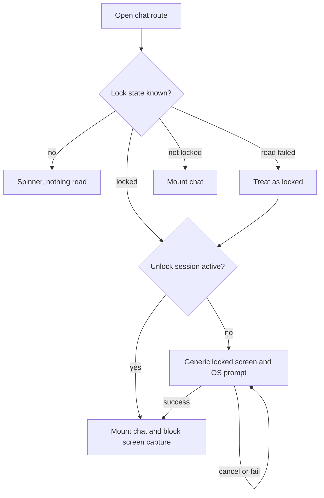
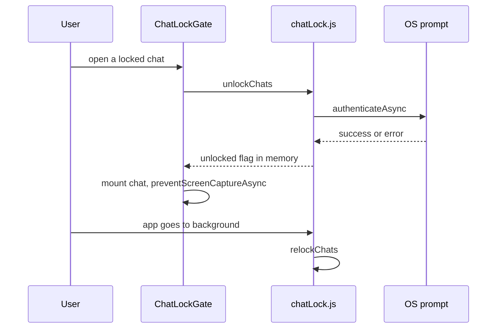

# 09. Chat Lock

> **Status:** ✅ Implemented — per-chat locking with OS authentication, a hidden "Locked chats" folder and screen-capture blocking are in the code and covered by tests; not yet verified on a device.
> Last reviewed against the code: 2026-10-12.

## Summary

Chat Lock lets a user hide individual chats behind the phone's own fingerprint, face or screen
lock (PIN, pattern or password). A locked chat disappears from the chat list and its search and
moves into a "Locked chats" folder. Opening it asks the operating system (OS) to check that the
owner is holding the phone. Chat Lock is **local access control, not encryption**: messages are
already end-to-end encrypted (E2EE) and the database is already encrypted with SQLCipher. The
server never learns which chats are locked.

## Status at a glance

| Part                                                                  | Status         | Evidence                                                         |
| --------------------------------------------------------------------- | -------------- | ---------------------------------------------------------------- |
| Lock / unlock a chat after OS authentication                          | ✅ Implemented | `chatLock.test.js`; not verified on a device                     |
| Unlock session (memory only, ends when the app leaves the foreground) | ✅ Implemented | `chatLock.test.js`; not verified on a device                     |
| `ChatLockGate` on the chat and security-code screens                  | ✅ Implemented | `chatLock.test.js`; not verified on a device                     |
| Locked chats folder and "Locked chats" entry in the chat list         | ✅ Implemented | `chatLock.test.js`; not verified on a device                     |
| Screen-capture blocking while a locked chat is visible                | ✅ Implemented | Code only (`expo-screen-capture`); not verified on a device      |
| Caller name hidden for locked chats (call screen, Calls tab)          | ✅ Implemented | Code (`useCallPeer.js`, `calls.js`); not verified on a device    |
| Chat Lock settings screen                                             | ✅ Implemented | Code; not verified on a device                                   |
| iOS behaviour                                                         | 🟡 Partial     | Code exists; iOS cannot block screenshots; no iOS device testing |

## How it works

**Locking a chat**

1. The user opens a chat and taps the lock icon in the header (a confirmation dialog explains
   what happens), or long-presses the chat in the chat list and picks "Lock chat".
2. `lockConversation()` calls `authenticateOwner()`. It first checks
   `getEnrolledLevelAsync()`. If the device has **no** screen lock, it stops with
   `NO_DEVICE_LOCK`. There is no app PIN.
3. `LocalAuthentication.authenticateAsync()` shows the OS prompt (BiometricPrompt on Android,
   Face ID / Touch ID on iOS) with device PIN/pattern/password as fallback
   (`disableDeviceFallback: false`). The app only learns success or failure.
4. On success, `conversations.locked = 1` and `locked_at` are written in the local SQLCipher
   database. The unlock session is also started, so the chat the user is looking at stays
   open.

**Opening a locked chat**

1. The chat list (`listConversations()`) returns only chats with `locked = 0`. Locked chats
   are listed only by `listConversations({ locked: true })`, which the Locked chats screen
   calls **only while unlocked**.
2. The chat list shows one "Locked chats" row when any exist. It reveals only that locked
   chats exist and whether any has unread messages (`lockedChatsSummary()`): no names,
   previews or counts.
3. Every route into a conversation renders through `ChatLockGate`: the chat screen
   (`chat/[peerUserId]`) and the security-code screen (`security-code/[peerUserId]`). This
   covers taps in the list, notification taps, deep links and restored routes.
4. `ChatLockGate` reads `isConversationLocked()`. Until the answer is known, it shows only a
   spinner. If the read fails, it treats the chat as locked (fail closed).
5. If the chat is locked and no unlock session is active, the gate shows a generic "This chat
   is locked" screen. The child component that reads messages is **not mounted**. The gate
   asks for authentication once when the screen gets focus; an "Unlock" button retries.
6. After success, `useChatLockStore.unlocked` becomes `true`. The gate mounts the chat and
   turns on screen-capture blocking for as long as the locked chat is visible.

**Ending the unlock session**

- An `AppState` listener in `chatLock.js` calls `relockChats()` whenever the app state is not
  `active` (background, or `inactive` such as the iOS app switcher).
- The signed-in layout calls `relockChats()` when it unmounts (sign-out).
- The flag lives only in memory (zustand), so a restart or force-close always starts locked.
- Concurrent unlock requests (for example, two screens re-locking at once) share one OS prompt
  (`unlockInFlight`).

**Other places that respect Chat Lock**

- **Chats search** works on the unlocked list only, so locked chats never appear in search
  results (see [13-contact-discovery-and-search.md](13-contact-discovery-and-search.md)).
- **Call screen:** `useCallPeer()` shows "CipherChat call" with no name or avatar initial if
  the caller's chat is locked and no unlock session is active. The remote video is hidden too.
  "Unlock to see caller" starts the OS prompt. The user can still answer or decline.
- **Calls tab:** call-history rows of locked chats show "Locked chat". A tap asks to unlock
  instead of opening the chat.
- **Developer E2EE card** (development builds only) never lists messages of locked chats
  (`WHERE COALESCE(c.locked, 0) = 0` in `signalStore.js`).

## Packages and versions

| Package                     | Declared   | Installed | Used for                                                       |
| --------------------------- | ---------- | --------- | -------------------------------------------------------------- |
| `expo-local-authentication` | `~57.0.3`  | 57.0.3    | OS authentication (biometrics with device-credential fallback) |
| `expo-screen-capture`       | `~57.0.4`  | 57.0.4    | `preventScreenCaptureAsync` / `allowScreenCaptureAsync`        |
| `expo-sqlite` (SQLCipher)   | `~57.0.4`  | 57.0.4    | Stores `locked` / `locked_at` in the encrypted database        |
| `zustand`                   | `^5.0.15`  | 5.0.15    | `useChatLockStore` (memory-only unlock flag)                   |
| `expo-router`               | `~57.0.25` | 57.0.25   | `useFocusEffect`, so only the visible screen prompts           |

## Source files

**API**

- None. Chat Lock has no server part.

**Mobile**

- [security/chatLock.js](../apps/mobile/src/security/chatLock.js) — authentication, unlock session, lock/unlock, error messages.
- [components/ChatLockGate.js](../apps/mobile/src/components/ChatLockGate.js) — the gate around every conversation route; screen-capture blocking.
- [app/(app)/chat-lock.js](<../apps/mobile/src/app/(app)/chat-lock.js>) — Chat Lock settings: unlock method and number of locked chats.
- [app/(app)/locked-chats.js](<../apps/mobile/src/app/(app)/locked-chats.js>) — the Locked chats folder (prompts, then lists; blocks capture).
- [app/(app)/(tabs)/index.js](<../apps/mobile/src/app/(app)/(tabs)/index.js>) — chat list with the "Locked chats" entry.
- [app/(app)/(tabs)/settings.js](<../apps/mobile/src/app/(app)/(tabs)/settings.js>) — "Chat Lock" row under Privacy & security.
- [components/ChatListRow.js](../apps/mobile/src/components/ChatListRow.js) — long-press lock/unlock and `LockedChatsEntry`.
- [chat/\[peerUserId\].js](<../apps/mobile/src/app/(app)/chat/[peerUserId].js>) — header lock action; content wrapped in `ChatLockGate`.
- [security-code/\[peerUserId\].js](<../apps/mobile/src/app/(app)/security-code/[peerUserId].js>) — security-code screen, also wrapped in `ChatLockGate`.
- [messaging/messageStore.js](../apps/mobile/src/messaging/messageStore.js) — `isConversationLocked`, `setConversationLocked`, `lockedChatsSummary`, `listConversations`.
- [messaging/hooks.js](../apps/mobile/src/messaging/hooks.js) — `useLockedConversations`, `useLockedChatsSummary`.
- [calls/useCallPeer.js](../apps/mobile/src/calls/useCallPeer.js) — hides the caller of a locked chat.
- [app/(app)/(tabs)/calls.js](<../apps/mobile/src/app/(app)/(tabs)/calls.js>) — hides locked chats in call history.
- [app/(app)/_layout.js](<../apps/mobile/src/app/(app)/_layout.js>) — re-locks on sign-out.
- [db/migrations.js](../apps/mobile/src/db/migrations.js) — migration v4 adds `locked`, `locked_at`.

Note: `app/(app)/security.js` is the "Security information" screen (encryption, local storage,
device id). It has no Chat Lock logic.

**Native module**

- None of our own. `expo-local-authentication` and `expo-screen-capture` are Expo modules.

**Shared**

- None.

## API endpoints

None. Nothing about Chat Lock is sent to the server, Pusher or push notifications (tested).

## Data storage

### MongoDB

Not used.

### Redis

Not used.

### On the phone

- **SQLCipher table `conversations`** (migration v4): `locked INTEGER NOT NULL DEFAULT 0`,
  `locked_at INTEGER`. These survive restarts.
- **Memory only:** `useChatLockStore.unlocked` (the unlock session). Never written to disk.
- **SecureStore:** not used. The app stores no PIN and no biometric data.
- On logout or account deletion, the whole database is deleted, so lock states go with it.

## Security measures

- **OS authentication only.** Biometrics with device PIN/pattern/password fallback. The app
  never sees biometric data. Without a device screen lock, Chat Lock is refused
  (`NO_DEVICE_LOCK`).
- **Authentication for every change.** Locking and unlocking (removing the lock) each need a
  fresh successful authentication. On failure nothing changes.
- **Gate before any read.** `ChatLockGate` decides before the message-reading component
  mounts. Unknown state renders nothing; a failed read is treated as locked.
- **Hidden from lists.** Locked chats are excluded from the chat list, its search, its unread
  badge and the developer card by SQL (`WHERE c.locked = ?`).
- **Minimal hint.** The "Locked chats" entry shows only that locked chats exist and whether
  any has unread messages.
- **Short unlock session.** Memory only; ends on background/inactive and on sign-out.
- **Screen capture.** While a locked chat (or the unlocked Locked chats list) is visible,
  `preventScreenCaptureAsync` is on. On Android this sets `FLAG_SECURE`: screenshots and
  recording are blocked and the app-switcher thumbnail is blank. On iOS only recording and
  mirroring can be blocked.
- **Calls.** The identity of a caller whose chat is locked is hidden on the call screen and in
  the Calls tab until unlock.
- **Local only.** The lock state never leaves the phone (tested: no request carries it).

## Error handling

| Situation                                   | Error code / behaviour                                                      | What the user sees                                                                              |
| ------------------------------------------- | --------------------------------------------------------------------------- | ----------------------------------------------------------------------------------------------- |
| Device has no screen lock                   | `NO_DEVICE_LOCK` (also from `not_enrolled`, `passcode_not_set`)             | "Set up a screen lock (PIN, pattern, password or fingerprint) on this device to use Chat Lock." |
| User cancels the prompt                     | `CANCELLED` (`user_cancel`, `system_cancel`, `app_cancel`, `user_fallback`) | No message; gate stays with its "Unlock" button                                                 |
| Wrong fingerprint / face / PIN              | `FAILED` (`authentication_failed`)                                          | "Authentication failed. Try again."                                                             |
| Too many attempts                           | `LOCKOUT` (`lockout`, `lockout_permanent`)                                  | "Too many attempts. Unlock your device, then try again."                                        |
| Any other error or exception                | `UNAVAILABLE`                                                               | "Authentication is not available right now. Try again."                                         |
| Lock state cannot be read from the database | Fail closed: treated as locked                                              | Locked screen                                                                                   |
| Capability check fails (settings screen)    | `available: false`                                                          | "Not available: set up a screen lock on this device"                                            |

The long-press menu and the header lock action show these texts in an alert titled
"Chat Lock". The gate and the Locked chats screen show them under the "Unlock" button.

## Configuration

- `apps/mobile/app.json` plugin `expo-local-authentication` with `faceIDPermission`
  ("Allow CipherChat to use Face ID to open your locked chats.").
- No environment variables. No server configuration.
- `android.allowBackup` is `false`, so the database with lock states is not backed up.

## Testing status

- **Automated:** `apps/mobile/test/chatLock.test.js` (14 cases):
  - locking after successful authentication hides the chat from the list; no lock when
    authentication fails, is cancelled or there is no screen lock; unlock only after
    authentication; independent lock states for several chats;
  - the developer E2EE card never lists messages of locked chats;
  - a locked chat cannot be shown before authentication, and backgrounding re-locks;
    concurrent re-locks share one OS prompt; lock state survives restart and force-close but
    the unlock session does not; logout removes lock state with all local messages;
  - `ChatLockGate` never mounts or loads a locked chat before authentication; the security
    code and "Security code changed" warning appear only after authentication; unlocked chats
    show immediately with no prompt;
  - a notification tap on a locked chat opens the gated route; nothing about chat locks is
    sent to the server.
- **Device testing:** no device results for Chat Lock are recorded in ARCHITECTURE.md §12.
  Not verified on a device in this review.
- **Not tested yet:**
  - Real BiometricPrompt / device-credential fallback on the two Android test phones.
  - `FLAG_SECURE` effect (screenshot blocked, blank app-switcher thumbnail) on a device.
  - Hidden caller on the call screen and in the Calls tab (no automated test found for it).
  - Any iOS behaviour (Face ID, recording block).

## Known limitations and pending work

- **Not encryption.** Anyone who can unlock the phone itself can open locked chats.
- **iOS:** there is no API to block screenshots, and the app-switcher snapshot is not blanked.
  Only recording and mirroring are blocked. iOS has not been tested on a device.
- **One session for all locked chats.** One successful unlock opens every locked chat until
  the app leaves the foreground.
- The "Locked chats" entry reveals that locked chats exist and whether one has unread
  messages.
- Notifications are generic for every chat ("New message"), so they do not reveal a locked
  chat; see [11-push-notifications.md](11-push-notifications.md).
- Media bubbles in ordinary (unlocked) chats do not block screenshots; only the full-screen
  viewer and locked chats do (see [05-encrypted-media.md](05-encrypted-media.md)).

## Related documents

- [05-encrypted-media.md](05-encrypted-media.md) — viewer screenshot blocking and plaintext cleanup.
- [06-key-management.md](06-key-management.md) — the security-code screen that is also gated.
- [07-local-database-encryption.md](07-local-database-encryption.md) — SQLCipher, migration v4, wipe on sign-out.
- [10-voice-video-calls.md](10-voice-video-calls.md) — call screen and history.
- [11-push-notifications.md](11-push-notifications.md) — notification content and tap routing.
- [13-contact-discovery-and-search.md](13-contact-discovery-and-search.md) — search excludes locked chats.
- ARCHITECTURE.md: [§7.8 Chat Lock](ARCHITECTURE.md#78-chat-lock),
  [§8 Security controls](ARCHITECTURE.md#8-security-controls),
  [§13 Known limitations](ARCHITECTURE.md#13-known-limitations-and-risks),
  [§14 Decision log](ARCHITECTURE.md#14-decision-log).
