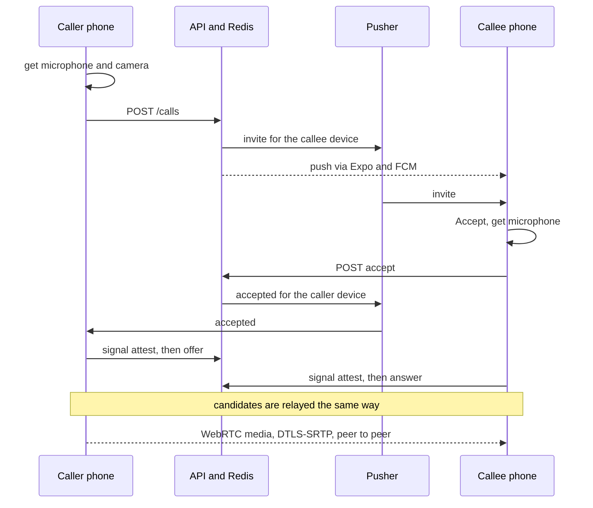
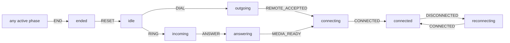

# 10. Voice and video calls

> **Status:** 🟡 Partially implemented — 1:1 voice and video calls work on Android and are device-verified, but no TURN server is configured, there is no full-screen incoming-call UI, and iOS is untested.
> Last reviewed against the code: 2026-10-12.

## Summary

Two users can make a 1:1 voice call or video call. Audio and video go directly between the two
phones with WebRTC. WebRTC encrypts the media with DTLS-SRTP (Datagram Transport Layer Security
plus Secure Real-time Transport Protocol). The server never carries media. It only checks every
call action and passes the call setup messages ("signaling") to the other phone over its private
Pusher channel. Since R2, each phone also proves its DTLS key fingerprint to the other phone
through the existing Signal session, so the server or Pusher cannot secretly sit in the middle.
Call history is kept only on the phone.

## Status at a glance

| Part                                                                       | Status         | Evidence                                                                                                                                                                                                                                                                                                                                     |
| -------------------------------------------------------------------------- | -------------- | -------------------------------------------------------------------------------------------------------------------------------------------------------------------------------------------------------------------------------------------------------------------------------------------------------------------------------------------- |
| Voice calls (place, ring, answer, decline, cancel, hang up, mute, speaker) | ✅ Implemented | `calls.test.js`, `callEngine.test.js`; device-verified 2026-10-09                                                                                                                                                                                                                                                                            |
| Video calls (camera on/off, flip, background and return)                   | ✅ Implemented | `callEngine.test.js`; device-verified 2026-10-11/12 (both directions, background/return)                                                                                                                                                                                                                                                     |
| Calls across different networks with STUN only                             | 🟡 Partial     | Wi-Fi ↔ Airtel LTE device-verified 2026-10-09; Wi-Fi ↔ Jio 5G did **not** connect                                                                                                                                                                                                                                                            |
| TURN relay (fallback for strict NATs)                                      | ⏳ Pending     | Code and config checks exist (`calls.test.js`); no TURN server configured, not verified on a device                                                                                                                                                                                                                                          |
| Network switch during a call (ICE restart)                                 | ✅ Implemented | `callEngine.test.js`; device-verified 2026-10-09                                                                                                                                                                                                                                                                                             |
| Lost-event recovery (re-sent offers, answer retries, ringing checks)       | ✅ Implemented | `callEngine.test.js`; first negotiation recovery tested with mocks only                                                                                                                                                                                                                                                                      |
| R2: DTLS fingerprints attested through Signal                              | ✅ Implemented | `callSecurity.test.js` (incl. two app instances with real libsignal), `callEngine.test.js`; device-verified 2026-10-10 (RMX2103 + RMX3085: first-contact and established attestations, identity change, tampered attestations fail closed) and on every connected call on 2026-10-12 (a call cannot connect unless the attestation verifies) |
| Call history (Calls tab, chat timeline, missed-call notes)                 | ✅ Implemented | `callEngine.test.js`, `calls.test.js`                                                                                                                                                                                                                                                                                                        |
| Android microphone foreground service                                      | ✅ Implemented | Device-verified 2026-10-09 (background and locked screen)                                                                                                                                                                                                                                                                                    |
| Ringing in vibrate mode                                                    | 🟡 Partial     | `media.test.js`; ARCHITECTURE.md says it needs device confirmation                                                                                                                                                                                                                                                                           |
| Full-screen incoming-call UI (ConnectionService / CallKit)                 | ⏳ Pending     | Not built                                                                                                                                                                                                                                                                                                                                    |
| iOS                                                                        | ⏳ Pending     | Not verified on a device                                                                                                                                                                                                                                                                                                                     |

## How it works

1. **Start.** The caller taps the call or video button in a chat header (or in the Calls tab).
   The phone first asks for the microphone (and the camera for video). Nothing reaches the server
   before the user grants it. A contact with an unreviewed security-code change cannot be called.
2. **Ring.** `POST /calls` creates the call in Redis. A Lua script makes sure that neither person
   is already in a call. The server sends an `invite` event to the callee's active device on
   `private-device-{deviceId}` and an "Incoming voice call" / "Incoming video call" push (see
   [11-push-notifications.md](11-push-notifications.md)). The caller gets the ICE servers
   (STUN, and TURN credentials made for this call).
3. **Answer.** The callee taps Accept. The phone gets the microphone (and camera), then calls
   `POST /calls/:callId/accept`. The server moves the call to `accepted` and sends `accepted`
   to the caller. If the callee refuses the camera, the call still goes on, audio only.
4. **Negotiate.** Both phones create an `RTCPeerConnection`. The caller sends its attestation
   (`attest`) and then its SDP offer. The callee sends its own attestation and then its answer.
   ICE candidates are sent in batches every 150 ms. All of this goes through
   `POST /calls/:callId/signal`, and the server relays it. A remote description is applied only
   after the other phone's attestation is verified and only if its fingerprints match.
5. **Connected.** Media flows directly between the phones (or through TURN, if configured). The
   phone moves to `connected` and starts the call timer.
6. **Problems.** If the connection drops, the phone shows "Reconnecting…". The caller restarts
   ICE after 2 s (at once after a network change). The call has 15 s to recover, or it ends as
   "Connection lost".
7. **End.** Either side calls `POST /calls/:callId/end` (or `/reject` while ringing). The server
   sends `ended` to the other side. Each phone releases the microphone, camera, audio mode and
   foreground service, and writes one row to its local call history.

The phone's state machine (`callMachine.js`). An event that does not fit the current phase is
ignored, so late, duplicate or replayed events cannot break a call.

**Server call states:** `ringing → accepted → ended`, or `rejected`, `cancelled`, `missed`,
`failed`. `connecting` and `connected` exist only on the phones.

**Timers on the phone** (`CALL_TIMEOUTS` in `callEngine.js`):

| Timer              | Value                    | Purpose                                                              |
| ------------------ | ------------------------ | -------------------------------------------------------------------- |
| Ring               | server ring window + 2 s | Give up on an unanswered call                                        |
| Ringing check      | every 5 s while ringing  | `GET /calls/current` to catch a lost `accepted` / `ended` / `invite` |
| Negotiation        | 20 s                     | From answer to connected; also the deadline for the attestation      |
| First-offer copy   | every 4 s                | Caller re-sends the same offer (next number) until answered          |
| Signal retry       | 2 s, then 4 s            | Offer or answer request that got no response at all                  |
| Reconnect          | 15 s                     | Time to recover a dropped call                                       |
| ICE restart        | 2 s after a drop         | Caller only; re-offer every 4 s while the answer is missing          |
| Network re-check   | 5 s                      | A path that survived a network change keeps the call                 |
| Capture deadline   | 15 s (`media.js`)        | Camera/microphone must start, else `media_unavailable`               |
| In-progress marker | every 15 s               | See [12-crash-recovery.md](12-crash-recovery.md)                     |

**Video specifics.** A video call is the same call with `kind: 'video'`. Camera on/off disables
the track and sends a `media { video }` flag. Flip uses the in-place camera switch (no
renegotiation). When the app leaves the screen, the camera is released with
`replaceTrack(null)` and reopened on return. Since 2026-10-12, app-state changes are ignored
until the call holds its media, and camera release and reopen run one at a time (`cameraTask`).

## Packages and versions

| Package                               | Declared                                    | Installed  | Used for                                                 |
| ------------------------------------- | ------------------------------------------- | ---------- | -------------------------------------------------------- |
| `react-native-webrtc`                 | `124.0.8`                                   | `124.0.8`  | Capture, `RTCPeerConnection`, DTLS-SRTP                  |
| `org.jitsi:webrtc` (native, Android)  | `124.+` (range, set by react-native-webrtc) | not pinned | Native WebRTC library                                    |
| `react-native-incall-manager`         | `4.3.0`                                     | `4.3.0`    | Audio mode, earpiece/speaker, proximity sensor, ringtone |
| `@config-plugins/react-native-webrtc` | `15.0.2`                                    | `15.0.2`   | Permission texts for microphone and camera               |
| `pusher-js`                           | `^8.6.0`                                    | `8.6.0`    | Receives `call` events on the phone                      |
| `pusher` (API)                        | `^5.3.4`                                    | `5.3.4`    | Publishes `call` events                                  |
| `ioredis` (API)                       | `^5.6.0`                                    | `5.11.1`   | Call state and Lua scripts                               |
| `@react-native-community/netinfo`     | `~12.0.1`                                   | `12.0.1`   | Network-change detection during calls                    |

## Source files

**API**

- [calls.routes.js](../apps/api/src/modules/calls/calls.routes.js) — routes and strict zod schemas for every call request.
- [callService.js](../apps/api/src/modules/calls/callService.js) — who may do what, relaying, ring timeout, missed-call notes, ending calls on sign-out.
- [callStore.js](../apps/api/src/modules/calls/callStore.js) — Redis keys and atomic Lua scripts (create, transition, missed notes).
- [iceServers.js](../apps/api/src/modules/calls/iceServers.js) — STUN list and per-call TURN credentials (TURN REST API scheme).
- [pushNotifier.js](../apps/api/src/modules/messages/pushNotifier.js) — the incoming-call push.
- [env.js](../apps/api/src/config/env.js) — call, STUN/TURN and ICE policy settings and their startup checks.

**Mobile**

- [callEngine.js](../apps/mobile/src/calls/callEngine.js) — the call logic: signaling, timers, recovery, attestation, video, cleanup.
- [callMachine.js](../apps/mobile/src/calls/callMachine.js) — phases, allowed transitions, end reasons and their texts.
- [callSecurity.js](../apps/mobile/src/calls/callSecurity.js) — fingerprint parsing and attestation checks (R2).
- [media.js](../apps/mobile/src/calls/media.js) — the only file that touches WebRTC, in-call audio and the foreground service.
- [ice.js](../apps/mobile/src/calls/ice.js) — ICE server clean-up and connection-path labels (types only, no addresses).
- [callHistory.js](../apps/mobile/src/calls/callHistory.js) — local `call_log` and collection of missed-call notes.
- [useCallPeer.js](../apps/mobile/src/calls/useCallPeer.js) — hides the caller's name for locked chats.
- [VideoView.js](../apps/mobile/src/calls/VideoView.js) — video surface for local and remote streams.
- [call.js](../apps/mobile/src/app/%28app%29/call.js) — full-screen call screen.
- [calls.js](../apps/mobile/src/app/%28app%29/%28tabs%29/calls.js) — Calls tab (history).
- [messagingEngine.js](../apps/mobile/src/messaging/messagingEngine.js) — feeds Pusher `call` events, reconnects and network changes into the engine; keeps Pusher open in the background during a call.

**Native module**

- [CallForegroundService.kt](../apps/mobile/modules/call-service/android/src/main/java/expo/modules/callservice/CallForegroundService.kt) — Android `microphone` foreground service ("Voice call in progress").
- [index.js](../apps/mobile/modules/call-service/index.js) — JS wrapper; a no-op on iOS and in tests.
- [withVoiceCallsAndroid.js](../apps/mobile/plugins/withVoiceCallsAndroid.js) — removes WebRTC's screen-share service, marks the camera optional.

**Shared**

- [constants.js](../packages/shared/src/constants.js) — `CALL_KIND`, `CALL_EVENT`, `CALL_STATUS`, `CALL_LIMITS`, call error codes.

## API endpoints

All routes need a JWT (JSON Web Token) and a live session. All share the 120 requests/min per
user limit.

| Method | Path                    | Auth                             | Purpose                                                                     | Rate limit      |
| ------ | ----------------------- | -------------------------------- | --------------------------------------------------------------------------- | --------------- |
| `POST` | `/calls`                | JWT (caller)                     | Start a call (`calleeUserId`, `kind`); returns the call and ICE servers     | 10/min per user |
| `GET`  | `/calls/current`        | JWT                              | This device's ongoing call (recovery)                                       | —               |
| `POST` | `/calls/:callId/accept` | JWT, callee device only          | Answer (idempotent); returns ICE servers                                    | —               |
| `POST` | `/calls/:callId/reject` | JWT, callee device only          | Decline (idempotent)                                                        | —               |
| `POST` | `/calls/:callId/signal` | JWT, either device, after answer | `offer` (caller), `answer` (callee), `candidates` (≤ 20), `media`, `attest` | —               |
| `POST` | `/calls/:callId/end`    | JWT, either device               | Hang up, cancel or report failure (idempotent)                              | —               |
| `GET`  | `/calls/missed`         | JWT                              | Missed-call notes not yet collected                                         | —               |
| `POST` | `/calls/missed/ack`     | JWT                              | Forget up to 100 collected notes                                            | —               |

Realtime events on `private-device-{deviceId}` (event name `call`): `invite`, `accepted`,
`signal`, `ended`. No Pusher client events are used.

## Data storage

### MongoDB

Not used for call state. `POST /calls` reads `devices` to find the callee's active device (not
revoked, with Signal keys). An `attest` signal reads the recipient device's
`signal.registrationId`.

### Redis

| Key                    | Value                                                                  | TTL                                                                                                   |
| ---------------------- | ---------------------------------------------------------------------- | ----------------------------------------------------------------------------------------------------- |
| `call:{callId}`        | hash: ids of both users and devices, `status`, `reason`, `kind`, times | ring window + 1 s + 60 s while ringing; `CALL_MAX_DURATION_SECONDS` once answered; 60 s after the end |
| `call:user:{userId}`   | the user's current call id ("busy" marker)                             | same as the call; deleted at the end                                                                  |
| `call:missed:{userId}` | hash: `callId` → `{ callId, callerUserId, kind, createdAt, endedAt }`  | 7 days; ≤ 100 notes                                                                                   |

SDP, ICE candidates and attestations are never stored. TURN credentials are never stored.

### On the phone

- SQLCipher table `call_log` (migrations v6 and v7): `call_id`, `peer_user_id`, `direction`,
  `kind`, `outcome`, `started_at`, `connected_at`, `ended_at`. No media and no SDP.
- SQLCipher `meta` key `calls.inProgress`: marker of a connected call (see
  [12-crash-recovery.md](12-crash-recovery.md)).
- No SecureStore keys. Call history is deleted with the database at sign-out.

## Security measures

- **Media is peer to peer.** The server, Redis, MongoDB and Pusher never carry audio or video.
- **Every step is authorized.** A call is bound to the exact caller device and callee device.
  Anyone else gets 404 `CALL_NOT_FOUND` (no call-id probing). Only the caller sends offers, only
  the callee sends answers, and signaling is accepted only while the call is `accepted`.
- **Atomic state.** All changes are Lua scripts in Redis, so two racing requests cannot both win.
- **R2 call-key check.** Each phone seals `call.dtls` v1 `{ callId, role, from, to, kind,
fingerprints }` (SHA-256 only) on the Signal session with the other person. The receiver
  checks the binding and applies a remote description only with exactly those fingerprints.
  Anything else fails closed ("Couldn't verify this call"). A changed identity key ends the call
  as "Security code changed".
- **Size limits.** SDP ≤ 8 000 characters and must start with `v=0`; candidates ≤ 512
  characters; attestation ≤ 3 072 bytes; any event over Pusher's 10 KB is refused with 413.
- **Candidate flood cap.** A phone accepts at most 100 remote candidates per ICE generation and
  300 per call, and drops duplicates.
- **TURN secret stays on the server.** Per-call credentials (`username = expiry:callId`,
  `credential = base64(HMAC-SHA1(TURN_SECRET, username))`) appear only in the HTTPS responses of
  `POST /calls` and `/accept`. Startup refuses a `TURN_SECRET` equal to the JWT or OTP secret.
- **Push has no caller identity.** It says only "Incoming voice call" or "Incoming video call".
- **Chat Lock.** For a locked chat, the call screen hides name, avatar and the other person's
  video until Chat Lock is unlocked. The Calls tab shows "Locked chat".
- **Sign-out ends the call.** Logout, sign-in elsewhere, device revocation and account deletion
  end the user's call on the server and tell the other side.
- **No logging of call content.** A test checks that a whole call leaves no SDP, candidates,
  tokens or phone numbers in logs or events.

## Error handling

| Situation                             | Error code / behaviour             | What the user sees                                                 |
| ------------------------------------- | ---------------------------------- | ------------------------------------------------------------------ |
| Callee has no active device with keys | 404 `CALLEE_UNAVAILABLE`           | "Can't be called right now"                                        |
| Callee is on another call             | 409 `CALLEE_BUSY`                  | "On another call"                                                  |
| Caller already in a call              | 409 `ALREADY_IN_CALL`              | "You are already in a call"                                        |
| Calling yourself                      | 400 `VALIDATION_ERROR`             | "Call failed"                                                      |
| Too many calls started                | 429 `RATE_LIMITED`                 | "Call failed"                                                      |
| Action on a finished call             | 409 `CALL_ENDED`                   | Accept on a cancelled call shows "Missed call"                     |
| Signal before the answer              | 409 `CALL_INVALID_STATE`           | Call fails                                                         |
| Wrong side sends offer/answer         | 403 `FORBIDDEN`                    | Call fails                                                         |
| Signal too large for Pusher           | 413 `PAYLOAD_TOO_LARGE`            | Call fails                                                         |
| Attestation for old keys              | 409 `STALE_RECIPIENT_DEVICE`       | Phone rebuilds its Signal session once, then the call goes on      |
| Microphone refused                    | `permission_denied` (nothing sent) | "Microphone permission is needed for calls" + Open Settings        |
| Camera refused (caller)               | `camera_denied` (nothing sent)     | "Camera permission is needed for video calls"                      |
| Camera refused (callee)               | answers audio only                 | "Camera unavailable: audio only"                                   |
| Camera/mic never start                | `media_unavailable` after 15 s     | "Camera or microphone not responding. Close and reopen CipherChat" |
| No answer                             | server `missed`, phone `missed`    | Caller "No answer", callee "Missed call"                           |
| Callee declines                       | server `rejected`                  | "Call declined"                                                    |
| Callee's phone could not take it      | server `failed`                    | "Can't be called right now"                                        |
| No connection within 20 s             | `failed`                           | "Call failed"                                                      |
| Drop not recovered within 15 s        | `connection_lost`                  | "Connection lost"                                                  |
| Attestation missing or wrong          | `security_unverified`              | "Couldn't verify this call"                                        |
| Peer's security code changed          | `identity_changed`                 | "Security code changed" + Review security code                     |

## Configuration

API environment (names and defaults; see `.env.example`):

| Variable                      | Default                        | Notes                                                      |
| ----------------------------- | ------------------------------ | ---------------------------------------------------------- |
| `CALL_RING_TIMEOUT_SECONDS`   | 45                             | 1–120                                                      |
| `CALL_MAX_DURATION_SECONDS`   | 14 400                         | Backstop for an answered call's Redis state                |
| `STUN_URLS`                   | `stun:stun.l.google.com:19302` | Development default; plain `stun:`/`stuns:` URIs only      |
| `TURN_URLS`, `TURN_SECRET`    | not set                        | Both or neither; `turn:`/`turns:` URIs without credentials |
| `TURN_CREDENTIAL_TTL_SECONDS` | 18 000                         | Must be ≥ ring timeout + max duration when TURN is set     |
| `ICE_TRANSPORT_POLICY`        | `all`                          | `relay` needs TURN                                         |

In production without TURN, the API logs a warning at startup.

Mobile (`app.json`): `@config-plugins/react-native-webrtc` (microphone and camera texts),
`./plugins/withVoiceCallsAndroid`, `ios.infoPlist.UIBackgroundModes: ["audio"]`. The
`call-service` module manifest adds `FOREGROUND_SERVICE` and `FOREGROUND_SERVICE_MICROPHONE`.

## Testing status

- **Automated** (counted `it(` cases):
  - API `calls.test.js` (41): start, busy, kinds, rate limit, answer/decline/cancel/hang-up
    races, relay direction, size limits, attestations, recovery, ring expiry on read, missed
    notes, sign-out/revocation/deletion, STUN/TURN config, no sensitive data in logs.
  - Mobile `callEngine.test.js` (138): full engine with fake WebRTC, including lost events,
    replay protection, stale reads, timeouts, ICE restarts, network changes, video, Chat Lock,
    history, attestation logic.
  - `callMachine.test.js` (6), `callSecurity.test.js` (14, incl. two app instances with real
    libsignal), `ice.test.js` (11), `media.test.js` (7: permissions, capture deadline, ringing).
- **Device testing** (debug builds, Android): voice calls on two phones on 2026-10-09 (connect,
  mute, speaker, hang-up, decline, cancel, 45 s timeout, background and locked screen with the
  foreground service, force-stop recovery, incoming call via push). Same-network and
  Wi-Fi ↔ Airtel LTE voice and video, and network switches recovered within 15 s (2026-10-09).
  Two-way video in both directions and background/return during video (2026-10-11/12, RMX2103
  Android 11 and RMX3851 Android 16).
  R2 attestations on two phones (2026-10-10, RMX2103 Android 11 and RMX3085 Android 13, from the
  project's test notes): audible audio and visible video both ways, first-contact and
  established attestations, a real identity change blocking calls until accepted, tampered
  attestations failing closed, Wi-Fi ↔ Jio 4G, and a mid-call Wi-Fi → data → Wi-Fi switch.
- **Not tested yet:** TURN and relay-only mode, Wi-Fi ↔ Jio 5G (failed with STUN only),
  first-negotiation recovery between two real phones, ringing in vibrate mode, release build,
  iOS.

## Known limitations and pending work

- No TURN server: calls behind strict NATs (for example, symmetric NAT) cannot connect.
- ICE candidates reveal IP addresses to the other phone, the server and Pusher (unless
  `ICE_TRANSPORT_POLICY=relay` with TURN).
- No full-screen incoming-call UI (no ConnectionService or CallKit). A locked phone only shows a
  notification. Push plus app start can use much of the 45 s ring window.
- Who is calling is shown while ringing from the server's word. It is proven only when the
  attestation verifies. The attestation is as strong as the Signal identity (trust on first use
  unless security codes are compared).
- Not built: voice-to-video upgrade during a call, group calls, screen sharing,
  picture-in-picture, call waiting.
- `media` camera flags have no order: a late flag can show the wrong camera state briefly.
- The foreground-service notification says "Voice call in progress" also during video calls.
- The native WebRTC binary (`org.jitsi:webrtc:124.+`) is not pinned.
- iOS: not tested; the call-service module does not exist there (the `audio` background mode is
  used instead).

## Related documents

- [03-end-to-end-encryption.md](03-end-to-end-encryption.md) — Signal sessions used by the R2 attestation; `call.dtls` content type.
- [06-key-management.md](06-key-management.md) — identity-key changes that block calls.
- [08-real-time-messaging.md](08-real-time-messaging.md) — Pusher device channels and reconnects.
- [09-chat-lock.md](09-chat-lock.md) — hiding the caller for locked chats.
- [11-push-notifications.md](11-push-notifications.md) — incoming-call push.
- [12-crash-recovery.md](12-crash-recovery.md) — interrupted calls and call recovery.
- [14-presence-and-typing.md](14-presence-and-typing.md) — heartbeats during calls.
- [ARCHITECTURE.md §12 Status and roadmap](ARCHITECTURE.md#12-status-and-roadmap) — Phases 5–9 and device results.
- [ARCHITECTURE.md §13 Known limitations](ARCHITECTURE.md#13-known-limitations-and-risks).
