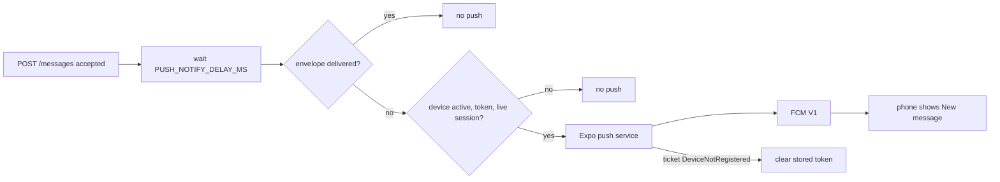
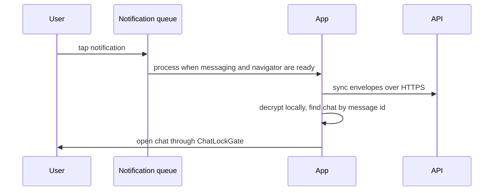

# 11. Push notifications

> **Status:** ✅ Implemented (Android) — message and incoming-call pushes are built end to end through the Expo push service and FCM; iOS push, release-build credentials and push receipts are not verified.
> Last reviewed against the code: 2026-10-12.

## Summary

When the app is closed or in the background, the phone still learns about new messages and
incoming calls through push notifications. The API sends them through the Expo push service,
which forwards them to FCM V1 (Firebase Cloud Messaging, HTTP v1 API) on Android. A push never
carries message content, a sender name or keys: it says only "New message" or "Incoming voice
call" with an opaque id. When the user taps it, the app syncs the encrypted envelope over HTTPS,
decrypts it on the phone and opens the right chat (or the call). A message push is sent only if
the phone did not confirm the message within 3 seconds, so an open app gets no duplicate.

## Status at a glance

| Part                                                        | Status         | Evidence                                                                                              |
| ----------------------------------------------------------- | -------------- | ----------------------------------------------------------------------------------------------------- |
| Push token registration and refresh (`/devices/push-token`) | ✅ Implemented | API `push.test.js`, mobile `push.test.js`                                                             |
| Delayed "New message" push (only if not acked in 3 s)       | ✅ Implemented | API `push.test.js`; not recorded as device-verified in ARCHITECTURE.md                                |
| Incoming-call push                                          | ✅ Implemented | API `calls.test.js`; device-verified 2026-10-09 (backgrounded app, tap, Accept, connected)            |
| Foreground suppression (no banner while the app is open)    | ✅ Implemented | Mobile `push.test.js`                                                                                 |
| Tap routing, cold start and warm                            | ✅ Implemented | Mobile `push.test.js`, `callEngine.test.js`; expired call notification tap device-verified 2026-10-09 |
| Clearing dead tokens (`DeviceNotRegistered`)                | 🟡 Partial     | API `push.test.js`; only the immediate push ticket is read, Expo push receipts are never fetched      |
| Android channels `messages` and `calls`                     | ✅ Implemented | Code (`pushNotifications.js`)                                                                         |
| Release build with FCM V1 credentials in EAS                | ⏳ Pending     | Not verifiable from the repository; release build not done                                            |
| iOS (APNs)                                                  | ⏳ Pending     | Not verified on a device                                                                              |

## How it works

1. **Registration.** After sign-in, once messaging is ready, the app creates the Android
   channels, asks for notification permission (only if the system still allows asking), and
   gets an Expo push token with the EAS project id. It sends the token to
   `POST /devices/push-token` only if it changed or is older than 7 days. The last registered
   token is kept in SecureStore `push.registration`. Registration is single-flight.
2. **Token rotation.** A push-token listener re-registers when FCM gives a new device token.
   Tokens already seen in this session are ignored, because expo-notifications also fires the
   listener for the app's own token fetch (this once caused a loop).
3. **Background behaviour.** When the app goes to the background, it drops its Pusher
   connection on purpose (except during a call). A backgrounded phone therefore does not ack new
   envelopes over realtime, and the server sends a push instead.
4. **New message.** After `POST /messages` stores a new envelope, the API waits
   `PUSH_NOTIFY_DELAY_MS` (default 3 000 ms). If the envelope is still not delivered, and the
   recipient device is not revoked, has a push token and has a live session, it sends the push.
5. **Incoming call.** `POST /calls` sends a call push at once (no delay), with a TTL (time to
   live) equal to the ring window, on the `calls` channel. When the call ends, the phone removes
   the call notification.
6. **Foreground.** While the app is on screen, banners, list entries and sounds are suppressed.
   A received push only triggers a sync. An incoming-call push triggers `GET /calls/current`;
   the phone rings only if the server confirms the call rings for this device.
7. **Tap.** Taps are queued from app launch (cold start) and from the listener (warm), and each
   is handled once (by request id). The queue runs after messaging is ready and the navigator is
   mounted. A message tap runs a sync, finds the chat by server message id and opens
   `/chat/<peer>` (through Chat Lock). A call tap opens `/call` only if the call still rings.
8. **Sign-out.** The app deletes `push.registration`, dismisses all notifications and
   unregisters its FCM token. The API clears the stored token on logout.

## Packages and versions

| Package              | Declared   | Installed | Used for                                                        |
| -------------------- | ---------- | --------- | --------------------------------------------------------------- |
| `expo-notifications` | `~57.0.22` | `57.0.22` | Permission, Expo push token, channels, listeners, taps          |
| `expo-constants`     | `~57.0.21` | `57.0.21` | Reads the EAS project id                                        |
| `expo`               | `~57.0.27` | `57.0.27` | SDK                                                             |
| API push provider    | —          | —         | Plain `fetch` to the Expo push API; no SDK, no Firebase library |

## Source files

**API**

- [push/index.js](../apps/api/src/services/push/index.js) — Expo push provider (`expo` or `none`), 10 s request timeout.
- [pushNotifier.js](../apps/api/src/modules/messages/pushNotifier.js) — the two push payloads, the delayed message check, the call push, dead-token cleanup.
- [messageService.js](../apps/api/src/modules/messages/messageService.js) — schedules the push after a new envelope is stored.
- [callService.js](../apps/api/src/modules/calls/callService.js) — sends the incoming-call push.
- [devices.routes.js](../apps/api/src/modules/devices/devices.routes.js) and [deviceService.js](../apps/api/src/modules/devices/deviceService.js) — register and clear tokens.
- [Device.js](../apps/api/src/models/Device.js) — `pushToken` field and its unique index.
- [container.js](../apps/api/src/container.js) — wires the provider and notifier.

**Mobile**

- [pushNotifications.js](../apps/mobile/src/notifications/pushNotifications.js) — permission, channels, token registration, foreground handler, unregister, call-notification dismissal.
- [notificationRouting.js](../apps/mobile/src/notifications/notificationRouting.js) — one queue for cold-start and warm taps.
- [useNotifications.js](../apps/mobile/src/notifications/useNotifications.js) — wiring in the signed-in layout; foreground pushes.
- [settings.js](../apps/mobile/src/app/%28app%29/%28tabs%29/settings.js) — "Notifications" row (status, retry, open system settings).
- [app.config.js](../apps/mobile/app.config.js) — `googleServicesFile` from `GOOGLE_SERVICES_JSON` in EAS builds.

**Shared**

- [validation.js](../packages/shared/src/validation.js) — `expoPushTokenSchema`.

## API endpoints

| Method   | Path                  | Auth | Purpose                                                                          | Rate limit                 |
| -------- | --------------------- | ---- | -------------------------------------------------------------------------------- | -------------------------- |
| `POST`   | `/devices/push-token` | JWT  | Register or refresh this device's Expo push token; moves it off any other device | 120/min per user (general) |
| `DELETE` | `/devices/push-token` | JWT  | Clear this device's token                                                        | 120/min per user (general) |

The token must match `ExpoPushToken[...]` or `ExponentPushToken[...]`. It is never returned by
any endpoint. Sending pushes uses no endpoint of ours: the API calls
`https://exp.host/--/api/v2/push/send`.

## Data storage

### MongoDB

- `devices.pushToken = { token, provider: 'expo', updatedAt }`, or `null`.
- Partial unique index on `pushToken.token`: one token belongs to at most one device.
- Cleared on logout, device revocation, replacement by a new login on another phone, account
  deletion (devices are deleted), and when the push service answers `DeviceNotRegistered`.
- Reads only: `messageenvelopes.deliveredAt` (was it acked?) and `sessions` (is the device
  still signed in?).

### Redis

Not used for push. (The 3 s wait is an in-process timer.)

### On the phone

- SecureStore `push.registration`: `{ token, registeredAt }`.
- No SQLCipher tables. Push content is never stored, because it holds nothing but ids.

## Security measures

- **Generic content.** Message push: title `CipherChat`, body `New message`, data
  `{ type: 'new_message', messageId, hasMessage: true }`. Call push: body `Incoming voice call`
  or `Incoming video call`, data `{ type: 'incoming_call', callId }`. No sender, no conversation
  id, no ciphertext, no keys.
- **Private lock screen.** Both Android channels use `PRIVATE` lock-screen visibility.
- **No Firebase server credentials on the API.** FCM V1 credentials live in the EAS project;
  the API holds at most an optional `EXPO_ACCESS_TOKEN`.
- **Only signed-in devices.** The notifier checks for a non-revoked device and a live,
  unexpired session before sending.
- **One token, one device.** Registering a token removes it from any other device row.
- **Tokens are not logged.** The logger redacts `pushToken`; push errors log only the error
  code.
- **Payload is never trusted as state.** A call push only triggers an authenticated
  `GET /calls/current`. A message push only triggers a sync.
- **Taps after sign-out.** A call tap checks with the server that the call rings for the
  current signed-in device. A message tap only opens a chat the local database knows; an
  unknown message id opens the chat list. (`clearPendingTaps()` exists in
  `notificationRouting.js` but nothing calls it; see the limitations.)

## Error handling

| Situation                                           | Error code / behaviour                                 | What the user sees                                                      |
| --------------------------------------------------- | ------------------------------------------------------ | ----------------------------------------------------------------------- |
| Push service HTTP error, timeout or network failure | Logged as a warning; message stays stored              | Message arrives on the next sync                                        |
| Ticket error `DeviceNotRegistered`                  | Token cleared (only if still the stored one)           | Nothing                                                                 |
| Other ticket error                                  | Logged (`pushError` code only)                         | Nothing                                                                 |
| Device revoked when registering                     | 401 `DEVICE_REVOKED`                                   | Session ends (see [02-session-management.md](02-session-management.md)) |
| Invalid token format                                | 400 `VALIDATION_ERROR`                                 | Settings shows "Not registered — tap to retry"                          |
| Permission denied                                   | Status `denied`                                        | Settings: "Off (blocked in system settings)"; tap opens system settings |
| No EAS project id in the build                      | Status `unavailable` (`NO_PROJECT_ID`)                 | "Unavailable on this build"                                             |
| Offline / API down / no Google Play services        | Status `error`; retried on next start or token refresh | "Not registered — tap to retry"                                         |
| Tap on a message the phone cannot find              | Opens the chat list                                    | Chat list                                                               |
| Tap on a call that no longer rings                  | Nothing opens                                          | Nothing stale                                                           |

## Configuration

API environment:

| Variable               | Default | Notes                                                      |
| ---------------------- | ------- | ---------------------------------------------------------- |
| `PUSH_PROVIDER`        | `expo`  | `none` turns push off                                      |
| `EXPO_ACCESS_TOKEN`    | not set | Only if "enhanced push security" is on in the Expo project |
| `PUSH_NOTIFY_DELAY_MS` | 3000    | 0–60 000                                                   |

Mobile:

- `app.json` → `expo-notifications` plugin: `icon` (monochrome icon), `color`,
  `defaultChannel: "messages"`.
- `app.json` → `android.googleServicesFile: "./google-services.json"`. The file **exists** in
  `apps/mobile/` and is gitignored (`.gitignore`); its contents were not read. EAS cloud builds
  get it from the file variable `GOOGLE_SERVICES_JSON` (see `app.config.js`).
- `app.json` → `extra.eas.projectId` (needed for `getExpoPushTokenAsync`).
- Android channels (created by the app): `messages` (HIGH, badge) and `calls` (MAX, vibration
  pattern, no badge). The call foreground service has its own `ongoing_call` channel (LOW).

## Testing status

- **Automated** (counted `it(` cases):
  - API `push.test.js` (12): token store/replace/move/validate/clear; opaque payload; no push
    after a realtime ack; no push for devices without a token, signed out, or duplicate sends;
    `DeviceNotRegistered` cleanup; a push failure never affects the message; Expo provider
    request and error mapping without leaking the token.
  - API `calls.test.js`: the callee gets a generic push; `kind=video` push text.
  - Mobile `push.test.js` (13): permission, denied, failures and recovery, missing project id,
    no listener loop, token rotation, foreground suppression, cold-start / warm / duplicate
    taps, unknown messages, no content in a notification, logout cleanup.
  - Mobile `callEngine.test.js`: foreground call push rings only when the server confirms; call
    tap routing; call notification removed when the call ends.
- **Device testing:** incoming call to a backgrounded app via push, tap, Accept, connected; and
  tapping an expired call notification shows nothing stale (two Android phones, debug build,
  2026-10-09). Observation: push delivery took about 10–20 s and opening the app another 10 s.
- **Not tested yet:** message pushes are not recorded as device-verified in ARCHITECTURE.md;
  release (preview/production) builds with EAS FCM V1 credentials; iOS / APNs; behaviour when
  Expo reports errors only in push receipts.

## Known limitations and pending work

- **Push receipts are not checked.** The API reads only the immediate push ticket. Errors that
  Expo reports later in receipts (for example a token that FCM rejects) are not seen, so such
  tokens are not cleared.
- **The 3 s check is an in-process timer.** If the API restarts inside that window, that push
  is lost. The message itself is still delivered by the next sync.
- **Slow call pushes.** Push plus app start can use much of the 45 s ring window. There is no
  full-screen incoming-call UI; a locked phone shows only a notification.
- **Permission is asked at app start** (after messaging is ready), not at a moment the user
  chose.
- **Queued taps are not cleared at sign-out.** `clearPendingTaps()` is exported for this but
  is not called anywhere in `src/`. Impact is small (see Security measures), but the comment's
  intent is not wired up.
- **iOS** is not set up or tested for push.
- **Server credentials** (FCM V1 service account in EAS) cannot be checked from the repository.

## Related documents

- [04-one-to-one-messaging.md](04-one-to-one-messaging.md) — envelopes, acks and sync after a tap.
- [08-real-time-messaging.md](08-real-time-messaging.md) — why Pusher is dropped in the background.
- [09-chat-lock.md](09-chat-lock.md) — taps open chats through `ChatLockGate`.
- [10-voice-video-calls.md](10-voice-video-calls.md) — what happens after an incoming-call push.
- [12-crash-recovery.md](12-crash-recovery.md) — lost push timers on API restart.
- [15-account-and-device-management.md](15-account-and-device-management.md) — tokens cleared on revocation and deletion.
- [ARCHITECTURE.md §7.4 Push notifications](ARCHITECTURE.md#74-push-notifications).
- [ARCHITECTURE.md §13 Known limitations](ARCHITECTURE.md#13-known-limitations-and-risks).
