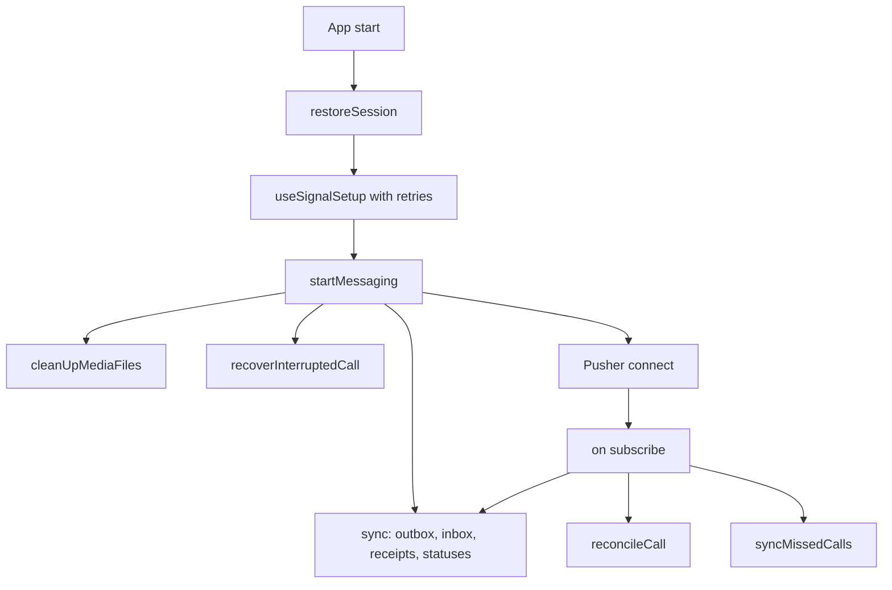
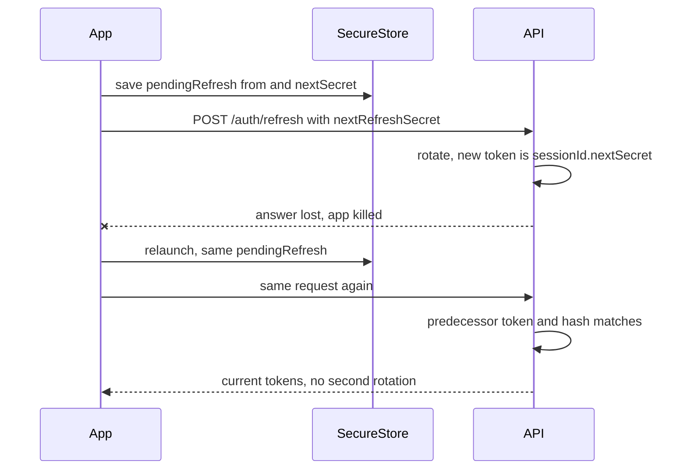

# 12. Crash recovery and resilience

> **Status:** ✅ Implemented — every recovery path below exists in code and is covered by automated tests; some are device-verified, and the known gaps are listed at the end.
> Last reviewed against the code: 2026-10-12.

## Summary

The app and the API are built so that a crash, a killed app, a lost network or a server restart
does not lose messages, does not leave a call stuck, and does not leave decrypted media on the
phone. The main ideas are simple: save state before acting, make every retry idempotent (doing
it twice has the same effect as once), acknowledge only after local processing, and re-check
the server's view whenever the app reconnects. This page is an overview. Details live in the
feature documents linked in each section.

## Status at a glance

| Part                                                         | Status         | Evidence                                                                                     |
| ------------------------------------------------------------ | -------------- | -------------------------------------------------------------------------------------------- |
| Call cut short by a killed app → "Interrupted" history entry | ✅ Implemented | `callEngine.test.js`; not verified on a device                                               |
| Other phone after a kill: call ends, no stale call on reopen | ✅ Implemented | `callEngine.test.js`; device-verified 2026-10-09 (ended in about 23 s)                       |
| Lost call events (reconcile, ringing checks, re-sent offers) | ✅ Implemented | `callEngine.test.js`, `calls.test.js`; first-negotiation recovery tested with mocks only     |
| Network switch during a call                                 | ✅ Implemented | `callEngine.test.js`; device-verified 2026-10-09                                             |
| Missed calls while the app was closed                        | ✅ Implemented | `calls.test.js`, `callEngine.test.js`                                                        |
| Refresh-token race (lost refresh answer)                     | ✅ Implemented | Mobile `api.test.js`, API `auth.test.js`; not verified on a device                           |
| Signal key setup retries when opened offline                 | ✅ Implemented | `signalSetup.test.js`; not verified on a device                                              |
| Outgoing messages interrupted by a crash                     | ✅ Implemented | `messaging.test.js` (mobile and API)                                                         |
| Incoming envelopes: store, process, then ack                 | ✅ Implemented | Mobile `e2ee.test.js`; 100 s outage device-verified 2026-10-09 (each message once, in order) |
| Decrypted-media cleanup (background, start, sign-out)        | ✅ Implemented | Mobile `messaging.test.js`; not verified on a device                                         |
| Attachment upload/download resume                            | ✅ Implemented | API `attachments.test.js`, mobile `messaging.test.js`                                        |
| Attachment sweep on the server (blob first)                  | ✅ Implemented | API `attachments.test.js`                                                                    |
| API restart during a push delay                              | 🟡 Partial     | That push is lost; the message still arrives by sync                                         |
| Database key lost on the phone                               | 🟡 Partial     | File recreated empty; old history cannot come back                                           |

## How it works

### 1. App start after a crash or kill

1. `restoreSession()` loads tokens. An expired refresh session or a detected reinstall wipes
   local data (see [02-session-management.md](02-session-management.md)).
2. `useSignalSetup` runs the key check. If the server cannot be reached (no response, 5xx, 429)
   it retries after 2, 5, 10, then every 30 s, and at once when the network comes back or the
   app returns to the screen. Other failures (for example the key store) are not retried.
3. `startMessaging()` then runs these in parallel:
   - `cleanUpMediaFiles()`: deletes plaintext viewer copies, leftover picker copies and
     recordings, partial downloads (`*.part`) and encrypted blobs no database row refers to.
   - `recoverInterruptedCall()`: turns a leftover `calls.inProgress` marker into one
     "Interrupted" call-history entry.
   - Pusher connect, and a full sync: `flushOutbox → syncInbox → sendReadReceipts →
refreshOutgoingStatuses`. Envelopes already stored before the crash are processed first.
4. On every Pusher (re)subscription: sync, `reconcileCall()` (`GET /calls/current`) and
   `syncMissedCalls()`.

### 2. Calls

- **Killed mid-call.** While a call is connected, the phone writes a marker to the SQLCipher
  `meta` table (`calls.inProgress`) and refreshes its time every 15 s. A normal ending records
  the call and deletes the marker. At the next start, a marker found while no call runs becomes
  an "Interrupted" entry (`INSERT OR IGNORE` by call id, so never twice). The end time is the
  last refresh (±15 s). The server is not used: it keeps no history of answered calls.
- **The server still has the call.** If `GET /calls/current` returns a call this phone has no
  session for (the app was restarted), the phone ends it for both sides (`end` with `failed`, or
  `hangup` if it was still ringing). A call this phone already ended gets its `end` re-sent.
- **The other phone** sees the WebRTC connection drop. Without recovery within 15 s it ends as
  "Connection lost" and releases microphone, camera, foreground service and peer connection.
- **The Android foreground service** returns `START_NOT_STICKY` and stops itself when the task
  is removed: a killed call is never "resumed".
- **Lost Pusher events** (Pusher keeps no history): ringing phones check `GET /calls/current`
  every 5 s; the caller re-sends its first offer every 4 s until answered (20 s limit); offer and
  answer requests with no response are retried after 2 s, then every 4 s; restart answers lost
  during a network switch are recovered by re-offering every 4 s (15 s limit).
- **Stale reads.** A `GET /calls/current` answer that started before the local call changed is
  dropped (`callEpoch` counter).
- **Missed calls while closed.** The server keeps a note in Redis (≤ 7 days). The phone saves it
  to `call_log` first and acknowledges it afterwards, so a crash in between only collects it
  again.

Details: [10-voice-video-calls.md](10-voice-video-calls.md).

### 3. Refresh-token race

A refresh can succeed on the server while its answer is lost (timeout, dropped connection, app
killed). Presenting the spent token again would look like theft and wipe the phone. So the app
saves `pendingRefresh = { from, nextSecret }` in SecureStore **before** it sends
`POST /auth/refresh` with `nextRefreshSecret`. Every retry (after a timeout, 5xx, 429 or a
relaunch) sends exactly the same request. The server answers a repeat without rotating again
only if the token is the direct predecessor and the hash of `nextRefreshSecret` equals the
current token's hash. A 400 means nothing rotated, so the next attempt proposes a new secret.
Refreshes are single-flight in the app.

Details: [02-session-management.md](02-session-management.md).

### 4. Messages

- **Sending.** A message is stored as `sending` before anything else. Its Signal ciphertext is
  kept in the `outbox` until the server accepts it, so a retry never re-encrypts.
  `flushOutbox()` re-sends `sending` and `failed` + `TEMPORARY` messages oldest first and stops
  at the first temporary failure (order is kept). The server de-duplicates on
  `(senderDeviceId, clientMessageId)` and answers a retry with the original message.
- **Receiving.** Each envelope is stored as `pending` first. Decrypting it commits session,
  used pre-key removal, message insert and envelope status in one SQLCipher transaction. The
  app acks `upToSeq` only after the page is stored and processed, then moves its cursor. The
  server keeps undelivered envelopes for 30 days, so nothing is lost if the app is closed.
- **Resync triggers.** Messaging start, every Pusher (re)subscription, foreground, network
  reconnect or Wi-Fi ⇄ mobile-data switch, the backend answering again after failures, a
  notification tap, and a 30 s poll while the app is on screen without Pusher. Syncs are
  single-flight with one queued re-run.
- **Pusher hangs.** After a network switch the app reconnects Pusher at once. Its activity
  timeout is 30 s + 10 s instead of the library's 120 s + 30 s.
- **Security-code changes** that are pending survive a force-close.

Details: [04-one-to-one-messaging.md](04-one-to-one-messaging.md) and
[08-real-time-messaging.md](08-real-time-messaging.md).

### 5. Media files

- Decrypted photos, videos and voice notes exist only in `cache/secure-media/` while shown or
  played. They are deleted on release, every time the app goes to the background
  (`releaseAllPlaintext()`), at every messaging start (`sweepMediaLeftovers()`), and at
  sign-out (`wipeAllMedia()`).
- Downloads are written to `<name>.part` and moved into place only after the size, digest and
  GCM tag are verified. Leftover `.part` files are deleted at start.
- Encrypted blobs with no database row (the app was killed between encrypting and saving the
  message) are deleted at start.
- Uploads are idempotent: `clientAttachmentId` maps a retry to the same server attachment. A
  network failure leaves the message `failed(TEMPORARY)` and the next sync retries it.
- Downloads stop at the first temporary failure and are retried after the next sync.

Details: [05-encrypted-media.md](05-encrypted-media.md).

### 6. Server restarts and outages

- **Call state** lives only in Redis with a TTL on every key, so a crashed server cannot leave
  a call ringing forever. The ring-timeout timer is in-process, but an overdue ringing call is
  also expired when it is next read. Missed-call notes are in Redis and survive an API restart.
- **Push delay** (`PUSH_NOTIFY_DELAY_MS`) is an in-process timer. A restart inside that window
  loses that push only.
- **Attachment sweep** deletes the blob first, then the metadata, so a crash in between leaves
  metadata that is retried, never an orphaned blob. It is safe on several instances.
- **Graceful shutdown** (SIGTERM/SIGINT) stops the sweeper, closes the HTTP server, then MongoDB
  and Redis, with a forced exit after `SHUTDOWN_TIMEOUT_MS`.
- **Redis down:** rate limiters answer 503 instead of letting requests through.
- **The app during an outage** keeps its session, data and pending refresh on network errors,
  timeouts, 429 and 5xx. The banner shows "You're offline. Messages will be sent when you reconnect." or "Can't
  reach CipherChat right now. Messages will be sent when it's back.", and
  everything catches up when the backend answers again.

## Packages and versions

| Package                           | Declared  | Installed | Used for                                              |
| --------------------------------- | --------- | --------- | ----------------------------------------------------- |
| `@react-native-community/netinfo` | `~12.0.1` | `12.0.1`  | Network changes that trigger resync and call recovery |
| `pusher-js`                       | `^8.6.0`  | `8.6.0`   | Realtime with re-subscribe events                     |
| `ioredis` (API)                   | `^5.6.0`  | `5.11.1`  | TTL-based call state                                  |

No package is specific to crash recovery. See the linked feature documents for the rest.

## Source files

**API**

- [callService.js](../apps/api/src/modules/calls/callService.js) — ring expiry on read, idempotent accept/reject/end, missed-call notes.
- [pushNotifier.js](../apps/api/src/modules/messages/pushNotifier.js) — in-process push delay.
- [attachmentService.js](../apps/api/src/modules/attachments/attachmentService.js) — sweep, blob first.
- [authService.js](../apps/api/src/modules/auth/authService.js) — refresh repeat answered without a second rotation.
- [server.js](../apps/api/src/server.js) — graceful shutdown.

**Mobile**

- [messagingEngine.js](../apps/mobile/src/messaging/messagingEngine.js) — start-up cleanup, sync triggers, polling, reconnects.
- [signalService.js](../apps/mobile/src/crypto/signalService.js) — outbox flush, pending envelopes, ack after processing.
- [messageStore.js](../apps/mobile/src/messaging/messageStore.js) — `listAutoRetryable()`.
- [useSignalSetup.js](../apps/mobile/src/crypto/useSignalSetup.js) — key setup retries.
- [api.js](../apps/mobile/src/lib/api.js) — `pendingRefresh`, single-flight refresh.
- [session.js](../apps/mobile/src/auth/session.js) — `restoreSession()`, `wipeLocalSession()`.
- [callEngine.js](../apps/mobile/src/calls/callEngine.js) — `recoverInterruptedCall()`, `reconcileCall()`, retries.
- [callHistory.js](../apps/mobile/src/calls/callHistory.js) — `syncMissedCalls()`.
- [mediaFiles.js](../apps/mobile/src/media/mediaFiles.js) and [attachmentService.js](../apps/mobile/src/media/attachmentService.js) — media sweeps and resumable transfers.

**Native module**

- [CallForegroundService.kt](../apps/mobile/modules/call-service/android/src/main/java/expo/modules/callservice/CallForegroundService.kt) — `START_NOT_STICKY`, stops on task removal.

## API endpoints

None of its own. Recovery uses existing endpoints: `GET /calls/current`, `POST /calls/:callId/end`,
`GET /calls/missed`, `POST /calls/missed/ack`, `POST /auth/refresh`, `POST /messages`,
`GET /messages/envelopes`, `POST /messages/envelopes/ack`, `POST /messages/status`,
`POST /attachments`. See the feature documents for limits.

## Data storage

### MongoDB

- `messageenvelopes`: undelivered for 30 days, 7 days after ack (redelivery source).
- `messages`: unique `(senderDeviceId, clientMessageId)` makes resends idempotent.
- `sessions.usedRefreshTokenHashes` (last 10): lets the server recognise a repeated refresh.
- `attachments`: unique `(uploaderDeviceId, clientAttachmentId)` makes upload retries idempotent.

### Redis

- `call:{callId}`, `call:user:{userId}`: TTL on everything; 60 s after a call ends.
- `call:missed:{userId}`: missed-call notes, ≤ 7 days, deleted after the phone acks them.

### On the phone

- SecureStore `auth.session` (holds `pendingRefresh`).
- SQLCipher: `message_envelopes` (status `pending` / `done` / `failed` / `identity_pending`),
  `outbox`, `sync_state` (envelope cursor), `messages` (`sending`, `failed` + `TEMPORARY`),
  `attachments` (transfer state), `call_log`, `meta` key `calls.inProgress`.
- Files: `files/attachments/*.bin` and `*.part`, `cache/secure-media/`, `cache/ImagePicker`,
  `cache/Audio`.

## Security measures

- Plaintext media never survives a crash: it is swept at the next start.
- A lost refresh answer cannot wipe the phone, but an old token without the current secret is
  still treated as theft and revokes the session.
- A refresh that answers after sign-out saves nothing, so signed-out credentials never come
  back.
- Recovery never trusts push payloads: a call tap or call push only triggers an authenticated
  `GET /calls/current`; a message tap only triggers a sync.
- A finished call id is never revived by a late event or a stale read.
- Recovery writes happen in SQLCipher transactions; no plaintext is written outside the
  encrypted database and the short-lived media cache.

## Error handling

| Situation                                        | Error code / behaviour                                 | What the user sees                     |
| ------------------------------------------------ | ------------------------------------------------------ | -------------------------------------- |
| App killed during a connected call               | Marker → "Interrupted" entry at next start             | Calls tab: "Interrupted"               |
| Other phone killed during a call                 | No recovery within 15 s → `connection_lost`            | "Connection lost"                      |
| Reopened app, server still has the call          | Phone sends `end` (`failed` / `hangup`)                | Nothing stale                          |
| Refresh answer lost                              | Same request repeated; server answers without rotating | Nothing (stays signed in)              |
| Refresh with genuinely reused token              | `REFRESH_TOKEN_REUSED` → wipe                          | Signed out                             |
| Opened in airplane mode                          | Key setup retries; messaging starts when online        | Offline banner, then catches up        |
| Message send interrupted                         | `sending` / `failed` + `TEMPORARY` resent by next sync | Bubble shows sending/failed, then sent |
| Permanent send failure                           | Waits for a tap                                        | Failed bubble with retry               |
| Envelope stored but not decrypted before a crash | Processed at next sync, once                           | Message appears                        |
| Partial download or orphan blob                  | Deleted at start                                       | Download retried                       |
| API restarted within the push delay              | Push lost                                              | No notification; message on next sync  |
| Database cannot be decrypted (key lost)          | File deleted and recreated                             | Empty history                          |

## Configuration

- API: `PUSH_NOTIFY_DELAY_MS`, `CALL_RING_TIMEOUT_SECONDS`, `CALL_MAX_DURATION_SECONDS`,
  `ATTACHMENT_SWEEP_INTERVAL_SECONDS` (600, 0 disables), `SHUTDOWN_TIMEOUT_MS`.
- Mobile constants (code, not env): `SETUP_RETRY_DELAYS_MS` 2/5/10/30 s, `POLL_INTERVAL_MS`
  30 s, `CALL_TIMEOUTS` (see [10-voice-video-calls.md](10-voice-video-calls.md)), Pusher
  `activityTimeout` 30 s and `pongTimeout` 10 s.

## Testing status

- **Automated** (counted `it(` cases):
  - Mobile `callEngine.test.js` (138): interrupted-call marker (recorded once, never for a
    running call), recovery after crash/force-close, stale reads, lost events, retries.
  - Mobile `api.test.js` (17): pending rotation saved first, lost answer after reload, same
    proposal after timeout, 400 drops the proposal, genuine reuse still wipes.
  - API `auth.test.js`: repeat after a lost response, CAS loser answered as a retry, refused from
    another device / revoked device / ended session.
  - Mobile `signalSetup.test.js` (6): offline start, backoff, retry on network/foreground, which
    errors are retried, stop on unmount.
  - Mobile `messaging.test.js`: resend with the same ciphertext, send after restart exactly once,
    interrupted upload retried, start-up removal of plaintext/partial/orphan files, pending
    security-code change survives a force-close, network switch catch-up.
  - Mobile `e2ee.test.js`: envelopes stored before a crash processed exactly once.
  - API `messaging.test.js`: idempotent retries; envelope TTLs. API `attachments.test.js`:
    interrupted upload, sweep. API `calls.test.js`: ring expiry on read after a lost timer.
- **Device testing** (Android, debug builds, 2026-10-09): force-stopping one app ends the call on
  the other in about 23 s and the reopened app shows no stale call; network switches during
  calls recovered within 15 s; a 100 s outage delivered queued messages once each, in order,
  with receipts.
- **Not tested yet on a device:** the "Interrupted" call entry, the refresh-token race, key setup
  retries after an offline start, media plaintext cleanup after a kill, first-negotiation
  signaling recovery between two real phones, API restart behaviour.

## Known limitations and pending work

- An API restart inside the 3 s push window loses that push (in-process timer).
- The ring-timeout timer is in-process too; after a restart a ringing call ends only when it is
  next read or when its Redis key expires (phones also run their own ring timers).
- A killed call cannot be resumed; it can only be recorded and ended.
- The "Interrupted" end time is approximate (±15 s).
- If the SQLCipher key is lost, local history is gone: acked envelopes are not served again.
- Lost trickle ICE candidates after the first answer are not re-sent; a connection that cannot
  form fails at 20 s.
- No server-side signal mailbox: call signaling recovery is client-side only.

## Related documents

- [02-session-management.md](02-session-management.md) — refresh-token race in full.
- [04-one-to-one-messaging.md](04-one-to-one-messaging.md) — outbox, retries, receipts.
- [05-encrypted-media.md](05-encrypted-media.md) — media cleanup, resumable transfers, sweep.
- [07-local-database-encryption.md](07-local-database-encryption.md) — database open failures, wipe.
- [08-real-time-messaging.md](08-real-time-messaging.md) — sync triggers and reconnects.
- [10-voice-video-calls.md](10-voice-video-calls.md) — call recovery and timers.
- [11-push-notifications.md](11-push-notifications.md) — push delay and tap routing.
- [ARCHITECTURE.md §9 Delivery semantics and reliability](ARCHITECTURE.md#9-delivery-semantics-and-reliability).
- [ARCHITECTURE.md §7.5 Sessions and tokens](ARCHITECTURE.md#75-sessions-and-tokens).
- [ARCHITECTURE.md §12 Status and roadmap](ARCHITECTURE.md#12-status-and-roadmap) — Phase 7 and Phase 8 recovery work.
