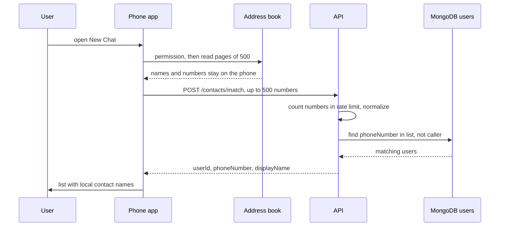
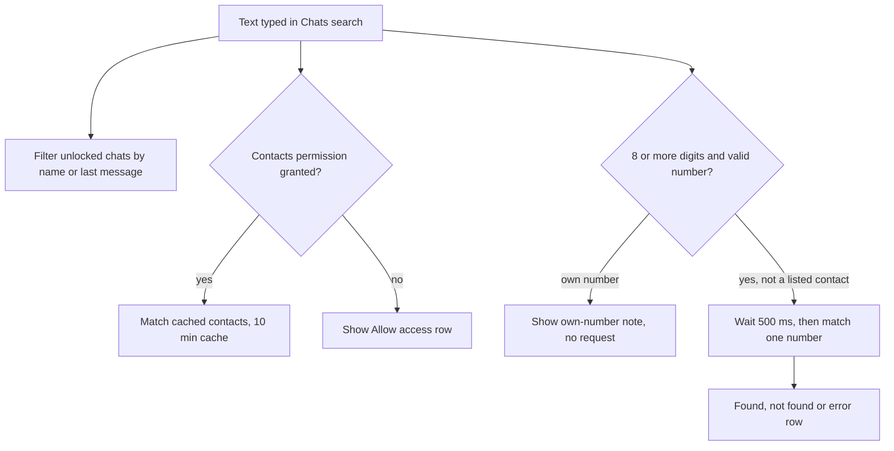

# 13. Contact discovery and chat search

> **Status:** ✅ Implemented — New Chat discovery, contact names for incoming chats and the Chats header search (chats, contacts, exact number lookup) are in the code and tested; the header search is device-verified.
> Last reviewed against the code: 2026-10-12.

## Summary

Users find friends in two ways. **New Chat** reads the phone's address book, sends only the
phone numbers to the server, and shows which contacts have a CipherChat account, with the name
from the user's own address book. The **Chats tab search** (WhatsApp style) finds existing
chats, contacts on CipherChat, and any person by their exact phone number. Contact names never
leave the phone, and the server stores nothing about a lookup. A third fallback, "Search by
CipherChat ID", starts a chat from a user id shared out of band.

## Status at a glance

| Part                                                             | Status         | Evidence                                                                             |
| ---------------------------------------------------------------- | -------------- | ------------------------------------------------------------------------------------ |
| `POST /contacts/match` (numbers only, per-number rate limit)     | ✅ Implemented | `apps/api/test/contacts.test.js` (10)                                                |
| Phone normalization to E.164 on the phone                        | ✅ Implemented | `apps/mobile/test/phone.test.js` (3)                                                 |
| New Chat screen: permission, discovery, local names              | ✅ Implemented | `contactDiscovery.test.js` (17); not verified on a device                            |
| Naming chats someone else started (background, no prompt)        | ✅ Implemented | `contactDiscovery.test.js`; not verified on a device                                 |
| Chats header search: chats, contacts on CipherChat, exact number | ✅ Implemented | `chatSearch.test.js` (6); device-verified 2026-10-11/12                              |
| Start a chat by CipherChat ID                                    | ✅ Implemented | `contactDiscovery.test.js` ("CipherChat ID fallback")                                |
| Phone number of someone who messaged us (`GET /contacts/peers`)  | ✅ Implemented | `contacts.test.js` (5), `contactDiscovery.test.js` (2); not verified on a device yet |
| Private set intersection / enclave matching                      | ⏳ Pending     | Not planned for v1 (ARCHITECTURE.md §13 item 1)                                      |

## How it works

**Phone normalization**

- On the phone, `toE164()` (`lib/phone.js`) parses with `libphonenumber-js/min` and the
  default country **IN** (numbers typed without `+country code` are read as Indian numbers).
  Invalid numbers return `null` and are skipped.
- On the server, `contactService.match()` parses each value again with
  `libphonenumber-js/max` and **no default country**, keeps only valid numbers, and removes
  duplicates. This is the same rule as phone sign-in (`modules/auth/phone.js`).

**New Chat (address-book discovery)**

1. Opening New Chat is the only moment the app asks for Contacts permission on its own
   (`resolvePermission({ ask: true })`). If the system will not ask again, the screen offers
   "Open settings" and re-checks (without prompting) when the app comes back.
2. `readPhoneBook()` reads contacts in pages of 500 (`FULL_NAME` and `PHONES` fields only),
   normalizes every number to E.164 and builds `Map(number → local name)`. The first name seen
   for a number wins. The app yields between pages so the UI does not freeze.
3. `discoverContacts()` removes the user's own number and sends **only the numbers**, in
   batches of 500 (`LIMITS.CONTACT_MATCH_BATCH_MAX`), to `POST /contacts/match`.
4. The server counts the numbers against the hourly budget (5 000 numbers per user), queries
   `users` with `phoneNumber $in [...]` and `_id $ne caller`, and returns
   `{ userId, phoneNumber, displayName }` for each match. Nothing is stored or logged.
5. The phone de-duplicates by `userId` and labels each match with the **local** contact name,
   else the account `displayName`, else a masked number (`+91 ******3210`). The list is sorted
   by name and can be filtered with the header search icon (name, or ≥ 3 digits).
6. Tapping a person calls `createConversation(userId, name)`: the name becomes the chat's
   local nickname in SQLCipher, and the chat opens.
7. Discovery also fills names of existing **unnamed** chats (`applyContactNames`, never
   overwrites an existing name).

**Naming chats someone else started**

- `nameConversationsFromContacts()` runs from the signed-in layout (when messaging is ready
  and on each messaging revision) and after a call (`rememberPeer` in `callEngine.js`).
- It runs only if there is an unnamed chat not yet tried in this app session, at most every
  2 minutes, and only if Contacts permission was **already granted**. It never prompts.

**Chats header search**

1. The search icon in the Chats header turns the header into a text field. Android Back (or
   the back arrow) closes it.
2. While the search is open, `useChatSearch()` builds three result groups:
   - **Chats:** unlocked conversations whose name or last message contains the text. Locked
     chats are not in this list at all (see [09-chat-lock.md](09-chat-lock.md)).
   - **Contacts on CipherChat:** from `getContactsOnApp()`, which reuses `discoverContacts()`
     results for **10 minutes**, so search does not re-upload the address book. It matches by
     name, or by ≥ 3 digits of the number, and skips people already shown under Chats. Without
     permission, a row "Allow access to contacts to find friends on CipherChat" asks only when
     tapped.
   - **Number:** if the text has ≥ 8 digits and is a valid number, and it is not already a
     listed contact, the app waits **500 ms** after the last keystroke and calls
     `POST /contacts/match` with that **one** number. Results: found (opens a chat named with
     the formatted number), "isn't on CipherChat", "That's your own number" (no request), or a
     connection error.
3. Opening a person or number result calls `createConversation()` and opens the chat.

### Names for chats someone else started (2026-10-12)

Before, such a chat showed "User …id" until the address book upload matched it (throttled to
once per 2 minutes), and forever if the person was not a contact. Now, like WhatsApp:

1. When an unnamed chat appears, the app asks `GET /contacts/peers?userIds=…` (at most 50 ids).
2. The server returns a phone number **only for people who have sent this user a message**
   (a `Message` with that sender and this user as recipient). Starting a chat with someone's
   user id therefore never reveals their number. Others are left out of the answer.
3. The number is saved in `conversations.peer_phone` (migration 9) and looked up in the
   address book **on the phone** (no upload), if Contacts permission was already granted.
4. The chat shows the contact name if saved, else the phone number (`+91 98123 45678`), else
   "User …id". A contact name (or nickname) always wins over the number.

A failed request is retried after 60 s. Chats whose peer never messaged us still use the
address-book matching above.

## Packages and versions

| Package                       | Declared                          | Installed | Used for                                                  |
| ----------------------------- | --------------------------------- | --------- | --------------------------------------------------------- |
| `expo-contacts`               | `~57.0.6`                         | 57.0.6    | Contacts permission and paged address-book reads          |
| `libphonenumber-js`           | mobile `^1.13.14`, API `^1.13.14` | 1.13.14   | E.164 parsing (`/min` on the phone, `/max` on the server) |
| `mongoose` (API)              | `^8.18.0`                         | 8.24.5    | `users` query                                             |
| `rate-limiter-flexible` (API) | `^11.2.1`                         | 11.2.1    | Per-number and per-user limits in Redis                   |
| `zod`                         | API `^4.1.0`, mobile `^4.6.5`     | 4.6.5     | Request validation; `objectIdSchema` for the ID fallback  |
| `express` (API)               | `^5.1.0`                          | 5.2.1     | Route                                                     |

## Source files

**API**

- [contacts.routes.js](../apps/api/src/modules/contacts/contacts.routes.js) — `POST /contacts/match`, strict body, per-number limit.
- [contactService.js](../apps/api/src/modules/contacts/contactService.js) — normalize, match, return the three fields.
- [auth/phone.js](../apps/api/src/modules/auth/phone.js) — sign-in phone schema with the same E.164 rule.
- [rateLimit.js](../apps/api/src/middleware/rateLimit.js) — `contactMatchNumbersPerUser`, `authenticatedPerUser`.
- [User.js](../apps/api/src/models/User.js) — `phoneNumber` and its partial unique index.

**Mobile**

- [contacts/contactDiscovery.js](../apps/mobile/src/contacts/contactDiscovery.js) — permission, paged reading, batched matching, 10-minute cache, single-number lookup, background naming.
- [contacts/useChatSearch.js](../apps/mobile/src/contacts/useChatSearch.js) — search logic for the Chats tab.
- [lib/phone.js](../apps/mobile/src/lib/phone.js) — `toE164` (default country IN), `formatPhone`.
- [app/(app)/(tabs)/index.js](<../apps/mobile/src/app/(app)/(tabs)/index.js>) — Chats tab and header search UI.
- [app/(app)/new-chat.js](<../apps/mobile/src/app/(app)/new-chat.js>) — New Chat screen.
- [app/(app)/new-chat-id.js](<../apps/mobile/src/app/(app)/new-chat-id.js>) — start a chat by CipherChat ID (24-character id).
- [app/(app)/_layout.js](<../apps/mobile/src/app/(app)/_layout.js>) — triggers background naming.
- [messaging/messageStore.js](../apps/mobile/src/messaging/messageStore.js) — `ensureConversation`, `applyContactNames`, `listUntitledConversationIds`.
- [config/endpoints.js](../apps/mobile/src/config/endpoints.js) — `ENDPOINTS.CONTACTS.MATCH`.

**Native module**

- None of our own (`expo-contacts` is an Expo module).

**Shared**

- [constants.js](../packages/shared/src/constants.js) — `LIMITS.CONTACT_MATCH_BATCH_MAX` (500).
- [validation.js](../packages/shared/src/validation.js) — `objectIdSchema` (ID fallback).

## API endpoints

| Method | Path                          | Auth | Purpose                                                                                                                               | Rate limit                                                   |
| ------ | ----------------------------- | ---- | ------------------------------------------------------------------------------------------------------------------------------------- | ------------------------------------------------------------ |
| `POST` | `/contacts/match`             | JWT  | Which of these numbers (1–500 strings, each 1–32 chars) have accounts. Returns `{ matches }`.                                         | 5 000 **numbers**/h per user, plus 120 requests/min per user |
| `GET`  | `/contacts/peers?userIds=a,b` | JWT  | Phone numbers of these people (1–50 ids), only of those who have messaged the caller. Returns `{ peers: [{ userId, phoneNumber }] }`. | 120 requests/min per user                                    |

Request body (strict, extra fields such as names are rejected):
`{ "phoneNumbers": ["+91…", …] }`. Response: `{ "matches": [{ userId, phoneNumber, displayName }] }`.
The caller and email-only accounts are never returned. The limit counts every string in the
request, including duplicates and invalid ones.

## Data storage

### MongoDB

Read only: `users.phoneNumber` (E.164, partial unique index) and `users.displayName`. Nothing
about a lookup is written.

### Redis

Rate-limit counters only: `rl:contactMatchNumbersPerUser:{userId}` (1 h window) and
`rl:authenticatedPerUser:{userId}` (60 s window). No numbers are stored.

### On the phone

- **SQLCipher `conversations.title`:** the local nickname, set from the contact name (or the
  formatted number for a number search result) when the user opens a person, or filled for
  unnamed chats by `applyContactNames`.
- **Memory only:** the 10-minute contacts cache (`contactsCache`), the set of chats already
  tried by background naming, and the time of the last run. Lost on restart.
- **SecureStore:** not used. The address book is never copied to disk by the app (tested).

## Security measures

- **Numbers only.** Only E.164 numbers go to the server. Names, emails and other contact
  fields stay on the phone. The server schema is strict, so a `names` field is rejected.
- **Nothing stored or logged.** The server uses the numbers for one query. Request logs hold
  only id, method, path and status (tested: no numbers in logs, no new collections).
- **Enumeration limit.** The rate limit counts **numbers checked** (5 000/h per user), not
  requests, so the number space cannot be scanned by many small requests. Over the limit: 429. If Redis is down: 503 (fail closed).
- **Minimal response.** Only `userId`, `phoneNumber`, `displayName`. Never the caller, never
  email-only accounts, never email, devices or keys (tested).
- **Permission only on intent.** Contacts permission is never requested at app start or
  sign-in; only when the user enters New Chat or taps "Allow" in search. Background naming
  never prompts.
- **Masked display.** New Chat and search show a masked number (`+91 ******3210`) under the
  name.
- **Locked chats.** Search uses the unlocked chat list only.
- **Android permissions.** `WRITE_CONTACTS` is blocked in `app.json`; only reading is possible.
- **Authentication.** JWT plus a live session row on every request (see
  [02-session-management.md](02-session-management.md)).

## Error handling

| Situation                                                 | Error code / behaviour               | What the user sees                                                                             |
| --------------------------------------------------------- | ------------------------------------ | ---------------------------------------------------------------------------------------------- |
| Contacts permission denied                                | No read, no API call                 | "Find people you know" with "Try again" (or "Open settings") and "Continue with CipherChat ID" |
| Offline during discovery                                  | `NetworkError`                       | "You're offline. Connect to the internet and try again."                                       |
| Too many numbers checked this hour                        | 429 `RATE_LIMITED`                   | "Too many lookups for now. Try again later or use a CipherChat ID."                            |
| Other discovery failure (incl. 503)                       | Error state                          | "Could not check your contacts. Try again."                                                    |
| Invalid request (empty, > 500, non-strings, extra fields) | 400 `VALIDATION_ERROR`               | Not reachable from the app's own calls                                                         |
| No token / invalid token                                  | 401                                  | Session handling (see 02)                                                                      |
| No contact uses CipherChat                                | Empty list                           | "None of your contacts use CipherChat yet" with the ID fallback                                |
| Search: typed number not registered                       | `matches: []`                        | "<number> isn't on CipherChat"                                                                 |
| Search: own number                                        | No request                           | "That's your own number"                                                                       |
| Search: lookup failed                                     | Error state                          | "Couldn't check <number>. Check your connection."                                              |
| Search: contacts load failed                              | Status `error`; contacts group empty | Chats and number results still work                                                            |
| ID fallback: not a 24-character id                        | Local check (`objectIdSchema`)       | "Enter the 24-character ID from the other person's Settings screen."                           |
| ID fallback: own id                                       | Local check                          | "That is your own ID."                                                                         |

## Configuration

- `apps/mobile/app.json` plugin `expo-contacts` with `contactsPermission` text: "CipherChat
  checks which of your contacts use CipherChat. Only phone numbers are checked; names never
  leave your phone."
- `android.blockedPermissions` includes `android.permission.WRITE_CONTACTS`.
- No environment variables. Limits are code constants: batch 500
  (`LIMITS.CONTACT_MATCH_BATCH_MAX`), 5 000 numbers/h (`RATE_LIMITS.contactMatchNumbersPerUser`),
  search cache 10 min, lookup debounce 500 ms, minimum 8 digits for a number lookup, background
  naming at most every 2 min, default country `IN`.

## Testing status

- **Automated:**
  - `apps/api/test/contacts.test.js` (10): only registered contacts with three fields;
    formatting-independent matching; mixed/duplicate/invalid numbers; no matches; never the
    caller or email-only accounts; no private data; authentication; request validation and
    batch size; per-number rate limit per user; nothing stored, no numbers logged.
  - `apps/mobile/test/contactDiscovery.test.js` (17): permission only on entering discovery;
    denial without reads or API calls; only normalized numbers sent; no names sent;
    normalization, de-duplication, own number excluded; empty address book; name fallbacks;
    paged reading and bounded batches; nothing stored locally; naming incoming chats once
    without overwriting; no naming without permission; New Chat names existing chats; New Chat
    screen states (list, denied, empty, error); CipherChat ID fallback.
  - `apps/mobile/test/chatSearch.test.js` (6): header search field and Back; contacts by name
    or number, opening a named chat; number lookup found → chat; unknown number and debounce
    (one request); own number without a request; permission asked only on "Allow".
  - `apps/mobile/test/phone.test.js` (3): Indian numbers with/without +91, other country codes,
    invalid input.
- **Device testing:** the Chats header search, including the exact phone-number lookup, was
  verified on two Android phones (RMX2103 Android 11, RMX3851 Android 16, debug build) on
  2026-10-11/12.
- **Not tested yet:**
  - The New Chat screen with a real address book on a device (no recorded result).
  - Very large address books on a device (paging is covered only by automated tests).
  - iOS contacts permission and reading.

## Known limitations and pending work

- **The server sees the numbers while it processes them.** They travel over TLS as plain
  E.164 values. This is not private set intersection or enclave-based matching. Mitigations:
  nothing is stored or logged, and the limit counts numbers.
- **Unverified numbers are discoverable.** A number typed at email sign-up is saved without an
  SMS check (`phoneVerifiedAt` is null) and is still used for matching, because no SMS provider
  exists yet (decision 2026-10-11, ARCHITECTURE.md §14).
- **Names.** `displayName` cannot be edited yet (no profile editing), so a match without a
  local contact name usually shows the masked number.
- **Opening a person sets the chat name.** `createConversation(userId, name)` writes the given
  name over an earlier nickname of that chat (`ensureConversation` uses the new title when one
  is given). Only `applyContactNames` is "fill if empty".
- **Locked chats and contact results.** Search hides locked chats, but a contact whose chat is
  locked can still appear under "Contacts on CipherChat". Opening it goes to the gated chat
  route. This case is not covered by a test.
- **Default country.** Numbers without a country code are read as Indian (`IN`) on the phone.
- **Background naming** is also triggered after calls (`callEngine.js`), which is not listed in
  ARCHITECTURE.md §7.9.

## Related documents

- [01-otp-login.md](01-otp-login.md) — phone and email at sign-up; sign-in E.164 rules.
- [02-session-management.md](02-session-management.md) — authentication for the endpoint.
- [04-one-to-one-messaging.md](04-one-to-one-messaging.md) — conversation list and chats.
- [09-chat-lock.md](09-chat-lock.md) — why locked chats never appear in search.
- [15-account-and-device-management.md](15-account-and-device-management.md) — adding a phone number later (CompleteProfile).
- ARCHITECTURE.md: [§4 Trust boundaries](ARCHITECTURE.md#4-trust-boundaries-who-sees-what),
  [§5.3 API surface](ARCHITECTURE.md#53-api-surface),
  [§7.9 Contact discovery](ARCHITECTURE.md#79-contact-discovery),
  [§7.9a Chat search](ARCHITECTURE.md#79a-chat-search-phase-11),
  [§8 Security controls](ARCHITECTURE.md#8-security-controls),
  [§10 Data retention](ARCHITECTURE.md#10-data-retention),
  [§13 Known limitations](ARCHITECTURE.md#13-known-limitations-and-risks).
