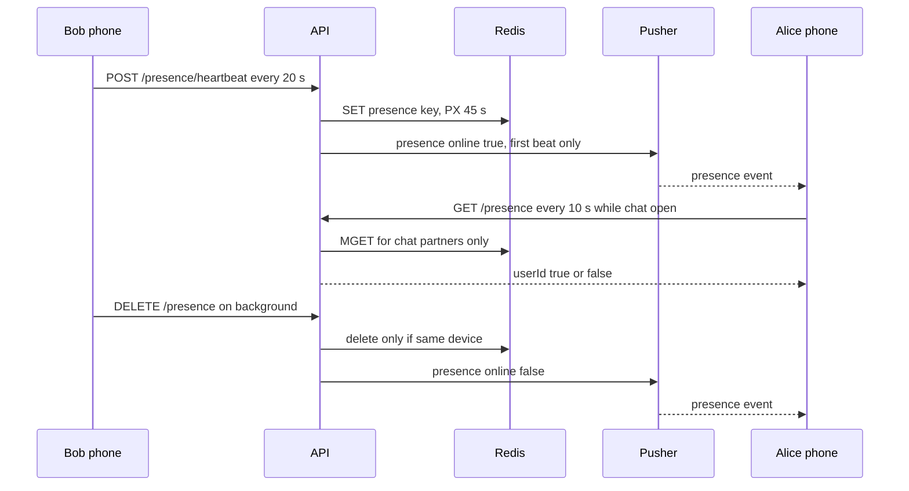
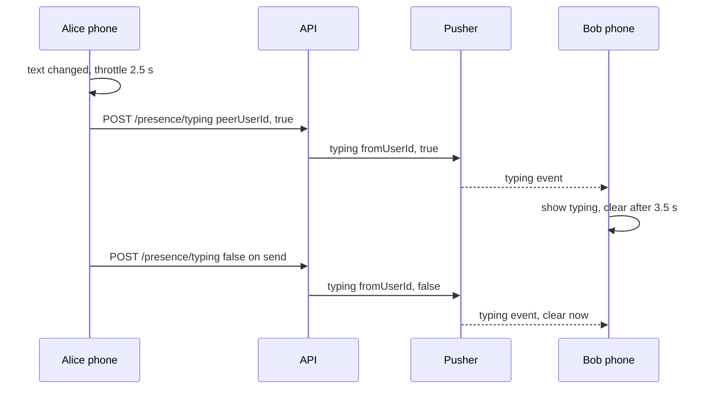

# 14. Presence (online status) and typing indicator

> **Status:** 🟡 Partially implemented — online status is complete, tested and device-verified; the typing indicator works in the code but has no server-side tests, no check that the two users share a chat, and has not been verified on a device.
> Last reviewed against the code: 2026-10-12.

## Summary

In an open chat, the header shows **"Online"** while the other person's app is connected, and
**"typing…"** while they type. "Online" means _the app on their active device recently reached
our server while it was on screen (or in a call)_. It does not mean the person is looking at
the phone, and no "last seen" time exists. The phone sends a small **heartbeat** every 20 s; the
server keeps a Redis key that expires 45 s after the last beat, and pushes "came online" / "went
away" events to the people the user chats with. Typing pings go through the API to the other
person's device channel and disappear by themselves after 3.5 s.

## Status at a glance

| Part                                                                      | Status         | Evidence                                                                                                                           |
| ------------------------------------------------------------------------- | -------------- | ---------------------------------------------------------------------------------------------------------------------------------- |
| Heartbeat → Redis key with TTL                                            | ✅ Implemented | `apps/api/test/presence.test.js`, `apps/mobile/test/messaging.test.js`                                                             |
| `DELETE /presence` when the app leaves the screen                         | ✅ Implemented | Same tests                                                                                                                         |
| Cleared by sign-in elsewhere, logout, device revocation, account deletion | ✅ Implemented | `apps/api/test/presence.test.js`                                                                                                   |
| Visible only to people with a conversation                                | ✅ Implemented | `apps/api/test/presence.test.js`                                                                                                   |
| Pushed `presence` events (came online / went away)                        | ✅ Implemented | `apps/api/test/presence.test.js`, `apps/mobile/test/presence.test.js`; device-verified 2026-10-11/12                               |
| Chat header "Online" / "Offline", 10 s poll, re-read on return            | ✅ Implemented | `apps/mobile/test/presence.test.js`; live updates device-verified 2026-10-11/12 (offline shown ~3 s, online ~4 s after the change) |
| Typing indicator: receive and show "typing…", auto-clear                  | ✅ Implemented | `apps/mobile/test/presence.test.js` (one case); not verified on a device                                                           |
| Typing indicator: send (`sendTypingPing`, `POST /presence/typing`)        | 🟡 Partial     | No automated test; no audience check on the server; not verified on a device                                                       |
| Online status in the chat list                                            | ⏳ Pending     | Not built (only the chat header shows it)                                                                                          |
| "Last seen" and privacy settings                                          | ⏳ Pending     | Settings row "Privacy — Last seen, read receipts" is disabled ("Soon")                                                             |

## How it works

**Online status: sending side**

1. While messaging runs, `startHeartbeat()` calls `sendHeartbeat()` every 20 s
   (`PRESENCE.HEARTBEAT_INTERVAL_SECONDS`). A beat is also sent on every Pusher
   (re)subscription, when the app returns to the foreground, after a network change, and when
   the backend answers again after failures.
2. A beat is skipped if `useMessagingStore.online` is false, or if the app is in the background
   or inactive and no call is active. During a call the app keeps beating in the background.
3. `POST /presence/heartbeat` has an empty body. The API takes the user and device only from the
   session.
4. `presenceService.heartbeat()` reads the old value, then sets `presence:{userId}` = `deviceId`
   with a TTL of `PRESENCE_TTL_SECONDS` (45 s). If there was no key before, the user just came
   online: the API **announces** `online: true`.
5. When the app goes to the background (and no call is active), or a call ends while in the
   background, the app sends `DELETE /presence`. The API deletes the key **only if it still
   holds this device id** (a Lua script), so an old phone cannot clear a newer phone's status. If
   a key was removed, it announces `online: false`.
6. The server also clears presence on sign-in on another device, logout, device revocation and
   account deletion. A crash, a dead network or a killed app sends nothing: the key simply
   expires after 45 s (two missed beats).

**Announcing changes**

1. `announce(userId, online)` finds every `conversationId` in `messages` where the user is the
   sender or the recipient, and takes the other user id from each.
2. It publishes `presence` `{userId, online}` to every non-revoked device of those people, on
   their `private-device-{deviceId}` channels. No time and no device id are sent.
3. This is best effort: errors are logged and polling recovers anything lost.

**Online status: viewing side**

1. The chat header calls `usePeerOnline(peerUserId)`.
2. While the chat is open and this phone is online, it reads `GET /presence?userIds=<peer>` at
   once, every 10 s (`PRESENCE_POLL_MS`), and whenever the app comes back to the foreground. It
   does not read while the app is in the background or inactive.
3. The API answers `false` for everybody except people the caller has a conversation with
   (checked by `conversationId` in `messages`); for those it reads the Redis keys (`MGET`). Your
   own id, unknown ids and strangers all read as `false`.
4. A pushed `presence` event updates the same store (`usePresenceStore`) at once. An "offline"
   event also clears that person's typing state.
5. A single "offline" answer counts (the server already allows one missed beat). A failed read
   keeps the last known value.

**Typing indicator**

1. In the chat screen, every text change calls `sendTypingPing(peer, true)` if the text is not
   empty, or `sendTypingPing(peer, false)` if it is. Sending a message, attaching media and
   leaving the chat send `false`.
2. `sendTypingPing` sends a `true` ping to the same peer at most once per 2.5 s. `false` pings
   are not throttled. Errors are ignored.
3. `POST /presence/typing {peerUserId, typing}` (`typing` defaults to `true`). If `peerUserId`
   is the caller, the API does nothing. Otherwise it publishes `typing` `{fromUserId, typing}` to
   every non-revoked device of that user and answers 204. Nothing is stored.
4. The receiving app (`handleTypingEvent`) sets `typingByUserId[fromUserId]`. A `true` event
   starts a 3.5 s timer that clears it, unless a new `true` event renews it; a `false` event
   clears it at once.
5. The chat header shows, in this order of priority: "Security code changed", "typing…",
   "Online", "Offline", or "End-to-end encrypted" (status unknown or this phone offline).

## Packages and versions

| Package                       | Declared  | Installed | Used for                                                            |
| ----------------------------- | --------- | --------- | ------------------------------------------------------------------- |
| `ioredis` (API)               | `^5.6.0`  | 5.11.1    | `presence:{userId}` key, `MGET`, Lua `presenceClearIfDevice`        |
| `mongoose` (API)              | `^8.18.0` | 8.24.5    | `Message.distinct('conversationId')` audience checks, device lookup |
| `pusher` (API)                | `^5.3.4`  | 5.3.4     | `presence` and `typing` events                                      |
| `rate-limiter-flexible` (API) | `^11.2.1` | 11.2.1    | 12 heartbeats/min per user                                          |
| `zod` (API, shared)           | `^4.1.0`  | 4.6.5     | Query and body validation                                           |
| `pusher-js` (mobile)          | `^8.6.0`  | 8.6.0     | Receiving events ([08](08-real-time-messaging.md))                  |
| `zustand` (mobile)            | `^5.0.15` | 5.0.15    | `usePresenceStore`, `useTypingStore`                                |
| `react-native` (mobile)       | `0.86.3`  | 0.86.3    | `AppState` (on screen or not)                                       |

## Source files

**API**

- [presence.routes.js](../apps/api/src/modules/presence/presence.routes.js) — heartbeat, `DELETE /presence`, `GET /presence`, `POST /presence/typing` (typing logic lives in the route).
- [presenceService.js](../apps/api/src/modules/presence/presenceService.js) — Redis key, device-scoped clear, audience check, `announce()`.
- [rateLimit.js](../apps/api/src/middleware/rateLimit.js) — `presenceHeartbeatPerUser` (12/min).
- [env.js](../apps/api/src/config/env.js) — `PRESENCE_TTL_SECONDS` (5–600, default 45).
- [container.js](../apps/api/src/container.js) — wires `presenceService` into auth, device and account services.
- [authService.js](../apps/api/src/modules/auth/authService.js), [deviceService.js](../apps/api/src/modules/devices/deviceService.js), [accountService.js](../apps/api/src/modules/account/accountService.js) — clear presence on sign-in elsewhere, logout, revocation, deletion.
- [realtime/index.js](../apps/api/src/services/realtime/index.js) — `deviceChannel()`.

**Mobile**

- [usePresence.js](../apps/mobile/src/presence/usePresence.js) — `usePeerOnline`, `handlePresenceEvent`, `resetPresence`, `sendTypingPing`, `handleTypingEvent`, `usePeerTyping`.
- [messagingEngine.js](../apps/mobile/src/messaging/messagingEngine.js) — heartbeat timer, `DELETE /presence` on background, beats on reconnect.
- [realtime.js](../apps/mobile/src/messaging/realtime.js) — binds `presence` and `typing` events.
- [chat/[peerUserId].js](<../apps/mobile/src/app/(app)/chat/[peerUserId].js>) — header subtitle, typing pings from the input.
- [session.js](../apps/mobile/src/auth/session.js) — `resetPresence()` on sign-out.
- [endpoints.js](../apps/mobile/src/config/endpoints.js) — `ENDPOINTS.PRESENCE`.

**Shared**

- [constants.js](../packages/shared/src/constants.js) — `PRESENCE` (`HEARTBEAT_INTERVAL_SECONDS` 20, `TTL_SECONDS` 45, `QUERY_MAX_IDS` 50), `REALTIME_EVENT.PRESENCE`, `REALTIME_EVENT.TYPING`.

## API endpoints

All routes need a valid access JWT and a live session, and share the limit of 120
requests/min per user.

| Method   | Path                    | Auth | Purpose                                                                        | Rate limit                     |
| -------- | ----------------------- | ---- | ------------------------------------------------------------------------------ | ------------------------------ |
| `POST`   | `/presence/heartbeat`   | JWT  | This device is on screen and connected. Body ignored. 204.                     | 12/min per user (plus 120/min) |
| `DELETE` | `/presence`             | JWT  | This device is going away. Clears only its own key. 204.                       | 120/min per user               |
| `GET`    | `/presence?userIds=a,b` | JWT  | `{presence: {id: boolean}}` for 1–50 ids; `true` only for online chat partners | 120/min per user               |
| `POST`   | `/presence/typing`      | JWT  | `{peerUserId, typing}` → `typing` event to the peer's devices. 204.            | 120/min per user only          |

## Data storage

### MongoDB

Nothing is written. `users.lastSeen` exists in the schema but stays unused (tested: it stays
`null`). The API only **reads** `messages.conversationId` (audience) and `devices` (channels).

### Redis

| Key                                    | Value                                  | TTL                                                 |
| -------------------------------------- | -------------------------------------- | --------------------------------------------------- |
| `presence:{userId}`                    | Device id of the device that last beat | `PRESENCE_TTL_SECONDS` (45 s), renewed by each beat |
| `rl:presenceHeartbeatPerUser:{userId}` | Rate-limit counter                     | 60 s                                                |

Typing state is not stored anywhere on the server.

### On the phone

Not stored in SQLCipher or SecureStore. Only in memory (zustand): `usePresenceStore.onlineByUserId`
and `useTypingStore.typingByUserId`, plus the typing timers. `resetPresence()` empties the
presence store at sign-out.

## Security measures

- **Small audience.** `GET /presence` and pushed events reach only people who share a
  conversation (a row in `messages`). Strangers, unknown ids and your own id read as `false`,
  so the endpoint cannot be used to probe arbitrary users. Tested.
- **Booleans only.** No last-seen time, no device, no session in any answer or event. Tested
  (`{userId, online}` keys only).
- **Own status only.** The heartbeat ignores its body; user and device come from the session.
  A stale session's beat or clear is refused with 401. Tested.
- **Device-scoped clear.** A Lua script deletes the key only if it holds the caller's device id.
- **Every sign-out path clears it:** sign-in on another device, logout, device revocation,
  account deletion. Tested.
- **Nothing durable.** Presence lives only in Redis with a TTL; nothing goes to MongoDB.
- **Typing — gap found in review:** `POST /presence/typing` does **not** check that the two users
  share a conversation, unlike presence. Any signed-in user who knows a user id can send
  `typing` events to that user's devices. The receiving app shows "typing…" only inside the chat
  with the sender, so the visible effect is limited, but the events still reach the device and
  Pusher learns who typed to whom. It has no own rate limit beyond 120 requests/min per user.

## Error handling

| Situation                                                | Error code / behaviour                                        | What the user sees                                        |
| -------------------------------------------------------- | ------------------------------------------------------------- | --------------------------------------------------------- |
| Heartbeat or clear with a revoked/expired session        | 401                                                           | Session handling ([02](02-session-management.md))         |
| More than 12 heartbeats/min                              | 429 `RATE_LIMITED`; the app ignores heartbeat errors          | Nothing; status may expire until the next allowed beat    |
| `GET /presence` without ids, bad id, or more than 50 ids | 400 `VALIDATION_ERROR`                                        | Header keeps the last known value                         |
| Presence read fails (offline, server error)              | Ignored                                                       | Header keeps the last known value                         |
| This phone is offline                                    | No reads, no beats                                            | "End-to-end encrypted" instead of Online/Offline          |
| Announce fails (MongoDB or Pusher)                       | Logged as a warning                                           | Change appears at the next poll (≤ 10 s)                  |
| Peer's app crashes or loses network                      | No event; key expires after 45 s                              | "Offline" at the next poll after expiry                   |
| Typing ping fails                                        | Ignored by the app                                            | No "typing…" on the other phone                           |
| Typing ping to yourself                                  | 204, nothing published                                        | Nothing                                                   |
| Pusher not configured                                    | Presence events and typing are not delivered (no-op realtime) | Online status still works by polling; no typing indicator |

## Configuration

| Name                                                             | Where   | Default            | Effect                                       |
| ---------------------------------------------------------------- | ------- | ------------------ | -------------------------------------------- |
| `PRESENCE_TTL_SECONDS`                                           | API env | 45 (allowed 5–600) | How long a beat keeps a user online          |
| `PUSHER_APP_ID`, `PUSHER_KEY`, `PUSHER_SECRET`, `PUSHER_CLUSTER` | API env | none               | Needed for pushed presence and typing events |

Code constants: `PRESENCE.HEARTBEAT_INTERVAL_SECONDS` 20, `PRESENCE.QUERY_MAX_IDS` 50
(`constants.js`); `PRESENCE_POLL_MS` 10 s, typing throttle 2.5 s, typing auto-clear 3.5 s
(`usePresence.js`); heartbeat limit 12/min (`rateLimit.js`).

## Testing status

- **Automated:**
  - `apps/api/test/presence.test.js` (8 cases): online only for chat partners, booleans only,
    pushed events only to chat partners and only on real changes, Redis-only with the right TTL,
    expiry and renewal, device-scoped clear and stale sessions, all sign-out paths, validation
    and the heartbeat rate limit, TTL bounds in config.
  - `apps/mobile/test/presence.test.js` (4 cases): header shows Online/Offline from polls, one
    offline read counts, a `typing` event shows "typing…" and expires, pushed changes apply at
    once, re-read when the app returns, no reads while offline.
  - `apps/mobile/test/messaging.test.js` ("online status and network changes"): heartbeat on
    start, `DELETE /presence` in the background, beat again in the foreground, empty beat body,
    beat after a network switch.
- **Device testing:** online/offline status updates live on two Android phones (RMX2103
  Android 11, RMX3851 Android 16, debug build, 2026-10-11/12): offline shown about 3 s and online
  about 4 s after the change.
- **Not tested yet:** `POST /presence/typing` (no API test), `sendTypingPing` throttling and the
  `false` pings from the chat screen (no mobile test), the typing indicator on a device, release
  build, iOS.

## Known limitations and pending work

- **Typing has no audience check** (see Security measures). Adding the same conversation check
  as `GET /presence` would close it.
- **Typing state is not cleared at sign-out.** `resetPresence()` empties only the presence store,
  not `useTypingStore`; entries clear themselves after 3.5 s.
- **Only the chat header shows status.** The chat list has no online dots or typing preview.
- **No "last seen"** and no privacy setting to hide online status (the Settings row is disabled).
- **Audience follows message metadata.** The partner check uses `messages`, which expire after
  90 days, so two people who have not exchanged a message for 90 days stop seeing each other's
  status. (Inference from the code; not tested.)
- **A vanished connection** is shown as offline only after the 45 s TTL plus the next 10 s poll.
- **Presence and typing are uncommitted** in git as of 2026-10-12 (`apps/api/src/modules/presence/`
  and `apps/mobile/src/presence/` are untracked).

## Related documents

- [08-real-time-messaging.md](08-real-time-messaging.md) — device channels and event delivery.
- [04-one-to-one-messaging.md](04-one-to-one-messaging.md) — conversations that define the audience.
- [02-session-management.md](02-session-management.md) — sign-out paths that clear presence.
- [10-voice-video-calls.md](10-voice-video-calls.md) — heartbeats continue during a call.
- [15-account-and-device-management.md](15-account-and-device-management.md) — revocation and deletion.
- ARCHITECTURE.md: [§5.5](ARCHITECTURE.md#55-redis), [§12 Phase 7](ARCHITECTURE.md#phase-7-connectivity-online-status-and-call-recovery--implemented-uncommitted), [§14](ARCHITECTURE.md#14-decision-log).
