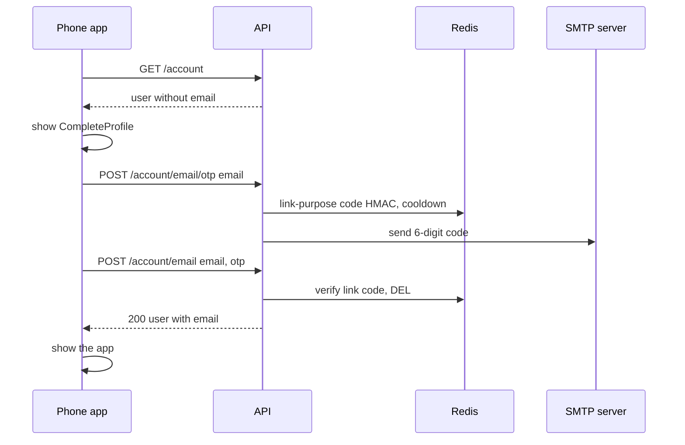
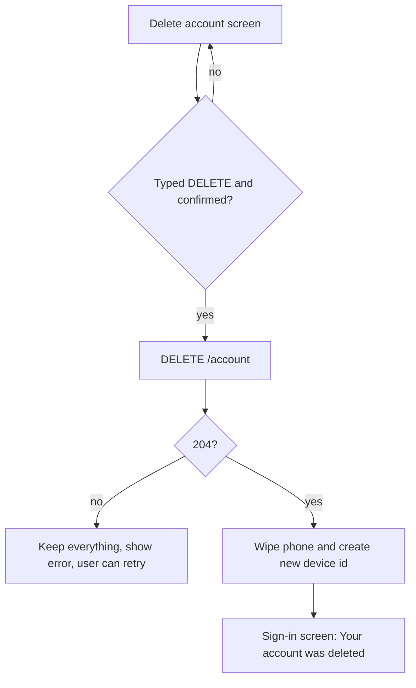

# 15. Account and device management

> **Status:** 🟡 Partially implemented — account details, adding a missing email or phone number, the devices list and permanent account deletion work; the app has no button to revoke a device (the API endpoint exists) and profile editing is not built.
> Last reviewed against the code: 2026-10-12.

## Summary

Every CipherChat account must have an email address **and** a phone number. Accounts that miss
one (phone sign-in accounts, or older email-only accounts) see a one-time "Add your email" or
"Add your phone number" screen (`CompleteProfile`) before they can use the app. A phone number is
saved as typed; an email is proven with a code sent to it, and that code can never be used to sign
in. Settings shows the account, a read-only list of devices, Log out and Delete account. Deleting
the account removes the user, devices, sessions, keys and message data on the server in one
database transaction, and then wipes the phone.

## Status at a glance

| Part                                                                          | Status         | Evidence                                                                          |
| ----------------------------------------------------------------------------- | -------------- | --------------------------------------------------------------------------------- |
| `GET /account` and refresh of the cached user                                 | ✅ Implemented | mobile `signUp.test.js`                                                           |
| Add a missing phone number (`POST /account/phone`)                            | ✅ Implemented | API `emailOtp.test.js`, mobile `signUp.test.js`                                   |
| Add a missing email with a link code (`/account/email/otp`, `/account/email`) | ✅ Implemented | API `emailOtp.test.js`, mobile `signUp.test.js`                                   |
| One-time `CompleteProfile` screen                                             | ✅ Implemented | device-verified 2026-10-11/12 (two Android phones)                                |
| Devices list (API + screen)                                                   | ✅ Implemented | API `devices.test.js`; screen: no dedicated test, not verified on a device        |
| Device revocation                                                             | 🟡 Partial     | API `devices.test.js`; **no UI** in the app calls it                              |
| Device metadata update (`POST /devices`)                                      | 🟡 Partial     | API `devices.test.js`; the app does not call it                                   |
| Account deletion (server + phone wipe)                                        | ✅ Implemented | API `account.test.js`, mobile `accountDeletion.test.js`; not verified on a device |
| Profile editing (name, photo)                                                 | ⏳ Pending     | Settings row shows "Soon"; no endpoint                                            |

## How it works

**Account details**

1. When the signed-in layout (`(app)/_layout.js`) mounts, it calls `refreshUser()` once:
   `GET /account` returns the caller's user (`id`, `email`, `phoneNumber`, `phoneVerifiedAt`,
   `displayName`, `profilePhoto`, `lastSeen`, timestamps). The app stores it in memory and in
   `auth.session`. Offline, the cached user is used.
2. Settings shows the avatar, "Your ID" (tap to share the user id), and "Signed in with" (the
   email, or the formatted phone number if there is no email).

**Adding a missing email or phone number**

3. If the cached user has no `email` or no `phoneNumber`, the signed-in layout renders
   `CompleteProfile` instead of the app (the call screen is not opened either). Key setup and
   messaging still start in the background. The screen has a "Sign out" link.
4. **Missing phone number** (asked first): the number is checked on the phone (`toE164`), then
   `POST /account/phone`. The server sets it only if the account has none (`ALREADY_SET`
   otherwise) and refuses a number used by another account (`PHONE_NUMBER_TAKEN`). It is saved
   unverified (`phoneVerifiedAt` stays `null`), like a number typed at email sign-up.
5. **Missing email:** `POST /account/email/otp { email }`. The server refuses if the account
   already has an email (`ALREADY_SET`) or the email belongs to another account (`EMAIL_TAKEN`),
   then sends a code through the normal OTP service with purpose `link`. The user types the code;
   `POST /account/email { email, otp }` verifies it and sets the email only if the account still
   has none.
6. **Link codes are separate from sign-in codes.** The Redis key is
   `HMAC("link:email:<address>")` instead of `HMAC("email:<address>")`, so a link code cannot
   sign in and a sign-in code cannot add an email.
7. When the user object has both values, the layout shows the normal app.

**Devices**

8. Settings → Devices opens `devices.js`, which calls `GET /devices` and lists up to 50 devices,
   newest first: name (or platform), "(this device)", and "Active · last seen …" or "Signed out".
   Pull down to reload. A note explains that signing in on a new phone signs this one out.
9. `DELETE /devices/:deviceId` revokes a device (its sessions end, its unused one-time pre-keys
   are deleted, its push token is cleared, its calls end, its online status is cleared). The app
   has no button for it today.

**Account deletion**

10. Settings → Delete account opens `delete-account.js`. It lists the consequences. The user must
    type `DELETE`, press "Delete my account", and confirm a final alert.
11. `DELETE /account` (no body: the account comes from the session). One MongoDB transaction
    deletes sessions, one-time pre-keys, envelopes addressed to the user, message metadata in both
    directions, the per-device sequence counters, expires attachments sent to the user (and the
    user's unfinished uploads), deletes devices, and deletes the user.
12. After the transaction: calls end (`account_deleted`), missed-call notes for the user are
    removed, presence is cleared, and the attachment sweep runs (failure is logged and retried
    later). The API answers `204`.
13. Only **after** the `204`, the phone runs `wipeLocalSession({ newDeviceId: true })` and shows
    "Your account was deleted." on the sign-in screen. If the request fails, nothing is wiped.

## Packages and versions

| Package                                   | Declared            | Installed | Used for                                                         |
| ----------------------------------------- | ------------------- | --------- | ---------------------------------------------------------------- |
| `mongoose` (API)                          | `^8.18.0`           | `8.24.5`  | Account and device queries, the deletion transaction             |
| `ioredis` (API)                           | `^5.6.0`            | `5.11.1`  | Link codes, rate limits                                          |
| `nodemailer` (API)                        | `10.0.11`           | `10.0.11` | Sending the link code email                                      |
| `libphonenumber-js` (API / mobile)        | `^1.13.14`          | `1.13.14` | Phone validation (`max` on the API, `min` on the phone)          |
| `zod` (API / mobile)                      | `^4.1.0` / `^4.6.5` | `4.6.5`   | Strict request bodies, email form check                          |
| `zustand` (mobile)                        | `^5.0.15`           | `5.0.15`  | `useAuthStore` (`user`, `addPhone`, `addEmail`, `deleteAccount`) |
| `react-native-safe-area-context` (mobile) | `~5.7.0`            | `5.7.0`   | Top inset of `CompleteProfile`                                   |
| `expo-router` (mobile)                    | `~57.0.25`          | `57.0.25` | `devices`, `delete-account` routes                               |

## Source files

**API**

- [account.routes.js](../apps/api/src/modules/account/account.routes.js) — `/account` routes, strict bodies, rate limits.
- [accountService.js](../apps/api/src/modules/account/accountService.js) — `getAccount`, `addPhone`, `requestEmailCode`, `addEmail`, `deleteAccount`, `linkIdentity`.
- [authService.js](../apps/api/src/modules/auth/authService.js) — `attachPhone` (never replaces a number), `phoneTaken`.
- [otpService.js](../apps/api/src/modules/auth/otpService.js) — `purpose` in the identity key.
- [devices.routes.js](../apps/api/src/modules/devices/devices.routes.js) — `/devices` routes.
- [deviceService.js](../apps/api/src/modules/devices/deviceService.js) — `registerCurrentDevice`, `listDevices`, `revokeDevice`, push token set/clear.
- [models/User.js](../apps/api/src/models/User.js), [models/Device.js](../apps/api/src/models/Device.js), [models/Session.js](../apps/api/src/models/Session.js) — schemas.
- [middleware/rateLimit.js](../apps/api/src/middleware/rateLimit.js) — `accountDetailsPerUser`, `authenticatedPerUser`.

**Mobile**

- [components/CompleteProfile.js](../apps/mobile/src/components/CompleteProfile.js) — the one-time add-email / add-phone screen.
- [app/(app)/_layout.js](<../apps/mobile/src/app/(app)/_layout.js>) — `refreshUser()` on start; shows `CompleteProfile` when a value is missing.
- [app/(app)/(tabs)/settings.js](<../apps/mobile/src/app/(app)/(tabs)/settings.js>) — account rows, Devices, Log out, Delete account.
- [app/(app)/devices.js](<../apps/mobile/src/app/(app)/devices.js>) — read-only devices list.
- [app/(app)/delete-account.js](<../apps/mobile/src/app/(app)/delete-account.js>) — typed confirmation and final alert.
- [auth/authStore.js](../apps/mobile/src/auth/authStore.js) — `refreshUser`, `setUser`, `addPhone`, `requestEmailCode`, `addEmail`, `deleteAccount`.
- [auth/session.js](../apps/mobile/src/auth/session.js) — `wipeLocalSession`.
- [auth/errorMessages.js](../apps/mobile/src/auth/errorMessages.js) — user texts for `EMAIL_TAKEN`, `ALREADY_SET`, `PHONE_NUMBER_TAKEN`.
- [config/endpoints.js](../apps/mobile/src/config/endpoints.js) — `ENDPOINTS.ACCOUNT`, `ENDPOINTS.DEVICES`.

**Shared**

- [constants.js](../packages/shared/src/constants.js) — `ERROR_CODE.EMAIL_TAKEN`, `ALREADY_SET`, `PHONE_NUMBER_TAKEN`, `DEVICE_PLATFORM`.
- [validation.js](../packages/shared/src/validation.js) — `emailSchema`, `otpSchema`, `deviceIdSchema`.

## API endpoints

All routes need a JWT and a live session ([02-session-management.md](02-session-management.md)),
and all are limited to 120 requests/min per user.

| Method   | Path                 | Auth | Purpose                                                                                    | Rate limit                                      |
| -------- | -------------------- | ---- | ------------------------------------------------------------------------------------------ | ----------------------------------------------- |
| `GET`    | `/account`           | JWT  | The caller's account details                                                               | 120/min per user                                |
| `POST`   | `/account/phone`     | JWT  | Add a phone number to an account without one (saved unverified)                            | + 20/h per user                                 |
| `POST`   | `/account/email/otp` | JWT  | Email a link code for an email the account does not have yet. `202`                        | + 20/h per user · 5/h per email · 60 s cooldown |
| `POST`   | `/account/email`     | JWT  | Verify the link code and add the email                                                     | + 20/h per user · 15/h per email                |
| `DELETE` | `/account`           | JWT  | Delete the caller's account. `204`                                                         | 120/min per user                                |
| `GET`    | `/devices`           | JWT  | List the caller's devices (max 50, newest first, `current` flag)                           | 120/min per user                                |
| `POST`   | `/devices`           | JWT  | Update this device's `platform`, `name`, `appVersion`, `osVersion` (not called by the app) | 120/min per user                                |
| `DELETE` | `/devices/:deviceId` | JWT  | Revoke one of the caller's devices. `204`; idempotent                                      | 120/min per user                                |

Push-token routes (`/devices/push-token`) are described in
[11-push-notifications.md](11-push-notifications.md).

## Data storage

### MongoDB

- `users`: `email` and `phoneNumber` are immutable in the schema; the add routes write them with a
  filtered `updateOne` (`{ field: { $exists: false } }`) so an existing value is never replaced.
  `phoneVerifiedAt` stays `null` for numbers added here.
- `devices`: `deviceId`, `platform`, `name`, `appVersion`, `osVersion`, `lastActiveAt`,
  `revokedAt`, `revokedReason`, `pushToken` (never returned by any endpoint), `signal` (public
  keys). The list returns only `deviceId`, `platform`, `name`, `appVersion`, `osVersion`,
  `createdAt`, `lastActiveAt`, `revokedAt`, `current`.
- **Removed by account deletion:** `sessions`, `onetimeprekeys`, `messageenvelopes` addressed to
  the user, `messages` sent or received by the user, `counters` (`envelope:{deviceId}`),
  `devices`, the `users` row. `attachments` sent to the user (and the user's pending uploads) are
  expired and swept.
- **Kept after deletion:** envelopes (ciphertext) and attachments the user already sent to other
  people, until their normal expiry.

### Redis

| Key                                                                     | Value                                    | TTL                                  |
| ----------------------------------------------------------------------- | ---------------------------------------- | ------------------------------------ |
| `otp:{HMAC("link:email:<address>")}`                                    | `{ codeHash, attempts }` for a link code | `OTP_TTL_SECONDS` (300 s)            |
| `otp:cd:{HMAC("link:email:<address>")}`                                 | resend cooldown                          | `OTP_RESEND_COOLDOWN_SECONDS` (60 s) |
| `rl:accountDetailsPerUser:{userId}`                                     | counter                                  | 1 h                                  |
| `rl:otpRequestPerIdentifier:{HMAC}`, `rl:otpVerifyPerIdentifier:{HMAC}` | counters (link-purpose key)              | 1 h                                  |

Account deletion also clears `presence:{userId}` and the user's `call:missed:{userId}` notes. OTP
and rate-limit keys are HMAC-keyed and expire on their own.

### On the phone

- SecureStore `auth.session` keeps the latest `user` object (`setUser`).
- Account deletion wipes the SQLCipher database **and** `db.key`, `auth.session`,
  `device.installId`, `signal.identity`, `push.registration`, all media files, and replaces
  `device.id` (tested: only `device.id`, with a new value, is left in SecureStore).
- The devices list is not stored; it is fetched each time.

## Security measures

- **The account always comes from the session**, never from the request: `DELETE /account` has no
  body and cannot name another account (tested).
- **Strict bodies** (`z.strictObject`) on the account routes; unknown fields are rejected.
- **Values are never replaced:** add routes only write when the field is missing (`ALREADY_SET`).
- **Email ownership is proven** with a code sent to that address; link codes and sign-in codes use
  different Redis keys, so neither can be used as the other (tested).
- **Link codes share all OTP rules:** HMAC only, 5 min, 5 attempts, single use, 60 s cooldown,
  plus 20 changes/h per user.
- **No cross-user device access:** another user's `deviceId` gives `404 NOT_FOUND`, the same as an
  unknown id; that device is not touched (tested).
- **Revocation is permanent:** revoked device rows are kept, and the `deviceId` cannot sign in
  again (`403 DEVICE_REVOKED`).
- **Deletion is atomic:** one transaction; a failure leaves the account intact. A repeated or
  concurrent deletion is harmless (tested). The log line holds only the user id.
- **Deletion ends access at once:** sessions are deleted, so access and refresh tokens stop
  working immediately (tested).
- **Phone wipe only after server success**, so a failed request loses nothing.
- **Deliberate confirmation:** typed `DELETE` + a final destructive alert.

## Error handling

| Situation                           | Error code / behaviour                          | What the user sees                                                                     |
| ----------------------------------- | ----------------------------------------------- | -------------------------------------------------------------------------------------- |
| Invalid email or number             | Phone-side check, else `400 VALIDATION_ERROR`   | "Enter a valid email address…" / "Enter a valid mobile number…"                        |
| Account already has the value       | `409 ALREADY_SET`                               | "This is already set on your account."                                                 |
| Email used by another account       | `409 EMAIL_TAKEN`                               | "This email is already used by another CipherChat account."                            |
| Number used by another account      | `409 PHONE_NUMBER_TAKEN`                        | "This phone number is already used by another CipherChat account."                     |
| Wrong / expired link code           | `400 OTP_INVALID` / `429 OTP_ATTEMPTS_EXCEEDED` | Same texts as at sign-in                                                               |
| Code requested too soon / too often | `429 OTP_COOLDOWN` / `429 RATE_LIMITED`         | "Please wait…" / "Too many attempts…"                                                  |
| Code email not sent                 | `502 OTP_DELIVERY_FAILED`                       | "We couldn't send the code. Please try again."                                         |
| `GET /account` fails (offline)      | Ignored                                         | The cached user is used                                                                |
| Devices list fails                  | —                                               | "You're offline. Pull down to retry." or "Could not load devices. Pull down to retry." |
| Revoke an unknown or foreign device | `404 NOT_FOUND`                                 | Not reachable from the app                                                             |
| Delete account offline              | `NetworkError`; nothing wiped                   | "No connection. Your account was not deleted; try again when you are online."          |
| Delete account server error         | Any error status; nothing wiped                 | "Your account could not be deleted. Nothing was changed; please try again."            |
| Delete account with a dead session  | 401 → refresh fails → session-ending wipe       | Signed out (tested: the phone is wiped)                                                |

## Configuration

No settings of its own. It uses the OTP and email settings from
[01-otp-login.md](01-otp-login.md) (`OTP_*`, `EMAIL_PROVIDER`, `SMTP_*`) and the session settings
from [02-session-management.md](02-session-management.md). Limits are constants in
`RATE_LIMITS` (`accountDetailsPerUser` 20/h, `authenticatedPerUser` 120/min). `MAX_LISTED_DEVICES`
is 50 in `deviceService.js`. The confirmation word `DELETE` is a constant in `delete-account.js`.

## Testing status

- **Automated** (counts are `it(` cases found by grep):
  - API `account.test.js` (6): deletes everything that belongs to the account; ends every
    session; requires authentication; only the caller; repeated/concurrent deletion; the same
    phone number can sign up again as a new account.
  - API `devices.test.js` (8): metadata update and validation; list only own devices with
    `current`; single active device; revocation (tokens stop, cannot sign in again); 404 for a
    foreign device; parameter validation.
  - API `emailOtp.test.js`, block "adding a missing email or phone number" (4): add email with a
    code; link vs sign-in code separation; `EMAIL_TAKEN` and never replacing values; add phone and
    `PHONE_NUMBER_TAKEN`.
  - Mobile `signUp.test.js`, block "adding a missing email or phone number" (3): add email with a
    code, add phone (normalised) with errors shown, `refreshUser` updates an old cached session.
  - Mobile `accountDeletion.test.js` (4): delete then wipe with a new device id; keep everything on
    error or offline; wipe when the session is already gone; screen needs the typed word and a
    final confirmation.
- **Device testing:** the one-time "Add your email/phone" screen (`CompleteProfile`) was verified
  on two Android phones (RMX2103 Android 11, RMX3851 Android 16, debug build, 2026-10-11/12).
- **Not tested yet:**
  - Account deletion on a device.
  - The Devices screen on a device (no mobile unit test either).
  - A real link-code email arriving in an inbox.
  - Release builds and iOS.

## Known limitations and pending work

- **No revoke button.** `DELETE /devices/:deviceId` exists and is tested, but the Devices screen is
  read-only. With one active device per user, the list shows the current device plus older,
  signed-out ones.
- **`POST /devices` is unused** by the app; device details are set only at sign-in.
- **Profile editing is pending:** `displayName` and `profilePhoto` exist, but no endpoint sets them
  (Settings shows "Profile · Soon").
- **The added phone number is not verified** (no SMS provider; same accepted risk as at sign-up).
- **Email and phone number cannot be changed** once set (immutable; `ALREADY_SET`).
- **Deletion keeps what the user already sent** to others (ciphertext envelopes and attachments)
  until they expire. Missed-call notes for calls the user made to others also stay with those
  people until they expire.
- `CompleteProfile` blocks the UI, but key setup and messaging still start behind it.

## Related documents

- [01-otp-login.md](01-otp-login.md) — sign-in codes and the email + phone rules at sign-up.
- [02-session-management.md](02-session-management.md) — sessions, single active device, sign-out wipe.
- [07-local-database-encryption.md](07-local-database-encryption.md) — what the wipe deletes.
- [05-encrypted-media.md](05-encrypted-media.md) — attachment expiry and sweep after deletion.
- [10-voice-video-calls.md](10-voice-video-calls.md) — calls ended and missed-call notes removed on deletion.
- [13-contact-discovery-and-search.md](13-contact-discovery-and-search.md) — why the phone number is required.
- ARCHITECTURE.md: [§5.3 API surface](ARCHITECTURE.md#53-api-surface), [§5.4 Data model](ARCHITECTURE.md#54-data-model-mongodb), [§7.1a Email and phone number](ARCHITECTURE.md#71a-email-and-phone-number-phase-11), [§7.7 Logout, revocation and account deletion](ARCHITECTURE.md#77-logout-revocation-and-account-deletion), [§10 Data retention](ARCHITECTURE.md#10-data-retention).
