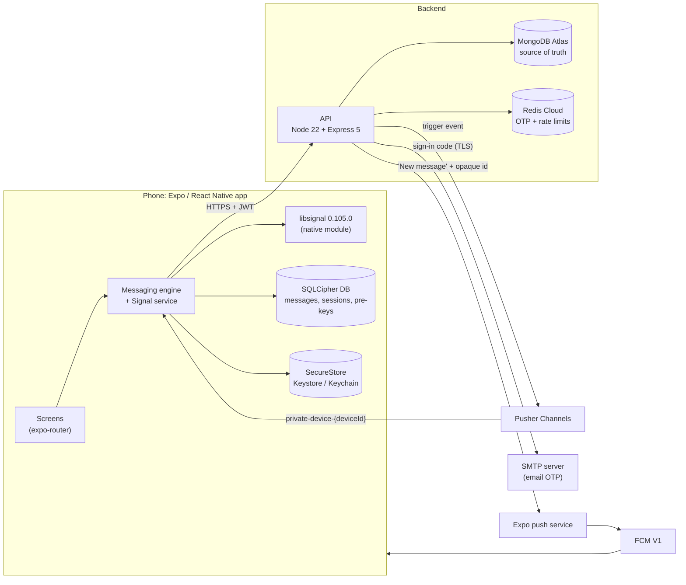
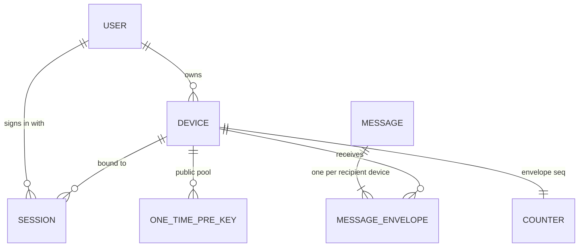
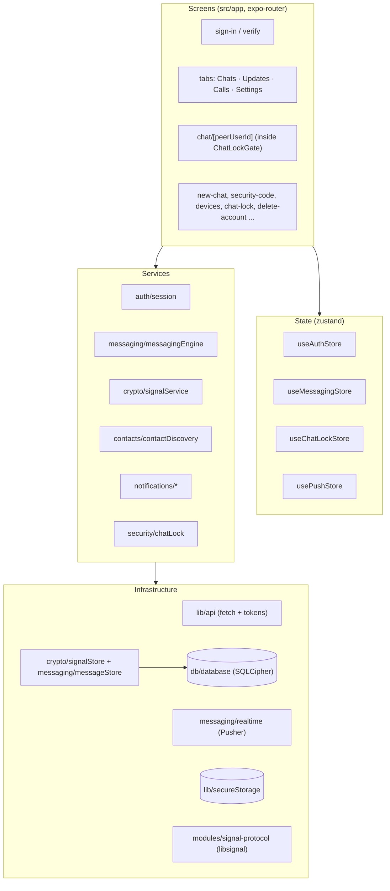
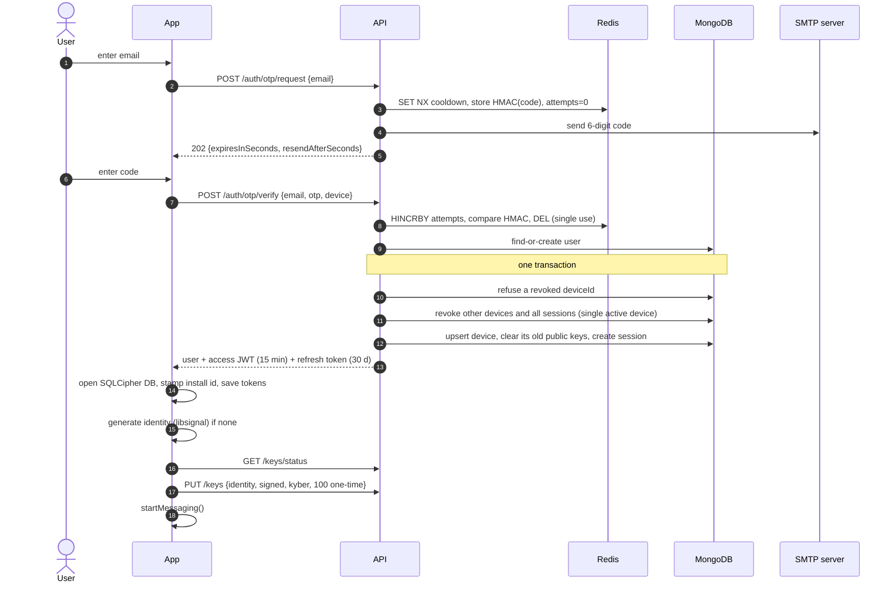
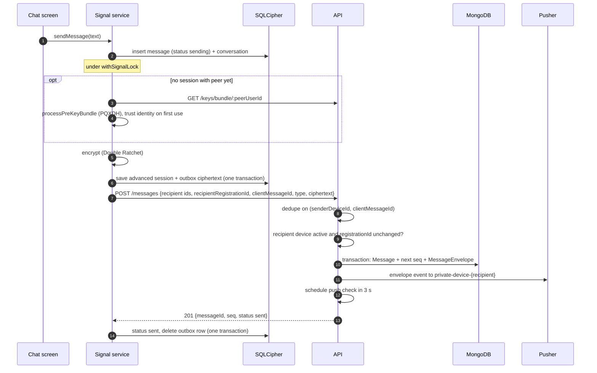
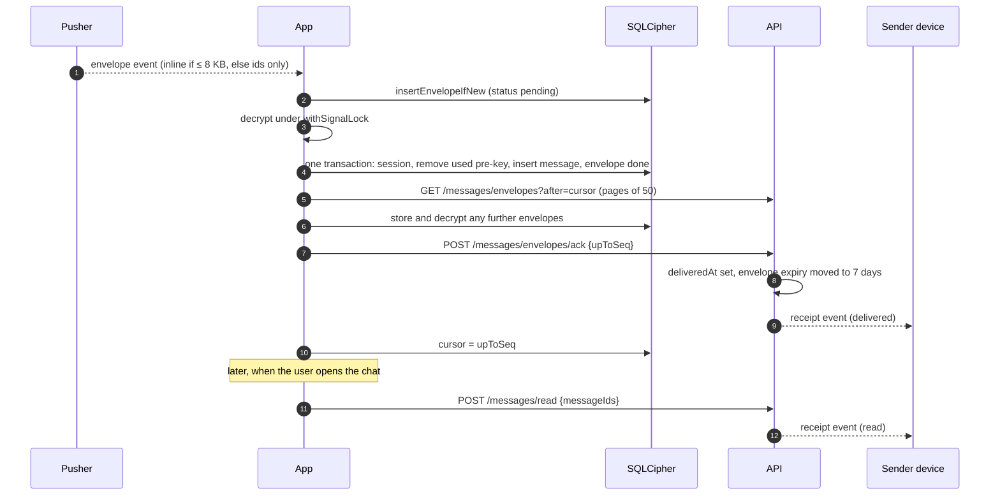
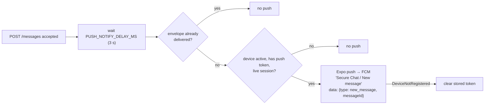

# CipherChat (Secure Chat) — Architecture

> **Status:** living document. It describes the code at commit `10ad8f9` (branch
> `feat/contact-discovery`) plus the uncommitted Phase 5 voice calling described in [§12](#12-status-and-roadmap).
> Last updated 2026-10-11 (Phase 10: encrypted photos, videos and voice notes; Phase 11: email +
> phone sign-up, pushed online status, chat search, CipherChat branding; uncommitted).
>
> The app is called **CipherChat** (display name, icon, splash, texts, emails, notifications).
> Internal names are unchanged: Android package `com.securechat.app`, link scheme
> `securechat://`, repository and package names.
>
> The original design brief is the PDF _Secure_Messaging_App_Architecture_Design_Pusher_. This
> document records what was actually built, including the approved additions to that brief
> ([§14](#14-decision-log)). When code and this document disagree, the code wins. Fix the document.

---

## Contents

1. [Summary](#1-summary)
2. [System context](#2-system-context)
3. [Repository layout](#3-repository-layout)
4. [Trust boundaries: who sees what](#4-trust-boundaries-who-sees-what)
5. [Backend (`apps/api`)](#5-backend-appsapi)
6. [Mobile app (`apps/mobile`)](#6-mobile-app-appsmobile)
7. [Key flows](#7-key-flows)
8. [Security controls](#8-security-controls)
9. [Delivery semantics and reliability](#9-delivery-semantics-and-reliability)
10. [Data retention](#10-data-retention)
11. [Shared package (`packages/shared`)](#11-shared-package-packagesshared)
12. [Status and roadmap](#12-status-and-roadmap)
13. [Known limitations and risks](#13-known-limitations-and-risks)
14. [Decision log](#14-decision-log)
15. [Development, testing and builds](#15-development-testing-and-builds)

---

## 1. Summary

Secure Chat is a 1:1 end-to-end encrypted messenger. Android is the platform tested on real
devices. The iOS Signal bridge is built but has not been tested on a device.

- The **mobile app** (Expo / React Native) encrypts every message on the phone with the official
  Signal Protocol library (**libsignal 0.105.0**) and keeps plaintext only in a SQLCipher database.
- The **API** (Node + Express) stores and routes ciphertext and metadata. It never has plaintext
  or private keys.
- **Pusher Channels** delivers events to an open app. **Expo push → FCM** wakes a closed one.
- **MongoDB Atlas** is the source of truth. **Redis Cloud** holds OTPs and rate-limit counters.

### Design principles (each one is enforced in code)

| #   | Principle                                                       | How it is enforced                                                                                                                                  |
| --- | --------------------------------------------------------------- | --------------------------------------------------------------------------------------------------------------------------------------------------- |
| 1   | The server never has plaintext or private keys.                 | Mongo schemas have no content field. Request schemas are `strictObject`, so an unexpected field such as a private key is rejected and never stored. |
| 2   | MongoDB is the source of truth. Realtime only speeds things up. | Every Pusher event can be recovered by HTTPS sync. If Pusher is not configured, a no-op realtime is used and delivery is still correct.             |
| 3   | No custom cryptography.                                         | All Signal operations call libsignal through a stateless native bridge.                                                                             |
| 4   | Every step is idempotent and crash-safe.                        | Outbox and inbox tables, `clientMessageId` dedupe, per-device `seq` cursors, ack only after local storage, and a transaction for each state change. |
| 5   | Third parties see as little as possible.                        | Pusher gets ciphertext or ids. Push gets "New message" plus an opaque id. The SMTP server gets an email address and a code.                         |
| 6   | Fail closed.                                                    | A missing rate limiter returns 503. A build without SQLCipher refuses to store data. An unknown chat-lock state is treated as locked.               |

---

## 2. System context



Audio for voice calls (Phase 5, not built yet) will flow phone-to-phone over WebRTC and will not
pass through any of these servers. See [§12](#12-status-and-roadmap).

---

## 3. Repository layout

The repo is an npm-workspaces monorepo. Everything is plain JavaScript (ESM), with no TypeScript.

```
Secure-Chat/
├─ apps/
│  ├─ api/                         Express API (Node ≥ 22.9)
│  │  ├─ src/
│  │  │  ├─ server.js              process entry: env → Mongo/Redis → container → app → listen
│  │  │  ├─ app.js                 Express pipeline and router mounting
│  │  │  ├─ container.js           dependency wiring (built once; tests inject fakes)
│  │  │  ├─ config/env.js          zod-validated environment → frozen config
│  │  │  ├─ db/                    mongo.js, redis.js
│  │  │  ├─ middleware/            authenticate, rateLimit, validate, errors
│  │  │  ├─ models/                Mongoose schemas (§5.4)
│  │  │  ├─ modules/<feature>/     <feature>.routes.js + <feature>Service.js
│  │  │  ├─ services/              external providers: email, sms, push, realtime
│  │  │  └─ lib/                   crypto helpers, pino logger
│  │  └─ test/                     Vitest + in-memory Mongo replica set + real libsignal (Node)
│  └─ mobile/                      Expo SDK 57 app
│     ├─ src/
│     │  ├─ app/                   expo-router screens (file-based routes)
│     │  ├─ config/                public build config (env), every API path (endpoints)
│     │  ├─ auth/                  auth store, session lifecycle, token store
│     │  ├─ crypto/                signalService (orchestration), signalStore (persistence)
│     │  ├─ messaging/             messagingEngine, messageStore, realtime (Pusher)
│     │  ├─ db/                    SQLCipher open / migrate / destroy
│     │  ├─ security/              Chat Lock
│     │  ├─ contacts/              contact discovery
│     │  ├─ calls/                 voice calls: state machine, engine, WebRTC/audio wrapper
│     │  ├─ notifications/         push registration and tap routing
│     │  ├─ lib/                   API client, secure storage, device id, phone parsing
│     │  └─ components/            UI building blocks, ChatLockGate
│     ├─ modules/signal-protocol/  local Expo module: Kotlin + Swift libsignal bridge
│     ├─ modules/call-service/     local Expo module: Android microphone foreground service
│     ├─ plugins/                  config plugins: libsignal (Android/iOS), SQLCipher OpenSSL,
│     │                            voice calls (drops WebRTC's screen-share service)
│     └─ test/                     Jest; native bridge replaced by a real-libsignal test double
├─ packages/
│  └─ shared/                      constants + zod validation shared by API and app
└─ docs/
   └─ ARCHITECTURE.md              this document
```

---

## 4. Trust boundaries: who sees what

| Party                       | Can see                                                                                                                                                                                              | Never sees                                                                                                              |
| --------------------------- | ---------------------------------------------------------------------------------------------------------------------------------------------------------------------------------------------------- | ----------------------------------------------------------------------------------------------------------------------- |
| **API + MongoDB**           | User id, email or phone number, device metadata (platform, model, app/OS version), public Signal keys, ciphertext envelopes, message metadata (sender, recipient, times, delivered/read), push token | Message plaintext, any private key, address-book names, chat nicknames, which chats are locked, security-code decisions |
| **Redis**                   | HMACs of identifiers, HMACs of OTP codes, attempt and rate-limit counters, client IPs as rate-limit keys (expire with their window)                                                                  | Raw phone numbers or emails, OTP codes                                                                                  |
| **Pusher**                  | Channel name (device UUID), ciphertext envelope if ≤ 8 KB (otherwise only ids), receipts (message id, status, time)                                                                                  | Plaintext, names, phone numbers                                                                                         |
| **Expo push / FCM**         | Push token, the fixed text "Secure Chat / New message", an opaque message id                                                                                                                         | Sender, conversation, content                                                                                           |
| **SMTP server**             | Email address and the 6-digit code                                                                                                                                                                   | Anything else                                                                                                           |
| **Attachment storage**      | Encrypted, padded blobs under random keys; their bucketed size; uploader and recipient ids and times (metadata in MongoDB)                                                                           | Media keys, plaintext, file type, file name, exact size, captions                                                       |
| **Contact discovery (API)** | The batch of E.164 phone numbers in one request, over TLS                                                                                                                                            | Contact names. Nothing from the request is stored or logged.                                                            |

---

## 5. Backend (`apps/api`)

### 5.1 Process and composition

`server.js` runs these steps in order and stops the process on any failure:

1. `loadEnv()` validates the environment with zod. Errors name only the variables, never their values.
2. Connect to MongoDB with `strictQuery` and `sanitizeFilter` on, and `autoIndex` off in production.
3. `migrateUserIndexes()` replaces the legacy `phoneNumber_1` index with a partial unique index.
   It is idempotent.
4. Connect to Redis.
5. `createContainer()` builds every service once from config and live clients.
6. `createApp()` builds the Express app. `listen()` uses `keepAliveTimeout` 65 s, which is longer
   than a typical load-balancer idle timeout.
7. On SIGTERM or SIGINT, it closes the server and then the datastores, with a forced exit after
   `SHUTDOWN_TIMEOUT_MS`.

`container.js` is the only place where services are wired together. Tests pass fake SMS, email
and push providers, a capturing realtime, and in-memory rate limiters through the same function.

### 5.2 Request pipeline

```
request
  → ETag off, Cache-Control: no-store          (tokens/ciphertext never land in an HTTP cache)
  → pino-http                                  (request id; logs only id, method, path, status)
  → helmet
  → CORS                                       (browser allowlist only; native apps send no Origin)
  → express.json (100 KB, strict)
  → router:  authenticate → per-user rate limit → zod validate → handler
  → notFoundHandler / errorHandler             → { error: { code, message, details? } }
```

**Authentication (`middleware/authenticate.js`)** requires both of these:

- a valid **access JWT** (HS256 with algorithm, issuer and audience pinned, 5 s clock tolerance,
  required claims `sub`, `sid`, `did`, `exp`, `iat`), **and**
- a **live `Session` row** that is not revoked, not expired, and whose `deviceId` matches the
  token.

Because the session row is checked on every request, logout and device revocation take effect
immediately rather than when the JWT expires.

Clients branch on the stable `ERROR_CODE` values from `packages/shared`, never on message text.

### 5.3 API surface

Every authenticated route is also limited to **120 requests/min per user**.

| Method      | Path                         | Auth                        | Extra rate limit                       | Purpose                                                                                            |
| ----------- | ---------------------------- | --------------------------- | -------------------------------------- | -------------------------------------------------------------------------------------------------- |
| `GET`       | `/health`                    | —                           | —                                      | API, MongoDB and Redis status (200 / 503). Internals go to logs only.                              |
| `POST`      | `/auth/otp/request`          | —                           | 20/h per IP · 5/h per identifier       | Send a code by email or phone. Returns 202 with the same response for new and existing accounts.   |
| `POST`      | `/auth/otp/verify`           | —                           | 50/15 min per IP · 15/h per identifier | Verify the code, find or create the user, take over as the single active device, issue tokens.     |
| `POST`      | `/auth/refresh`              | refresh token               | 60/15 min per IP                       | Rotate the refresh token and issue a new access token. A verified repeat is answered again (§7.5). |
| `POST`      | `/auth/logout`               | JWT                         | —                                      | Revoke the session and clear the push token.                                                       |
| `DELETE`    | `/account`                   | JWT                         | —                                      | Delete the caller's account in one transaction (§7.7).                                             |
| `POST`      | `/devices`                   | JWT                         | —                                      | Update the calling device's metadata.                                                              |
| `GET`       | `/devices`                   | JWT                         | —                                      | List the caller's devices (max 50).                                                                |
| `POST`      | `/devices/push-token`        | JWT                         | —                                      | Register or refresh the Expo push token. The token is moved off any other device.                  |
| `DELETE`    | `/devices/push-token`        | JWT                         | —                                      | Clear the push token.                                                                              |
| `DELETE`    | `/devices/:deviceId`         | JWT                         | —                                      | Revoke one of the caller's devices: its sessions end and its unused one-time pre-keys are deleted. |
| `PUT`       | `/keys`                      | JWT                         | —                                      | Register or rotate public keys. The identity key is fixed until the next OTP login.                |
| `POST`      | `/keys/one-time`             | JWT                         | —                                      | Upload one-time pre-keys (≤ 100 per batch, ≤ 200 stored).                                          |
| `GET`       | `/keys/status`               | JWT                         | —                                      | The caller's own registration and pre-key counts.                                                  |
| `GET`       | `/keys/bundle/:userId`       | JWT                         | 30/min per user                        | A peer's public pre-key bundle. Consumes one one-time pre-key.                                     |
| `POST`      | `/messages`                  | JWT                         | 60/min per user                        | Send one encrypted envelope. Idempotent on `clientMessageId`.                                      |
| `GET`       | `/messages/envelopes`        | JWT                         | —                                      | Undelivered envelopes for this device, `?after=<seq>&limit=` (default 50, max 100).                |
| `POST`      | `/messages/envelopes/ack`    | JWT                         | —                                      | Mark everything up to `upToSeq` delivered and send delivery receipts.                              |
| `POST`      | `/messages/read`             | JWT                         | —                                      | Read receipts for up to 100 message ids addressed to the caller.                                   |
| `POST`      | `/messages/status`           | JWT                         | —                                      | State of the caller's own sent messages, to recover receipts missed while offline.                 |
| `GET`       | `/pusher/config`             | JWT                         | —                                      | Public Pusher key and cluster, plus this device's channel name.                                    |
| `POST`      | `/pusher/auth`               | JWT                         | —                                      | Sign a subscription. Only the caller's own `private-device-{deviceId}` is allowed.                 |
| `POST`      | `/contacts/match`            | JWT                         | 5 000 **numbers**/h per user           | Contact discovery: which of these numbers (≤ 500 per request) have accounts.                       |
| `GET`       | `/account`                   | JWT                         | —                                      | The caller's account details (refreshes a cached session).                                         |
| `POST`      | `/account/phone`             | JWT                         | 20/h per user                          | Add a phone number to an account that has none (saved unverified).                                 |
| `POST`      | `/account/email/otp`         | JWT                         | 20/h per user · 5/h per email          | Email a code to add an email to an account that has none (a "link" code: cannot sign in).          |
| `POST`      | `/account/email`             | JWT                         | 20/h per user · 15/h per email         | Verify that code and add the email.                                                                |
| `POST`      | `/attachments`               | JWT                         | 30/min · 2 048 MiB/h per user          | Reserve (or, for a retry, re-find) an upload slot for an encrypted blob; pre-signed upload URL.    |
| `POST`      | `/attachments/:id/complete`  | JWT (uploading device)      | —                                      | Accept the upload if storage holds exactly the declared bytes. Idempotent.                         |
| `GET`       | `/attachments/:id`           | JWT (uploader or recipient) | —                                      | Pre-signed download URL (15 min). Anyone else gets the same 404 as for a missing id.               |
| `POST`      | `/attachments/:id/received`  | JWT (recipient)             | —                                      | The recipient stored its own encrypted copy: keep the server copy 7 more days at most.             |
| `PUT`/`GET` | `/blobs/:storageKey?exp&sig` | signed URL                  | —                                      | `local` storage driver only: the transfer behind a pre-signed URL (no bearer token).               |

### 5.4 Data model (MongoDB)



| Collection         | Key fields                                                                                                                                                                                                                                     | Indexes / constraints                                                             | Retention                                                 |
| ------------------ | ---------------------------------------------------------------------------------------------------------------------------------------------------------------------------------------------------------------------------------------------- | --------------------------------------------------------------------------------- | --------------------------------------------------------- |
| `users`            | `phoneNumber` (E.164, immutable), `email` (lower-case, immutable), `displayName`, `profilePhoto`, `lastSeen`                                                                                                                                   | Partial unique on `phoneNumber` and on `email`. At least one of them is required. | Until account deletion                                    |
| `devices`          | `userId`, `deviceId` (client UUID v4, immutable), `signalDeviceId` (always 1 in v1), `platform`, `name`, `appVersion`, `osVersion`, `signal{registrationId, identityKey, signedPreKey, kyberPreKey}`, `pushToken`, `lastActiveAt`, `revokedAt` | Unique `(userId, deviceId)`. Partial unique `pushToken.token`.                    | Revoked rows are kept, so revocation is permanent         |
| `sessions`         | `userId`, `deviceId`, `refreshTokenHash` (SHA-256), `usedRefreshTokenHashes` (last 10), `expiresAt`, `revokedAt`                                                                                                                               | `(userId, deviceId, revokedAt)`. TTL on `expiresAt`.                              | Removed by TTL at expiry                                  |
| `onetimeprekeys`   | `userId`, `deviceId`, `keyId`, `publicKey`                                                                                                                                                                                                     | Unique `(deviceId, keyId)`                                                        | Deleted when served (`findOneAndDelete`)                  |
| `messages`         | `senderUserId`, `senderDeviceId`, `recipientUserId`, `clientMessageId`, `conversationId` (`sorted(a,b).join(':')`), `chatId` (reserved for groups), `deliveredAt`, `readAt`, `expiresAt`. **No content field.**                                | Unique `(senderDeviceId, clientMessageId)`. `(conversationId, createdAt)`. TTL.   | 90 days                                                   |
| `messageenvelopes` | `messageId`, `recipientUserId`, `recipientDeviceId`, sender ids, `senderSignalDeviceId`, `seq`, `type` (2 = Whisper, 3 = PreKey), `ciphertext` (base64), `deliveredAt`, `expiresAt`                                                            | Unique `(recipientDeviceId, seq)`. Unique `(messageId, recipientDeviceId)`. TTL.  | 30 days undelivered, then 7 days after ack                |
| `counters`         | `_id = "envelope:{deviceId}"`, `value`                                                                                                                                                                                                         | —                                                                                 | Deleted with the account                                  |
| `attachments`      | `uploaderUserId`, `uploaderDeviceId`, `recipientUserId`, `clientAttachmentId`, `storageKey` (random), `size` (encrypted, padded), `status` (`pending`/`uploaded`), `uploadedAt`, `downloadedAt`, `expiresAt`. **No key, type or name.**        | Unique `(uploaderDeviceId, clientAttachmentId)`. Unique `storageKey`.             | Sweep (blob first): 24 h pending, 30 d, 7 d after receipt |

Multi-document writes (login, send, key registration, revocation, account deletion) use Mongo
transactions, which need a replica set. Atlas provides one, and tests use `MongoMemoryReplSet`.

### 5.5 Redis

| Key                            | Value                         | TTL                                  |
| ------------------------------ | ----------------------------- | ------------------------------------ |
| `otp:{HMAC(channel:value)}`    | hash `{ codeHash, attempts }` | `OTP_TTL_SECONDS` (default 300 s)    |
| `otp:cd:{HMAC(channel:value)}` | `"1"` (resend cooldown)       | `OTP_RESEND_COOLDOWN_SECONDS` (60 s) |
| `rl:{limiter}:{key}`           | rate-limit counter            | The limiter's window                 |
| `call:{callId}`                | hash: one call's state (§12)  | Ring window / call length + 60 s     |
| `call:user:{userId}`           | the user's current call id    | Same as the call                     |
| `call:missed:{userId}`         | hash: unanswered-call notes   | Until the phone collects them, ≤ 7 d |
| `presence:{userId}`            | active device id ("online")   | `PRESENCE_TTL_SECONDS` (45) per beat |

Identifiers are always HMAC'd with `OTP_HMAC_SECRET`, which must differ from the JWT secret. If
Redis is unavailable, the rate limiters return **503** rather than letting requests through
unthrottled.

### 5.6 External providers

Each provider sits behind a small interface in `services/` and is chosen by an environment
variable:

| Service  | Implementations             | Notes                                                                                                                                                                                                                 |
| -------- | --------------------------- | --------------------------------------------------------------------------------------------------------------------------------------------------------------------------------------------------------------------- |
| Email    | `smtp` · `console` · `none` | Nodemailer over SMTP, one pooled transporter; TLS always (587 STARTTLS required, 465 TLS) with certificate verification. A send counts only if the server accepted the recipient. `console` is refused in production. |
| SMS      | `console` · `none`          | No real SMS provider yet, so phone sign-in is off in production (`none`).                                                                                                                                             |
| Push     | `expo` · `none`             | Expo push service forwards to FCM V1. The API holds no Firebase credentials.                                                                                                                                          |
| Realtime | Pusher · no-op              | Needs all four `PUSHER_*` variables or none. Without them, clients rely on sync.                                                                                                                                      |

### 5.7 Configuration

All variables are validated in `apps/api/src/config/env.js`. Template: `apps/api/.env.example`.

| Group                        | Variables                                                                                                                                                                               |
| ---------------------------- | --------------------------------------------------------------------------------------------------------------------------------------------------------------------------------------- |
| Core                         | `NODE_ENV`, `HOST`, `PORT` (4000), `LOG_LEVEL`, `CORS_ORIGINS`, `TRUST_PROXY_HOPS`, `HEALTH_CHECK_TIMEOUT_MS`, `SHUTDOWN_TIMEOUT_MS`                                                    |
| Datastores                   | `MONGODB_URI`, `REDIS_URL` (credentials required in production; unfilled `<placeholders>` rejected)                                                                                     |
| Auth                         | `JWT_ACCESS_SECRET` (≥ 32 chars), `JWT_ISSUER`, `JWT_AUDIENCE`, `ACCESS_TOKEN_TTL_SECONDS` (900), `REFRESH_TOKEN_TTL_DAYS` (30)                                                         |
| OTP                          | `OTP_HMAC_SECRET`, `OTP_TTL_SECONDS` (300), `OTP_MAX_ATTEMPTS` (5), `OTP_RESEND_COOLDOWN_SECONDS` (60)                                                                                  |
| Email / SMS                  | `EMAIL_PROVIDER`, `SMTP_HOST`, `SMTP_PORT`, `SMTP_USER`, `SMTP_PASS`, `SMTP_FROM` (optional, defaults to `SMTP_USER`), `SMS_PROVIDER` (at least one channel must be enabled)            |
| Push                         | `PUSH_PROVIDER`, `EXPO_ACCESS_TOKEN` (optional), `PUSH_NOTIFY_DELAY_MS` (3000)                                                                                                          |
| Realtime                     | `PUSHER_APP_ID`, `PUSHER_KEY`, `PUSHER_SECRET`, `PUSHER_CLUSTER`                                                                                                                        |
| Attachments (Phase 10)       | `ATTACHMENT_STORAGE` (`local`), `ATTACHMENT_STORAGE_DIR` (`./data/attachments`), `ATTACHMENT_SWEEP_INTERVAL_SECONDS` (600)                                                              |
| Calls (Phase 5, uncommitted) | `CALL_RING_TIMEOUT_SECONDS` (45), `CALL_MAX_DURATION_SECONDS` (14 400), `STUN_URLS`, `TURN_URLS`, `TURN_SECRET`, `TURN_CREDENTIAL_TTL_SECONDS` (18 000), `ICE_TRANSPORT_POLICY` (`all`) |

The mobile app has a single build-time variable, `EXPO_PUBLIC_API_URL`. It contains no secrets,
because everything public (such as the Pusher key) is served by the API.

---

## 6. Mobile app (`apps/mobile`)

### 6.1 Stack

Expo SDK 57 · React Native 0.86.3 · New Architecture (Fabric) + Hermes · expo-router ·
zustand · pusher-js · expo-sqlite (SQLCipher) · expo-secure-store · expo-notifications ·
expo-contacts · expo-local-authentication · expo-screen-capture · NetInfo.

### 6.2 Layers



Layering rules that keep the security properties easy to check:

- Only `crypto/signalService.js` calls the native Signal module.
- Only the `*Store.js` modules and `db/` run SQL.
- Only `lib/api.js` calls `fetch` against the API. It attaches and refreshes tokens.
- Only `config/endpoints.js` spells out API paths (a test fails on a literal path elsewhere).
- Message rows are read only by components rendered **inside** `ChatLockGate`.

### 6.3 Startup sequence

1. **Root layout, at module load:** `startNotificationCapture()` records a notification tap that
   cold-started the app before anything else can miss it.
2. **`useAuthStore.initialize()`:** gets or creates the device id, then calls `restoreSession()`.
   - If the refresh token has expired, the local session is wiped.
   - If the install id in SecureStore does not match the one in the database, the app was
     reinstalled. On iOS, Keychain items outlive an uninstall. The local session is wiped and a
     new device id is created.
3. **Signed-in layout (`src/app/(app)/_layout.js`):**
   - `useSignalSetup` calls `ensureKeysRegistered()`, which creates the identity, uploads the
     keys, tops up pre-keys and rotates keys when due.
   - Once keys are ready, `startMessaging(userId)` starts the realtime connection, an initial
     sync, polling, and the AppState and NetInfo listeners.
   - Once messaging is ready, push is registered, queued notification taps are processed, and
     unnamed chats get names from contacts (only if Contacts permission was already granted).

### 6.4 On-device storage

**SecureStore** (Android Keystore / iOS Keychain, `AFTER_FIRST_UNLOCK_THIS_DEVICE_ONLY`, so
nothing is synced or restored to another device):

| Key                 | Holds                                                                        |
| ------------------- | ---------------------------------------------------------------------------- |
| `auth.session`      | Tokens, their expiry times, cached user, any pending rotation (§7.5)         |
| `device.id`         | Per-install UUID v4. Replaced only after revocation or a detected reinstall. |
| `device.installId`  | Matched against the database to detect reinstalls                            |
| `db.key`            | 256-bit random SQLCipher key (raw hex, so no KDF is needed)                  |
| `signal.identity`   | Signal identity key pair + registration id                                   |
| `push.registration` | Last Expo push token registered with the API                                 |

**SQLCipher database** (`securechat.db`). Migrations are tracked with `PRAGMA user_version` and
are append-only:

| Table                                                             | Purpose                                                                                                                                                  | Migration |
| ----------------------------------------------------------------- | -------------------------------------------------------------------------------------------------------------------------------------------------------- | --------- |
| `meta`                                                            | Install id and other key/value metadata                                                                                                                  | v1        |
| `signal_signed_prekeys`, `signal_kyber_prekeys`, `signal_prekeys` | This device's pre-key records, including private halves                                                                                                  | v2        |
| `signal_sessions`                                                 | Session record for each peer address (`userId.signalDeviceId`)                                                                                           | v2        |
| `signal_identities`                                               | Trusted identity key for each peer (trust on first use)                                                                                                  | v2        |
| `peer_devices`                                                    | Which server device currently represents each peer                                                                                                       | v2        |
| `message_envelopes`                                               | Crash-safe inbox of envelopes exactly as received. Status: `pending` / `done` / `failed` / `identity_pending`                                            | v2        |
| `messages`                                                        | Decrypted messages, with status, delivered/read times and `receipt_pending`                                                                              | v2, v3    |
| `sync_state`                                                      | Envelope cursor, next pre-key id                                                                                                                         | v2        |
| `conversations`                                                   | One row per peer, with a local-only nickname and `locked` / `locked_at`                                                                                  | v3, v4    |
| `outbox`                                                          | Ciphertext of outgoing messages until the server accepts them                                                                                            | v3, v5    |
| `identity_changes`                                                | Changed security codes, pending or accepted                                                                                                              | v5        |
| `call_log`                                                        | Call history: peer, direction, kind (voice / video), outcome, start / connect / end times (no media, no SDP)                                             | v6, v7    |
| `attachments`                                                     | One per media message: kind, type, server id, upload key, **media key**, digest, size, display metadata, file name of the encrypted blob, transfer state | v8        |

**Media files** (app-private internal storage only; never shared storage, so no gallery, music
app or media scanner sees them; `allowBackup=false`):

| Location                           | Holds                                                                                 |
| ---------------------------------- | ------------------------------------------------------------------------------------- |
| `files/attachments/<id>.bin`       | Encrypted blobs (the same bytes that were uploaded). Keys only in SQLCipher.          |
| `cache/secure-media/`              | Plaintext **only** while a photo/video/voice note is on screen or playing (see §7.10) |
| `cache/ImagePicker`, `cache/Audio` | The picker's copy / a fresh recording, deleted once encrypted or discarded            |

The database open fails closed: if the build is not linked against SQLCipher, it throws instead
of writing plaintext. If the file cannot be decrypted (for example, the key was lost), the file is
deleted and recreated. Android `allowBackup` is `false`.

### 6.5 Native Signal bridge (`modules/signal-protocol`)

The bridge is a thin, **stateless** Expo module over the official libsignal. JavaScript passes in
the records a call needs and saves the updated records it gets back. libsignal runs against an
in-memory store for the duration of each call. All binary values cross the bridge as base64.

| Function               | What it does                                                                         |
| ---------------------- | ------------------------------------------------------------------------------------ |
| `generateIdentity`     | Identity key pair + registration id                                                  |
| `generateSignedPreKey` | EC pre-key signed by the identity key                                                |
| `generateKyberPreKey`  | Kyber-1024 last-resort pre-key signed by the identity key                            |
| `generatePreKeys`      | A batch of one-time EC pre-keys                                                      |
| `processPreKeyBundle`  | Builds a session from a peer bundle (PQXDH) and enforces the trusted identity        |
| `encrypt` / `decrypt`  | Double Ratchet. `decrypt` also reports a used one-time pre-key so it can be deleted. |
| `preKeyMessageInfo`    | Reads the pre-key id and sender identity from a PreKey message before decrypting     |
| `securityCode`         | 60-digit safety number (NumericFingerprintGenerator, 5 200 iterations, version 2)    |

| Platform     | Library                                                         | Build glue                                                                          |
| ------------ | --------------------------------------------------------------- | ----------------------------------------------------------------------------------- |
| Android      | `org.signal:libsignal-android:0.105.0` from Signal's Maven repo | `plugins/withLibsignalAndroid.js` (adds the repo and core-library desugaring)       |
| iOS          | `LibSignalClient` pod at tag `v0.105.0`                         | `plugins/withLibsignalIos.js` (adds the pod and verifies the prebuilt FFI checksum) |
| Tests (Node) | `@signalapp/libsignal-client` 0.105.0 (dev dependency only)     | `test/mocks/signalBridge.mjs` implements the same contract                          |

> **Keep all three libsignal versions in lockstep.** `test/nativeParity.test.js` checks that the
> Android, iOS and test-double function surfaces match.

In JavaScript, `withSignalLock` serialises every read-modify-write of a session (encrypt, decrypt,
session setup). Without it, two concurrent operations could load the same session record, and
the second save would discard the first ratchet step.

### 6.6 Screens

| Route                                   | Purpose                                                         |
| --------------------------------------- | --------------------------------------------------------------- |
| `sign-in`, `verify`                     | Email (or phone) OTP sign-in                                    |
| `(tabs)/index`                          | Chat list                                                       |
| `(tabs)/updates`                        | Placeholder ("coming soon")                                     |
| `(tabs)/calls`                          | Placeholder. Phase 5 will build it.                             |
| `(tabs)/settings`                       | Settings hub                                                    |
| `chat/[peerUserId]`                     | Conversation, always rendered through `ChatLockGate`            |
| `security-code/[peerUserId]`            | View, compare and accept a changed security code                |
| `new-chat`                              | Contact discovery                                               |
| `new-chat-id`                           | Start a chat by Secure Chat user ID                             |
| `devices`                               | List and revoke devices                                         |
| `security`, `chat-lock`, `locked-chats` | Security settings, Chat Lock settings, hidden locked-chats list |
| `delete-account`                        | Permanent account deletion                                      |

Deep-link scheme: `securechat://`.

---

## 7. Key flows

### 7.1 Sign-in and key registration



### 7.1a Email and phone number (Phase 11)

Every account has an email **and** a phone number.

- **Sign-up / sign-in by email (default form):** the user enters both; the code goes to the
  email (`POST /auth/otp/request { email }`), and `POST /auth/otp/verify { email, otp,
phoneNumber, device }` checks the code **first**, then: a new account is created with both
  (the number is required: `PHONE_NUMBER_REQUIRED`); an existing account without a number gets
  this one; an account with a different number is refused (`PHONE_NUMBER_MISMATCH`); a number
  used by another account is refused (`PHONE_NUMBER_TAKEN`). Because every check runs after the
  code is verified, nobody learns whether an email or number is registered without owning the
  mailbox.
- **The number typed at email sign-up is not verified** (no SMS provider yet), but it is used for
  contact discovery so friends can find each other by number (product decision for the first
  cut). Risk accepted: someone could register another person's number, appear under that
  person's name in others' contacts, and block the real owner from registering it. `users.phoneVerifiedAt`
  records numbers proven by an SMS code (phone sign-in), ready for a later "verified" rule.
- **Phone sign-in (SMS code)** is kept as an alternative ("Sign in with phone number instead");
  it needs an SMS provider in production.
- **Accounts missing one** (phone sign-in accounts, or older email-only ones) see a required
  one-time screen after opening the app (`CompleteProfile`, shown by the signed-in layout after
  `GET /account`): a phone number is saved as typed; an email is proven with a code sent to it.
  That code uses a separate OTP purpose (`link:`), so it can never sign anyone in, and a sign-in
  code can never add an email. Existing values are never replaced (`ALREADY_SET`).

### 7.2 Sending a message



**Failure paths**

- **Temporary failure** (offline, 5xx, 429): the message is marked `failed(TEMPORARY)`.
  `flushOutbox` retries it on the next sync, oldest first, and stops at the first temporary
  failure so messages stay in order. A retry sends the **same ciphertext** with the same
  `clientMessageId`, so the ratchet never advances twice for one message.
- **`STALE_RECIPIENT_DEVICE`**: the recipient reinstalled or signed in again. The server stored
  nothing. The app drops the old session and the outbox ciphertext, fetches a fresh bundle,
  re-encrypts and sends once more.
- **Pending identity change for the peer**: nothing is encrypted until the user decides (§7.6).

### 7.3 Receiving a message



**Sync triggers.** Delivery never depends on Pusher alone. `requestSync()` runs on:

- messaging start
- every Pusher (re)subscription
- app returning to the foreground
- network reconnect
- a notification tap
- a 30 s poll while the app is in the foreground and Pusher is not connected

A full sync runs `flushOutbox → syncInbox → sendReadReceipts → refreshOutgoingStatuses`. Every
step is idempotent. Syncs are single-flight, and a sync requested mid-run queues exactly one
re-run.

**Messages that cannot be decrypted** keep a visible placeholder (status `undecryptable`) so the
user knows something arrived. Duplicates reported by libsignal (`DUPLICATE_MESSAGE`) are marked
done silently.

**Message content (versioned since R1).** The plaintext inside each Signal message is typed
content (`src/messaging/content.js`): the byte `0xFF`, then a UTF-8 JSON object with an explicit
`type` and `version`. `0xFF` never occurs in UTF-8, so a plaintext without it is raw text from an
app version before R1 and is shown as text exactly as before; old text can never be read as
typed or internal content. Every field is validated strictly (required fields, types, sizes, no
unknown fields: a new field means a new version). The whole content is limited to 48 KiB,
checked before parsing, which leaves room for Signal's overhead under the 64 KiB ciphertext cap.

| Type         | Version | Fields                                                                                       | In the chat                        |
| ------------ | ------- | -------------------------------------------------------------------------------------------- | ---------------------------------- |
| `text`       | 1       | `text` (1 to 16,000 characters)                                                              | The text                           |
| `attachment` | 1       | `id`, `key` (AES-256-GCM, 32 B), `digest`, `size`, `contentType`, optional metadata, caption | Photo, video or voice note (§7.10) |
| `call.dtls`  | 1       | `callId`, `role`, `from`, `to`, `kind`, `fingerprints` (SHA-256, R2)                         | Never shown: internal content      |

- **Internal content.** A type containing a dot (`call.*`) is internal. Whatever its version, and
  even if malformed, it never becomes a chat message, conversation, unread count or read
  receipt. The Signal session still advances and is saved, and the envelope is acknowledged
  (`done`, error `INTERNAL_CONTENT`). If such a message was held for a security-code change, its
  placeholder is removed once it decrypts. The server cannot tell it apart from a chat message,
  so its "delivered" receipt and push timer still apply to anything sent through `/messages`:
  internal content is meant for its own path (R2: call signaling), not the chat pipeline.
- **Content this version cannot show.** An unknown chat type or version (from a later app
  version) and malformed content become a placeholder: status `unsupported`, error
  `UNSUPPORTED_CONTENT` or `INVALID_CONTENT`, empty body (nothing of the content is kept). Like
  undecryptable messages, placeholders are not unread and get no read receipt.
- **Sending.** New text is always sent in the typed form. Text that could never be sent (empty,
  over the limits) is refused before it is stored. Ciphertext already in the outbox (for example
  encrypted by an older version while offline) is sent unchanged.
- **No database migration.** Placeholders reuse `messages.status` and `messages.error`.

### 7.4 Push notifications



- **When the app goes to the background, it drops its Pusher connection on purpose.** The server
  then sees no ack within 3 s and sends a push. A foreground app acks within a second or two, so
  it gets no duplicate notification. Its notification handler also suppresses banners.
- The Android channel `messages` is high importance with **private** lock-screen visibility.
- **Tap routing (`notificationRouting.js`):** cold-start and warm taps go into one queue,
  deduplicated by request id. The queue is processed only after messaging is ready and the
  navigator is mounted. Each tap runs a sync, finds the conversation by its server message id,
  and calls `router.push('/chat/<peer>')`. The chat then opens through `ChatLockGate`.

### 7.5 Sessions and tokens

| Token   | Format                                                        | Lifetime                            | Server stores                                       |
| ------- | ------------------------------------------------------------- | ----------------------------------- | --------------------------------------------------- |
| Access  | HS256 JWT `{sub: userId, sid: sessionId, did: deviceId, jti}` | 15 min                              | Nothing. Validated against the live session row.    |
| Refresh | `<sessionId>.<256-bit random>` (opaque)                       | 30 days, extended on every rotation | SHA-256 of the secret, plus the last 10 used hashes |

**Server.** Each refresh rotates the token with a compare-and-swap on the current hash, so two
concurrent refreshes cannot both rotate. If an already-used token is presented, it is treated as
theft and the session is revoked. If a valid token arrives from a different `deviceId`, the
session is also revoked.

**Interrupted rotations.** A rotation can succeed on the server while its answer never reaches
the app: a timeout, a dropped connection, or the app reloaded or killed mid-request. The app
then holds only the spent token, and presenting it again would look like theft, revoke the
session and wipe the phone. To make the rotation recoverable:

1. The app chooses the next token's secret itself (`nextRefreshSecret`: 32 random bytes,
   base64url) and saves it in `auth.session`, as `pendingRefresh = {from, nextSecret}`, **before**
   sending `POST /auth/refresh {refreshToken, deviceId, nextRefreshSecret}`. The server makes the
   next token `<sessionId>.<nextRefreshSecret>` and stores only its hash, as before.
2. Until a refresh answer is saved, every attempt (after a timeout, a 5xx, a 429 or a relaunch)
   sends exactly the same request. A new proposal is made only for a new refresh token. A 400 is
   the one rejection that rotated nothing, so after a 400 the next attempt proposes a new secret.
3. The server answers such a repeat, **without rotating again**, only when all of these hold:
   - the presented token is the immediate predecessor of the current one (the last entry of
     `usedRefreshTokenHashes`);
   - `SHA-256(nextRefreshSecret)` equals the current hash, which proves the caller holds the
     current token (it chose that secret);
   - the session is live and not expired, and the device checks pass (same `deviceId`, device
     not revoked).

   The answer is a new access token plus the current refresh token and its expiry. The same
   check runs when a copy loses the compare-and-swap, so identical concurrent requests all
   succeed. There is no time window: the proof of possession is the condition.

4. Everything else is still reuse and revokes the session: a rotated token without a proposal
   (older app versions) or with another one, an older token even with the current secret, or a
   repeat from another device. A proposal equal to the current or a used secret is refused (400)
   without revoking. Someone holding only an old token learns nothing: answering requires the
   current secret.

**Client (`lib/api.js`).**

- Refreshes are single-flight within the app, so concurrent callers share one rotation.
- The client refreshes proactively when less than 30 s of access-token life remain, and retries
  once after a 401.
- The new refresh token is persisted before it is used. Saving it drops `pendingRefresh`.
- A refresh whose session was signed out (or replaced by a new sign-in) while it ran saves
  nothing, so a late answer cannot bring signed-out credentials back.
- The codes `REFRESH_TOKEN_INVALID`, `REFRESH_TOKEN_REUSED` and `DEVICE_REVOKED` (and any
  401/403 from the refresh endpoint) end the session and wipe all local data, including chat
  history and the Signal identity (`wipeLocalSession` in `auth/session.js`). Network errors,
  timeouts, 429 and 5xx keep the session, its data and the pending rotation.

### 7.6 Identity key change ("security code changed")

- **Trust on first use.** The first identity key seen for a peer is stored in
  `signal_identities` and is never silently overwritten.
- **Outgoing.** If a fetched bundle carries a different identity key, libsignal refuses it. The
  change is recorded in `identity_changes` as `pending`, and sending to that peer is blocked.
- **Incoming.** If a PreKey message carries a different identity key, its ciphertext is held
  (envelope status `identity_pending`) and a placeholder is shown. No read receipt can be sent
  for it.
- **Accepting.** The user compares the 60-digit security code and accepts it. One transaction
  then:
  1. makes the new key the trusted key,
  2. drops the old session and the cached peer device,
  3. discards outbox ciphertext made for the old session,
  4. marks the change accepted,
  5. re-queues the held envelopes.

  After the transaction, the held messages are decrypted and the held outgoing messages are
  re-encrypted and sent.

- **Privacy.** The server never learns trust decisions.
- **Re-login on the same install** also changes keys. The server clears the device's public keys
  at login, and senders include `recipientRegistrationId` in each send, so ciphertext for keys
  that no longer exist is rejected with `STALE_RECIPIENT_DEVICE` (§7.2).

### 7.7 Logout, revocation and account deletion

| Event                                  | Server                                                                                                                                                                                                                                                                                 | Phone                                                                                                                                                                               |
| -------------------------------------- | -------------------------------------------------------------------------------------------------------------------------------------------------------------------------------------------------------------------------------------------------------------------------------------- | ----------------------------------------------------------------------------------------------------------------------------------------------------------------------------------- |
| Logout                                 | Revoke the session and clear the push token. Best effort, with a 5 s timeout.                                                                                                                                                                                                          | `wipeLocalSession()` stops messaging, unregisters push, clears tokens, deletes the database **and** its key, and deletes the install id and Signal identity. The device id is kept. |
| Sign-in on another phone               | Revoke this device and all of its sessions.                                                                                                                                                                                                                                            | The next API call fails with a session-ending code. The phone wipes local data and creates a new device id.                                                                         |
| Device revoked from the Devices screen | Revoke the device and its sessions, and delete its unused one-time pre-keys. Revocation is permanent.                                                                                                                                                                                  | Same as above.                                                                                                                                                                      |
| Account deletion                       | One transaction deletes sessions, one-time pre-keys, envelopes addressed to the user, message metadata in both directions, sequence counters, devices and the user. Envelopes the user **already sent** to others are kept, so recipients still get them (ciphertext, removed by TTL). | Local data is wiped only **after** the server confirms, with a new device id. If the request fails, nothing is lost and the user can retry.                                         |

### 7.8 Chat Lock

Chat Lock is local access control, not encryption: messages are already end-to-end encrypted and
the database is already SQLCipher.

- **Authentication** is done by the OS (BiometricPrompt or Face ID, with the device PIN, pattern
  or password as fallback). The app only learns success or failure. If the device has no screen
  lock, Chat Lock is refused; there is no app-level PIN.
- **One unlock** opens locked chats until the app leaves the foreground. The unlock state lives
  only in memory, so a restart always starts locked.
- **`ChatLockGate`** wraps every way into a chat: the list, notification taps, deep links and
  restored routes. Until the lock state is known, nothing renders. A locked chat outside an
  unlock session never mounts the component that reads messages.
- **While a locked chat is visible**, screen capture is blocked. On Android, `FLAG_SECURE` blocks
  screenshots and recording and blanks the app-switcher thumbnail. On iOS only recording and
  mirroring can be blocked.
- **Lock state** is stored only in the local database. It is never sent to the server, Pusher or
  push.

### 7.9a Chat search (Phase 11)

The Chats tab's search icon turns the header into a search field (WhatsApp style; Back closes
it). Results: matching **chats** (name or last message; locked chats never appear), **contacts on
CipherChat** from the address book by name or number (Contacts permission is requested only when
the user taps "Allow"; matches are cached for 10 minutes so searching does not re-upload the
address book), and an exact typed **phone number**, looked up with `POST /contacts/match` for
that one number after a 500 ms pause in typing (same per-number rate limit as discovery). Opening
a result creates the chat named with the contact name, or the formatted number.

### 7.9 Contact discovery

1. The phone reads the address book page by page, only when the user opens New Chat, and
   normalises numbers to E.164.
2. It sends **only the numbers** in batches of 500 to `POST /contacts/match`.
3. The server returns `{userId, phoneNumber, displayName}` for matching accounts. It never
   returns the caller themselves or email-only accounts.
4. Matches are shown with the **local** contact name. That name is saved, locally and encrypted,
   only as the nickname of a chat the user starts.
5. Chats started by someone else are named from contacts in the background, but only if Contacts
   permission was already granted, at most every 2 minutes, and never with a prompt.

The limit is counted in **numbers checked** (5 000/h per user), not in requests, so the number
space cannot be enumerated by spreading probes over many small requests.

---

### 7.10 Photos, videos and voice notes (Phase 10)

```mermaid
sequenceDiagram
  autonumber
  participant S as Sender app
  participant N as MediaCrypto (native, libsignal AES-256-GCM)
  participant API
  participant St as Attachment storage
  participant R as Recipient app

  S->>N: encryptFile(picked/recorded copy) with a new random 32-byte key
  N-->>S: { key, digest = SHA-256(blob), size } (blob in files/attachments)
  S->>S: delete the plaintext copy; message + attachment row in one transaction
  S->>API: POST /attachments { clientAttachmentId, recipientUserId, size (padded) }
  API-->>S: attachmentId + pre-signed PUT URL
  S->>St: PUT blob (streamed natively)
  S->>API: POST /attachments/:id/complete (size checked)
  S->>API: POST /messages: Signal ciphertext of { id, key, digest, size, type, ... }
  API-->>R: envelope (Pusher / sync), as for text
  R->>API: GET /attachments/:id (uploader or recipient only)
  R->>St: GET blob (aborted beyond the expected size)
  R->>N: verifyFile: size, digest, GCM tag (no plaintext written)
  R->>API: POST /attachments/:id/received
  R->>N: decryptFile into cache/secure-media only while viewing / playing
```

- **Format.** `blob = nonce(12) ‖ AES-256-GCM(key, nonce, aad="SecureChat attachment v1",
plaintext ‖ zero padding) ‖ tag(16)`. One random key and nonce per file. Padding to
  `paddedAttachmentSize` (16 buckets per power of two, ≥ 1 KiB, ≤ 6.25 % larger) hides the exact
  size from the server. The digest (SHA-256 of the blob) travels in the Signal message, so the
  server cannot swap or truncate blobs. The Signal content is `attachment` v1 (§7.3).
- **No custom cryptography.** `modules/media-crypto` (Android) streams files through libsignal's
  incremental `Aes256GcmEncryption/Decryption` (the same audited library as the Signal bridge),
  64 KiB at a time, so a 100 MB video never has to fit in memory and plaintext never crosses
  into JavaScript. It refuses any path outside the app's `filesDir`/`cacheDir`. GPS EXIF tags
  are removed from the app's JPEG copy before encryption. iOS has no implementation yet.
- **Transfers.** expo-file-system `UploadTask`/`DownloadTask` (native, streamed) to the
  pre-signed URLs. Relative URLs are the API's own (`local` driver); absolute ones must be https
  in release builds. Downloads stop beyond the expected size; nothing is trusted before the
  digest and tag verify.
- **Idempotent retries.** The upload is part of sending: a message is announced only after its
  blob is complete. `clientAttachmentId` maps a retry to the same server attachment (PUT
  replaces the same bytes); the Signal ciphertext is then made once and kept in the outbox, as
  for text. Network trouble leaves the message `failed(TEMPORARY)` and the next sync retries.
- **Downloads.** Automatic after each sync and realtime envelope, oldest first, stopping at the
  first temporary failure. Outcomes: `downloaded`; `pending + TEMPORARY` (retried);
  `failed + EXPIRED` (gone from the server; not retried); `failed + CORRUPT` (size, digest or
  tag mismatch; tap retries).
- **Viewing.** Photos are decrypted for display while their bubble is mounted; videos and voice
  notes only when played. The full-screen viewer blocks screenshots and recording and closes
  when the app leaves the screen. No share, save or "open with": nothing leaves the app.
  Temporary plaintext is deleted on release/unmount, every time the app goes to the background,
  at every start (crash recovery, with partial downloads and orphaned blobs) and at sign-out.
- **Voice notes.** expo-audio records mono AAC (.m4a, 64 kbit/s) into the app cache; the
  microphone is requested on first use; recording is impossible during a call and stops (kept
  as a draft) when a call starts, the app leaves the screen, or at 15 minutes; under 1 s is
  discarded. One voice note plays at a time; playback pauses for calls and audio-focus loss.
  `setAudioModeAsync` is never called: on Android it would switch the audio mode and speaker
  under a running call.
- **Storage drivers.** `local` (API host disk, signed URLs with a per-process random key,
  atomic writes, exact-size uploads) is the only driver. It suits development and a single API
  instance with a persistent disk. Production object storage (Cloudflare R2 recommended, or S3)
  needs an S3-compatible driver behind the same interface, plus credentials and a bucket
  lifecycle rule as a backstop; not built yet (needs approval).

## 8. Security controls

| Area                   | Control                                                                                                                                                                                                                                        | Where                                                |
| ---------------------- | ---------------------------------------------------------------------------------------------------------------------------------------------------------------------------------------------------------------------------------------------- | ---------------------------------------------------- |
| End-to-end encryption  | libsignal 0.105.0: PQXDH session setup (X25519 + Kyber-1024) and the Double Ratchet                                                                                                                                                            | `modules/signal-protocol`, `crypto/signalService.js` |
| Pre-key hygiene        | Signed and Kyber pre-keys rotate every 7 days. Replaced private halves are deleted after 35 days, which is longer than the 30-day undelivered retention. One-time pre-keys: 100 per batch, ≤ 200 stored, topped up below 20, each served once. | `signalService.js`, `keyService.js`                  |
| Private keys           | Identity key pair in SecureStore; other private keys in SQLCipher. Strict server schemas reject unexpected fields such as a private key.                                                                                                       | `signalStore.js`, `keys.routes.js`                   |
| Data at rest (phone)   | SQLCipher with a random 256-bit raw key held in Keystore/Keychain (this device only). Refuses to run without SQLCipher. `allowBackup=false`.                                                                                                   | `db/database.js`, `app.json`                         |
| Sign-in                | 6-digit OTP stored only as an HMAC, 5 min TTL, 5 attempts, 60 s resend cooldown, single use. No account enumeration.                                                                                                                           | `otpService.js`                                      |
| Sessions               | Short-lived JWT plus a session-row check on every request. Rotating refresh tokens with reuse detection and device binding.                                                                                                                    | `authenticate.js`, `authService.js`                  |
| Devices                | One active device per user. Revocation is permanent. A new login clears the device's public keys.                                                                                                                                              | `authService.js`, `deviceService.js`                 |
| Abuse                  | Redis-backed rate limits per IP, identifier and user; they fail closed.                                                                                                                                                                        | `middleware/rateLimit.js`                            |
| Input                  | Shared zod schemas (strict objects), Mongo `sanitizeFilter` + `strictQuery`, 100 KB body cap, ciphertext ≤ 64 KB                                                                                                                               | `packages/shared/src/validation.js`, `db/mongo.js`   |
| Transport              | Release builds must use an `https://`, non-loopback API URL (checked when the build is configured and again at runtime). Pusher uses `forceTLS`.                                                                                               | `app.config.js`, `src/config/env.js`, `realtime.js`  |
| Logging                | Request logs hold only id, method, path and status. Secrets are redacted. Duplicate-key messages are scrubbed of values. No phone numbers, emails or tokens are logged.                                                                        | `lib/logger.js`, `app.js`                            |
| HTTP caching           | ETag off; every response is `Cache-Control: no-store`.                                                                                                                                                                                         | `app.js`                                             |
| Realtime authorisation | A device may subscribe only to `private-device-{its own deviceId}`, taken from the session rather than the request.                                                                                                                            | `realtime.routes.js`                                 |
| Push privacy           | Generic text, opaque id, private lock-screen visibility. Sent only if the message was not delivered within 3 s.                                                                                                                                | `pushNotifier.js`, `pushNotifications.js`            |
| Chat Lock              | OS authentication only, memory-only unlock, gate before any database read, screen-capture blocking                                                                                                                                             | `security/chatLock.js`, `components/ChatLockGate.js` |
| Contact discovery      | Numbers only. Nothing stored or logged. Counted per number.                                                                                                                                                                                    | `contactService.js`, `contactDiscovery.js`           |

---

## 9. Delivery semantics and reliability

- **Delivery is at least once, and the effect is exactly once.**
  - The sender's `clientMessageId` is unique per sender device. A retry returns the original
    message (`200`, `duplicate: true`), including when concurrent retries race.
  - The outbox keeps the exact ciphertext, so a retry never re-encrypts.
  - Each recipient device has its own monotonic `seq`, assigned from an atomic counter inside the
    send transaction. The phone stores its cursor in `sync_state`.
  - The phone acks only after envelopes are stored **and** processed locally. Envelopes are
    deduplicated by envelope id and messages by server message id.
- **Crash safety.** Each phone-side state change commits in a single SQLCipher transaction:
  session advance plus outbox write; session plus pre-key removal plus message insert plus
  envelope status.
- **Optional dependencies.** Without Pusher, sync and polling still deliver everything. A push
  failure never affects a stored message.
- **Single-flight operations** prevent duplicate work and token-reuse false alarms: key
  registration, token refresh, full sync, inbox sync, read receipts, push registration, the
  unlock prompt, and the delivery of each message.

---

## 10. Data retention

| Data                               | Where              | Kept for                                                                                                         |
| ---------------------------------- | ------------------ | ---------------------------------------------------------------------------------------------------------------- |
| OTP (HMAC)                         | Redis              | 5 min, or until first successful use                                                                             |
| OTP resend cooldown                | Redis              | 60 s                                                                                                             |
| Rate-limit counters                | Redis              | The limiter's window                                                                                             |
| Undelivered envelope (ciphertext)  | MongoDB            | 30 days                                                                                                          |
| Delivered envelope                 | MongoDB            | 7 days after ack                                                                                                 |
| Message metadata                   | MongoDB            | 90 days                                                                                                          |
| Login session                      | MongoDB            | Until expiry (30 days, extended on use), then removed by TTL                                                     |
| One-time pre-key (public)          | MongoDB            | Until served, the device is revoked, the user signs in again, or the account is deleted                          |
| Revoked device row                 | MongoDB            | Until account deletion (makes revocation permanent)                                                              |
| Replaced signed/Kyber private keys | Phone              | 35 days                                                                                                          |
| Message plaintext                  | Phone (SQLCipher)  | Until logout or account deletion. There is no server copy and no backup.                                         |
| Call history                       | Phone (SQLCipher)  | Until the user deletes an entry, logs out or deletes the account                                                 |
| Missed-call note (who, when)       | Redis              | Until the callee's phone collects it, at most 7 days; deleted with the callee's account                          |
| Call state                         | Redis              | The call, plus 60 s after it ends                                                                                |
| Numbers sent for contact discovery | Nowhere            | Only for the duration of the request                                                                             |
| Encrypted attachment blob          | Attachment storage | 24 h if never completed; 30 days; 7 days after the recipient confirms receipt; deleted (blob first) by the sweep |
| Attachment sent to a deleted user  | Attachment storage | Expired at account deletion and swept                                                                            |
| Media (encrypted) and its key      | Phone              | With the chat, until logout or account deletion                                                                  |
| Decrypted media                    | Phone (cache)      | Only while viewed or played; cleared on background, start and sign-out                                           |

---

## 11. Shared package (`packages/shared`)

This package has no runtime dependencies, so it loads in both Node and Metro.

- **`constants.js`**: `LIMITS`, `ERROR_CODE`, `SIGNAL` parameters, `CIPHERTEXT_TYPE`,
  `REALTIME_EVENT`, `CHANNEL_PREFIX`, `MESSAGE_STATUS`, `CHAT_TYPE`, `OTP_CHANNEL`,
  `DEVICE_PLATFORM`. Phase 5 adds `CALL_EVENT`, `CALL_STATUS` and `CALL_LIMITS` (uncommitted).
- **`validation.js`**: zod schemas for ids, keys, ciphertext, cursors, push tokens and Pusher
  socket ids. Both the API routes and the app use them.

Only `CHANNEL_PREFIX.DEVICE` is in use. `CHAT`, `PRESENCE_CHAT` and `CALL` are reserved.

---

## 12. Status and roadmap

### Built

| Commit               | Scope                                                                                                            |
| -------------------- | ---------------------------------------------------------------------------------------------------------------- |
| `9a3413e`            | Phases 0–3B: monorepo, OTP auth, devices, encrypted storage, E2EE foundation, 1:1 messaging with Pusher and sync |
| `a6c1058`            | Push notifications (Expo push → FCM V1) and the tab-based UI                                                     |
| `22237d6`            | Cold-start notification tap opens the right conversation                                                         |
| `4315990`            | Chat Lock                                                                                                        |
| `fdcd9a5`, `60f5ee8` | Contact-based discovery; contact names for incoming chats                                                        |
| `54a9bbb`            | Signal identity-key changes (security codes)                                                                     |
| `e88c1c2`            | E2EE and Chat Lock hardening                                                                                     |
| `10ad8f9`            | Account deletion, release build configuration, iOS Signal bridge                                                 |

### Phase 5, 1:1 voice calling — implemented, uncommitted, partly device-validated

Implemented and covered by automated tests (API 31, mobile 74). Validated on two Android phones
(Realme RMX3851 Android 16, RMX2103 Android 11; debug build, same Wi-Fi) on 2026-10-09; see the
device results below. **Not yet proven**: audible two-way audio (confirmed by a person
listening), calls across different networks (STUN), TURN fallback (no TURN server configured),
network switching, and iOS.

- **Media:** WebRTC audio (`react-native-webrtc` 124.0.8), peer-to-peer, encrypted with
  DTLS-SRTP. The server, Redis, MongoDB and Pusher never carry audio. Earpiece/speaker,
  proximity sensor and ringtone via `react-native-incall-manager` 4.3.0.
- **Signaling:** authenticated HTTPS (`apps/api/src/modules/calls`), relayed by the server as a
  `call` event on the existing `private-device-{deviceId}` channel (no new channels, no Pusher
  client events). Event types: `invite` → callee; `accepted` → caller; `signal`
  (`offer | answer | candidates`) → the other side; `ended` → one or both sides.

  | Method | Path                    | Who                  | Purpose                                                    |
  | ------ | ----------------------- | -------------------- | ---------------------------------------------------------- |
  | `POST` | `/calls`                | caller (10/min)      | Ring the callee's active device (`kind` voice/video); ICE  |
  | `GET`  | `/calls/current`        | either               | This device's ongoing call (recovery, no polls)            |
  | `POST` | `/calls/:callId/accept` | callee device only   | Answer (idempotent); ICE servers                           |
  | `POST` | `/calls/:callId/reject` | callee device only   | Decline (idempotent)                                       |
  | `POST` | `/calls/:callId/signal` | either, after answer | Offer (caller only), answer (callee only), ≤ 20 candidates |
  | `POST` | `/calls/:callId/end`    | either               | Hang up / cancel / report failure (idempotent)             |
  | `GET`  | `/calls/missed`         | the user             | Unanswered calls not yet in this phone's call history      |
  | `POST` | `/calls/missed/ack`     | the user             | ≤ 100 call ids saved by the phone: forget them             |

  A call is bound to the exact caller device and callee device; anyone else gets 404.

- **Call state:** Redis only. `call:{callId}` hash and a `call:user:{userId}` busy marker,
  every change an atomic Lua script, TTLs on everything.
  Server states `ringing → accepted → ended`, or `rejected | cancelled | missed | failed`;
  `connecting/connected` exist only on the phones. Ring timeout 45 s (server timer, lazy expiry
  on read, and both phones' own timers); 4 h backstop for answered calls; finished calls kept
  60 s so late requests get `CALL_ENDED`. Logout, login elsewhere, device revocation and account
  deletion end the user's call and tell the other side.
- **Call history:** kept only on the phone, in the `call_log` table (SQLCipher, migration 6):
  peer, direction, outcome (`answered`, `missed`, `declined`, `no_answer`, `cancelled`, `busy`,
  `unavailable`, `failed`) and times. `callEngine` records every finished call; attempts that
  never dialled (no microphone permission, already in a call) and sign-out are not recorded. A
  call the phone never saw (the app was closed while it rang) reaches it through a server note:
  when a call ends `missed` or `cancelled`, the API stores `{ callId, callerUserId, createdAt,
endedAt }` in `call:missed:{calleeUserId}` (≤ 100 notes, expires after 7 days, deleted with
  the account). The phone collects the notes on Pusher (re)connect and on foreground, saves them
  (a call id it already has is kept as it is), then acknowledges them so the server deletes
  them. The Calls tab lists the history (tap: open the chat; call button: call back; long press:
  delete from this phone). Each chat shows its calls in the timeline. A locked chat's calls read
  "Locked chat" with no name or avatar until Chat Lock is unlocked.
- **ICE:** `STUN_URLS` (default: Google's public STUN, for development). TURN via the coturn
  "TURN REST API": per-call credentials `username = expiry:callId`,
  `credential = base64(HMAC-SHA1(TURN_SECRET, username))`, returned only in the HTTPS responses
  to `POST /calls` and `/accept` (never in events, pushes, Redis, `GET /calls/current` or logs);
  the secret never leaves the server. Startup refuses: STUN/TURN URLs that are not plain RFC
  7064/7065 URIs (no user name or password, valid port, `transport=udp|tcp` only on TURN, no
  `turns:` over UDP); a `TURN_SECRET` equal to `JWT_ACCESS_SECRET` or `OTP_HMAC_SECRET` (the
  TURN operator holds it); `TURN_CREDENTIAL_TTL_SECONDS` shorter than ring timeout + maximum
  call length (a relayed call would lose its allocation mid-call); and `ICE_TRANSPORT_POLICY=relay`
  without TURN. `relay` sends all media through TURN (hides IP addresses from the other phone,
  and is the way to prove a TURN server works); the policy is returned with the ICE servers.
  Production without TURN logs a warning: calls behind strict NATs cannot connect.
- **ICE on the phone:** the ICE servers are passed to WebRTC as a validated copy (only
  stun/turn URLs, string credentials; react-native-webrtc rewrites what it is given). Remote
  candidates are de-duplicated, limited to 512 characters and to 100 per call (a flood would
  only make the phone probe addresses chosen by someone else). On every connect and reconnect
  the selected candidate pair is classified from `getStats()` as `host` (same network),
  `reflexive` (through NAT via STUN) or `relay` (TURN), reading candidate types only, never
  addresses (`src/calls/ice.js`); development builds show it on the call screen.
- **Phone:** explicit state machine (`src/calls/callMachine.js`: idle → outgoing/incoming →
  answering → connecting → connected ⇄ reconnecting → ended); engine in `callEngine.js`.
  Timeouts: ring 45 s + 2 s, negotiation 20 s, reconnect 15 s with one caller ICE restart after
  2 s. Candidates batched (150 ms) and de-duplicated; signaling applied in order; duplicates,
  stale and replayed events ignored; cleanup idempotent. `GET /calls/current` reconciles on
  Pusher (re)subscribe, foreground and notification taps. Pusher stays connected in the
  background only while a call is active.
- **Background (Android):** Android 11+ silences the microphone of a backgrounded app, so while
  a call holds the microphone the app runs `CallForegroundService`
  (`modules/call-service`, type `microphone`, not exported) with a low-importance "Voice call in
  progress" notification (no name, private on the lock screen). It is started with
  `startService()` right after the microphone is acquired, which always happens in the
  foreground because the user just tapped call or Accept, and stopped in call cleanup. A refused
  start is ignored and the call still works in the foreground. iOS uses the `audio` background
  mode instead.
- **Notifications:** generic "Incoming voice call" push (no caller identity) on a MAX-importance
  `calls` Android channel, TTL = ring window; dismissed when the call ends. Taps go through the
  existing notification routing and open the call only if it still rings for this device.
- **Chat Lock:** the call screen hides the caller's name and avatar for a locked chat until Chat
  Lock authentication ("Unlock to see caller"); answering does not require unlocking. Calls are
  started from the chat header, which is already behind the Chat Lock gate.
- **Limits stated openly:** call media security is WebRTC's, not the Signal Protocol's. As built
  in this phase, the DTLS fingerprints in the SDP were authenticated only by the signaling path
  (our server + Pusher); since R2 each phone attests its fingerprints through Signal (see
  "Phase 9 — R2" below). ICE candidates reveal IP addresses to the peer, the server and Pusher. No
  full-screen incoming-call UI or CallKit/ConnectionService: on a locked phone the incoming call
  is only a sound-enabled notification that does not wake the screen, and its text is hidden
  until unlock. Expo Doctor flags both call libraries as "untested on New Architecture"; on the
  two test phones they worked (debug build).

**Device results (2026-10-09, two Android phones, debug build).** Passed: call placed and
received; incoming ring screen; microphone prompt only after tapping call / Accept; WebRTC
connected (timer running on both, mic captured with echo cancellation, remote audio track
playing); mute; speaker routing; hang-up from either side releases mic, audio mode and service;
decline; caller cancels while ringing; unanswered call times out at 45 s on both; caller in the
background and callee screen locked mid-call with both microphones still live (after adding the
foreground service; before it the backgrounded microphone was silenced); force-stopping one app
ends the call on the other in about 23 s ("connection lost") and the reopened app shows no stale
call; incoming call to a backgrounded app via push, notification tap, Accept, connected; tapping
an expired call notification shows nothing stale. Observations: push delivery took about 10–20 s
and opening the app another 10 s, which uses most of the 45 s ring window; Accept tapped in the
last second of the ring window is lost, because the server times the call out first. Not tested:
audible two-way audio, different networks or NAT, TURN, network switching, release build, iOS.
The TURN hardening, relay-only policy, candidate cap and connection-path classification
(added later the same day) are covered by automated tests only; no device has run them yet.

**Android release configuration (inspected, not built).** Release builds take the `main`
manifest: no cleartext traffic, `SYSTEM_ALERT_WINDOW` removed (the debug source sets add both
for development only), `allowBackup=false`. Permissions for calls: `RECORD_AUDIO`,
`MODIFY_AUDIO_SETTINGS`, `FOREGROUND_SERVICE` + `FOREGROUND_SERVICE_MICROPHONE` (needs a
foreground-service declaration in the Play Console), `WAKE_LOCK`, `BLUETOOTH`; `CAMERA` and
`READ_MEDIA_IMAGES` are blocked (expo-screen-capture adds the latter only for screenshot
detection, which the app does not use). R8 is off in release (`android.enableMinifyInReleaseBuilds`
unset) and react-native-webrtc ships `-keep class org.webrtc.**` anyway. Local release builds are
signed with the template's debug keystore; store builds must come from EAS credentials.
react-native-webrtc depends on `org.jitsi:webrtc:124.+` (a version range, so the native WebRTC
binary is not pinned).

### Phase 6, 1:1 video calling — implemented, uncommitted, not device-validated

Built on the voice-call machinery above; nothing in it was rewritten. Covered by automated
tests (API 32 call tests, mobile 90 call-related tests). Device-validated on 2026-10-09 on two
Android phones on the same Wi-Fi (Realme RMX2103, Android 11; Realme RMX3085, Android 13; debug
build): two-way video with self-preview on both; front/back switching (camera device changes,
no renegotiation); camera off/on shown as "Their camera is off" on the other phone; caller
backgrounded → camera closed, microphone kept, other phone shows camera off → resumed →
camera reopened and video returned; hang-up released camera, microphone and the foreground
service on both; the camera-permission prompt appears only on the first video call; a
ringing-only call created and named the chat. Audible two-way audio during video was not
separately confirmed by a listener in that session (it was confirmed for voice calls earlier).
Not tested: different networks, TURN, network switching during video, release build, iOS.

- **Same call, one more track.** A call has a `kind` (`voice` | `video`) chosen by the caller
  (`POST /calls { kind }`), stored in the Redis hash, sent in the `invite` event, in
  `GET /calls/current`, in the missed-call note and in the push text ("Incoming video call";
  still no caller identity). The state machine, timers, signaling relay, authorization, ICE/TURN
  flow, candidate handling, reconnect, recovery and cleanup are the voice-call ones. A video
  call's local stream carries a camera track as well as the microphone; both go into the same
  peer connection and the same DTLS-SRTP session, never through the server.
- **Camera on/off:** disables the local video track (frames stop; the camera stays open for a
  quick resume) and tells the other phone with a relayed `signal { kind: 'media', video }`: a
  boolean only, validated by the API like every other signal and accepted only from the two
  participants after the call is answered. The other phone shows "Their camera is off" until a
  `media { video: true }` follows. Front/back switching uses react-native-webrtc's in-place
  camera switch (no renegotiation).
- **Permissions:** microphone first, then camera, only when the user places or answers a call.
  A caller whose camera is refused is told (`camera_denied`) and nothing reaches the server; a
  callee whose camera is refused still answers, audio only (`cameraUnavailable`), and the caller
  sees "camera off". A refused microphone ends either kind of call as before. `CAMERA` is no
  longer blocked in `app.json`; `android.hardware.camera` is declared optional so devices
  without one still get the app.
- **Background:** Android closes a backgrounded app's camera (seen on the test phones), so
  when the app leaves the screen the engine stops the camera track, sends nothing in its place
  (`RTCRtpSender.replaceTrack(null)`, no renegotiation) and tells the other phone; on return it
  reopens the camera (camera-only capture, no second microphone) and swaps the new track into
  the same sender, unless the user had switched the camera off (then "Camera on" reopens it).
  Audio continues through the existing microphone foreground service (no `camera` service
  type: the camera is never used in the background). Signals sent from the background can
  reach the other phone late (background networking is throttled), so the other side may see a
  frozen/black frame for a moment before "Their camera is off".
  App-state changes are ignored until the call holds its camera and microphone (a first
  call's permission dialog pauses the app too), and camera releases/reopens run one at a time:
  two captures of the same camera evicted each other on an Android 16 phone (RMX3851) and left
  react-native-webrtc's capture thread stuck, so no call could capture again until the app
  restarted (2026-10-12).
- **Capture deadline:** `getUserMedia` (after any permission prompt) must finish within
  `CAPTURE_TIMEOUT_MS` (15 s); otherwise the call ends as `media_unavailable` ("Camera or
  microphone not responding. Close and reopen CipherChat") instead of staying on "Calling…".
  A stream that arrives late is released at once. An outgoing attempt that ends this way is
  not in the call history (nothing reached the other phone); a failed answer is.
- **Chats from calls:** whoever we call or are called by gets a conversation row (so they
  appear in Chats, not only in Calls) and it is named from the address book right away when
  Contacts permission was already granted (`nameConversationsFromContacts`, never a prompt).
  Without a match the label stays "User …" plus the end of their ID: the server holds no
  display names by design.
- **Rendering note (Android, Fabric):** an absolutely positioned `RTCView` was laid out with
  height 0 and never got a surface; the full-screen remote view is therefore sized explicitly
  from the window dimensions inside its own container, like the preview.
- **UI:** the same call screen renders the other phone's video full screen and ours as a small
  mirrored preview, with camera on/off, flip, mute, speaker and end. For a locked chat the other
  person's video is withheld with their name and avatar until Chat Lock is unlocked (a face
  identifies the caller as much as a name). Video calls appear in the Calls tab and the chat
  timeline with a camera icon; calling back from a video entry starts a video call.
- **Security boundary:** media encryption is WebRTC's DTLS-SRTP between the two phones. Its
  fingerprints were authenticated through the signaling path only; since R2 they are attested
  through Signal (see "Phase 9 — R2" below). Nothing is recorded or stored. Video is not
  Signal-Protocol encrypted, and the app does not claim it is.
- **Not included:** upgrading a voice call to video mid-call (would need renegotiation), group
  video, screen sharing (WebRTC's screen-share service stays removed), picture-in-picture, call
  waiting, and iOS validation (CallKit, camera in the background) which is deferred.

### Phase 7, connectivity, online status and call recovery — implemented, uncommitted

**What existed before:** NetInfo's `isConnected` flag as "online"; pusher-js's own reconnect
with a sync on every `subscription_succeeded`; a 30 s poll while realtime is down; Pusher
dropped in the background (push takes over) except during calls; token refresh with a
single-flight; idempotent sync (client message ids, envelope `seq`, `INSERT OR IGNORE`);
calls: `disconnected` → "Reconnecting…", one ICE restart per call, 15 s to recover, recovery
via `GET /calls/current`; no presence at all (`User.lastSeen` unused).

**Pushed changes (Phase 11).** When a device comes online (first beat after none) or goes away
on purpose (`DELETE /presence`, sign-out, sign-in elsewhere, revocation, deletion), the API also
publishes `REALTIME_EVENT.PRESENCE { userId, online }` on the existing device channels of the
people the user has a conversation with (same audience as `GET /presence`; no time, no device).
An open chat shows the change at once. A connection that vanishes without saying so is still
caught by polling: the key expires after the TTL and the header's next read (every 10 s, and
whenever the app returns to the screen) shows offline. A single "offline" read now counts (the
client used to wait for two, on top of the server's own one-beat tolerance, which kept "Online"
on screen for up to a minute).

**Online status (presence).** _App connectivity, not human availability_: it says the user's
active device recently reached the API with the app on screen (or in a call), nothing about
whether they are looking at it. Redis only: `presence:{userId}` = device id, set by
`POST /presence/heartbeat` with a TTL of `PRESENCE_TTL_SECONDS` (45 s; the app beats every
20 s, so one missed beat is tolerated and two mean offline). `DELETE /presence` when the app
leaves the screen; also cleared on logout, login elsewhere, device revocation and account
deletion, and only the device that set it can clear it (a newer device's beat stands). A beat
carries nothing but the session; a revoked session's beat is refused (401). `GET
/presence?userIds=…` (≤ 50) returns `true`/`false` only — no last-seen time — and only for
people the caller has a conversation with (`messages.conversationId`); strangers, unknown ids
and oneself read as offline, so the endpoint cannot probe arbitrary users. Shown in the chat
header ("Online · End-to-end encrypted"), read every 20 s while that chat is open and the app
on screen; a single missed read does not flip it off. Not shown in the chat list (no per-row
polling), not pushed over Pusher (no new channels). Nothing is written to MongoDB.

**Connectivity (the app's own view).** `src/lib/connectivity.js`: the API client records every
response (reachable) and every failure to reach the API at all (unreachable); NetInfo reports
the interface, its type and its reachability probe. Status: **offline** when there is no
interface, NetInfo says the internet is unreachable, or requests have failed for 15 s since
the last answer; **connecting/reconnecting** when an interface exists but the backend has not
answered yet (or realtime is reconnecting); **online** when realtime is connected or the API
answered and nothing failed since. A network interface alone never counts as online. The
banner uses this status only (a sync that failed during an outage no longer leaves "offline"
on screen after recovery: the engine re-syncs and beats as soon as the backend answers again).
When offline, the banner says why (`offlineReason`): "You’re offline" only if the phone itself
has no network or reports no internet; if the phone is online but our server does not answer,
it says "Can’t reach Secure Chat right now" instead (server down or blocked; in development
also a USB/adb tunnel that went away).

**Opened without a connection.** Messaging (realtime, sync, heartbeats, calls) starts only after
the per-launch Signal key check (`useSignalSetup`). That check used to run once: an app opened
in airplane mode or while the server was down stayed offline for the whole session, even after
the connection returned. It now retries while the server cannot be reached (no response, 5xx,
429): after 2, 5, 10, then every 30 s, and at once when the network comes back or the app
returns to the screen. Other failures (e.g. the key store) are not retried, as before.

**Network switching.** On NetInfo "came online" or "type changed" (Wi-Fi ⇄ mobile data) the
engine reconnects Pusher at once (sockets on the old interface may hang until the activity
timeout, now 30 s + 10 s instead of pusher-js's 120 s + 30 s), syncs over HTTPS (outbox,
envelopes, read receipts, statuses: all idempotent), reconciles the call state, beats, and
tells the call engine. Sleep/wake and background/foreground go through the existing AppState
path (reconnect + sync + reconcile + beat). Expired sessions behave as before (refresh, else
sign out, which clears presence server-side).

**Calls.** A network change during a connected call moves it to "Reconnecting…" and the
caller restarts ICE immediately (same call, same authorization, same tracks: no new offer of
tracks, no new call); the callee's drop is recovered by the caller's restart, as before. ICE
restarts are now allowed once per drop instead of once per call, so repeated switches recover
repeatedly. Recovery still has 15 s; beyond it the call ends as "Connection lost" and the
microphone, camera, foreground service and peer connection are released. The UI never shows a
running timer without a connected peer connection. Recovery is best effort: a path that cannot
be re-established (e.g. symmetric NATs without TURN) ends the call.

WebRTC reports connection _changes_ only, so a path that survives a network change (mobile data
stays up for a while after Wi-Fi joins; an ICE restart that moves to a new pair without a drop)
never says "connected" again. The engine therefore reads the live `connectionState` 5 s after
the change (`NETWORK_RECHECK_MS`) and at the 15 s deadline, and never ends a call that WebRTC
reports connected. A restart offer that cannot be sent (the first request on a network that is
still coming up) is retried every 2 s within the 15 s window instead of ending the call; a server
rejection still ends it.

**Lost restart answers.** Seen on devices: when a phone switches Wi-Fi → mobile data, its Pusher
socket reconnects at the same moment the ICE restart runs, and the answer published during that
gap is lost (Pusher keeps no history; `GET /calls/current` restores call status, not SDP). The
caller therefore offers again every 4 s (`RESTART_ANSWER_MS`) while still reconnecting and its
offer is unanswered (`signalingState` still `have-local-offer`), bounded by the 15 s deadline.
Restart offers carry a number (`signal.restart`, 1…`CALL_LIMITS.ICE_RESTARTS_MAX`); the callee
echoes it in its answer and the caller applies only the answer to its latest offer, so a late
answer to an older offer can never be paired with a newer one. The first offer/answer carry no
number. A server-side signal mailbox (replay after reconnect) would be the more general fix.

**Validated on devices (2026-10-09, debug build, RMX2103 Android 11 + I2221 Android 16, STUN only,
no TURN):** same-network voice and video both ways (audio incl. during video confirmed by the
user); office Wi-Fi ↔ Airtel LTE voice and video both ways ("Direct · through NAT (STUN)");
office Wi-Fi ↔ Jio 5G did **not** connect with STUN only (likely needs TURN, unverified);
network switches mobile data → Wi-Fi, Wi-Fi → data for caller and callee, and during video all
recovered within 15 s (Wi-Fi → data only after the re-offer fix above); a 100 s outage delivered
queued messages once each, in order, with receipts; decline, cancel, force-close, background
and lock behaved and cleaned up (foreground service, audio mode, camera). Not validated: TURN,
release build, iOS.

### Phase 8 — call edge cases and signaling replay audit (2026-10-10)

Narrow maintenance on the Phase 5–7 call system; no new architecture. TURN stays deferred.

**How a call ended (A1).** A callee whose phone cannot take a ringing call (no microphone, setup
failed) ends it with `reason: failed`; the server now records that as `failed`, not `rejected`
(`POST /reject` is the only decline). The caller maps the server's `{ status, reason }` and its
own phase (`remoteEndReason`): declined → "Call declined"; could not take it → "Can't be called
right now" (history: Unavailable; an older server's `rejected` + `failed` reads the same);
no answer → "No answer"; the caller cancelled → "Missed call" on the callee; a failure after
answering → "Call failed" (never connected) or "Connection lost" (was connected).

**Refused permissions (A2).** Calls still ask for the microphone (and camera) only when the user
starts or answers one, and stop before anything reaches the server. A refusal now stays on the
call screen (`PERMISSION_NOTICE_MS`, or until Close) with an explanation and **Open Settings**
(`Linking.openSettings`, shown only when available); when Android will no longer ask
(`never_ask_again`), the text says Settings is the only way.

**Ringing in vibrate mode (A3).** The ringtone library plays sound only in normal ringer mode and
vibrates only when given a pattern; the app passed none, so a phone in vibrate mode gave no
alert. It now passes a 1 s on / 1 s off ringtone vibration lasting the call's ring window
(Android). The library still never vibrates in silent mode, and the vibration uses ringtone
attributes, so the system's Do Not Disturb rules apply. Needs device confirmation.

**Calls cut short by a killed app (A4).** A connected call is remembered in the encrypted local
database (`meta`, key `calls.inProgress`, refreshed every 15 s) until it is recorded in the
history. A marker found at the next start (when no call is running in this process; a call
cannot outlive the process) becomes one "Interrupted" entry, idempotently (`INSERT OR IGNORE`
by call id). The server is deliberately not used: it keeps no history of answered calls. The
recorded end time is the last refresh (±15 s).

**Connection-path label (A5, development builds).** Read from the selected candidate pair only:
relay on either side → "Relayed · TURN" (only then); a server-reflexive candidate → "through
NAT (STUN)"; host on both sides → "same network"; a peer-reflexive candidate with no STUN or
relay candidate → "Direct" (its type cannot be known); no selected pair → "Route unknown".
Re-read every 5 s while connected (development builds only), so an ICE restart that moves to
another pair without a state change no longer leaves it stale.

**Candidate budget (A7).** Remote ICE candidates are accepted up to 100 per ICE generation (the
first exchange, then each restart) and 300 per call (`CALL_LIMITS.CANDIDATES_PER_GENERATION`,
`CANDIDATES_PER_CALL`); duplicates are still dropped. Before, 100 per call in total could run out
on a long call with many network switches (each restart, and each re-offer, brings fresh
candidates), and recovery then failed. Exposure analysis: only the other participant can send
candidates (authenticated, role-checked, rate-limited); per exchange the bound is unchanged;
over a whole call it rises from 100 to 300 addresses this phone may probe.

**Missing remote video (A6).** One unreproduced occurrence (2026-10-09 19:25): the caller's log
shows the video track arrived (`ontrack` ×2) and the call recovered normally; no lifecycle race
was found, so nothing was changed. To diagnose a recurrence: both phones' `rn-webrtc` logs
(`ontrack`, camera open/close), the `media` signals sent/received, and a screenshot of both.

**Signaling replay protection (audit).**

| Question                                                                     | Finding                                                                                                                                                                                                                                                                                                                                                                                                                                                                                    |
| ---------------------------------------------------------------------------- | ------------------------------------------------------------------------------------------------------------------------------------------------------------------------------------------------------------------------------------------------------------------------------------------------------------------------------------------------------------------------------------------------------------------------------------------------------------------------------------------ |
| How do signaling events enter?                                               | Only through authenticated API endpoints (`/calls`, `/calls/:id/{accept,reject,signal,end}`); the server relays them to the other participant's private device channel.                                                                                                                                                                                                                                                                                                                    |
| Can clients publish to Pusher?                                               | No call path uses client events. Channel auth signs only the requester's own `private-device-{deviceId}`, so even with client events enabled in the Pusher app, a client could only reach itself, and the app binds no `client-*` events. (Operational: keep client events disabled.)                                                                                                                                                                                                      |
| Are sender and recipient authorized?                                         | Yes: a call is bound to the exact caller and callee user + device; anyone else gets 404; offers only from the caller, answers only from the callee; signaling only while `accepted`; relayed only to the other device.                                                                                                                                                                                                                                                                     |
| Can replayed or duplicate messages be accepted?                              | Server: any action on a finished call is 409 `CALL_ENDED`; accept/reject/end are idempotent. Phones: events are dropped unless their call id is the current call; finished call ids never revive; duplicate candidates are dropped; an answer is applied only in `have-local-offer` and only if it echoes the latest restart number.                                                                                                                                                       |
| Can an old offer, answer, candidate, hang-up or decline affect a newer call? | No: everything is keyed to the call id (server and phone). Within one call, a stale or duplicate **offer** used to be re-applied by the callee (rolling ICE back to replaced credentials); **fixed**: the callee applies an offer only if its restart number is newer than the last one applied (first offer = 0).                                                                                                                                                                         |
| What remains                                                                 | The server does not itself enforce restart-number order (only the authenticated caller can send offers, so this is robustness, not authorization); `media` (camera on/off) flags carry no order (a late flag can show the wrong camera state briefly); SDP/DTLS fingerprints are authenticated only by the signaling path (server + Pusher) — separate design task; a stolen device session can act as that participant (mitigated by short access tokens and per-request session checks). |

Not changed, by design or for lack of evidence: TURN and Jio relay, iOS, release builds, DTLS
fingerprint authentication, server-side signal replay/mailbox, ordering of `media` flags.

### Phase 8 — reliable initial signaling (2026-10-10)

**What a 2xx means.** `POST /calls` (201) and `/accept` (200) persist the call state in Redis and
then hand an event to Pusher; `POST /signal` (204) persists nothing (SDP and candidates are
never stored) and hands the event to Pusher. A Pusher failure is only logged, so a 2xx means
"validated and handed to Pusher", never "delivered". Pusher delivers at most once and keeps no
history: an event published while the other phone's socket is reconnecting or not subscribed
yet (e.g. right after answering from a notification) is gone.

**Recovery (client only; no new server state, event types or endpoints).**

- **First offer (P1).** While connecting, the caller sends its first offer again every
  `RESTART_ANSWER_MS` (4 s) until it is answered, bounded by `NEGOTIATION_MS` (20 s, then "Call
  failed"). Each copy is the _same_ local offer — no new `createOffer`, so there are never
  overlapping offers; `signalingState` stays `have-local-offer`; react-native-webrtc's
  `localDescription` includes the candidates gathered so far, so lost candidate batches ride
  along — under the next offer number (`signal.restart`). Only sent while the offer is still
  unanswered (`have-local-offer`, no remote description, phase `connecting`).
- **Answers.** The callee applies an offer only if its number is newer (a copy of an offer it
  already applied is a no-op renegotiation) and answers echoing the number; the caller applies
  only the answer to its latest number, once. Offer numbers are shared with ICE restarts (0 =
  first offer; each copy or restart takes the next).
- **Requests with no response (P2 caller offers, P3 callee answers).** A `NetworkError` (no
  response: offline, DNS, timeout) is retried after 2 s, then every 4 s
  (`SIGNAL_RETRY_MS`); an offer retry is the next copy, an answer retry is the same answer under
  the same number. Any HTTP rejection (e.g. 409 `CALL_ENDED`), an expired session or a local
  WebRTC error is final and ends the call as before. Retries stop when the call ends, at its
  deadline (negotiation 20 s; during a reconnect, the 15 s reconnect deadline), once connected,
  or (answers) once a newer offer has been applied.
- **While ringing (P4).** Both phones read `GET /calls/current` every `RING_CHECK_MS` (5 s) while
  their call rings (at most ~9 reads per call), one request at a time (single-flight), stopped
  by acceptance or any ending (the session's timers die with it). It picks up a lost "accepted"
  (caller continues), a lost "ended" (ringing stops), and a newer call replacing the ringing one
  (the caller gave up and called again: the old one becomes missed and the new one rings). A
  finished call is never revived (finished call ids are refused).
- **Foreground push (P5).** An incoming-call push received while the app is open (its banner is
  suppressed) runs the same authenticated reconciliation; the call rings only if the server
  confirms it rings for this device. The push payload is never taken as call state.
- **Stale reads (R0).** A `GET /calls/current` answer describes the server as it was when the
  request arrived. If this phone's call changed while the request was in flight (a call started
  ringing or was dialled, an outgoing call got its id, a call ended, or the user signed out), the
  answer is dropped: acting on it could end the new call (its "no call" predates it), send an
  `end` for a call already over, or ring after sign-out. Each change bumps a counter
  (`callEpoch`) that the read compares when it returns; the next read (the ringing check, a
  reconnect, the foreground) sees the current state.

**Limits.** Lost trickle candidates after an answer was applied are not re-sent (no ICE restart
during the first negotiation by design; a connection that cannot form fails at 20 s). An app
version that does not echo offer numbers would not recover (none was released). Recovery during
the first negotiation was validated with mocks only; real two-party validation is pending.

### Phase 9 — R2: call keys verified through Signal (2026-10-10)

**Why.** libwebrtc accepts the other phone's DTLS certificate only if it matches an
`a=fingerprint` of the remote description. Whoever can change that description (our server,
Pusher, a leaked Pusher secret) could otherwise sit in the middle of a call unnoticed.

**Protocol** (`calls/callSecurity.js`, `calls/callEngine.js` "Call security").

- Each phone reads its own fingerprints from its local description and seals an attestation,
  `call.dtls` v1 `{ callId, role, from, to, kind, fingerprints }` (SHA-256 only), on the regular
  Signal session with the other person (`signalService.sealForPeer`: same lock and atomic
  session update as messages; no message, outbox or conversation). It is sent as an `attest`
  signal (`POST /calls/:id/signal`): the caller before its first offer, the callee before its
  answer, and again, byte for byte, with every P1 copy and P3 retry. Never through `/messages`.
- The receiver decrypts it on its session with the person the call is with
  (`openFromPeer`: session, first-contact identity, peer device and used pre-key in one
  transaction), checks the binding (this call id, the opposite role, `from` = the peer,
  `to` = this user, this kind), and keeps the fingerprint set. A remote description is applied
  only after that, and only if its fingerprint set is exactly the attested one; until then it is
  held (newest 8). ICE-restart descriptions must keep the same set (a connection's certificate
  never changes).
- **Copies are no-ops.** A ciphertext already verified in this call (canonical form) is ignored
  without decrypting: P1/P3 re-sends and Pusher duplicates never end a call.
- **Fails closed**, ending the call as "Couldn't verify this call": a malformed attestation, one
  bound to another call/person/role/kind, one that does not decrypt (altered, forged, for other
  keys, or a replay of a ciphertext decrypted before), other fingerprints later, a description
  with other fingerprints, or no attestation by the 20 s negotiation deadline. A changed identity
  key ends it as "Security code changed" and is recorded for review.
- **Pending security-code change:** an outgoing call is not placed (nothing sent, not in the
  history); an incoming one rings but cannot be answered until the new code is accepted (the
  call screen says so and links to the security code).
- **New keys on the other phone:** the server refuses an attestation built for keys the
  recipient no longer has (409 `STALE_RECIPIENT_DEVICE`, as for messages); the sender rebuilds
  its session once from a fresh bundle (which also surfaces a changed identity) and re-seals;
  a second refusal ends the call.

**Who is proven, and by what.** Identity comes only from the Signal session (the peer's trusted
identity key). The server-supplied `senderDeviceId` only routes later chat messages (like an
envelope's sender device); the Signal address is always (peer user id, device 1).

**Server.** Relays `attest` only between the two participants of an accepted call, adds the
sending device, never stores or logs it, and refuses (413 `PAYLOAD_TOO_LARGE`) any call signal
whose event would exceed Pusher's 10 KB instead of letting Pusher drop it silently.

**Sizes** (measured; libsignal 0.105 and the app's own WebRTC on an RMX2103, Android 11):

| Event                                                    | Bytes |
| -------------------------------------------------------- | ----- |
| `attest`, first contact (pre-key message)                | 2,848 |
| `attest`, established session                            | 644   |
| Video offer with 6 gathered candidates (4,621 chars SDP) | 4,945 |
| Offer at the 8,000-char SDP limit (real line lengths)    | 8,374 |

The attestation travels as its own event because a pre-key attestation inside a worst-case offer
would exceed Pusher's 10,240 bytes (~11,170).

**Not verified on devices.** All of the above is automated (unit tests, a fake-crypto engine
harness, and two app instances with real libsignal and fake WebRTC). Two-phone calls with R2
are still to be tested.

### Phase 10 — encrypted photos, videos and voice notes (2026-10-11, uncommitted)

Implemented as described in §7.10. Automated tests: API `attachments.test.js` (29), shared
padding (5), mobile two-app end-to-end media tests with real libsignal (16 in
`messaging.test.js`), composer UI (`mediaUi.test.js`, 9) and units/parity (`mediaUnits.test.js`,
16). Email OTP review: added activation-only-after-verification and concurrent single-use tests,
and production refused Resend's `resend.dev` test sender (Resend was later replaced by SMTP). **Not yet verified on devices.**

### Not in v1

- **Group chats.** The schema is ready: `messages.chatId`, `CHAT_TYPE.GROUP`, and reserved
  `private-chat-` / `presence-chat-` channels.
- **Multi-device.** Envelopes are already per device. `signalDeviceId` is fixed at 1 and login
  enforces a single active device.
- **SMS provider for phone sign-in.** The code path exists; the provider has not been chosen.
- **Profile editing.** `displayName` and `profilePhoto` fields exist, but no endpoint sets them.
- **Status updates** (the tab is a placeholder), message backup, documents/other file types,
  camera capture from the chat (the system camera app may save its own gallery copy), video
  thumbnails, media in iOS builds.
- **iOS device testing.**

---

## 13. Known limitations and risks

1. **Contact discovery reveals numbers to the server while it processes them.** Numbers travel
   over TLS as plain E.164 values. This is not private set intersection or enclave-based
   matching. Mitigations: nothing is stored or logged, and requests are limited per number.
2. **The server sees metadata:** who messages whom, and when. Sealed sender is not implemented.
3. **One active device, and history lives only on the phone.** Signing in on a new phone revokes
   the old one, and history does not move with the user. If the database key is lost, the local
   history is gone; recreating the file does not restore it, because acked envelopes are not
   served again.
4. **Trust on first use.** A peer's first identity key is trusted until the users compare
   security codes. Later changes are always surfaced and held until the user decides.
5. **Push timing depends on the process.** The 3 s push check is an in-process timer. If the API
   instance restarts inside that window, that push is lost. The message itself is still
   delivered on the next sync.
6. **One-time pre-key pool.** Fetching bundles drains it, which is limited to 30 fetches/min per
   caller. When the pool is empty, sessions start from the signed + Kyber pre-keys alone. This is
   still secure, but the first message has weaker forward secrecy.
7. **iOS.** The bridge and build plugin exist but have not been tested on a device. iOS has no
   screenshot-blocking API, so Chat Lock can block only recording there.
8. **Android development builds crash intermittently.** The crash is a SIGSEGV in RN Fabric's
   `MountingCoordinator` in roughly 15–20 % of cold launches. Release builds did not reproduce it
   (0 of 25 launches). Judge stability on release builds.
9. **Phone sign-in is off in production** until an SMS provider is chosen.
10. **Media.** The server sees that an attachment exists, who sent it to whom, when, and its
    size bucket. Video and audio container metadata (e.g. a phone's MP4 location atom) is not
    stripped, only JPEG GPS tags. Screenshots are blocked in the full-screen viewer and locked
    chats, not in ordinary chat bubbles. Recipients can still photograph the screen. The `local`
    storage driver supports one API instance only.
11. **Calls.** Media is DTLS-SRTP encrypted between the phones, and since R2 its keys are
    verified through the Signal session with the other person, which makes them only as
    trustworthy as that identity: trust on first use unless security codes are compared. Who is
    calling is shown while ringing from the server's word; it is proven only once the attestation
    verifies. No full-screen incoming-call UI (a locked phone only gets a notification), no TURN
    server configured yet, and audible audio, NAT traversal, network switching and R2 are not yet
    verified on two devices.

---

## 14. Decision log

| Date       | Decision                                                                                | Why                                                                                 |
| ---------- | --------------------------------------------------------------------------------------- | ----------------------------------------------------------------------------------- |
| brief      | Pusher Channels for realtime; never Socket.IO                                           | Managed fan-out with no sticky sessions; MongoDB stays the source of truth          |
| brief      | Monorepo `apps/mobile`, `apps/api`, `packages/shared`                                   | One source for constants, error codes and validation                                |
| —          | Plain JavaScript everywhere (no TypeScript)                                             | Project owner's preference                                                          |
| 2026-10-07 | Per-device `message_envelopes`; `messages` hold metadata only                           | The server never holds content, and it is ready for multi-device and groups         |
| 2026-10-07 | One `private-device-{deviceId}` channel per device                                      | A single subscription, authorised from the session                                  |
| 2026-10-07 | Inline envelopes ≤ 8 KB; otherwise `{envelopeId, seq}` plus an HTTPS fetch              | Pusher's 10 KB event limit                                                          |
| 2026-10-07 | Official libsignal through a stateless native bridge; JavaScript owns persistence       | No custom crypto; all state stays in SQLCipher and SecureStore                      |
| 2026-10-07 | v1 is 1:1 chats with one active device per user                                         | Smaller scope; the schema is ready for more                                         |
| 2026-10-07 | MongoDB Atlas + Redis Cloud; no Docker                                                  | Project owner's decision                                                            |
| 2026-10-08 | Email OTP via Resend (REST, no SDK) is the active channel; phone OTP kept but off       | SMS provider not chosen yet                                                         |
| 2026-10-12 | Email OTP via SMTP (Nodemailer) instead of Resend                                       | No verified sending domain yet; an SMTP account (e.g. Gmail App Password) works now |
| 2026-10-08 | Push through the Expo push service to FCM V1                                            | The API holds no Firebase server credentials                                        |
| 2026-10-08 | Push only if no ack within 3 s; app drops Pusher in the background                      | No duplicate notifications and no idle socket                                       |
| 2026-10-08 | Chat Lock uses OS authentication and stays local                                        | No app PIN to leak; the server learns nothing                                       |
| 2026-10-08 | Contact discovery sends numbers only and stores nothing                                 | Privacy; names never leave the phone                                                |
| 2026-10-08 | Identity changes are held until the user explicitly accepts                             | No silent re-trust of a changed key                                                 |
| 2026-10-09 | Voice calls: WebRTC media P2P; signaling via HTTPS + the device channel                 | Server authorizes every step; no Pusher client events; audio never via us           |
| 2026-10-09 | Call state only in Redis (TTL, Lua transitions); no call history in v1                  | Transient by nature; nothing durable to protect or delete                           |
| 2026-10-09 | TURN via coturn REST credentials minted per call                                        | No long-lived TURN secret in the app; provider-agnostic behind one function         |
| 2026-10-09 | Android `microphone` foreground service while a call holds the mic                      | Device test: Android silenced the mic of a backgrounded or locked call              |
| 2026-10-09 | Call history on the phone only; the server keeps unanswered-call notes ≤ 7 days         | Missed calls appear even if the app was closed (replaces "no call history in v1")   |
| 2026-10-09 | All mobile API paths in `src/config/endpoints.js`                                       | One place to change a route; a test rejects literal paths elsewhere                 |
| 2026-10-09 | Video calls as a `kind` of the same call, plus a relayed camera-on/off flag             | Reuses the whole voice-call path; no second state machine or signaling              |
| 2026-10-09 | Video pauses in the background; no `camera` foreground-service type                     | Android forbids background camera capture; audio keeps the microphone service       |
| 2026-10-11 | Email + phone required; code to the email; typed number saved unverified and searchable | Product decision: friends find each other by number before an SMS provider exists   |
| 2026-10-11 | Presence changes pushed to chat partners on the device channels                         | Online/offline in an open chat updated within a poll or two; now immediate          |
| 2026-10-11 | Display name CipherChat; package id and scheme unchanged                                | Installed apps update in place; Firebase/EAS configuration unchanged                |
| 2026-10-11 | Media: per-file AES-256-GCM via libsignal (native, streamed); key + digest in Signal    | No custom crypto; large files; server holds only padded ciphertext                  |
| 2026-10-11 | Blob storage behind a driver interface; `local` driver first, R2/S3 later               | No provider approved yet; same pre-signed-URL contract for the app                  |
| 2026-10-11 | Media stays encrypted at rest on the phone; plaintext only while viewed                 | Hiding from the gallery is not enough; crash-safe cleanup                           |

---

## 15. Development, testing and builds

**Running locally**

```bash
npm install
npm run api:dev        # API with nodemon (needs apps/api/.env; see .env.example)
npm run mobile:start   # Metro for the dev client (needs apps/mobile/.env with EXPO_PUBLIC_API_URL)
npm run check          # lint + format check + all tests
```

**Tests**

- **API (Vitest).** Uses an in-memory MongoDB replica set (`mongodb-memory-server`, so
  transactions work), `ioredis-mock`, `supertest`, and test devices driven by the real Node
  libsignal. End-to-end crypto is therefore exercised against the real library. Tests never
  touch Atlas.
- **Mobile (Jest, `jest-expo`).** The native Signal module is replaced by a test double that runs
  the real Node libsignal in a child process, and `sql.js` stands in for SQLite.
  `nativeParity.test.js` checks that the Android, iOS and test-double bridges expose the same
  functions.
- **Shared.** Validation tests.

**EAS build profiles** (`apps/mobile/eas.json`)

| Profile                 | Purpose                                                                                                                |
| ----------------------- | ---------------------------------------------------------------------------------------------------------------------- |
| `development`           | Dev client, emulator (`http://10.0.2.2:4000`)                                                                          |
| `development-device`    | Dev client on a LAN device                                                                                             |
| `development-simulator` | iOS simulator dev client                                                                                               |
| `preview`, `production` | Release builds. `EXPO_PUBLIC_API_URL` must be an https server. `google-services.json` comes from an EAS file variable. |

**Android build notes**

- **SQLCipher** needs `plugins/withSqlcipherOpenssl.js` to package `libcrypto.so`.
- **libsignal** needs `plugins/withLibsignalAndroid.js` for Signal's Maven repository and
  desugaring.
- **Optional native peers** of expo-router are pinned through root `overrides` to the versions
  the SDK expects.
- **pusher-js** must be imported as `import { Pusher } from 'pusher-js'`. The React Native build
  has no default export, and Jest mocks would hide the mistake.
- **Edge-to-edge (SDK 57):** the chat screen pads by the keyboard height because
  `KeyboardAvoidingView` is not enough.
